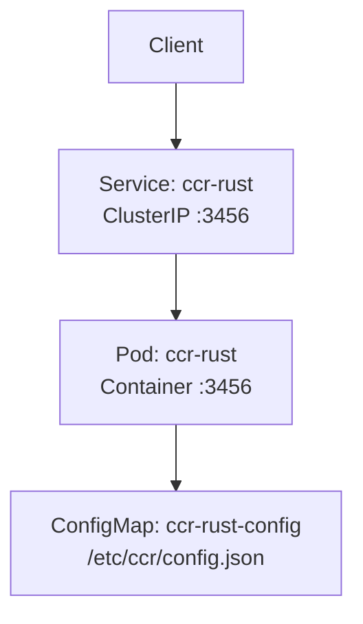
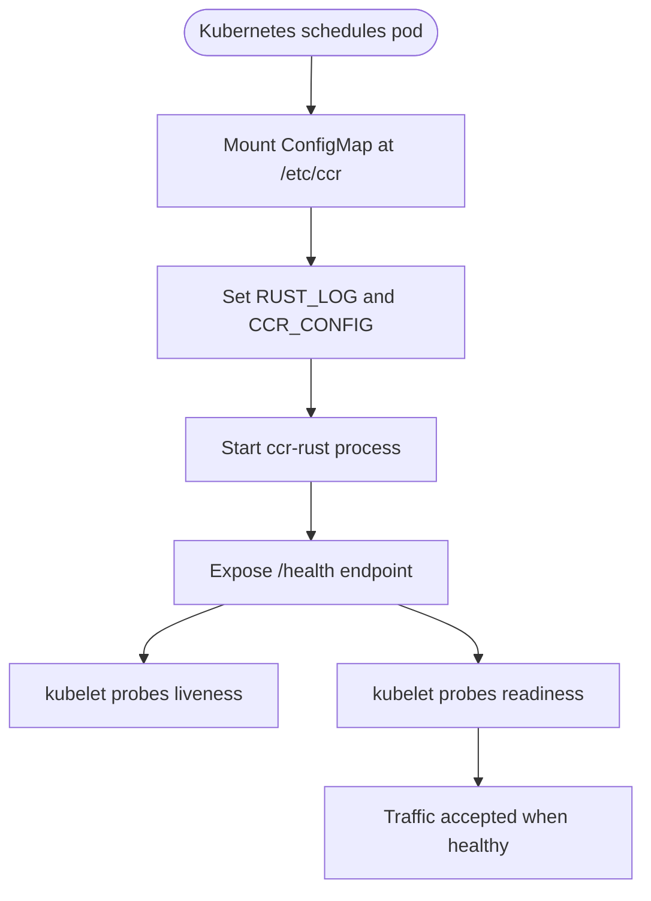
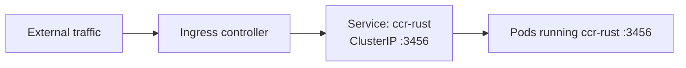
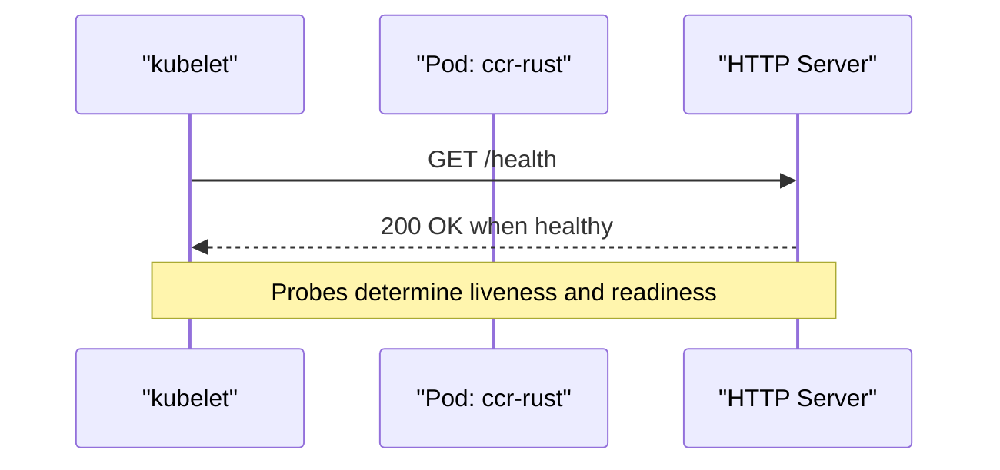
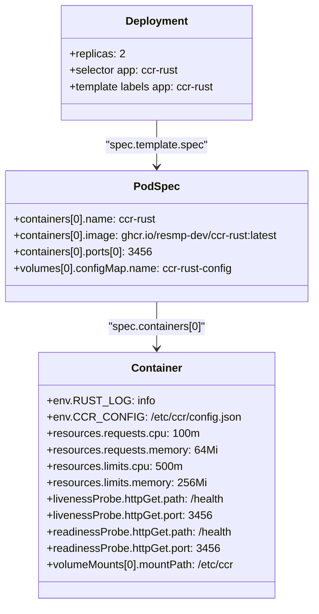
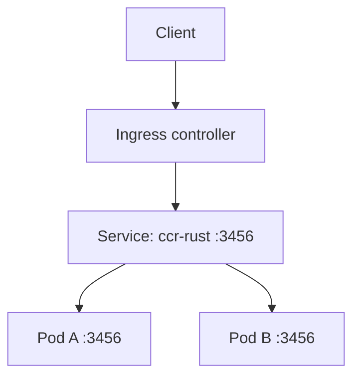
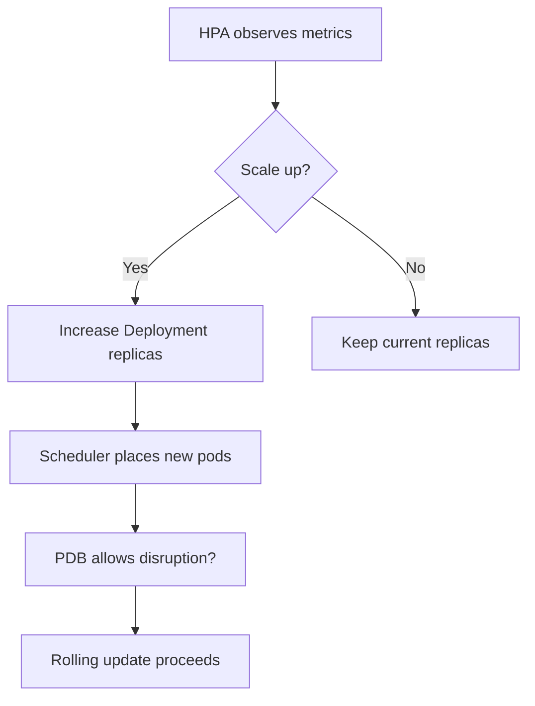
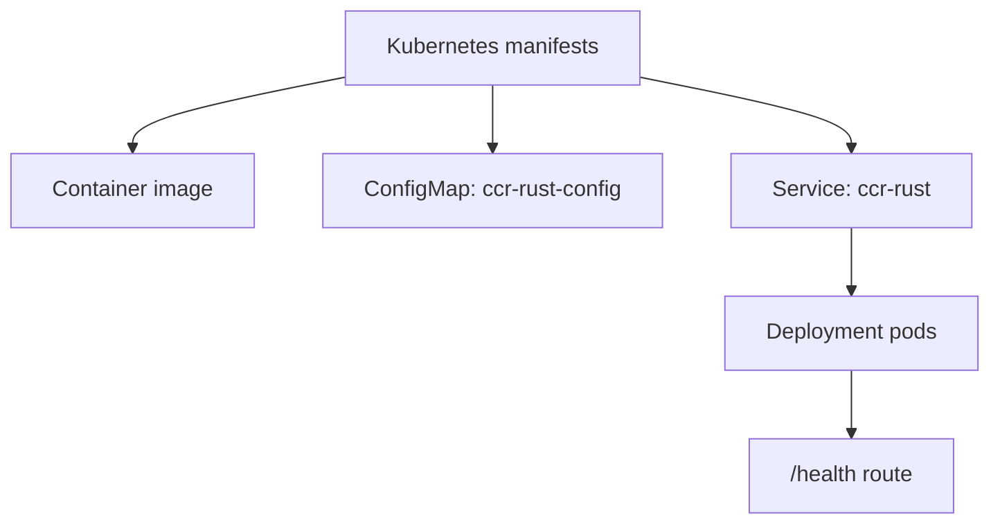

# Kubernetes Deployment

<cite>
**Referenced Files in This Document**
- [deployment.yaml](file://k8s/deployment.yaml)
- [service.yaml](file://k8s/service.yaml)
- [configmap.yaml](file://k8s/configmap.yaml)
- [Dockerfile](file://Dockerfile)
- [main.rs](file://src/main.rs)
- [client_auth.rs](file://src/client_auth.rs)
- [router/mod.rs](file://src/router/mod.rs)
- [configuration.md](file://docs/configuration.md)
- [deployment.md](file://docs/deployment.md)
</cite>

## Table of Contents
1. Introduction
2. Project Structure
3. Core Components
4. Architecture Overview
5. Detailed Component Analysis
6. Dependency Analysis
7. Performance Considerations
8. Troubleshooting Guide
9. Conclusion

## Introduction
This document explains how to deploy CCR-Rust on Kubernetes using the provided manifests and runtime behavior. It covers the Deployment, Service, ConfigMap, environment configuration, networking, autoscaling, availability controls, ingress, TLS, storage, and backup considerations for stateful or long-running routing workloads.

CCR-Rust is a self-hosted LLM router that exposes a local HTTP API (default port 3456) and routes requests to configured upstream model providers. In Kubernetes, it runs as one or more pods behind a ClusterIP Service, with optional NodePort or LoadBalancer exposure, and can be fronted by an Ingress controller for external access and TLS termination.

## Project Structure
The Kubernetes assets are under `k8s/`:
- `deployment.yaml` defines the pod template, container image, ports, environment variables, resource requests/limits, liveness/readiness probes, and mounted configuration.
- `service.yaml` exposes port 3456 via a ClusterIP Service.
- `configmap.yaml` provides a default JSON configuration file at `/etc/ccr/config.json`.

**Diagram sources**
- [service.yaml:1-11](file://k8s/service.yaml#L1-L11)
- [deployment.yaml:1-50](file://k8s/deployment.yaml#L1-L50)
- [configmap.yaml:1-10](file://k8s/configmap.yaml#L1-L10)

**Section sources**
- [deployment.yaml:1-50](file://k8s/deployment.yaml#L1-L50)
- [service.yaml:1-11](file://k8s/service.yaml#L1-L11)
- [configmap.yaml:1-10](file://k8s/configmap.yaml#L1-L10)

## Core Components

### Deployment
The Deployment creates two replicas of the CCR-Rust container. Key aspects:
- Image: `ghcr.io/resmp-dev/ccr-rust:latest`
- Container port: `3456`
- Environment:
  - `RUST_LOG=info`
  - `CCR_CONFIG=/etc/ccr/config.json`
- Resources:
  - Requests: `100m` CPU, `64Mi` memory
  - Limits: `500m` CPU, `256Mi` memory
- Probes:
  - Liveness: HTTP GET `/health` on port `3456`, initial delay 5 seconds
  - Readiness: HTTP GET `/health` on port `3456`
- Volume mount:
  - ConfigMap volume `config` mounted at `/etc/ccr`
  - ConfigMap name: `ccr-rust-config`

**Diagram sources**
- [deployment.yaml:1-50](file://k8s/deployment.yaml#L1-L50)
- [main.rs:574-576](file://src/main.rs#L574-L576)
- [client_auth.rs:77-79](file://src/client_auth.rs#L77-L79)
- [router/mod.rs:40-41](file://src/router/mod.rs#L40-L41)

**Section sources**
- [deployment.yaml:1-50](file://k8s/deployment.yaml#L1-L50)
- [Dockerfile:1-19](file://Dockerfile#L1-L19)

### Service
The Service exposes the deployment internally:
- Type: `ClusterIP`
- Port mapping: `3456` → target port `3456`
- Selector: `app: ccr-rust`

For external exposure strategies:
- ClusterIP: Internal-only cluster access. Use Ingress or a mesh to reach it externally.
- NodePort: Add `type: NodePort` to expose a static port on each node; useful for quick testing.
- LoadBalancer: Add `type: LoadBalancer` to obtain a cloud provider load balancer address.

**Diagram sources**
- [service.yaml:1-11](file://k8s/service.yaml#L1-L11)

**Section sources**
- [service.yaml:1-11](file://k8s/service.yaml#L1-L11)

### ConfigMap and Configuration Management
The ConfigMap supplies the router’s JSON configuration:
- Name: `ccr-rust-config`
- Key: `config.json`
- Mounted path: `/etc/ccr/config.json`

The Deployment sets `CCR_CONFIG=/etc/ccr/config.json`, so the process reads its configuration from the mounted ConfigMap.

Recommended production patterns:
- Keep provider credentials out of ConfigMaps. Store secrets in Kubernetes Secrets and expand them into environment variables before starting the process.
- The application supports `${VAR_NAME}` expansion in configuration values. Load secrets into the pod environment, then reference them in the JSON config.
- Separate configuration files per environment or tenant by creating distinct ConfigMaps and pointing `CCR_CONFIG` at the appropriate path.

**Section sources**
- [configmap.yaml:1-10](file://k8s/configmap.yaml#L1-L10)
- [deployment.yaml:1-50](file://k8s/deployment.yaml#L1-L50)
- [configuration.md:1-60](file://docs/configuration.md#L1-L60)

## Architecture Overview
At runtime, the container starts `ccr-rust` and binds the HTTP listener on port 3456. The `/health` endpoint is used by both kubelet probes and internal health reporting.

**Diagram sources**
- [main.rs:574-576](file://src/main.rs#L574-L576)
- [client_auth.rs:77-79](file://src/client_auth.rs#L77-L79)
- [router/mod.rs:40-41](file://src/router/mod.rs#L40-L41)

**Section sources**
- [Dockerfile:1-19](file://Dockerfile#L1-L19)
- [main.rs:574-576](file://src/main.rs#L574-L576)

## Detailed Component Analysis

### Pod Specifications
- Replicas: 2
- Labels: `app: ccr-rust`
- Prometheus annotations:
  - `prometheus.io/scrape: "true"`
  - `prometheus.io/port: "3456"`
- Container:
  - Image: `ghcr.io/resmp-dev/ccr-rust:latest`
  - Ports: `containerPort: 3456`
  - Environment:
    - `RUST_LOG=info`
    - `CCR_CONFIG=/etc/ccr/config.json`
  - Resources:
    - Requests: `cpu: 100m`, `memory: 64Mi`
    - Limits: `cpu: 500m`, `memory: 256Mi`
  - Liveness probe:
    - HTTP GET `/health` on port `3456`
    - Initial delay: 5 seconds
  - Readiness probe:
    - HTTP GET `/health` on port `3456`
  - Volume mount:
    - Name: `config`
    - Mount path: `/etc/ccr`
    - Source: ConfigMap `ccr-rust-config`

**Diagram sources**
- [deployment.yaml:1-50](file://k8s/deployment.yaml#L1-L50)

**Section sources**
- [deployment.yaml:1-50](file://k8s/deployment.yaml#L1-L50)

### Networking and Exposure
- Internal exposure:
  - Service type `ClusterIP` maps port `3456` to the pod’s port `3456`.
- External access options:
  - NodePort: Change Service type to `NodePort` to expose a host port across nodes.
  - LoadBalancer: Change Service type to `LoadBalancer` to obtain a cloud-managed external IP.
  - Ingress: Recommended for TLS termination, hostname-based routing, and centralized access control. Point the Ingress backend to Service `ccr-rust` on port `3456`.

**Diagram sources**
- [service.yaml:1-11](file://k8s/service.yaml#L1-L11)
- [deployment.yaml:1-50](file://k8s/deployment.yaml#L1-L50)

**Section sources**
- [service.yaml:1-11](file://k8s/service.yaml#L1-L11)

### Environment Variables and Configuration
Important variables:
- `RUST_LOG`: Controls logging verbosity; set to `info` in the manifest.
- `CCR_CONFIG`: Path to the configuration JSON; defaults to `/etc/ccr/config.json`.
- Application-level settings such as `PORT`, `HOST`, `AUTH_PORT`, `AUTH_HOST`, timeouts, and pool sizes are supported by the configuration schema.

Configuration loading rules:
- The CLI accepts a `--config` flag and environment variable `CCR_CONFIG`.
- The Docker entrypoint passes `start --host 0.0.0.0`, so in containers the server binds all interfaces.
- Configuration supports `${VAR_NAME}` expansion for secrets loaded from the pod environment.

Security recommendations:
- Do not embed API keys in ConfigMaps. Store them in Kubernetes Secrets and inject them as environment variables.
- Reference secret-backed environment variables in your JSON configuration.

**Section sources**
- [deployment.yaml:1-50](file://k8s/deployment.yaml#L1-L50)
- [configuration.md:1-120](file://docs/configuration.md#L1-L120)
- [main.rs:85-86](file://src/main.rs#L85-L86)
- [Dockerfile:1-19](file://Dockerfile#L1-L19)

### Health Checks
- The HTTP server registers `/health`.
- The Deployment uses `/health` for both liveness and readiness.
- The application treats the health path as service liveness data.

Operational guidance:
- If you add custom authentication to the main listener, ensure `/health` remains accessible to kubelet.
- Tune `initialDelaySeconds` based on startup time; increase if pods are being restarted during slow initialization.

**Section sources**
- [main.rs:574-576](file://src/main.rs#L574-L576)
- [client_auth.rs:77-79](file://src/client_auth.rs#L77-L79)
- [router/mod.rs:40-41](file://src/router/mod.rs#L40-L41)
- [deployment.yaml:1-50](file://k8s/deployment.yaml#L1-L50)

### High Availability and Scaling

#### Horizontal Pod Autoscaler (HPA)
The Deployment has two replicas. To scale automatically:
- Install the Metrics Server.
- Create an HPA targeting the `ccr-rust` Deployment.
- Base scaling on CPU, memory, or custom metrics exposed by Prometheus scraping.

Example guidance:
- Target average CPU utilization between 50% and 70%.
- Set minimum replicas to at least 2 for redundancy.
- Use custom metrics for request rate or queue depth if available.

#### Pod Disruption Budget (PDB)
Protect rolling updates and voluntary disruptions:
- Allow at most one disruption at a time (`maxUnavailable: 1`).
- With two replicas, this ensures one replica stays ready during maintenance.

#### Topology and Anti-Affinity
- Prefer spreading pods across nodes using node anti-affinity to avoid single-node failures.
- Combine with PDB and HPA for resilient operations.

[No sources needed since this diagram shows conceptual workflow, not actual code structure]

### Ingress Controller, TLS, and External Access
- Use an Ingress controller (for example, NGINX, ALB, or cloud-native equivalents).
- Backend service: `ccr-rust`, port `3456`.
- TLS termination:
  - Configure TLS on the Ingress with certificates managed through cert-manager or your provider’s certificate store.
  - Route hostnames to the CCR-Rust Service.
- Authentication:
  - If enabling authenticated endpoints, point external traffic to the dedicated AUTH_PORT listener where applicable, following the application’s validation rules.
  - Keep the standard PORT/HOST listener unauthenticated for local clients unless you explicitly configure client authentication.

**Section sources**
- [configuration.md:120-200](file://docs/configuration.md#L120-L200)
- [main.rs:383-412](file://src/main.rs#L383-L412)

### Storage Considerations and Persistent Volumes
The provided Deployment does not use persistent volumes. The configuration is supplied via a ConfigMap mounted as read-only.

If CCR-Rust is extended to persist state (for example, usage metrics, cache, or MCP-related state):
- Define a `PersistentVolumeClaim` bound to a suitable storage class.
- Mount the PVC into the container at a stable path.
- Ensure the filesystem is writable by the non-root user defined in the container image.
- Back up the PVC regularly using your cluster’s backup tooling.

Current configuration approach:
- ConfigMap content is read from `/etc/ccr/config.json`.
- No write-back of configuration is implied by the manifest.

**Section sources**
- [deployment.yaml:1-50](file://k8s/deployment.yaml#L1-L50)
- [configmap.yaml:1-10](file://k8s/configmap.yaml#L1-L10)
- [Dockerfile:1-19](file://Dockerfile#L1-L19)

### Backup Strategies for Stateful Components
Even though the current Deployment is stateless, consider these practices for any future state:
- Persistent storage backups:
  - Snapshot PVCs periodically.
  - Include metadata such as timestamps and environment labels.
- Configuration backups:
  - Version-control ConfigMaps separately.
  - Avoid committing secrets to version control.
- Disaster recovery:
  - Test restoring configurations and state to a new cluster.
  - Validate connectivity to upstream providers after restore.

[No sources needed since this section provides general operational guidance]

## Dependency Analysis
The Kubernetes layer depends on:
- The container image built by the repository’s Dockerfile.
- The application’s `/health` route.
- The ConfigMap containing valid JSON configuration.
- Optional external resources: Metrics Server, Ingress controller, Secrets, PVCs.

**Diagram sources**
- [deployment.yaml:1-50](file://k8s/deployment.yaml#L1-L50)
- [service.yaml:1-11](file://k8s/service.yaml#L1-L11)
- [configmap.yaml:1-10](file://k8s/configmap.yaml#L1-L10)
- [main.rs:574-576](file://src/main.rs#L574-L576)

**Section sources**
- [Dockerfile:1-19](file://Dockerfile#L1-L19)
- [deployment.yaml:1-50](file://k8s/deployment.yaml#L1-L50)
- [service.yaml:1-11](file://k8s/service.yaml#L1-L11)
- [configmap.yaml:1-10](file://k8s/configmap.yaml#L1-L10)

## Performance Considerations
- Resource requests and limits:
  - Start with `100m` CPU requests and `64Mi` memory requests.
  - Monitor actual usage with Prometheus and adjust accordingly.
- Probes:
  - Increase `initialDelaySeconds` if startup exceeds five seconds.
  - Add failure thresholds if necessary to tolerate transient errors during cold start.
- Scaling:
  - Use HPA with conservative CPU targets initially.
  - Add horizontal scaling only after validating latency and error rates under load.
- Network:
  - Place Ingress close to the cluster for low-latency access.
  - Enable connection reuse and keep-alive where supported by the ingress controller.
- Observability:
  - Prometheus scraping is enabled via annotations on port `3456`.
  - Review metrics and logs before increasing replicas or concurrency.

[No sources needed since this section provides general guidance]

## Troubleshooting Guide

Common issues and resolutions:
- Pod restarts due to liveness probe failures:
  - Check whether `/health` responds within the configured delay.
  - Verify that the process starts successfully and binds port `3456`.
- Pod not receiving traffic:
  - Confirm readiness probe passes.
  - Verify Service selector matches pod labels `app: ccr-rust`.
- Configuration not applied:
  - Ensure ConfigMap `ccr-rust-config` exists and contains `config.json`.
  - Confirm `CCR_CONFIG` points to `/etc/ccr/config.json`.
- Secrets not available:
  - Inject secrets as environment variables and reference them in the configuration file using `${VAR_NAME}` expansion.
- External access problems:
  - For Ingress, verify TLS configuration and backend service port `3456`.
  - For NodePort or LoadBalancer, confirm firewall rules and cloud provider allocations.

**Section sources**
- [deployment.yaml:1-50](file://k8s/deployment.yaml#L1-L50)
- [service.yaml:1-11](file://k8s/service.yaml#L1-L11)
- [configmap.yaml:1-10](file://k8s/configmap.yaml#L1-L10)
- [configuration.md:1-120](file://docs/configuration.md#L1-L120)
- [deployment.md:1-50](file://docs/deployment.md#L1-L50)

## Conclusion
The provided Kubernetes manifests deploy a secure, observable, and horizontally scalable CCR-Rust router. The Deployment mounts configuration from a ConfigMap, exposes port 3456, and uses `/health` for lifecycle management. Production deployments should add Secrets for sensitive values, enable autoscaling and disruption budgets, and use an Ingress controller for TLS termination and external access. For any stateful extensions, attach persistent volumes and implement regular backups to maintain reliability and recoverability.