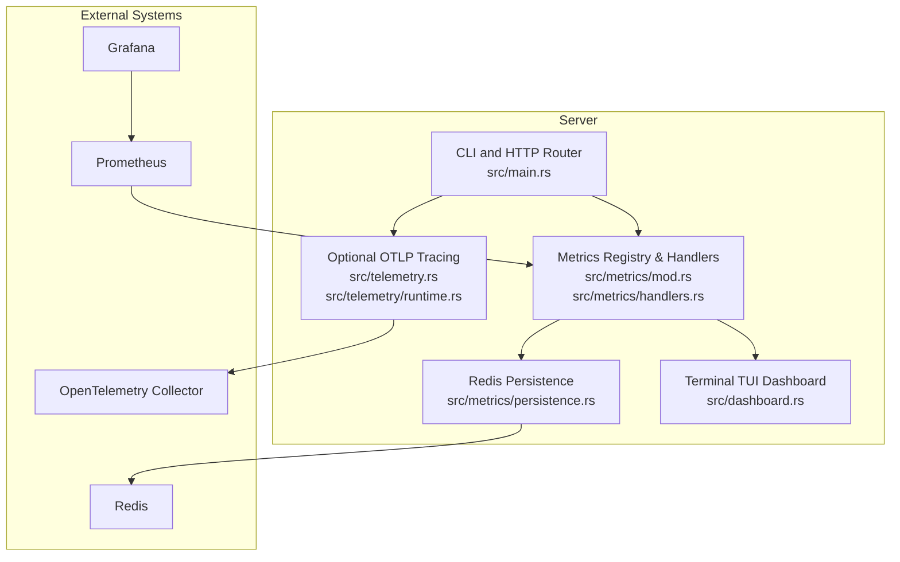
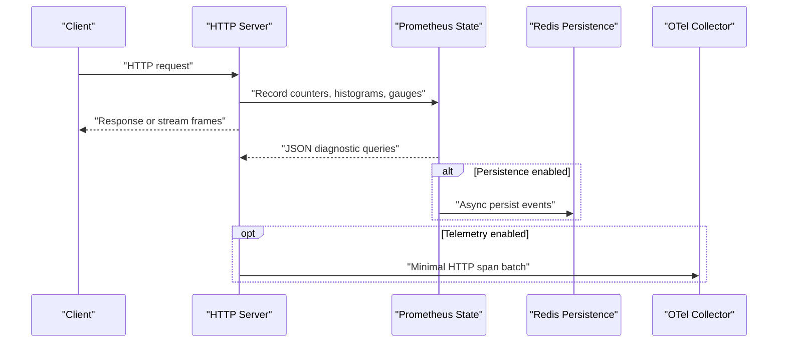
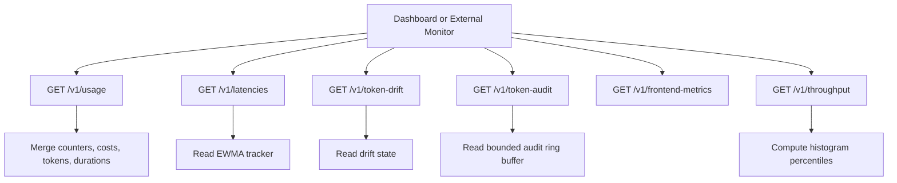
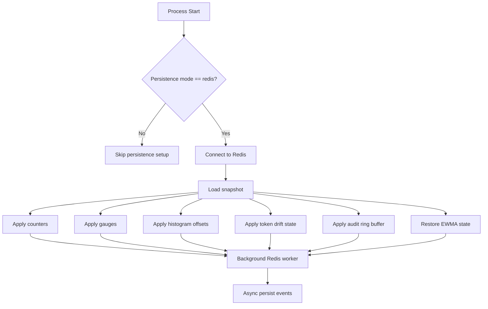
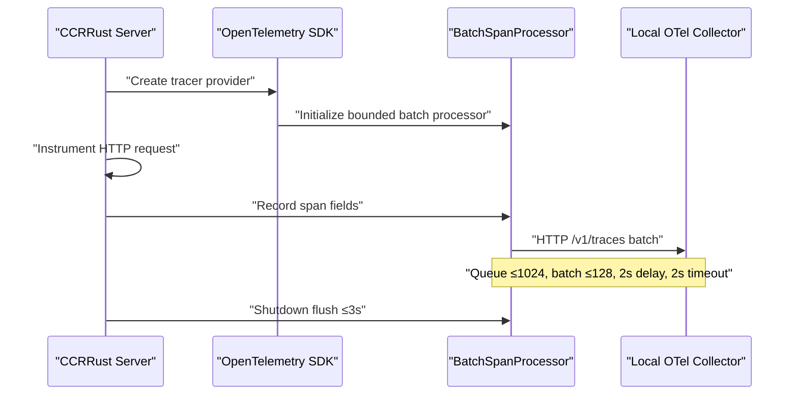
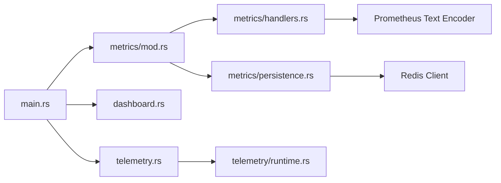

# Monitoring and Observability

<cite>
**Referenced Files in This Document**   
- [observability.md](file://docs/observability.md)
- [telemetry.md](file://docs/telemetry.md)
- [troubleshooting.md](file://docs/troubleshooting.md)
- [prometheus-snippet.yml](file://monitoring/prometheus-snippet.yml)
- [README.md](file://monitoring/README.md)
- [mod.rs](file://src/metrics/mod.rs)
- [handlers.rs](file://src/metrics/handlers.rs)
- [persistence.rs](file://src/metrics/persistence.rs)
- [dashboard.rs](file://src/dashboard.rs)
- [main.rs](file://src/main.rs)
- [runtime.rs](file://src/telemetry/runtime.rs)
</cite>

## Table of Contents
1. [Introduction](#introduction)
2. [Project Structure](#project-structure)
3. [Core Components](#core-components)
4. [Architecture Overview](#architecture-overview)
5. [Detailed Component Analysis](#detailed-component-analysis)
6. [Dependency Analysis](#dependency-analysis)
7. [Performance Considerations](#performance-considerations)
8. [Troubleshooting Guide](#troubleshooting-guide)
9. [Conclusion](#conclusion)
10. [Appendices](#appendices)

## Introduction
This document describes the monitoring, observability, logging, tracing, profiling, alerting, and operational procedures for CCR-Rust. It covers:

- Prometheus metrics collection, metric names, labels, histogram buckets, and aggregation patterns.
- Live terminal dashboard usage, panels, thresholds, and keyboard controls.
- Structured logs, log retention behavior, and diagnostic commands.
- Optional OpenTelemetry request tracing, endpoint validation, export limits, and collector guidance.
- Redis-backed persistence for counters, gauges, histograms, token drift state, audit log, and EWMA latency.
- Dashboard templates, Grafana integration notes, and custom metric collection advice.
- Error tracking, exception monitoring, and user experience monitoring.
- Runbooks for common operational scenarios.

## Project Structure
Observability-related code is primarily under `src/metrics`, `src/dashboard`, `src/telemetry`, and supporting documentation under `docs` and `monitoring`. The server CLI is defined in `src/main.rs`, while configuration-driven behavior (for example, Redis persistence) is referenced from the observability guide.



**Diagram sources**
- [main.rs:1-250](file://src/main.rs#L1-L250)
- [mod.rs:1-200](file://src/metrics/mod.rs#L1-L200)
- [handlers.rs:1-200](file://src/metrics/handlers.rs#L1-L200)
- [persistence.rs:1-200](file://src/metrics/persistence.rs#L1-L200)
- [dashboard.rs:1-200](file://src/dashboard.rs#L1-L200)
- [telemetry.rs:1-198](file://src/telemetry.rs#L1-L198)
- [runtime.rs:1-115](file://src/telemetry/runtime.rs#L1-L115)

**Section sources**
- [main.rs:1-250](file://src/main.rs#L1-L250)
- [observability.md:1-200](file://docs/observability.md#L1-L200)

## Core Components
CCR-Rust exposes several observability surfaces:

| Surface | Purpose | Default Location or Mechanism |
|---|---|---|
| Prometheus metrics | Time-series counters, gauges, and histograms | `GET /metrics` on the server port |
| JSON diagnostics | Aggregated usage, latency, throughput, drift, audit, and frontend metrics | `/v1/usage`, `/v1/latencies`, `/v1/token-drift`, `/v1/token-audit`, `/v1/frontend-metrics`, `/v1/throughput` |
| Health check | Service readiness | `/health` |
| Terminal dashboard | Real-time local monitoring | `ccr-rust dashboard` |
| Logs | Structured process logs controlled by `RUST_LOG` | Standard error/stdout |
| Optional traces | Minimal loopback-only HTTP spans to an OpenTelemetry Collector | Enabled via feature flag and environment variable |

Key characteristics:

- Metrics are named with a `ccr_` prefix and include tier-based dimensions.
- Token accounting includes input tokens, output tokens, cache reads, cache creation, estimated USD cost, pre-request estimates, and drift verification.
- Streaming metrics include active streams, peak streams, backpressure events, and rejected streams.
- Latency metrics include per-tier request duration histograms, EWMA latency gauges, TTFT histograms, and output throughput histograms.
- Admission control, retry budget, hedging, rate limiting, and deterministic rejection are exposed through dedicated metrics.
- Redis persistence can restore counters, gauges, histogram offsets, token drift state, audit entries, and EWMA state across restarts.

**Section sources**
- [mod.rs:1-200](file://src/metrics/mod.rs#L1-L200)
- [mod.rs:201-600](file://src/metrics/mod.rs#L201-L600)
- [handlers.rs:1-200](file://src/metrics/handlers.rs#L1-L200)
- [handlers.rs:201-577](file://src/metrics/handlers.rs#L201-L577)
- [observability.md:1-200](file://docs/observability.md#L1-L200)
- [README.md:1-26](file://monitoring/README.md#L1-L26)

## Architecture Overview
The observability pipeline has three main flows:

1. **Request lifecycle instrumentation**: Request counters, durations, failures, streaming activity, admission defers, retries, hedging, rate limits, and token accounting are recorded into in-memory Prometheus metrics.
2. **Aggregation endpoints**: JSON handlers read Prometheus state plus additional runtime state to produce human-readable summaries for dashboards and external systems.
3. **Persistence and exports**: When configured, metric mutations are forwarded to a background Redis worker; optional telemetry exports minimal request spans to a local OpenTelemetry Collector.



**Diagram sources**
- [handlers.rs:1-200](file://src/metrics/handlers.rs#L1-L200)
- [persistence.rs:201-681](file://src/metrics/persistence.rs#L201-L681)
- [telemetry.rs:1-198](file://src/telemetry.rs#L1-L198)
- [runtime.rs:1-115](file://src/telemetry/runtime.rs#L1-L115)

## Detailed Component Analysis

### Prometheus Metrics Catalog
The following table documents the primary metrics implemented in the codebase.

| Metric Name | Type | Labels | Description | Operational Use |
|---|---|---|---|---|
| `ccr_requests_total` | Counter | `tier` | Total requests processed per tier | Traffic volume and routing distribution |
| `ccr_request_duration_seconds` | Histogram | `tier` | Request latency distribution | SLO and latency analysis |
| `ccr_frontend_requests_total` | Counter | `frontend` | Requests grouped by frontend client | Frontend-specific traffic |
| `ccr_frontend_request_duration_seconds` | Histogram | `frontend` | Frontend request latency | Frontend UX latency |
| `ccr_failures_total` | Counter | `tier`, `reason` | Terminal failures | Failure categorization |
| `ccr_cost_usd_total` | Counter | `tier` | Estimated USD cost for priced tiers | Cost estimation |
| `ccr_active_streams` | Gauge | None | Current active SSE connections | Streaming load |
| `ccr_active_requests` | Gauge | None | In-flight requests | Overall concurrency |
| `ccr_input_tokens_total` | Counter | `tier` | Input tokens consumed | Token accounting |
| `ccr_output_tokens_total` | Counter | `tier` | Output tokens generated | Token accounting |
| `ccr_cache_read_tokens_total` | Counter | `tier` | Cache read tokens | Provider prompt cache usage |
| `ccr_cache_creation_tokens_total` | Counter | `tier` | Cache creation tokens | Cache write costs |
| `ccr_tier_ewma_latency_seconds` | Gauge | `tier` | Exponentially weighted moving average latency | Tier ordering and degradation detection |
| `ccr_stream_backpressure_total` | Counter | None | Stream producer blocked by full buffer | Backpressure diagnostics |
| `ccr_peak_active_streams` | Gauge | None | High-water mark for concurrent streams | Capacity planning |
| `ccr_rejected_streams_total` | Counter | None | Streams rejected due to concurrency limit | Concurrency pressure |
| `ccr_retry_sweeps_total` | Counter | None | Retry sweeps while holding exhausted requests open | Retry cascade health |
| `ccr_deterministic_rejections_total` | Counter | `tier` | Deterministic upstream rejections | Non-retryable failure signal |
| `ccr_tier_inflight` | Gauge | `tier` | Current in-flight upstream attempts per tier | Admission control visibility |
| `ccr_tier_limit` | Gauge | `tier` | Current AIMD admission limit per tier | Admission tuning |
| `ccr_tier_inflight_tokens` | Gauge | `tier` | Estimated prompt tokens in flight per tier | Prefill pressure |
| `ccr_admission_defers_total` | Counter | `tier` | Deferrals due to admission limit | Admission saturation |
| `ccr_retry_budget_overflow_total` | Counter | None | Retries rejected by process-wide retry budget | Retry budget exhaustion |
| `ccr_hedges_launched_total` | Counter | None | Fallback hedges launched | Hedging activity |
| `ccr_hedge_wins_total` | Counter | `tier` | Hedged fallback wins | Hedge effectiveness |
| `ccr_primary_hedge_wins_total` | Counter | `tier` | Primary wins after hedge launch | Hedge race outcomes |
| `ccr_hold_wait_seconds` | Histogram | None | Time exhausted requests were held before terminal response | Retry hold latency |
| `ccr_pre_request_tokens_total` | Counter | `tier`, `component` | Estimated input tokens before dispatch | Pre-request estimation accuracy |
| `ccr_pre_request_tokens` | Histogram | `tier` | Distribution of estimated pre-request tokens | Estimate shape analysis |
| `ccr_rate_limit_hits_total` | Counter | `tier` | Backend 429 responses | Rate-limit pressure |
| `ccr_token_drift_absolute` | Gauge | `tier` | Absolute difference between local estimate and upstream report | Drift magnitude |
| `ccr_token_drift_pct` | Gauge | `tier` | Percentage drift between local estimate and upstream report | Drift percentage |
| `ccr_token_drift_alerts_total` | Counter | `tier`, `severity` | Drift alerts exceeded per severity | Alert tracking |
| `ccr_ttft_seconds` | Histogram | `tier` | Time to first token per tier | First-token UX |
| `ccr_output_tokens_per_second` | Histogram | `tier` | Output throughput per tier | Streaming throughput |

Histogram bucket sets used by the implementation:

- Request duration: approximately `0.1s`, `0.5s`, `1s`, `2s`, `5s`, `10s`, `30s`, `60s`.
- Hold wait: approximately `0.01s` through `120s`.
- Pre-request tokens: approximately `100` through `200,000`.
- TTFT: approximately `0.1s` through `30s`.
- Output tokens per second: approximately `1` through `200`.

Label conventions:

- `tier`: backend routing tier identifier.
- `frontend`: `codex` or `claude_code`.
- `reason`: failure reason string.
- `component`: pre-request token component label.
- `severity`: drift alert severity level.

Aggregation patterns:

- Per-tier totals: sum or rate over `ccr_requests_total`, `ccr_input_tokens_total`, `ccr_output_tokens_total`, and `ccr_failures_total`.
- Success rate: `(total requests - total failures) / total requests`.
- Average latency: use the persisted histogram offset plus live histogram data through `/v1/usage`.
- Throughput percentiles: `/v1/throughput` computes approximate p50, p90, and p99 from histograms.
- Drift alerts: `ccr_token_drift_alerts_total` counts threshold breaches by tier and severity.

**Section sources**
- [mod.rs:1-200](file://src/metrics/mod.rs#L1-L200)
- [mod.rs:201-600](file://src/metrics/mod.rs#L201-L600)
- [handlers.rs:201-577](file://src/metrics/handlers.rs#L201-L577)

### Live Terminal Dashboard
The terminal dashboard provides a real-time view of CCR-Rust operation without requiring an external dashboard system.

Usage:

- Local dashboard: `ccr-rust dashboard`
- Remote dashboard host/port: `ccr-rust dashboard --host <host> --port <port>`
- Environment override: `CCR_DASHBOARD_HOST` and `CCR_DASHBOARD_PORT`
- Exit: press `q` or `Esc`

Dashboard behavior:

- A background thread polls the server every 500 milliseconds.
- It fetches `/v1/usage`, `/v1/latencies`, `/v1/token-drift`, `/v1/frontend-metrics`, and `/v1/throughput`.
- The UI refreshes at 250 milliseconds using a terminal rendering loop.
- Session information shows current working directory, Git branch, and version.

Panels:

- Header: active requests, total requests and failures with success-rate color coding, and token throughput in thousands.
- Token Drift Monitor: per-tier cumulative drift and last-sample drift with warning/critical coloring.
- Frontend metrics: request count and average latency per frontend.
- Session Info: environment context.
- Tier Statistics: EWMA latency, TTFT, tokens per second, request success/failure counts, and token consumption.

Thresholds visible in the dashboard:

- Token drift warning: greater than 10% cumulative drift.
- Token drift critical: greater than 25% cumulative drift.
- EWMA latency warning and critical coloring based on millisecond thresholds.
- TTFT warning and critical coloring based on millisecond thresholds.
- Tokens-per-second coloring indicating healthy versus low throughput.

Operational recommendations:

- Keep the dashboard running during on-call shifts for immediate visual feedback.
- Correlate drift warnings with provider-reported token usage to detect misestimation.
- Watch active requests and active streams separately; high active requests with low active streams may indicate long non-streaming workloads.

**Section sources**
- [dashboard.rs:1-200](file://src/dashboard.rs#L1-L200)
- [dashboard.rs:201-658](file://src/dashboard.rs#L201-L658)
- [observability.md:1-200](file://docs/observability.md#L1-L200)
- [main.rs:1-250](file://src/main.rs#L1-L250)

### API Endpoints and Aggregation
The observability API endpoints provide structured JSON for dashboards, external monitors, and automated runbooks.

| Endpoint | Method | Response Summary | Notes |
|---|---:|---|---|
| `/metrics` | GET | Prometheus text format | Includes all registered metrics and merged histogram offsets |
| `/health` | GET | Health check | Used by service managers and probes |
| `/v1/usage` | GET | Aggregate usage summary with per-tier breakdown | Combines counters, costs, tokens, durations, and active counts |
| `/v1/latencies` | GET | Per-tier EWMA latency and sample count | Uses the routing EWMA tracker |
| `/v1/token-drift` | GET | Per-tier drift samples, cumulative drift, and last drift | Useful for token estimation validation |
| `/v1/token-audit` | GET | Recent pre-request token breakdowns | Ring buffer with bounded capacity |
| `/v1/frontend-metrics` | GET | Per-frontend request count and average latency | Supports frontend-specific monitoring |
| `/v1/throughput` | GET | Per-tier TTFT and tokens per second with recent samples | Includes approximate percentile calculations |

Important details:

- `/v1/usage` aggregates data by reading Prometheus metric families and computing averages from both live histograms and persisted histogram offsets.
- `/v1/throughput` uses linear interpolation over histogram buckets to estimate p50, p90, and p99 values.
- `/v1/token-audit` returns the most recent entries from an in-memory ring buffer.
- All JSON endpoints return empty arrays when no state is available.



**Diagram sources**
- [handlers.rs:1-200](file://src/metrics/handlers.rs#L1-L200)
- [handlers.rs:201-577](file://src/metrics/handlers.rs#L201-L577)

**Section sources**
- [handlers.rs:1-200](file://src/metrics/handlers.rs#L1-L200)
- [handlers.rs:201-577](file://src/metrics/handlers.rs#L201-L577)
- [observability.md:1-200](file://docs/observability.md#L1-L200)

### Redis Persistence
When persistence mode is set to Redis, CCR-Rust restores and persists observability state so that restarts do not erase counters, gauges, histogram offsets, token drift state, audit log, or EWMA latency state.

Configuration:

- Persistence mode: `redis`
- Redis URL: provided in configuration or overridden by `CCR_REDIS_URL`
- Redis prefix: configurable key prefix scoped to CCR-Rust data

What is restored:

- Counters: requests, frontend requests, failures, input/output/cache tokens, cost, stream backpressure, rejected streams, pre-request tokens, rate-limit hits/backoffs, retry sweeps, drift alerts.
- Gauges: peak active streams, EWMA latency, token drift absolute and percentage.
- Histogram offsets: request duration, frontend request duration, and pre-request tokens.
- Token drift state and semantic version.
- Bounded token audit log.
- EWMA per-tier state.

What is cleared:

- The `clear-stats` command deletes only keys matching the configured persistence prefix, leaving unrelated Redis data untouched.

Risk model:

- Persistence is asynchronous through a channel and a dedicated worker thread.
- Export failures do not block request handling.
- Snapshot loading occurs at startup; if Redis is unavailable, the application continues with in-memory defaults.



**Diagram sources**
- [persistence.rs:1-200](file://src/metrics/persistence.rs#L1-L200)
- [persistence.rs:201-681](file://src/metrics/persistence.rs#L201-L681)

**Section sources**
- [observability.md:1-200](file://docs/observability.md#L1-L200)
- [persistence.rs:1-200](file://src/metrics/persistence.rs#L1-L200)
- [persistence.rs:201-681](file://src/metrics/persistence.rs#L201-L681)
- [main.rs:1-250](file://src/main.rs#L1-L250)

### Optional Distributed Tracing
Tracing is disabled by default. Build with the telemetry feature to include it. Only server commands initialize the provider.

Environment:

- `CCR_OT_ENDPOINT` or `CCR_OTEL_ENDPOINT` configures the trace exporter endpoint.
- Only literal loopback HTTP endpoints ending in `/v1/traces` are accepted.
- Redirects and proxy discovery are disabled.

Export characteristics:

- Service name: `ccr-rust`.
- Span target: `ccr_telemetry`.
- Fields recorded: HTTP method, matched route template, HTTP status code, and whether the body reached end of stream.
- Fields excluded: raw URLs, query strings, path parameters, headers, request/response bodies, error strings, tool outputs, and source-file locations.
- Queue size: up to 1,024 spans.
- Batch size: up to 128 spans.
- Scheduled delay: 2 seconds.
- HTTP timeout: 2 seconds.
- Shutdown flush: bounded 3-second flush off the async runtime.

Error behavior:

- Invalid endpoint, exporter initialization failure, or provider initialization task failure disables export and prints a fixed diagnostic message.
- Export failures can lose telemetry but do not delay request handling.
- Both successful and failed command dispatch attempt a bounded flush.

Recommendation:

- Place a local OpenTelemetry Collector on the same host.
- Apply tail sampling at the Collector: retain error traces within bounded memory and queue limits, and sample successful traces at a lower rate.
- Do not forward unrestricted application logs through the same ingestion pipeline.



**Diagram sources**
- [telemetry.rs:1-198](file://src/telemetry.rs#L1-L198)
- [runtime.rs:1-115](file://src/telemetry/runtime.rs#L1-L115)
- [telemetry.md:1-57](file://docs/telemetry.md#L1-L57)

**Section sources**
- [telemetry.rs:1-198](file://src/telemetry.rs#L1-L198)
- [runtime.rs:1-115](file://src/telemetry/runtime.rs#L1-L115)
- [telemetry.md:1-57](file://docs/telemetry.md#L1-L57)

### Logging and Log Retention
Logs are standard structured Rust logs. There is no embedded log rotation or remote log shipping in this repository. Operators should configure their operating system or container orchestration platform to collect, filter, and retain process logs.

Recommended practices:

- Use `RUST_LOG` to adjust verbosity for diagnostics.
- Capture structured logs from the process stdout/stderr.
- Separate operational logs from debug captures.
- Apply retention policies appropriate to compliance and storage capacity.
- Avoid forwarding unrestricted application logs to tracing exporters; use sampling and destination-specific pipelines.

Diagnostic capture tools:

- Debug captures can be inspected through CLI commands such as listing captures, filtering by provider, showing statistics, or including full request/response bodies.
- These captures are useful for replaying and diagnosing provider interactions without enabling full request tracing.

**Section sources**
- [troubleshooting.md:1-200](file://docs/troubleshooting.md#L1-L200)
- [main.rs:1-250](file://src/main.rs#L1-L250)

### Error Tracking and Exception Monitoring
Errors appear through multiple channels:

1. **Prometheus counters**: `ccr_failures_total` with `tier` and `reason` labels.
2. **Rate-limit metrics**: `ccr_rate_limit_hits_total` and related backoff metrics.
3. **Streaming signals**: `/v1/responses` preserves transport failures and emits terminal failure events.
4. **Token drift alerts**: `ccr_token_drift_alerts_total` tracks threshold breaches.
5. **Admission and retry signals**: `ccr_admission_defers_total`, `ccr_retry_budget_overflow_total`, `ccr_hedges_launched_total`, and related metrics.
6. **Health endpoint**: `/health` indicates service liveness.
7. **Logs**: structured messages produced by the application.

User experience monitoring:

- Track TTFT and output throughput using `ccr_ttft_seconds` and `ccr_output_tokens_per_second`.
- Use `/v1/throughput` for aggregated percentile views.
- Monitor active requests and active streams to distinguish slow responses from connection backlog.
- Monitor frontend latency through `ccr_frontend_request_duration_seconds`.

**Section sources**
- [mod.rs:201-600](file://src/metrics/mod.rs#L201-L600)
- [handlers.rs:201-577](file://src/metrics/handlers.rs#L201-L577)
- [troubleshooting.md:1-200](file://docs/troubleshooting.md#L1-L200)

### Performance Profiling Guidance
The repository includes benchmark infrastructure and a stress binary, but explicit CPU/memory profiler integration is not described in the provided files. For production profiling:

- Use the project’s benchmark and stress scripts to generate load.
- Profile the process externally with native tools such as `perf`, flamegraphs, or language-level profilers supported by your deployment environment.
- Correlate profiles with `ccr_request_duration_seconds`, `ccr_ttft_seconds`, `ccr_output_tokens_per_second`, `ccr_active_requests`, and `ccr_tier_inflight`.
- Inspect admission control metrics (`ccr_admission_defers_total`, `ccr_tier_limit`) to distinguish application-side throttling from upstream overload.

[No sources needed since this section provides general guidance]

### Dashboard Templates and Grafana Integration
The monitoring README references importing a dashboard template file. The repository does not contain the template itself in the scanned paths, but the integration approach is clear:

1. Configure Prometheus to scrape `http://localhost:3456/metrics`.
2. Import the provided Grafana dashboard template.
3. Create panels for:
   - Requests per tier.
   - Request duration percentiles.
   - Failures by tier and reason.
   - Active streams and peak streams.
   - Input/output token rates.
   - TTFT and output throughput.
   - Token drift percentage and drift alerts.
   - Rate-limit hits and backoffs.
   - Admission defers and retry budget overflow.

Example scraping configuration:

```yaml
scrape_configs:
  - job_name: "ccr-rust"
    static_configs:
      - targets: ["localhost:3456"]
    metrics_path: "/metrics"
    scrape_interval: 10s
```

Custom metric collection:

- Add new metrics through the existing registry functions in the metrics module.
- Record them close to the relevant business logic.
- Expose derived aggregations through JSON endpoints when they require cross-metric computation.
- Ensure histogram buckets are chosen to match expected latency and token distributions.
- If persistence is enabled, register the metric with the persistence layer so it survives restarts.

**Section sources**
- [README.md:1-26](file://monitoring/README.md#L1-L26)
- [prometheus-snippet.yml:1-7](file://monitoring/prometheus-snippet.yml#L1-L7)
- [mod.rs:1-200](file://src/metrics/mod.rs#L1-L200)
- [persistence.rs:201-681](file://src/metrics/persistence.rs#L201-L681)

## Dependency Analysis
The observability subsystem depends on:

- The HTTP router for exposing `/metrics`, `/health`, and JSON diagnostics.
- Prometheus for time-series metrics.
- Redis for optional persistent state.
- OpenTelemetry Collector for optional trace export.
- Terminal libraries for the TUI dashboard.
- Configuration for persistence settings and server addresses.



**Diagram sources**
- [mod.rs:1-200](file://src/metrics/mod.rs#L1-L200)
- [handlers.rs:1-200](file://src/metrics/handlers.rs#L1-L200)
- [persistence.rs:1-200](file://src/metrics/persistence.rs#L1-L200)
- [dashboard.rs:1-200](file://src/dashboard.rs#L1-L200)
- [main.rs:1-250](file://src/main.rs#L1-L250)
- [telemetry.rs:1-198](file://src/telemetry.rs#L1-L198)
- [runtime.rs:1-115](file://src/telemetry/runtime.rs#L1-L115)

**Section sources**
- [mod.rs:1-200](file://src/metrics/mod.rs#L1-L200)
- [handlers.rs:1-200](file://src/metrics/handlers.rs#L1-L200)
- [persistence.rs:1-200](file://src/metrics/persistence.rs#L1-L200)
- [dashboard.rs:1-200](file://src/dashboard.rs#L1-L200)
- [main.rs:1-250](file://src/main.rs#L1-L250)
- [telemetry.rs:1-198](file://src/telemetry.rs#L1-L198)

## Performance Considerations
- Prefer rate-based PromQL queries for counters and histogram quantile approximations for latency.
- Use `/v1/usage` and `/v1/throughput` when you need combined metrics that are expensive to compute directly from Prometheus.
- Avoid high-frequency polling of `/v1/token-audit`; it returns a bounded in-memory list and is intended for diagnostics rather than continuous scraping.
- Enable Redis persistence only when restart resilience for observability state is required, because it adds network I/O.
- Keep Prometheus scrape intervals reasonable; the default snippet uses 10 seconds.
- Use tail sampling at the OpenTelemetry Collector to bound trace storage and cost.
- Monitor `ccr_stream_backpressure_total` and `ccr_rejected_streams_total` when evaluating concurrency limits.
- Track `ccr_tier_inflight` and `ccr_tier_inflight_tokens` together to understand whether upstream pressure is request-bound or token-bound.

[No sources needed since this section provides general guidance]

## Troubleshooting Guide

### Prometheus Scrape Fails
- Verify the server is listening on the expected host and port.
- Confirm the scrape target matches the configured address.
- Check `/health` and `/metrics` manually.
- Review firewall rules and container networking.

**Section sources**
- [main.rs:1-250](file://src/main.rs#L1-L250)
- [prometheus-snippet.yml:1-7](file://monitoring/prometheus-snippet.yml#L1-L7)

### High Failure Rate
- Query `ccr_failures_total` by tier and reason.
- Check rate-limit hits with `ccr_rate_limit_hits_total`.
- Inspect `/v1/latencies` for degraded tiers.
- Look for `response.failed` events in streaming Responses requests.

**Section sources**
- [troubleshooting.md:1-200](file://docs/troubleshooting.md#L1-L200)
- [mod.rs:201-600](file://src/metrics/mod.rs#L201-L600)

### Token Drift Warning or Critical
- Inspect `/v1/token-drift` for cumulative and last-sample drift.
- Compare `ccr_pre_request_tokens_total` with upstream-reported usage.
- Check `ccr_token_drift_alerts_total` for alert history.
- Tune tokenizer assumptions or provider token reporting if drift remains high.

**Section sources**
- [handlers.rs:1-200](file://src/metrics/handlers.rs#L1-L200)
- [mod.rs:201-600](file://src/metrics/mod.rs#L201-L600)
- [observability.md:1-200](file://docs/observability.md#L1-L200)

### Streaming Backpressure or Rejections
- Watch `ccr_stream_backpressure_total` and `ccr_rejected_streams_total`.
- Compare `ccr_active_streams` with configured concurrency limits.
- Adjust maximum concurrent streams or upstream backpressure handling.

**Section sources**
- [mod.rs:201-600](file://src/metrics/mod.rs#L201-L600)
- [dashboard.rs:201-658](file://src/dashboard.rs#L201-L658)

### Slow First Token or Low Throughput
- Use `/v1/throughput` for TTFT and tokens per second.
- Check `ccr_ttft_seconds` and `ccr_output_tokens_per_second` histograms.
- Inspect EWMA latency and tier reorder behavior.

**Section sources**
- [handlers.rs:201-577](file://src/metrics/handlers.rs#L201-L577)
- [observability.md:1-200](file://docs/observability.md#L1-L200)

### Redis Persistence Issues
- Validate Redis connectivity and credentials.
- Confirm persistence mode is set to `redis`.
- Use `ccr-rust clear-stats` to reset only CCR-persisted keys.
- Check that the Redis key prefix matches the configured value.

**Section sources**
- [observability.md:1-200](file://docs/observability.md#L1-L200)
- [persistence.rs:1-200](file://src/metrics/persistence.rs#L1-L200)
- [persistence.rs:201-681](file://src/metrics/persistence.rs#L201-L681)
- [main.rs:1-250](file://src/main.rs#L1-L250)

### Trace Export Disabled
- Verify `CCR_OTEL_ENDPOINT` points to a loopback HTTP `/v1/traces` endpoint.
- Confirm the build includes the telemetry feature.
- Check exporter initialization messages for disabled-export diagnostics.
- Validate the local OpenTelemetry Collector is reachable on the loopback interface.

**Section sources**
- [telemetry.rs:1-198](file://src/telemetry.rs#L1-L198)
- [telemetry.md:1-57](file://docs/telemetry.md#L1-L57)

## Conclusion
CCR-Rust provides a layered observability stack: Prometheus metrics for scalable monitoring, JSON endpoints for rich aggregation, a terminal dashboard for fast local inspection, optional Redis persistence for restart resilience, and a bounded loopback-only OpenTelemetry tracing path. Operators should monitor request volume, latency, failures, streaming concurrency, token accounting, drift, rate limits, admission control, and throughput. They should combine Prometheus alerts with Grafana visualization, keep Redis persistence enabled when state continuity matters, and deploy a local OpenTelemetry Collector for sampled request tracing.

[No sources needed since this section summarizes without analyzing specific files]

## Appendices

### Quick Reference: Essential Metrics and Queries
- Request volume: `sum(rate(ccr_requests_total[5m])) by (tier)`
- Failure rate: `sum(rate(ccr_failures_total[5m])) by (tier, reason)`
- Success rate: `(1 - sum(rate(ccr_failures_total[5m])) / sum(rate(ccr_requests_total[5m]))) * 100`
- Active streams: `ccr_active_streams`
- Peak streams: `ccr_peak_active_streams`
- Token drift: `ccr_token_drift_pct`
- Drift alerts: `sum(increase(ccr_token_drift_alerts_total[1h])) by (tier, severity)`
- Rate-limit pressure: `sum(rate(ccr_rate_limit_hits_total[5m])) by (tier)`
- TTFT latency: `histogram_quantile(0.95, rate(ccr_ttft_seconds_bucket[5m]))`
- Output throughput: `ccr_output_tokens_per_second`

**Section sources**
- [mod.rs:1-200](file://src/metrics/mod.rs#L1-L200)
- [mod.rs:201-600](file://src/metrics/mod.rs#L201-L600)
- [handlers.rs:201-577](file://src/metrics/handlers.rs#L201-L577)