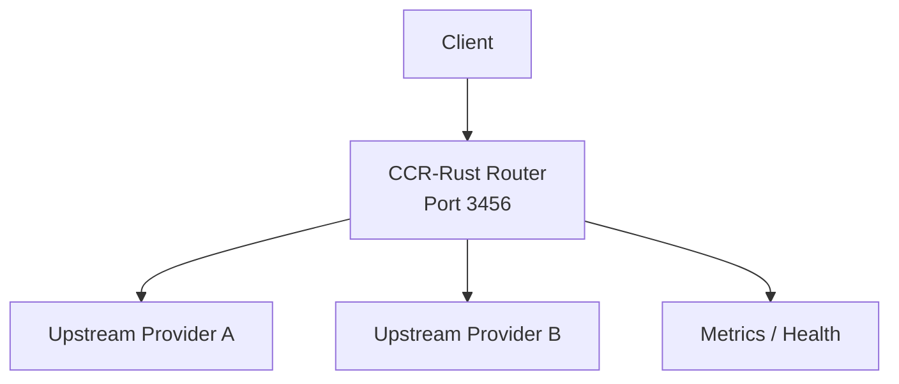
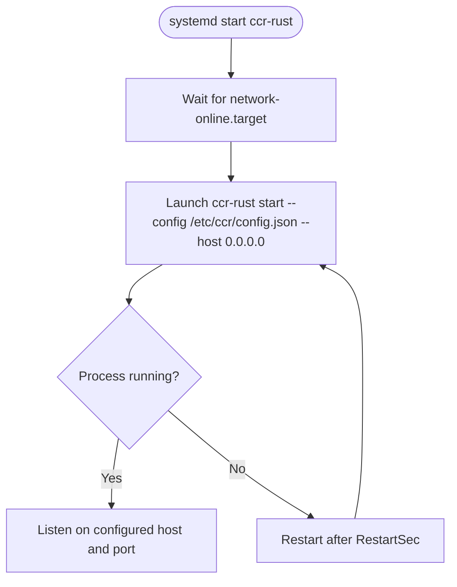
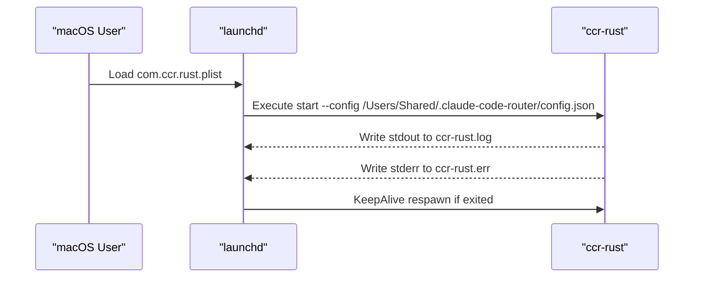
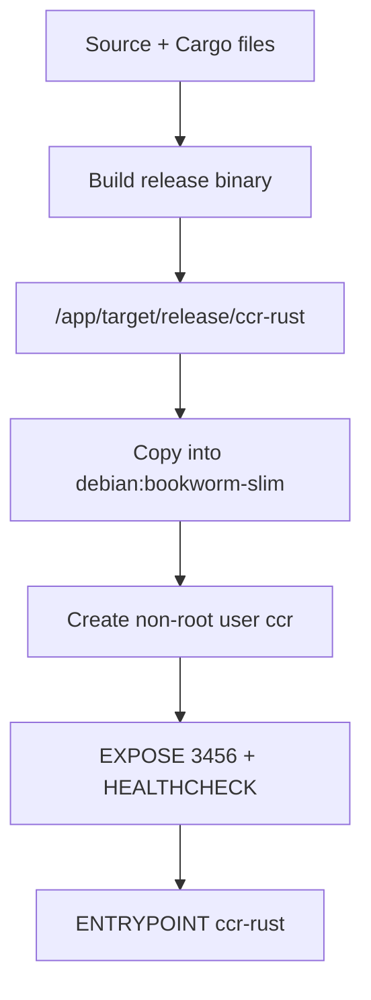
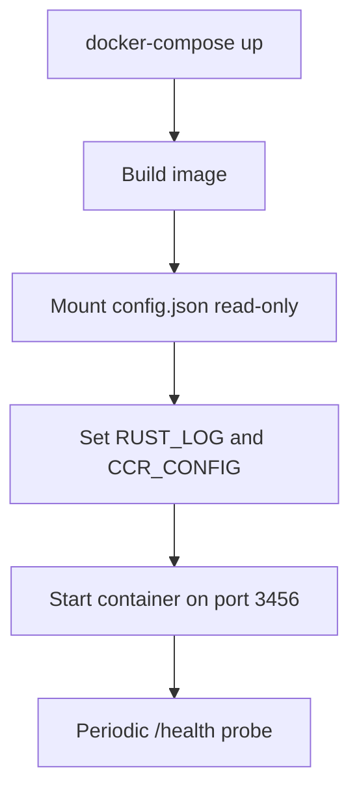
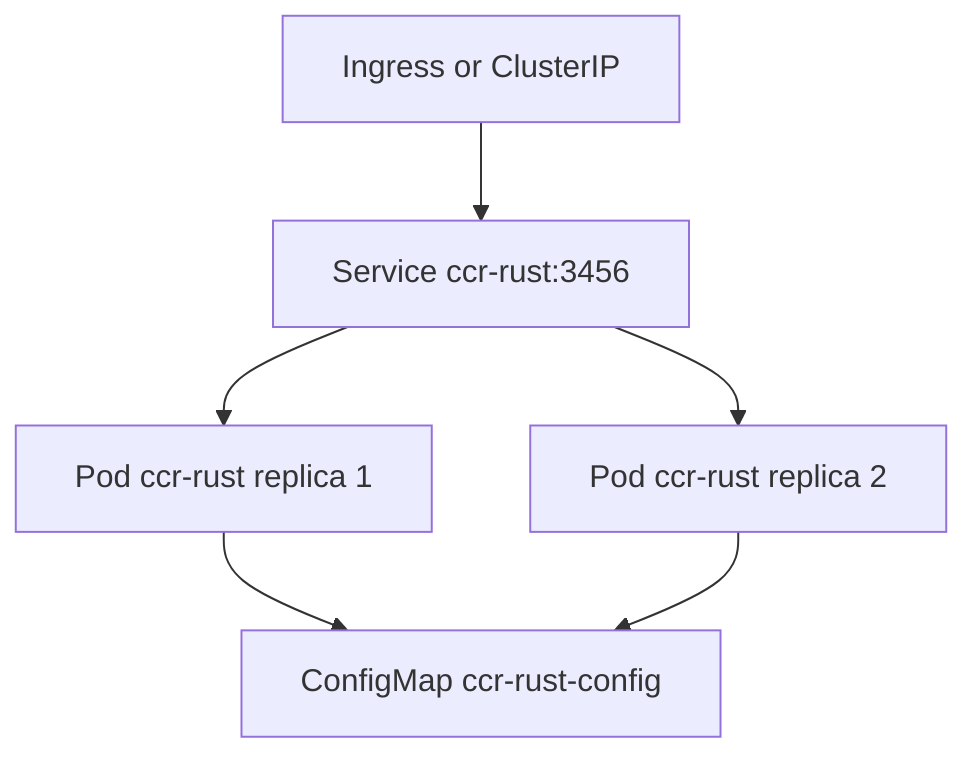
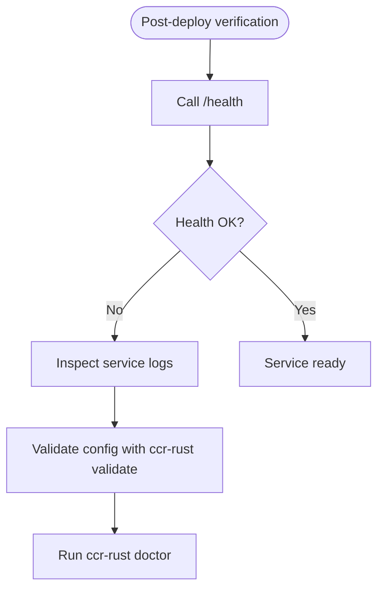

# Production Deployment

<cite>
**Referenced Files in This Document**   
- [main.rs](file://src/main.rs)
- [Cargo.toml](file://Cargo.toml)
- [deploy/ccr-rust.service](file://deploy/ccr-rust.service)
- [deploy/com.ccr.rust.plist](file://deploy/com.ccr.rust.plist)
- [Dockerfile](file://Dockerfile)
- [docker-compose.yml](file://docker-compose.yml)
- [docs/deployment.md](file://docs/deployment.md)
- [docs/configuration.md](file://docs/configuration.md)
- [k8s/deployment.yaml](file://k8s/deployment.yaml)
- [k8s/service.yaml](file://k8s/service.yaml)
- [k8s/configmap.yaml](file://k8s/configmap.yaml)
</cite>

## Table of Contents
1. [Introduction](#introduction)
2. [Supported Deployment Targets](#supported-deployment-targets)
3. [Systemd Service Deployment](#systemd-service-deployment)
4. [macOS launchd Deployment](#macos-launchd-deployment)
5. [Docker Containerization](#docker-containerization)
6. [Docker Compose for Development and Staging](#docker-compose-for-development-and-staging)
7. [Kubernetes Overview](#kubernetes-overview)
8. [Configuration and Environment Variables](#configuration-and-environment-variables)
9. [Deployment Checklist](#deployment-checklist)
10. [Validation Procedures](#validation-procedures)
11. [Common Deployment Pitfalls and Solutions](#common-deployment-pitfalls-and-solutions)
12. [Security and Resource Hardening](#security-and-resource-hardening)
13. [Performance Considerations](#performance-considerations)
14. [Conclusion](#conclusion)

## Introduction
This document describes production deployment options for CCR-Rust, a multi-provider LLM router written in Rust. It covers Linux systemd services, macOS launchd agents, Docker container images, Docker Compose environments, and Kubernetes manifests. It also documents configuration loading, environment variables, health checks, resource limits, startup parameters, validation procedures, and common pitfalls.

The service defaults to listening on `127.0.0.1:3456` when no host is explicitly configured. The default port is `3456`, and the default maximum number of concurrent streams is `512`. Configuration can be supplied through a JSON file or via environment variable expansion at load time.

**Section sources**
- [main.rs:1-120](file://src/main.rs#L1-L120)
- [docs/configuration.md:1-80](file://docs/configuration.md#L1-L80)

## Supported Deployment Targets
CCR-Rust supports the following production targets:

| Target | Primary artifact | Default listener | Notes |
|---|---:|---:|---|
| Linux with systemd | `/usr/local/bin/ccr-rust` | `127.0.0.1:3456` by default; systemd example binds `0.0.0.0` | Use a dedicated user such as `ccr`; place config under `/etc/ccr`. |
| macOS with launchd | `/usr/local/bin/ccr-rust` | `127.0.0.1:3456` by default | Uses `com.ccr.rust.plist`; logs go to `/usr/local/var/log`. |
| Docker | Multi-stage image based on `rust:1.88-bookworm` and `debian:bookworm-slim` | `0.0.0.0:3456` inside the container | Exposes port `3456`; includes an HTTP health check. |
| Docker Compose | Local development and staging compose stack | `0.0.0.0:3456` | Mounts config read-only and sets logging and restart behavior. |
| Kubernetes | Deployment, Service, and ConfigMap | `3456` inside the pod | Two replicas by default; liveness and readiness probes use `/health`. |

[No sources needed since this diagram shows conceptual traffic flow, not specific code structure]

**Section sources**
- [deploy/ccr-rust.service:1-14](file://deploy/ccr-rust.service#L1-L14)
- [deploy/com.ccr.rust.plist:1-23](file://deploy/com.ccr.rust.plist#L1-L23)
- [Dockerfile:1-19](file://Dockerfile#L1-L19)
- [docker-compose.yml:1-17](file://docker-compose.yml#L1-L17)
- [k8s/deployment.yaml:1-50](file://k8s/deployment.yaml#L1-L50)

## Systemd Service Deployment

### Service File Overview
The provided systemd unit runs CCR-Rust as a simple service under a dedicated `ccr` user. It waits for network availability, starts the binary, enables automatic restart, and sets the logging level through `RUST_LOG`.

Key behaviors:
- Service type: `simple`
- Run level target: `multi-user.target`
- Restart policy: always with a 5-second delay
- Logging: controlled by `RUST_LOG=info`
- Listener binding: `--host 0.0.0.0` in the provided unit
- Configuration path: `/etc/ccr/config.json`

**Diagram sources**
- [deploy/ccr-rust.service:1-14](file://deploy/ccr-rust.service#L1-L14)

### Installation Steps
1. Build the release binary:
   - Build location: `target/release/ccr-rust`
2. Copy the binary to `/usr/local/bin/ccr-rust`.
3. Create the configuration directory:
   - `/etc/ccr/config.json`
4. Place the unit file:
   - `/etc/systemd/system/ccr-rust.service`
5. Reload systemd:
   - `systemctl daemon-reload`
6. Enable and start the service:
   - `systemctl enable --now ccr-rust`
7. Verify status:
   - `systemctl status ccr-rust`

### Environment Variables
| Variable | Purpose | Example value |
|---|---|---|
| `RUST_LOG` | Controls tracing/logging verbosity | `info` |
| `CCR_CONFIG` | Overrides the config file path | `/etc/ccr/config.json` |
| `CCR_MAX_STREAMS` | Overrides maximum concurrent streams | `512` |
| `CLIENT_API_KEY` | Client authentication key used by the router | Set through your secret manager |

For provider credentials, use environment-variable expansion inside the JSON configuration rather than hardcoding secrets.

**Section sources**
- [deploy/ccr-rust.service:1-14](file://deploy/ccr-rust.service#L1-L14)
- [main.rs:1-120](file://src/main.rs#L1-L120)
- [docs/configuration.md:1-80](file://docs/configuration.md#L1-L80)

### Startup Parameters
The systemd unit passes:
- `start` command
- `--config /etc/ccr/config.json`
- `--host 0.0.0.0`

Relevant CLI options include:
- `--host`: server bind address
- `-p, --port`: server port (default `3456`)
- `--max-streams`: maximum concurrent streams (default `512`, overridable via `CCR_MAX_STREAMS`)
- `--shutdown-timeout`: graceful shutdown timeout in seconds
- `--config` or `CCR_CONFIG`: global configuration path

**Section sources**
- [deploy/ccr-rust.service:1-14](file://deploy/ccr-rust.service#L1-L14)
- [main.rs:1-120](file://src/main.rs#L1-L120)

### Resource Limits
systemd does not define memory or CPU limits in the provided unit. For production, add resource controls directly in the unit file according to your workload:

- `MemoryMax=`: hard memory limit
- `MemoryHigh=`: soft memory pressure threshold
- `CPUQuota=`: CPU share
- `TasksMax=`: process/task limit
- `LimitNOFILE=`: open-file descriptor limit
- `ProtectSystem=strict` and `ReadWritePaths=/etc/ccr,/var/log/ccr` for filesystem isolation

These are operational recommendations rather than values present in the repository’s unit file.

**Section sources**
- [deploy/ccr-rust.service:1-14](file://deploy/ccr-rust.service#L1-L14)

## macOS launchd Deployment

### Agent File Overview
The launchd agent `com.ccr.rust.plist` defines:
- Label: `com.ccr.rust`
- Program: `/usr/local/bin/ccr-rust`
- Arguments: `start` and `--config` pointing to `/Users/Shared/.claude-code-router/config.json`
- Auto-start: `RunAtLoad=true`
- Auto-respawn: `KeepAlive=true`
- Standard output log: `/usr/local/var/log/ccr-rust.log`
- Standard error log: `/usr/local/var/log/ccr-rust.err`

**Diagram sources**
- [deploy/com.ccr.rust.plist:1-23](file://deploy/com.ccr.rust.plist#L1-L23)

### Installation Steps
1. Build the release binary and copy it to `/usr/local/bin/ccr-rust`.
2. Create the configuration directory:
   - `/Users/Shared/.claude-code-router/config.json`
3. Install the plist:
   - Copy `deploy/com.ccr.rust.plist` to `~/Library/LaunchAgents/com.ccr.rust.plist`
4. Load the agent:
   - `launchctl load ~/Library/LaunchAgents/com.ccr.rust.plist`
5. Check status:
   - `launchctl list com.ccr.rust`
6. Inspect logs:
   - `/usr/local/var/log/ccr-rust.log`
   - `/usr/local/var/log/ccr-rust.err`

### Environment Variables
For macOS, pass environment variables through the launchd job or the shell that loads them before starting the agent. The documented configuration loader expands `${VAR_NAME}` from the router process environment at load time.

Recommended approach:
- Export required provider keys before launching the agent.
- Reference those variables in the JSON configuration using `${GEMINI_API_KEY}`, `${DEEPSEEK_API_KEY}`, etc.

**Section sources**
- [deploy/com.ccr.rust.plist:1-23](file://deploy/com.ccr.rust.plist#L1-L23)
- [docs/configuration.md:1-80](file://docs/configuration.md#L1-L80)

## Docker Containerization

### Image Structure
The Dockerfile uses a two-stage build:

| Stage | Base image | Purpose |
|---|---|---|
| Builder | `rust:1.88-bookworm` | Compiles the release binary from source |
| Runtime | `debian:bookworm-slim` | Runs the compiled binary with minimal dependencies |

Build steps:
1. Copy `Cargo.toml`, `Cargo.lock`, vendor directory, source, and benches.
2. Build a release binary with `cargo build --release`.
3. Copy only the compiled binary into the runtime image.
4. Add CA certificates and curl for the health check.
5. Create a non-root user `ccr`.
6. Set the entrypoint to `ccr-rust` and default arguments to `start --host 0.0.0.0`.

**Diagram sources**
- [Dockerfile:1-19](file://Dockerfile#L1-L19)

### Security Best Practices Applied
- Multi-stage build reduces final image size and exposure surface.
- Non-root user `ccr` is created and activated with `USER ccr`.
- Only the compiled binary is copied into the runtime image.
- The container exposes port `3456`.
- An HTTP health check calls `/health` on port `3456`.

### Runtime Behavior
- Default entrypoint: `ccr-rust`
- Default command: `start --host 0.0.0.0`
- Port: `3456`
- Health endpoint: `http://localhost:3456/health`

### Building and Running
To build locally:
- `docker build -t ccr-rust .`

To run interactively:
- `docker run --rm -p 3456:3456 -v ./config.json:/etc/ccr/config.json:ro -e RUST_LOG=info ccr-rust`

To verify health:
- `curl http://localhost:3456/health`

**Section sources**
- [Dockerfile:1-19](file://Dockerfile#L1-L19)
- [main.rs:1-120](file://src/main.rs#L1-L120)

## Docker Compose for Development and Staging

### Compose Service Definition
The provided `docker-compose.yml` defines:
- Service name: `ccr-rust`
- Build context: current directory
- Port mapping: host `3456` to container `3456`
- Volume mount: `./config.json` mounted read-only at `/etc/ccr/config.json`
- Environment: `RUST_LOG=info` and `CCR_CONFIG=/etc/ccr/config.json`
- Restart policy: `unless-stopped`
- Healthcheck: HTTP GET against `http://localhost:3456/health`

**Diagram sources**
- [docker-compose.yml:1-17](file://docker-compose.yml#L1-L17)

### Development vs Staging Differences
The repository provides one compose definition. For staging, consider:
- Pinning the image tag instead of building from source.
- Using Compose profiles for development-only features.
- Adding secrets for API keys through Compose secret management.
- Adjusting `restart` policies and healthcheck intervals.
- Isolating volumes and networks per environment.

These are operational recommendations because the repository contains only the base compose file.

**Section sources**
- [docker-compose.yml:1-17](file://docker-compose.yml#L1-L17)

## Kubernetes Overview

### Deployments
The Kubernetes manifests provide:
- A Deployment named `ccr-rust`
- Two replicas by default
- Prometheus scrape annotations on the pod template
- Environment variables `RUST_LOG` and `CCR_CONFIG`
- Resource requests and limits
- Liveness and readiness probes against `/health` on port `3456`
- A volume-mounted ConfigMap providing `/etc/ccr/config.json`

### Service
The Service exposes internal cluster access on port `3456` targeting the same container port.

### ConfigMap
The ConfigMap supplies a minimal `config.json` containing placeholder providers and router settings. Replace this with real provider configuration and secrets.

**Diagram sources**
- [k8s/deployment.yaml:1-50](file://k8s/deployment.yaml#L1-L50)
- [k8s/service.yaml:1-11](file://k8s/service.yaml#L1-L11)
- [k8s/configmap.yaml:1-10](file://k8s/configmap.yaml#L1-L10)

**Section sources**
- [k8s/deployment.yaml:1-50](file://k8s/deployment.yaml#L1-L50)
- [k8s/service.yaml:1-11](file://k8s/service.yaml#L1-L11)
- [k8s/configmap.yaml:1-10](file://k8s/configmap.yaml#L1-L10)

## Configuration and Environment Variables

### Configuration File Resolution Order
CCR-Rust reads configuration from:
1. `--config` CLI flag
2. `CCR_CONFIG` environment variable
3. Default path: `~/.claude-code-router/config.json`

### Environment Variable Expansion
The configuration loader supports `${VAR_NAME}` expansion from the router process environment at load time. This means provider API keys should be injected through the service manager, container environment, or launched shell environment.

Important security notes:
- Do not store secrets in `.env` files checked into version control.
- Prefer secret managers or service-manager-native secret injection.
- Use `validate` to check configuration syntax, but remember that successful validation does not prove upstream provider credentials were accepted.

### Relevant Runtime Options
| Option | CLI flag | Environment variable | Default | Meaning |
|---|---|---|---:|---|
| Host | `--host` | none | `127.0.0.1` | Bind address for the router listener |
| Port | `-p, --port` | none | `3456` | TCP port for the router listener |
| Max streams | `--max-streams` | `CCR_MAX_STREAMS` | `512` | Maximum concurrent streams; `0` allows unlimited |
| Shutdown timeout | `--shutdown-timeout` | none | `30` | Graceful shutdown timeout in seconds |
| Config path | `--config` | `CCR_CONFIG` | `~/.claude-code-router/config.json` | Path to JSON configuration |

Additional configuration fields exist for providers, routing, timeouts, proxy settings, pool behavior, and streaming buffer size.

**Section sources**
- [main.rs:1-120](file://src/main.rs#L1-L120)
- [docs/configuration.md:1-200](file://docs/configuration.md#L1-L200)

## Deployment Checklist

### Pre-Deployment
- [ ] Build the release binary with `cargo build --release`.
- [ ] Confirm binary location matches the service configuration.
- [ ] Prepare `/etc/ccr/config.json` or the macOS equivalent.
- [ ] Inject provider credentials through environment variables or secret management.
- [ ] Validate configuration syntax with `ccr-rust validate`.
- [ ] Choose deployment target: systemd, launchd, Docker, Compose, or Kubernetes.

### Systemd
- [ ] Unit file installed at `/etc/systemd/system/ccr-rust.service`.
- [ ] `User=ccr` exists and owns the configuration directory.
- [ ] `ExecStart` points to `/usr/local/bin/ccr-rust`.
- [ ] `--config` points to `/etc/ccr/config.json`.
- [ ] `--host` is set appropriately for the deployment boundary.
- [ ] `RUST_LOG` is set to the desired level.
- [ ] Service is enabled and started.
- [ ] Health endpoint responds on the expected port.

### macOS launchd
- [ ] Binary is at `/usr/local/bin/ccr-rust`.
- [ ] Plist is installed under `~/Library/LaunchAgents/com.ccr.rust.plist`.
- [ ] Config path matches `/Users/Shared/.claude-code-router/config.json`.
- [ ] Log paths exist and are writable by the user.
- [ ] Agent is loaded and visible in `launchctl list`.

### Docker
- [ ] Image builds without errors.
- [ ] Port `3456` is mapped correctly.
- [ ] Configuration volume is mounted read-only.
- [ ] `RUST_LOG` and `CCR_CONFIG` are set.
- [ ] Health endpoint responds inside the container.

### Docker Compose
- [ ] `docker-compose up` starts successfully.
- [ ] `config.json` is mounted read-only.
- [ ] Healthcheck reports healthy.
- [ ] Logs are accessible through Docker or Compose.

### Kubernetes
- [ ] ConfigMap contains valid configuration.
- [ ] Secrets are mounted separately for sensitive data.
- [ ] Replicas, resources, probes, and labels match requirements.
- [ ] Service exposes port `3456`.
- [ ] Network policies restrict access as needed.

**Section sources**
- [deploy/ccr-rust.service:1-14](file://deploy/ccr-rust.service#L1-L14)
- [deploy/com.ccr.rust.plist:1-23](file://deploy/com.ccr.rust.plist#L1-L23)
- [Dockerfile:1-19](file://Dockerfile#L1-L19)
- [docker-compose.yml:1-17](file://docker-compose.yml#L1-L17)
- [k8s/deployment.yaml:1-50](file://k8s/deployment.yaml#L1-L50)
- [k8s/configmap.yaml:1-10](file://k8s/configmap.yaml#L1-L10)

## Validation Procedures

### Health Check
After startup, verify the HTTP health endpoint:
- `curl http://localhost:3456/health`

This endpoint is used by:
- The Docker `HEALTHCHECK` directive
- The Compose `healthcheck`
- Kubernetes liveness and readiness probes

### Configuration Validation
Use the CLI validation command:
- `ccr-rust validate`
- With a custom config: `ccr-rust --config /etc/ccr/config.json validate`

Note: Validation confirms syntax and some configuration constraints but does not guarantee that upstream provider credentials are valid.

### Diagnostics
Use the doctor command for broader diagnostics:
- `ccr-rust doctor`
- Machine-readable report: `ccr-rust doctor --json`
- Skip live provider probes: `ccr-rust doctor --skip-providers`
- Probe a different listener: `ccr-rust doctor -p 3457`

### Service Status
- systemd: `systemctl status ccr-rust`
- macOS: `launchctl list com.ccr.rust`
- Docker: `docker ps` and `docker logs`
- Kubernetes: `kubectl get pods`, `kubectl describe pod <pod>`

**Diagram sources**
- [main.rs:1-120](file://src/main.rs#L1-L120)
- [Dockerfile:1-19](file://Dockerfile#L1-L19)
- [docker-compose.yml:1-17](file://docker-compose.yml#L1-L17)
- [k8s/deployment.yaml:1-50](file://k8s/deployment.yaml#L1-L50)

**Section sources**
- [main.rs:1-120](file://src/main.rs#L1-L120)
- [docs/deployment.md:1-50](file://docs/deployment.md#L1-L50)

## Common Deployment Pitfalls and Solutions

| Problem | Likely Cause | Solution |
|---|---|---|
| Service fails immediately after boot | Missing or unreadable config file | Ensure `--config` points to a valid JSON file readable by the service user. |
| Provider credentials are missing | Secrets not injected into the process environment | Configure environment variables through systemd, launchd, Docker, or Kubernetes. |
| Health endpoint returns failure | Wrong port or wrong host binding | Confirm the bound host/port matches the deployment and healthcheck configuration. |
| macOS agent does not auto-start | Incorrect plist path or permissions | Install under `~/Library/LaunchAgents` and ensure correct ownership. |
| Docker container exits | Config volume not mounted or invalid config | Mount `config.json` read-only and validate it before deploying. |
| Compose healthcheck never becomes healthy | `/health` unreachable from inside the container | Verify port mapping, host binding, and that the router started successfully. |
| Kubernetes pod stays NotReady | Probes failing | Check `/health` on port `3456`, resource limits, and ConfigMap content. |
| Too many concurrent streams cause overload | High `--max-streams` or no explicit limit | Tune `--max-streams` or `CCR_MAX_STREAMS` based on upstream capacity. |
| Logs are too verbose | `RUST_LOG` set to debug or trace | Set `RUST_LOG=info` for production. |
| Secrets appear in logs or images | Hardcoded values in config or image layers | Use environment-variable expansion and secret management. |

**Section sources**
- [deploy/ccr-rust.service:1-14](file://deploy/ccr-rust.service#L1-L14)
- [deploy/com.ccr.rust.plist:1-23](file://deploy/com.ccr.rust.plist#L1-L23)
- [Dockerfile:1-19](file://Dockerfile#L1-L19)
- [docker-compose.yml:1-17](file://docker-compose.yml#L1-L17)
- [docs/configuration.md:1-80](file://docs/configuration.md#L1-L80)

## Security and Resource Hardening

### Least Privilege
- Run as a dedicated non-root user (`ccr`).
- Mount configuration read-only.
- Restrict filesystem access where possible.
- Avoid embedding secrets in configuration files or images.

### Secret Management
- Prefer environment variables or secret mounts for API keys.
- Use `${VAR_NAME}` expansion in the configuration file.
- Keep `.env` files out of version control and treat them as executable shell code.

### Networking
- Bind to `127.0.0.1` unless external access is required.
- Terminate TLS at a reverse proxy or load balancer.
- Use private networks in Kubernetes and Compose.

### Resource Controls
- systemd: add `MemoryMax`, `CPUQuota`, `TasksMax`, and `LimitNOFILE`.
- Docker: add `--memory`, `--cpus`, and restart policies.
- Kubernetes: adjust requests, limits, and pod disruption budgets.

### Build Optimization
- Use the provided multi-stage Dockerfile.
- Release profile in Cargo.toml enables optimization, link-time optimization, and single codegen unit.
- Vendor dependencies if reproducible builds require it.

**Section sources**
- [Dockerfile:1-19](file://Dockerfile#L1-L19)
- [Cargo.toml:1-87](file://Cargo.toml#L1-L87)
- [docs/configuration.md:1-80](file://docs/configuration.md#L1-L80)
- [docs/deployment.md:40-50](file://docs/deployment.md#L40-L50)

## Performance Considerations

### Concurrency
- Default max concurrent streams: `512`
- Override with `--max-streams` or `CCR_MAX_STREAMS`
- Set to `0` to allow unlimited streams; use caution in production.

### Resource Tuning
- Increase stream limits only if upstream providers and infrastructure can handle the load.
- Monitor metrics endpoints and upstream rate limits.
- Use admission control and retry budgets configured in the provider and router sections of the configuration.

### Observability
- Use `RUST_LOG` to control log verbosity.
- Enable Prometheus scraping annotations in Kubernetes.
- Use the built-in worker inspection and dashboard commands where appropriate.

**Section sources**
- [main.rs:1-120](file://src/main.rs#L1-L120)
- [k8s/deployment.yaml:1-50](file://k8s/deployment.yaml#L1-L50)
- [docs/configuration.md:1-200](file://docs/configuration.md#L1-L200)

## Conclusion
CCR-Rust supports multiple production deployment targets. For Linux, use the provided systemd unit with a dedicated user and a read-only configuration file. For macOS, use the launchd agent with proper paths and logging. For containers, use the multi-stage Dockerfile and Compose for local development and staging. For clusters, apply the Kubernetes manifests and replace placeholders with real configuration and secrets. Always validate configuration, test health endpoints, constrain resources, and manage secrets securely.