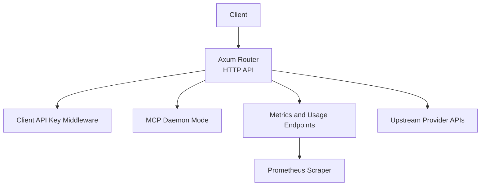
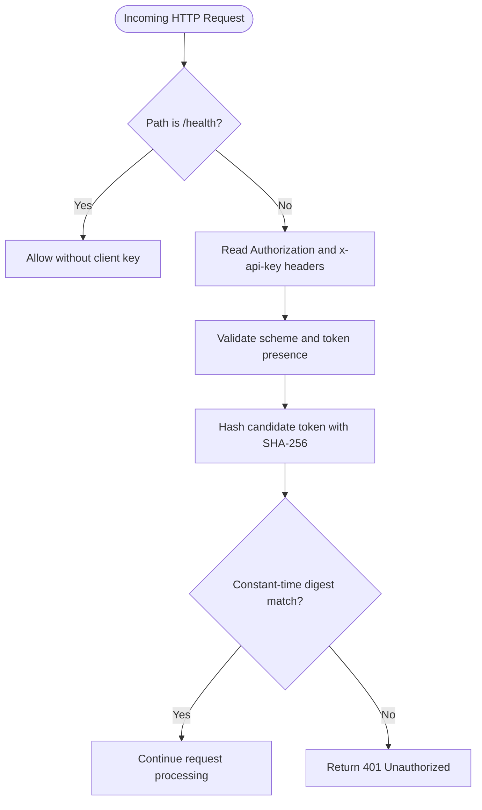
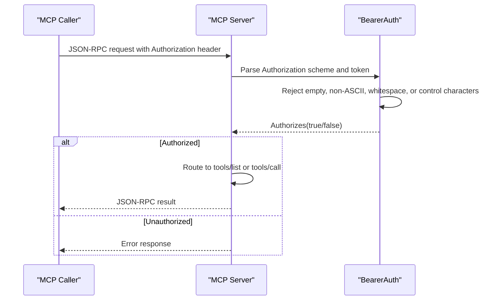
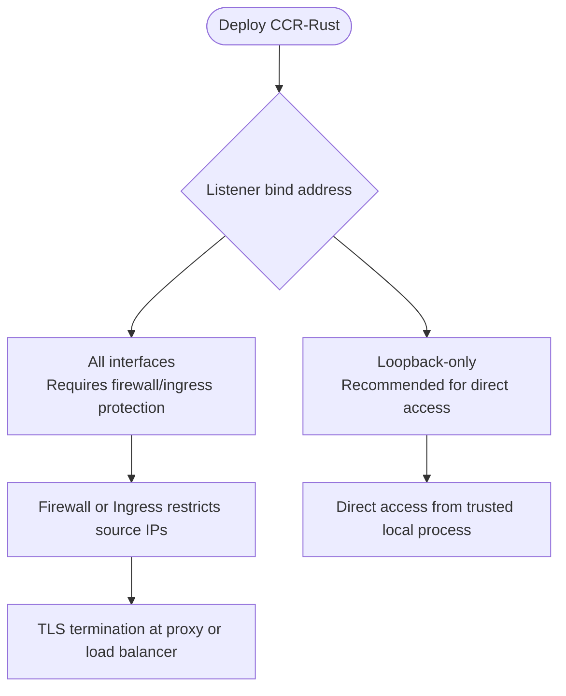
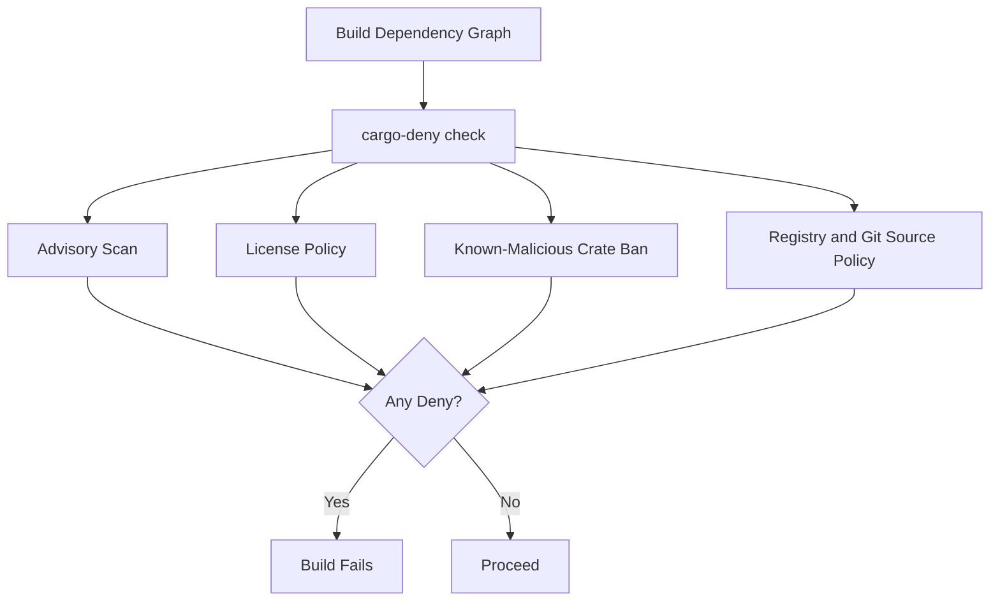
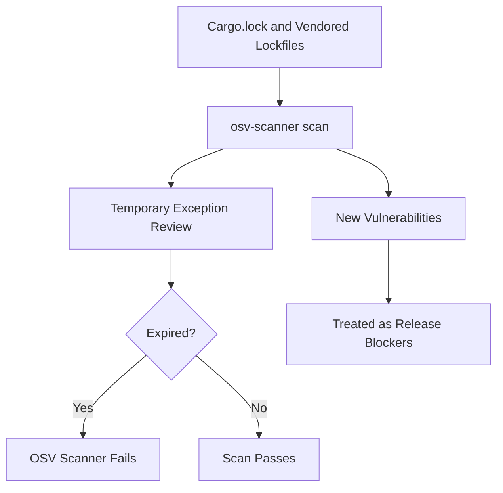
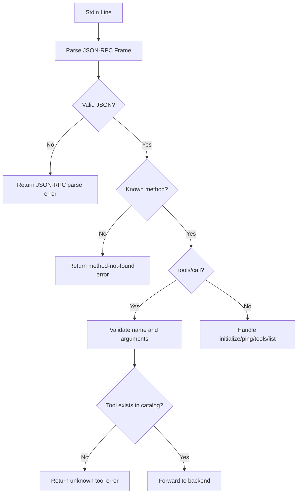
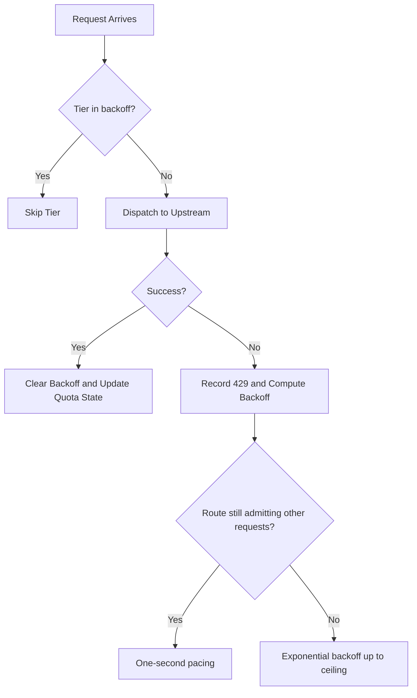
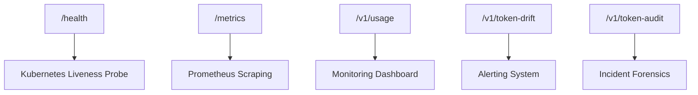

# Security Hardening

<cite>
**Referenced Files in This Document**   
- [deny.toml](file://deny.toml)
- [osv-scanner.toml](file://osv-scanner.toml)
- [src/client_auth.rs](file://src/client_auth.rs)
- [src/mcp/auth.rs](file://src/mcp/auth.rs)
- [src/mcp/server.rs](file://src/mcp/server.rs)
- [docs/dependency-security.md](file://docs/dependency-security.md)
- [docs/configuration.md](file://docs/configuration.md)
- [docs/auth-suites.md](file://docs/auth-suites.md)
- [Cargo.toml](file://Cargo.toml)
- [Dockerfile](file://Dockerfile)
- [deploy/ccr-rust.service](file://deploy/ccr-rust.service)
- [k8s/deployment.yaml](file://k8s/deployment.yaml)
- [k8s/configmap.yaml](file://k8s/configmap.yaml)
- [monitoring/prometheus-snippet.yml](file://monitoring/prometheus-snippet.yml)
- [src/metrics/handlers.rs](file://src/metrics/handlers.rs)
- [src/ratelimit.rs](file://src/ratelimit.rs)
- [docs/observability.md](file://docs/observability.md)
- [docs/deployment.md](file://docs/deployment.md)
</cite>

## Table of Contents
1. [Introduction](#introduction)
2. [Project Structure](#project-structure)
3. [Authentication and Authorization](#authentication-and-authorization)
4. [Network Security and Transport Configuration](#network-security-and-transport-configuration)
5. [Dependency Security Policy](#dependency-security-policy)
6. [Input Validation and Request Sanitization](#input-validation-and-request-sanitization)
7. [Secrets Management and Environment Security](#secrets-management-and-environment-security)
8. [Audit Logging, Monitoring, and Incident Response](#audit-logging-monitoring-and-incident-response)
9. [Deployment Hardening Checklist](#deployment-hardening-checklist)
10. [Conclusion](#conclusion)

## Introduction
This document provides production security hardening guidance for CCR-Rust. It covers client authentication, MCP bearer tokens, API key handling, network exposure, dependency supply-chain policy, input validation, secrets management, monitoring, and incident response. The guidance is grounded in the repository’s authentication middleware, MCP server implementation, configuration documentation, dependency policies, Docker/systemd/Kubernetes manifests, and observability endpoints.

## Project Structure
CCR-Rust is a Rust application that exposes HTTP APIs through Axum, supports multiple upstream provider protocols, includes an optional MCP daemon mode, and ships with metrics and health endpoints. Production deployments are commonly managed through systemd, Docker, or Kubernetes.

**Diagram sources**
- [src/main.rs:1-200](file://src/main.rs#L1-L200)
- [src/client_auth.rs:1-144](file://src/client_auth.rs#L1-L144)
- [src/mcp/server.rs:1-200](file://src/mcp/server.rs#L1-L200)
- [src/metrics/handlers.rs:1-200](file://src/metrics/handlers.rs#L1-L200)

**Section sources**
- [src/main.rs:1-200](file://src/main.rs#L1-L200)
- [Dockerfile:1-19](file://Dockerfile#L1-L19)
- [deploy/ccr-rust.service:1-14](file://deploy/ccr-rust.service#L1-L14)
- [k8s/deployment.yaml:1-50](file://k8s/deployment.yaml#L1-L50)

## Authentication and Authorization
### Client API Key Authentication
The public-facing HTTP listener uses a client API key middleware to authenticate requests. The middleware accepts two standard forms:
- `Authorization: Bearer <key>`
- `x-api-key: <key>`

Internally, the configured token is hashed with SHA-256 at startup. Incoming tokens are also hashed and compared using constant-time comparison to prevent timing attacks. Missing headers, empty tokens, wrong schemes, and incorrect values return `401 Unauthorized` with a JSON error and a `WWW-Authenticate: Bearer` header. The `/health` endpoint is exempted from authentication because it reports service liveness.

**Diagram sources**
- [src/client_auth.rs:1-144](file://src/client_auth.rs#L1-L144)

**Security properties**
- Tokens are never stored as plaintext; only their SHA-256 digest is retained in memory.
- Comparison uses constant-time equality.
- Input validation rejects empty, non-ASCII, whitespace-containing, and control-character-containing keys.
- Both Bearer and Anthropic-style API key formats are supported so OpenAI-compatible and native Anthropic clients can share one authenticated endpoint.

**Operational guidance**
- Configure `CLIENT_API_KEY` through environment variables rather than embedding it in source code or shared configuration files.
- Treat each deployment port as belonging to a single authentication suite unless you explicitly design cross-suite routing controls.
- Restrict access to the authenticated listener behind a firewall or ingress controller when exposing it beyond loopback.

**Section sources**
- [src/client_auth.rs:1-144](file://src/client_auth.rs#L1-L144)
- [docs/configuration.md:1-200](file://docs/configuration.md#L1-L200)

### MCP Bearer Token Authentication
The MCP daemon mode has its own bearer token validation. The MCP implementation reads JSON-RPC frames from stdin/stdout and does not expose a general-purpose HTTP API in this file. Bearer authentication is enforced by parsing the `Authorization` header, rejecting malformed entries, requiring a non-empty token after the scheme, accepting case-insensitive `Bearer`, and comparing token digests using constant-time equality.

**Diagram sources**
- [src/mcp/auth.rs:1-81](file://src/mcp/auth.rs#L1-L81)
- [src/mcp/server.rs:1-200](file://src/mcp/server.rs#L1-L200)

**Section sources**
- [src/mcp/auth.rs:1-81](file://src/mcp/auth.rs#L1-L81)
- [src/mcp/server.rs:1-200](file://src/mcp/server.rs#L1-L200)

### API Key Management Best Practices
- Use separate processes, ports, configurations, and credential stores for different accounts or suites.
- Do not rely on distinct ports alone as an access-control boundary; local HTTP listeners do not inherently authenticate unless the client key middleware is enabled.
- Keep provider API keys out of Git, shell history, logs, screenshots, and issue comments.
- Prefer service-manager-managed environment variables or a secret manager over `.env` files in production.

**Section sources**
- [docs/auth-suites.md:1-200](file://docs/auth-suites.md#L1-L200)
- [docs/configuration.md:1-200](file://docs/configuration.md#L1-L200)

## Network Security and Transport Configuration
### Listener Exposure
By default, the CLI starts on loopback unless overridden. The systemd unit binds to `0.0.0.0`, which makes the process reachable on all network interfaces unless restricted by host firewall rules or container networking. The Dockerfile exposes port `3456` and runs as a non-root user named `ccr`. The Kubernetes deployment exposes container port `3456` and mounts configuration through a ConfigMap.

**Diagram sources**
- [src/main.rs:1-200](file://src/main.rs#L1-L200)
- [deploy/ccr-rust.service:1-14](file://deploy/ccr-rust.service#L1-L14)
- [Dockerfile:1-19](file://Dockerfile#L1-L19)
- [k8s/deployment.yaml:1-50](file://k8s/deployment.yaml#L1-L50)

### TLS and Secure Communication Channels
The repository documents TLS termination at the load balancer and does not implement HTTPS directly in the shown server entry points. For production:
- Terminate TLS at a reverse proxy, ingress controller, or service mesh.
- Forward only HTTPS traffic to CCR-Rust.
- If CCR-Rust must speak to upstream providers over TLS, ensure system CA certificates are present in the runtime image.
- Avoid sending credentials over unencrypted channels; prefer short-lived tokens and scoped API keys.

The Dockerfile installs `ca-certificates`, and the Kubernetes deployment sets `RUST_LOG=info`, making certificate availability and log level relevant operational concerns.

**Section sources**
- [docs/deployment.md:1-50](file://docs/deployment.md#L1-L50)
- [Dockerfile:1-19](file://Dockerfile#L1-L19)
- [k8s/deployment.yaml:1-50](file://k8s/deployment.yaml#L1-L50)

### Firewall Rules
Use host-level firewalls and cloud network policies to restrict inbound access to the CCR-Rust listener:
- Allow only trusted client CIDRs.
- Restrict the metrics and usage endpoints to internal monitoring networks.
- Block public internet access unless a hardened ingress layer enforces authentication and rate limiting.

[No sources needed since this section provides general guidance]

## Dependency Security Policy
### cargo-deny Policy
Supply-chain security is enforced through `deny.toml`:
- Advisories deny vulnerabilities by default.
- Unmaintained advisories are limited to workspace crates.
- Only crates.io is allowed as a registry; unknown registries and unknown Git sources are denied.
- A narrow Git allow-list is used for the vendored Sindexer revision.
- Multiple versions of the same crate warn; wildcards are denied.
- Known-malicious crates are explicitly banned.
- Allowed licenses are enumerated.

**Diagram sources**
- [deny.toml:1-83](file://deny.toml#L1-L83)

**Section sources**
- [deny.toml:1-83](file://deny.toml#L1-L83)

### OSV Scanner Integration
`osv-scanner.toml` declares temporary vulnerability exceptions with explicit expiry dates. These exceptions mirror reviewed risks documented in `docs/dependency-security.md`. The documentation requires operators to run OSV Scanner before building or publishing artifacts and explains how dated exceptions are enforced locally.

Key policy behaviors:
- Exceptions expire on documented dates and must be removed manually when no longer valid.
- `cargo-deny` does not read OSV Scanner exception files, so matching entries exist in both places.
- The vendored GP surrogate has its own lockfile and is scanned separately.
- Historical advisory resolutions and remaining migration notes are recorded for auditability.

**Diagram sources**
- [osv-scanner.toml:1-24](file://osv-scanner.toml#L1-L24)
- [docs/dependency-security.md:1-157](file://docs/dependency-security.md#L1-L157)

**Section sources**
- [osv-scanner.toml:1-24](file://osv-scanner.toml#L1-L24)
- [docs/dependency-security.md:1-157](file://docs/dependency-security.md#L1-L157)

### Runtime Dependencies and CVE Notes
`Cargo.toml` pins several dependencies and includes inline CVE references for OpenSSL, Prometheus, random number generation, and terminal UI components. This signals that dependency refreshes should be treated carefully and validated against the full test suite.

**Section sources**
- [Cargo.toml:1-87](file://Cargo.toml#L1-L87)

## Input Validation and Request Sanitization
### Client Keys and Bearer Tokens
Both client API key and MCP bearer token implementations validate inputs before hashing:
- Empty tokens are rejected.
- Non-ASCII tokens are rejected.
- ASCII whitespace and control characters are rejected.
- Incorrect or missing authorization headers fail authentication.

This reduces injection surfaces at the authentication boundary and avoids logging or storing unsafe raw tokens.

**Section sources**
- [src/client_auth.rs:1-144](file://src/client_auth.rs#L1-L144)
- [src/mcp/auth.rs:1-81](file://src/mcp/auth.rs#L1-L81)

### MCP Protocol Input Handling
The MCP server parses incoming lines as JSON-RPC messages and returns structured errors for malformed frames. Unknown methods and missing parameters produce JSON-RPC error responses. Tool names are routed through a catalog, and unknown tool calls are rejected. Include/exclude filters constrain the exposed tool surface.

**Diagram sources**
- [src/mcp/server.rs:1-200](file://src/mcp/server.rs#L1-L200)

**Section sources**
- [src/mcp/server.rs:1-200](file://src/mcp/server.rs#L1-L200)

### Response Schema Enforcement
The schema enforcement transformer validates final assistant text against a JSON Schema. Importantly, validation failures are logged as warnings but do not block the response. This is defensive output validation rather than strict request-side sanitization.

**Operational implication**
- Use schema enforcement to detect malformed upstream responses or transformation bugs.
- Do not treat it as a complete input sanitizer or access control mechanism.

**Section sources**
- [src/schema_validate.rs:1-200](file://src/schema_validate.rs#L1-L200)

### Rate Limiting and Backoff
The rate limiter tracks per-tier state, honors server-provided `Retry-After` headers up to a maximum backoff, and applies exponential backoff for starved routes under repeated 429 responses. It also supports proactive tier skipping based on `X-RateLimit-Remaining: 0` when the operator trusts those headers.

**Diagram sources**
- [src/ratelimit.rs:1-200](file://src/ratelimit.rs#L1-L200)

**Section sources**
- [src/ratelimit.rs:1-200](file://src/ratelimit.rs#L1-L200)

## Secrets Management and Environment Security
### Configuration File Locations and Expansion
CCR-Rust reads configuration from a JSON file selected by CLI flag, environment variable, or default path. Configuration supports `${VAR_NAME}` expansion from the router process environment at load time. The loader warns if expansion fails and retains raw config text; therefore, validating configuration syntax is not proof that credentials were loaded.

Recommended practices:
- Store API keys in environment variables provided by the service manager, container runtime, or secret manager.
- Avoid `.env` files in production unless they are tightly controlled and sourced before starting the process.
- Never commit real secrets to version control.
- Validate required variables before startup without printing them.

**Section sources**
- [docs/configuration.md:1-200](file://docs/configuration.md#L1-L200)

### Suite Isolation
For multi-account or multi-tenant scenarios, use separate directories, ports, processes, and credential environments. The suite documentation recommends restrictive directory and file permissions and isolates native client login homes.

**Section sources**
- [docs/auth-suites.md:1-200](file://docs/auth-suites.md#L1-L200)

### Container and Process Isolation
- Run as a non-root user. The Dockerfile creates and switches to user `ccr`.
- Minimize container capabilities and filesystem write access.
- Mount configuration through sealed secrets or encrypted volumes rather than baking them into images.
- Use Kubernetes Secrets for sensitive data; avoid placing secrets in ConfigMaps.

**Section sources**
- [Dockerfile:1-19](file://Dockerfile#L1-L19)
- [k8s/deployment.yaml:1-50](file://k8s/deployment.yaml#L1-L50)
- [k8s/configmap.yaml:1-10](file://k8s/configmap.yaml#L1-L10)

## Audit Logging, Monitoring, and Incident Response
### Logging Configuration
Logging level is controlled through `RUST_LOG`. The systemd unit, Kubernetes deployment, and documentation examples set it to `info`. Operators may adjust verbosity for production, typically avoiding debug or trace levels unless diagnosing an incident.

**Section sources**
- [deploy/ccr-rust.service:1-14](file://deploy/ccr-rust.service#L1-L14)
- [k8s/deployment.yaml:1-50](file://k8s/deployment.yaml#L1-L50)
- [docs/observability.md:1-200](file://docs/observability.md#L1-L200)

### Observability Endpoints
CCR-Rust exposes:
- `/health` for liveness checks.
- `/metrics` for Prometheus scraping.
- `/v1/usage`, `/v1/token-drift`, `/v1/token-audit`, `/v1/frontend-metrics`, `/v1/throughput`, `/v1/latencies` for JSON observability.

These endpoints provide request counts, failures, latency statistics, streaming state, token accounting, and pre-request audit entries. Persistence can be backed by Redis to survive restarts.

**Diagram sources**
- [monitoring/prometheus-snippet.yml:1-7](file://monitoring/prometheus-snippet.yml#L1-L7)
- [src/metrics/handlers.rs:1-200](file://src/metrics/handlers.rs#L1-L200)
- [docs/observability.md:1-200](file://docs/observability.md#L1-L200)

**Section sources**
- [monitoring/prometheus-snippet.yml:1-7](file://monitoring/prometheus-snippet.yml#L1-L7)
- [src/metrics/handlers.rs:1-200](file://src/metrics/handlers.rs#L1-L200)
- [docs/observability.md:1-200](file://docs/observability.md#L1-L200)

### Incident Response Procedures
Recommended steps when a security event is suspected:
1. Stop or isolate the affected CCR-Rust instance using the service manager or Kubernetes rollout rollback.
2. Preserve logs, metrics, and audit snapshots before restarting.
3. Rotate compromised client API keys, MCP bearer tokens, and provider API keys.
4. Revoke any leaked session tokens or OAuth grants where applicable.
5. Review `/v1/token-audit` and token drift metrics for unusual patterns.
6. Inspect dependency scan results if a supply-chain concern is suspected.
7. Redeploy from a verified artifact after remediation.

[No sources needed since this section provides general guidance]

## Deployment Hardening Checklist
- **Authentication**
  - Set `CLIENT_API_KEY` through a secure environment source.
  - Restrict MCP bearer tokens to trusted callers.
  - Do not rely on ports as access-control boundaries.
- **Network**
  - Prefer loopback binding for direct access.
  - If binding to all interfaces, enforce firewall and TLS termination.
  - Restrict `/metrics`, `/v1/*`, and `/health` to internal networks.
- **Secrets**
  - Store API keys in environment variables or a secret manager.
  - Use Kubernetes Secrets, not ConfigMaps, for credentials.
  - Use restrictive file permissions for local `.env` and suite directories.
- **Dependencies**
  - Run `cargo deny check` and `osv-scanner` before builds.
  - Review and remove expired exceptions promptly.
  - Validate new dependency refreshes across all features and targets.
- **Runtime**
  - Run as non-root.
  - Enable structured logging at appropriate levels.
  - Scrape Prometheus metrics and alert on failures, drift, and unexpected token volume.
  - Test Redis persistence reset and recovery procedures.

**Section sources**
- [docs/deployment.md:1-50](file://docs/deployment.md#L1-L50)
- [docs/dependency-security.md:1-157](file://docs/dependency-security.md#L1-L157)
- [docs/observability.md:1-200](file://docs/observability.md#L1-L200)

## Conclusion
CCR-Rust provides solid foundations for production security: constant-time client key verification, MCP bearer token validation, explicit dependency-supply-chain policies, structured observability, and clear configuration-driven secret loading. Production hardening depends on correct deployment choices—binding addresses, TLS termination, secret storage, firewall rules, dependency scanning, and monitored incident response. Treat the existing mechanisms as part of a layered defense rather than standalone guarantees.