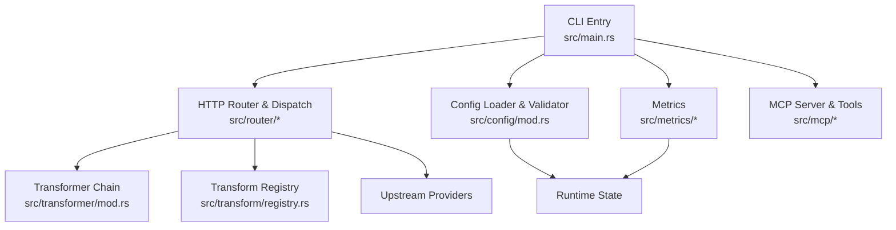
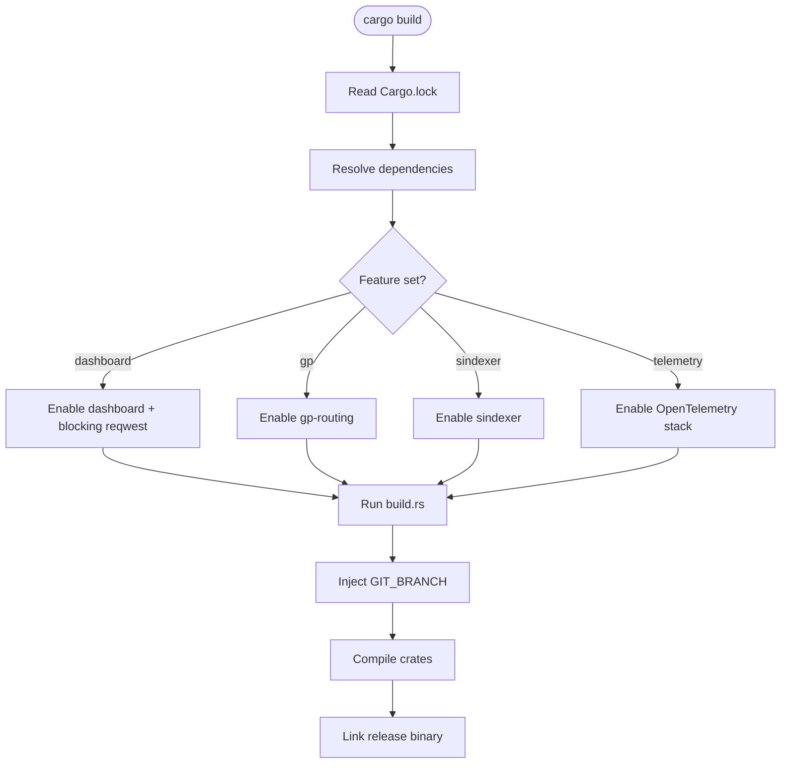
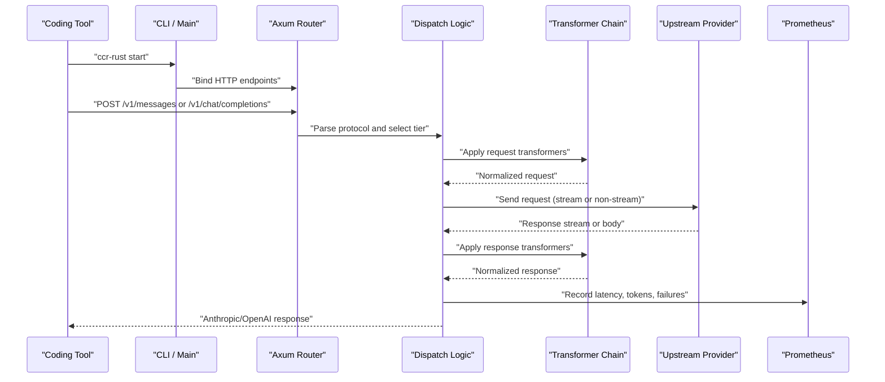
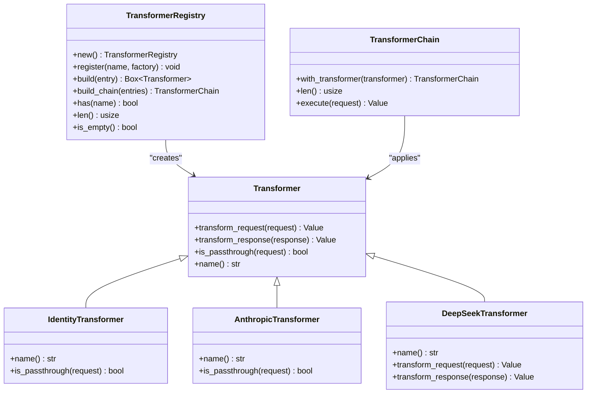
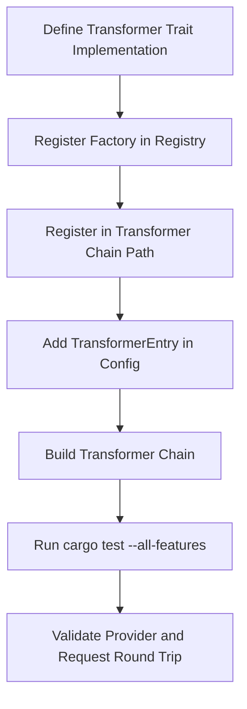
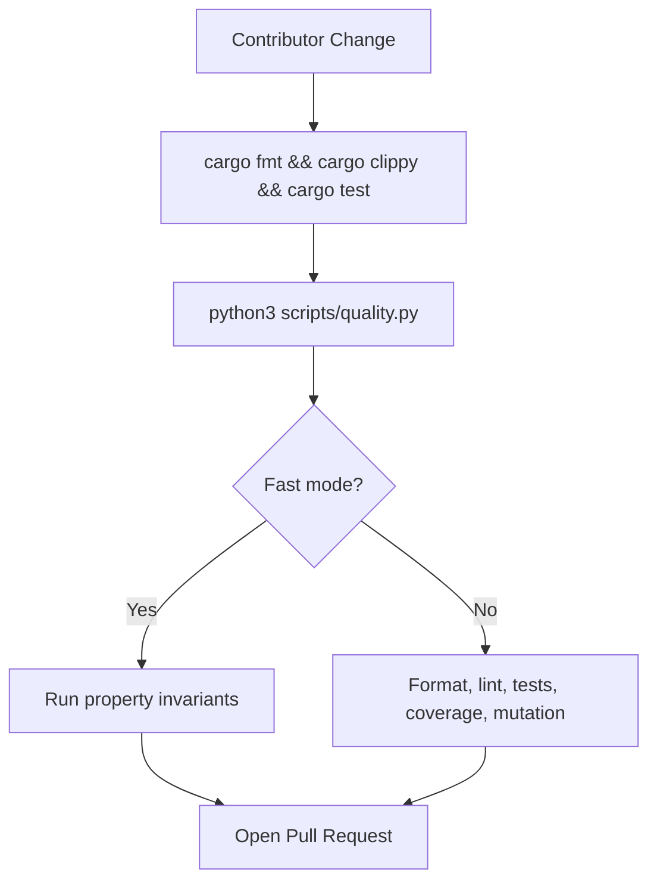
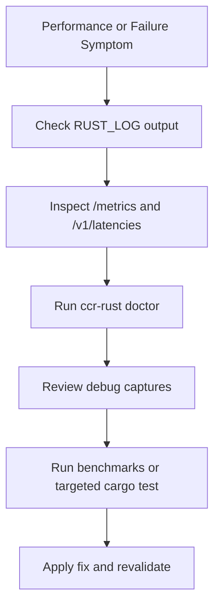

# Developer Guide

<cite>
**Referenced Files in This Document**   
- [README.md](file://README.md)
- [CONTRIBUTING.md](file://CONTRIBUTING.md)
- [REVIEW.md](file://REVIEW.md)
- [AGENTS.md](file://AGENTS.md)
- [Cargo.toml](file://Cargo.toml)
- [build.rs](file://build.rs)
- [src/main.rs](file://src/main.rs)
- [src/lib.rs](file://src/lib.rs)
- [src/config/mod.rs](file://src/config/mod.rs)
- [src/transformer/mod.rs](file://src/transformer/mod.rs)
- [src/transform/registry.rs](file://src/transform/registry.rs)
- [src/router/dispatch.rs](file://src/router/dispatch.rs)
- [docs/configuration.md](file://docs/configuration.md)
- [docs/troubleshooting.md](file://docs/troubleshooting.md)
- [scripts/quality.py](file://scripts/quality.py)
- [benches/concurrent_streams.rs](file://benches/concurrent_streams.rs)
</cite>

## Table of Contents
1. [Introduction](#introduction)
2. [Project Structure](#project-structure)
3. [Development Environment Setup](#development-environment-setup)
4. [Build System and Dependency Management](#build-system-and-dependency-management)
5. [Coding Standards and Review Process](#coding-standards-and-review-process)
6. [Architecture Overview](#architecture-overview)
7. [Core Components](#core-components)
8. [Extension Points: Transformers, Providers, and MCP Tools](#extension-points-transformers-providers-and-mcp-tools)
9. [Testing and Quality Gates](#testing-and-quality-gates)
10. [Debugging, Profiling, and Performance Analysis](#debugging-profiling-and-performance-analysis)
11. [Release Procedures](#release-procedures)
12. [Troubleshooting Guide for Contributors](#troubleshooting-guide-for-contributors)
13. [Conclusion](#conclusion)

## Introduction
CCR-Rust is a self-hosted, multi-protocol LLM router that sits between coding tools such as Claude Code, Codex, or OpenAI-compatible clients and upstream model providers. It selects provider tiers, translates request and response formats, streams responses, retries failed tiers, tracks rate limits, and exposes metrics and optional MCP tool aggregation.

The repository root is the Rust crate. Contributors should install from source using the Rust toolchain, run formatting and linting, execute tests with all features enabled, and keep configuration-driven provider support separate from code-only normalization paths.

**Section sources**
- [README.md:1-60](file://README.md#L1-L60)
- [CONTRIBUTING.md:1-20](file://CONTRIBUTING.md#L1-L20)

## Project Structure
The project follows a layered Rust layout:

- `src/main.rs`: CLI entry point, subcommand parsing, server bootstrap, feature-gated dashboard and telemetry wiring.
- `src/lib.rs`: Crate root exposing modules behind feature flags.
- `src/config/`: Configuration loading, environment expansion, validation, pricing, and provider definitions.
- `src/router/`: HTTP handlers, dispatch, protocol translation, streaming, usage metrics, and response shaping.
- `src/frontend/`: Client-format normalization for Claude Code, Codex, and detection logic.
- `src/transform/`: Provider-specific transformers and a factory registry.
- `src/transformer/`: Core transformer trait, chain, built-in implementations, and shared behavior.
- `src/mcp/`: Model Context Protocol server, daemon, catalog, authentication, and built-in tools.
- `src/metrics/`: Prometheus collectors and persistence helpers.
- `tests/`: Integration and property tests against mocked upstreams.
- `benchmarks/` and `benches/`: Stress scripts and Criterion benchmarks.
- `scripts/`: Python quality matrix, helper utilities, and test harnesses.
- `deploy/`, `k8s/`, `monitoring/`: Deployment and observability assets.

**Diagram sources**
- [src/main.rs:1-120](file://src/main.rs#L1-L120)
- [src/lib.rs:1-27](file://src/lib.rs#L1-L27)
- [src/router/dispatch.rs:1-60](file://src/router/dispatch.rs#L1-L60)
- [src/transformer/mod.rs:1-40](file://src/transformer/mod.rs#L1-L40)
- [src/transform/registry.rs:1-40](file://src/transform/registry.rs#L1-L40)

**Section sources**
- [CONTRIBUTING.md:21-60](file://CONTRIBUTING.md#L21-L60)
- [AGENTS.md:39-66](file://AGENTS.md#L39-L66)
- [src/lib.rs:1-27](file://src/lib.rs#L1-L27)

## Development Environment Setup
Recommended setup:

1. Install the Rust toolchain through rustup.
2. Clone the repository.
3. Run basic checks:
   - `cargo check`
   - `cargo fmt`
   - `cargo clippy`
   - `cargo test`
4. Build and install the local binary:
   - `cargo build --release`
   - `cargo install --path . --force`
5. Verify the installed CLI:
   - `ccr-rust version`
6. Start the router with a minimal config and verify it:
   - `ccr-rust validate`
   - `ccr-rust start`
   - `ccr-rust status`

The AGENTS guide emphasizes keeping CCR opt-in, avoiding global localhost overrides, validating the Git checkout, installed binary, listener, client version, and route before claiming a setup works.

**Section sources**
- [README.md:61-120](file://README.md#L61-L120)
- [CONTRIBUTING.md:1-20](file://CONTRIBUTING.md#L1-L20)
- [AGENTS.md:10-38](file://AGENTS.md#L10-L38)

## Build System and Dependency Management
### Cargo Package Metadata
The package is named `ccr-rust`, edition 2021, licensed under AGPL-3.0-or-later, and depends on Axum for HTTP routing, Tokio for async runtime, reqwest for upstream calls, serde for serialization, tracing and env_logger for logging, Prometheus for metrics, Redis for persistence, and optional OpenTelemetry for telemetry.

### Features
| Feature | Purpose | Default |
|---|---|---|
| `dashboard` | Interactive terminal dashboard; enables blocking reqwest transport | Yes |
| `gp` | Request-aware GP reranking via vendored surrogate | Yes |
| `sindexer` | Optional sindexer dependency | Yes |
| `telemetry` | OpenTelemetry tracing, OTLP exporter, and reqwest instrumentation | No |

### Release Profile
The release profile uses optimization level 3, link-time optimization, and a single codegen unit to produce a compact, optimized binary.

### Compile-Time Build Script
`build.rs` captures the current Git branch at compile time and injects it as `GIT_BRANCH`. It reruns when `.git/HEAD` changes.

**Diagram sources**
- [Cargo.toml:1-87](file://Cargo.toml#L1-L87)
- [build.rs:1-21](file://build.rs#L1-L21)

**Section sources**
- [Cargo.toml:1-87](file://Cargo.toml#L1-L87)
- [build.rs:1-21](file://build.rs#L1-L21)

## Coding Standards and Review Process
### Formatting and Linting
- Format with `cargo fmt`.
- Lint with `cargo clippy`; warnings are treated as failures by the quality matrix.
- Public items must have `///` documentation.
- Fallible functions should use `anyhow::Result`.

### Commit Workflow
1. Write a clear commit message describing problem and solution.
2. Ensure `cargo test` and `cargo clippy` pass.
3. Add documentation for new public items.
4. Push a feature branch and open a pull request.

### Review Expectations
Review guidance requires focused changes, preserved compatibility, security-sensitive audits, and verification against checked-in commands. New or changed behavior needs focused tests plus at least one failure or edge case. Lockfile changes require graph and vulnerability review. Networked, concurrent, or long-running work must treat timeouts, retries, cancellation, cleanup, and partial failure as part of public behavior.

**Section sources**
- [CONTRIBUTING.md:61-112](file://CONTRIBUTING.md#L61-L112)
- [REVIEW.md:1-56](file://REVIEW.md#L1-L56)

## Architecture Overview
At runtime, the CLI parses subcommands and starts the Axum server unless the command is diagnostic. The router accepts Anthropic `/v1/messages` and OpenAI `/v1/chat/completions` and `/v1/responses` endpoints. Requests are dispatched to configured provider tiers, translated into the upstream format when needed, streamed back to the client, and recorded in Prometheus metrics. Transformers can modify requests and responses along the path.

**Diagram sources**
- [src/main.rs:1-120](file://src/main.rs#L1-L120)
- [src/router/dispatch.rs:1-60](file://src/router/dispatch.rs#L1-L60)
- [src/transformer/mod.rs:1-40](file://src/transformer/mod.rs#L1-L40)

## Core Components
### CLI and Application Bootstrap
The CLI defines subcommands for starting the server, checking status, validating configuration, running diagnostics, inspecting workers, launching the dashboard, showing version, clearing persisted stats, and running as an MCP server or shared daemon. Command arguments include host, port, maximum concurrent streams, shutdown timeout, Redis URL, and dashboard host/port.

Key responsibilities:
- Parse global options like `--config` and `CCR_CONFIG`.
- Map subcommands to application behavior.
- Construct shared state, including configuration, transformer registry, rate-limit tracker, EWMA tracker, debug capture, and optional GP router.
- Initialize tracing, CORS, and trace layers.
- Bind the HTTP server and handle graceful shutdown.

**Section sources**
- [src/main.rs:1-120](file://src/main.rs#L1-L120)

### Configuration Loading and Validation
Configuration is loaded from a JSON file, defaulting to `~/.claude-code-router/config.json`, with override through `--config` or `CCR_CONFIG`. It supports `${VAR}` and `$VAR` expansion, credential validation, extra header validation, and client credential checks.

Important behaviors:
- Recursive expansion of environment references in string values.
- Recording of unresolved placeholders for later diagnosis.
- Refusal to start when provider credentials remain unexpanded unless explicitly overridden.
- Validation of extra headers as valid HTTP header names and values.
- Security-oriented defaults that favor loopback listeners unless configured otherwise.

**Section sources**
- [src/config/mod.rs:1-120](file://src/config/mod.rs#L1-L120)
- [docs/configuration.md:1-60](file://docs/configuration.md#L1-L60)

### Routing and Dispatch
The dispatcher handles protocol selection, provider selection, retry and rate-limit handling, streaming, embedded error detection, debug capture, and metric recording. It normalizes success envelopes from some OpenAI-compatible gateways and inspects early stream frames for embedded errors.

Key responsibilities:
- Translate Anthropic and OpenAI requests into provider-native formats.
- Stream upstream responses while preserving SSE semantics where required.
- Apply response transformations before returning data to the client.
- Track token usage, cost, rate limits, and failures.
- Redact sensitive headers during debug capture.

**Section sources**
- [src/router/dispatch.rs:1-120](file://src/router/dispatch.rs#L1-L120)

### Transformer System
The transformer system provides a trait for request/response modification, a chain implementation, built-in transformers, and a registry that builds transformers from configuration entries. Built-ins include identity, Anthropic passthrough, DeepSeek thinking-block injection, provider-specific transformers, format converters, compression, and utility transformers.

**Diagram sources**
- [src/transformer/mod.rs:1-120](file://src/transformer/mod.rs#L1-L120)
- [src/transform/registry.rs:1-120](file://src/transform/registry.rs#L1-L120)

**Section sources**
- [src/transformer/mod.rs:1-120](file://src/transformer/mod.rs#L1-L120)
- [src/transform/registry.rs:1-120](file://src/transform/registry.rs#L1-L120)

## Extension Points: Transformers, Providers, and MCP Tools
### Adding a Standard Provider
Most OpenAI- or Anthropic-compatible providers need only configuration. Configure the provider name, base URL, API key, models, optional pricing, and optional transformer chain. Do not add code unless the provider requires normalization or a new protocol variant.

Steps:
1. Add provider configuration.
2. Validate with `ccr-rust validate`.
3. Test through the expected client endpoint.
4. Add integration coverage if normalization or protocol behavior changes.

**Section sources**
- [CONTRIBUTING.md:80-112](file://CONTRIBUTING.md#L80-L112)
- [docs/configuration.md:61-140](file://docs/configuration.md#L61-L140)

### Adding a Transformer
Transformers are used when request or response normalization is required.

Steps:
1. Implement the `Transformer` trait in `src/transformer/mod.rs` or a related module.
2. Register the transformer factory in both registry construction paths:
   - `src/transform/registry.rs`
   - `src/transformer/mod.rs`
3. Add configuration documentation if the transformer has options.
4. Add tests covering transformation behavior and failure cases.
5. Verify the full chain builds without skipping the new transformer.

**Diagram sources**
- [src/transformer/mod.rs:1-80](file://src/transformer/mod.rs#L1-L80)
- [src/transform/registry.rs:40-120](file://src/transform/registry.rs#L40-L120)
- [CONTRIBUTING.md:80-112](file://CONTRIBUTING.md#L80-L112)

**Section sources**
- [CONTRIBUTING.md:80-112](file://CONTRIBUTING.md#L80-L112)
- [src/transform/registry.rs:40-120](file://src/transform/registry.rs#L40-L120)

### Extending MCP Tools
The MCP module includes a server, daemon, catalog, authentication, protocol layer, and built-in tools. New tools belong under `src/mcp/tools/` and are integrated through the MCP catalog and server plumbing.

Guidance:
- Keep tool inputs validated and bounded.
- Avoid embedding secrets in tool outputs or logs.
- Treat MCP tool execution as external-side effects requiring careful error handling.
- Add tests under `tests/` or MCP-related test files when behavior affects the catalog or server.

**Section sources**
- [src/mcp/mod.rs:1-8](file://src/mcp/mod.rs#L1-L8)
- [AGENTS.md:39-66](file://AGENTS.md#L39-L66)

## Testing and Quality Gates
### Rust Tests
Use `cargo test --all-features` for the complete suite. Focus areas include:
- Provider routing and failover.
- Streaming behavior.
- Reasoning controls.
- Responses protocol.
- Worker inspection.
- Property invariants.
- MCP daemon behavior.
- Rate-limit and retry sweep scenarios.

### Python Quality Matrix
The quality matrix runs deterministic checks:
- Rust formatting.
- Python formatting and linting.
- Python type checking.
- SLOC ratchet.
- Shellcheck.
- Clippy with warnings as errors.
- Full test run or LLVM coverage.
- No-default-features build.
- Debug binary build.
- Python helper tests.
- Vendored GP routing tests.
- Mutation testing when requested.

**Diagram sources**
- [scripts/quality.py:1-120](file://scripts/quality.py#L1-L120)
- [CONTRIBUTING.md:61-112](file://CONTRIBUTING.md#L61-L112)

**Section sources**
- [CONTRIBUTING.md:61-112](file://CONTRIBUTING.md#L61-L112)
- [scripts/quality.py:1-120](file://scripts/quality.py#L1-L120)

## Debugging, Profiling, and Performance Analysis
### Logging and Tracing
- Use `RUST_LOG=ccr_rust=debug,tower_http=debug ccr-rust start` for detailed request-level logs.
- For TLS or network issues, enable `reqwest=debug`.
- The dashboard is available through `ccr-rust dashboard` when the `dashboard` feature is enabled.
- Telemetry can be enabled with the `telemetry` feature for OpenTelemetry tracing.

### Metrics and Diagnostics
- Query `/metrics` for Prometheus data.
- Query `/v1/latencies` for tier latency signals.
- Use `ccr-rust doctor` to probe listener health, configuration, and optionally providers.
- Use `ccr-rust status` to verify the router process.
- Use `ccr-rust workers` to inspect saved worker runs.

### Debug Capture
The router can record request and response interactions for troubleshooting. Captures redact sensitive headers and store interaction metadata alongside bodies for analysis.

### Benchmarks
Criterion is configured for `benches/concurrent_streams.rs`. The current benchmark is a placeholder and should be replaced with realistic concurrency measurements when profiling streaming performance.

**Diagram sources**
- [docs/troubleshooting.md:1-80](file://docs/troubleshooting.md#L1-L80)
- [src/router/dispatch.rs:1-60](file://src/router/dispatch.rs#L1-L60)
- [benches/concurrent_streams.rs:1-9](file://benches/concurrent_streams.rs#L1-L9)

**Section sources**
- [docs/troubleshooting.md:1-120](file://docs/troubleshooting.md#L1-L120)
- [src/router/dispatch.rs:1-60](file://src/router/dispatch.rs#L1-L60)
- [benches/concurrent_streams.rs:1-9](file://benches/concurrent_streams.rs#L1-L9)

## Release Procedures
The README states that prebuilt release binaries are not published yet and recommends building from source or using Docker. The documented installation flow installs the binary through `cargo install --path . --force`.

Recommended release preparation steps based on repository evidence:
1. Update version in `Cargo.toml`.
2. Run the full quality matrix:
   - `python3 scripts/quality.py`
3. Run fast-mode checks first for iteration:
   - `python3 scripts/quality.py --fast`
4. Run coverage and mutation diagnostics when required:
   - `python3 scripts/quality.py --coverage`
   - `python3 scripts/quality.py --mutation`
5. Build the release binary:
   - `cargo build --release`
6. Install and validate locally:
   - `cargo install --path . --force`
   - `ccr-rust validate`
   - `ccr-rust start`
   - `ccr-rust status`

Docker users can build the image directly or use `docker compose up --build` with a mounted configuration file.

**Section sources**
- [README.md:90-160](file://README.md#L90-L160)
- [Cargo.toml:1-20](file://Cargo.toml#L1-L20)
- [scripts/quality.py:100-200](file://scripts/quality.py#L100-L200)

## Troubleshooting Guide for Contributors
### Common Contributor Issues
- **Unexpanded credentials**: If provider keys still contain `${VAR}` after startup, export variables before starting the router or use the credential launcher. The `CCR_ALLOW_UNEXPANDED_CREDENTIALS` environment variable can override this check for intentionally keyless local setups.
- **Connection refused**: Verify the configured provider URL and listener address.
- **SSL/TLS errors**: Ensure system CA certificates are installed and increase log verbosity.
- **Rate limiting**: A 429 marks a tier as rate-limited; remaining retries for that tier are skipped. Backoff is exponential and respects `Retry-After`. Tiers may also be proactively skipped when quota headers indicate exhaustion.
- **Requests bypassing tier order**: Clients may cache model strings. Enable `ignoreDirect` in router configuration to force traffic through configured tiers.
- **Tool-use blocks dropped in pseudo-SSE mode**: When `forceNonStreaming` is enabled, ensure response event emission handles all content block types.

### Diagnostic Commands
- `ccr-rust validate`
- `ccr-rust status`
- `ccr-rust doctor`
- `curl -s localhost:3456/metrics`
- `curl -s localhost:3456/v1/latencies`
- `RUST_LOG=ccr_rust=debug,tower_http=debug ccr-rust start`

**Section sources**
- [docs/troubleshooting.md:1-160](file://docs/troubleshooting.md#L1-L160)
- [src/config/mod.rs:1-120](file://src/config/mod.rs#L1-L120)

## Conclusion
Contributing to CCR-Rust means keeping configuration-first provider support, preserving stable protocols, streaming behavior, retry and rate-limit semantics, and observability surfaces. New providers usually require only configuration; code changes should be reserved for normalization or protocol differences. Every meaningful change should be formatted, linted, tested, and reviewed with attention to correctness, security, concurrency, and backward compatibility.