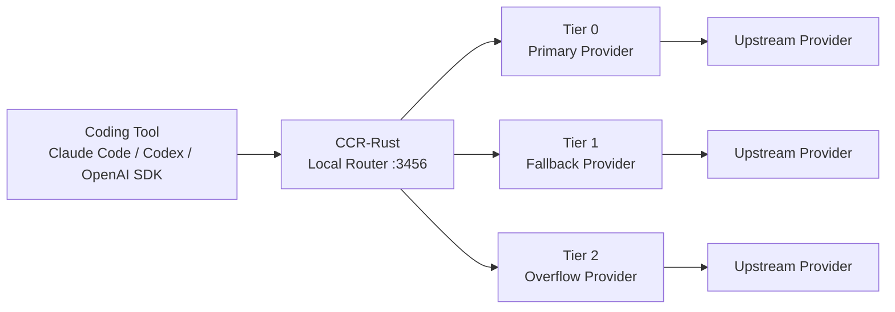
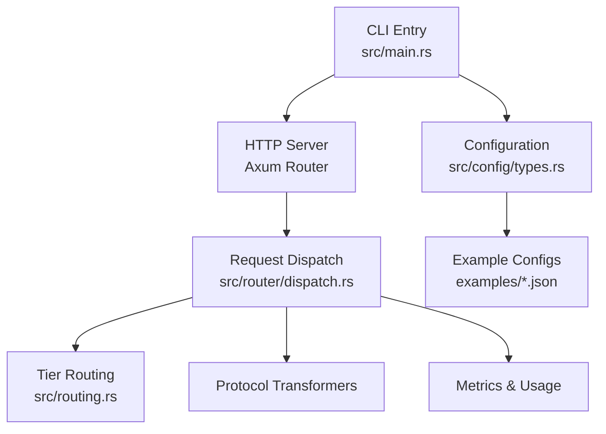
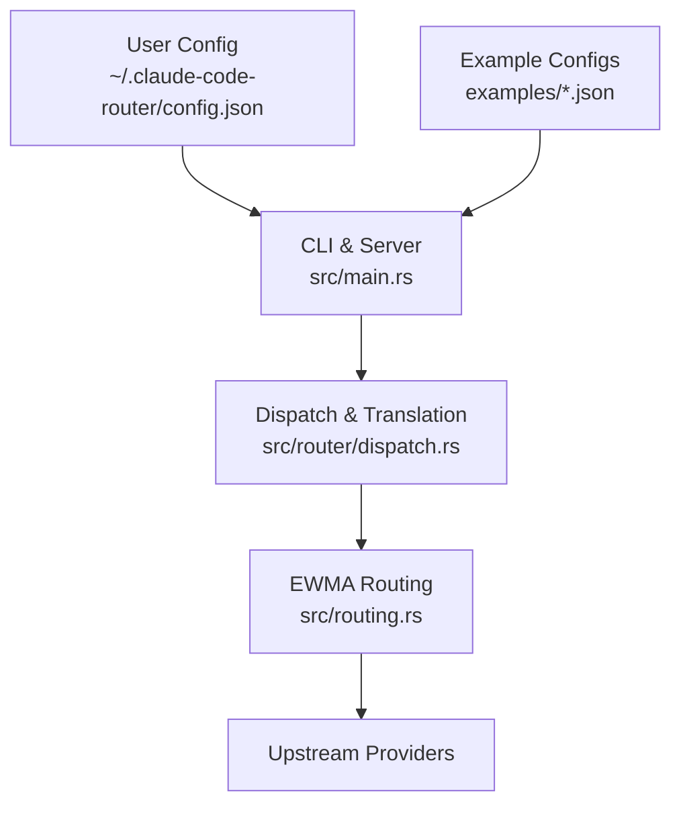

# Getting Started

<cite>
**Referenced Files in This Document**
- [README.md](file://README.md)
- [Cargo.toml](file://Cargo.toml)
- [Dockerfile](file://Dockerfile)
- [docker-compose.yml](file://docker-compose.yml)
- [src/main.rs](file://src/main.rs)
- [docs/configuration.md](file://docs/configuration.md)
- [docs/deployment.md](file://docs/deployment.md)
- [docs/local-operation.md](file://docs/local-operation.md)
- [docs/troubleshooting.md](file://docs/troubleshooting.md)
- [examples/README.md](file://examples/README.md)
- [examples/coding-plans.json](file://examples/coding-plans.json)
- [src/routing.rs](file://src/routing.rs)
- [src/router/dispatch.rs](file://src/router/dispatch.rs)
</cite>

## Table of Contents
1. [Introduction](#introduction)
2. [Project Structure](#project-structure)
3. [Core Concepts](#core-concepts)
4. [Installation](#installation)
5. [Quick Start Tutorial](#quick-start-tutorial)
6. [Basic Configuration](#basic-configuration)
7. [Starting the Service](#starting-the-service)
8. [Making Your First Request](#making-your-first-request)
9. [Connecting a Coding Tool](#connecting-a-coding-tool)
10. [Directory Structure and Key Files](#directory-structure-and-key-files)
11. [Common Setup Issues](#common-setup-issues)
12. [Troubleshooting Tips](#troubleshooting-tips)
13. [Conclusion](#conclusion)

## Introduction

CCR-Rust is a lightweight, self-hosted multi-provider LLM router. It sits between your coding tools — Claude Code, Codex, OpenCode, or any OpenAI-compatible client — and one or more model providers such as Anthropic, OpenAI, DeepSeek, GLM, MiniMax, or OpenRouter.

Your client talks to one local URL. CCR-Rust chooses which provider and model handle each request, translates between API formats when needed, and automatically fails over when an upstream provider has problems. The most common reason people install it is simple: when one provider quota runs out, keep using your preferred coding tool with another provider instead of changing workflows.



**Diagram sources**
- [README.md:1-120](file://README.md#L1-L120)

CCR-Rust does not create capacity; it maximizes the availability of the provider capacity you already have.

**Section sources**
- [README.md:1-120](file://README.md#L1-L120)

## Project Structure

At a high level, CCR-Rust is organized around configuration, routing, protocol translation, streaming, metrics, and CLI entry points.

| Area | Purpose |
|---|---|
| `src/` | Rust source code for the router, CLI, HTTP server, configuration, routing, transformers, metrics, and workers |
| `src/main.rs` | CLI parser, command dispatch, server startup, and process signals |
| `src/config/` | Configuration types and schema handling |
| `src/router/` | Request dispatch, protocol translation, streaming, responses API, and failover logic |
| `src/routing.rs` | EWMA-based latency tracking and tier reordering |
| `src/transform*` | Protocol and payload transformers between providers |
| `docs/` | User-facing documentation, deployment guides, and troubleshooting |
| `examples/` | Minimal and multi-provider example configurations |
| `k8s/` | Kubernetes manifests for containerized deployment |
| `deploy/` | System-level service definitions such as systemd and launchd |
| `monitoring/` | Prometheus snippets and observability helpers |
| `benches/` | Performance benchmarks |



**Diagram sources**
- [src/main.rs:1-200](file://src/main.rs#L1-L200)
- [src/router/dispatch.rs:1-150](file://src/router/dispatch.rs#L1-L150)
- [src/routing.rs:1-120](file://src/routing.rs#L1-L120)
- [examples/README.md:1-60](file://examples/README.md#L1-L60)

**Section sources**
- [src/main.rs:1-200](file://src/main.rs#L1-L200)
- [examples/README.md:1-60](file://examples/README.md#L1-L60)

## Core Concepts

### Provider

A **provider** is an upstream model endpoint that CCR-Rust sends requests to. Each provider entry includes a name, base URL, API key, and supported models. Common examples are Anthropic, OpenAI, DeepSeek, GLM, MiniMax, and OpenRouter.

Think of a provider like a restaurant. You can go to one restaurant, but if it is closed, full, or too expensive, you want another option ready.

### Tier

A **tier** is an ordered route through one or more providers. CCR-Rust tries higher tiers first. If a lower-tier provider fails, the request moves to the next available tier.

Tiers are like lanes on a highway. The fast lane (tier 0) is tried first. If it is blocked, traffic moves to the next lane.

### Failover

**Failover** means automatic recovery when a provider is unavailable, rate-limited, timing out, or returning errors. CCR-Rust classifies failures and either retries within a tier, skips to the next tier, or holds the request open for a retry sweep depending on configuration.

Failover is like an automatic backup generator: when the main power fails, the backup starts without asking you what happened.

### Routing

**Routing** is how CCR-Rust decides which provider and model to use. Routing can be driven by:

- Default routes
- Named traffic classes such as default, think, background, or web search
- Direct model pins from clients
- Presets
- Optional GP-backed reranking
- EWMA latency adaptation

Routing is the traffic controller that picks the best lane based on your configuration and observed performance.

### Environment Variables and Credentials

Provider keys are expanded from environment variables at config load time using `${VAR_NAME}` syntax. CCR-Rust does not read `.env` files automatically; export them in the shell that starts the router, or configure them through your service manager.

**Section sources**
- [docs/configuration.md:1-120](file://docs/configuration.md#L1-L120)
- [README.md:1-120](file://README.md#L1-L120)
- [src/routing.rs:1-120](file://src/routing.rs#L1-L120)
- [src/router/dispatch.rs:1-150](file://src/router/dispatch.rs#L1-L150)

## Installation

There are three supported installation paths: building from source, running through Docker, and installing via Cargo. Prebuilt binaries are not published yet.

### Build From Source

You need a Rust toolchain. The recommended way is `rustup`.

Steps:

1. Clone the repository.
2. Enter the project directory.
3. Build the release binary.
4. Install the `ccr-rust` binary into your Cargo bin directory.

This installs the binary under `~/.cargo/bin`, so make sure that path is on your `PATH`.

The package metadata defines the binary as `ccr-rust` and describes it as a multi-provider LLM router with automatic failover, streaming, and observability.

### Install With Cargo

After cloning and building, you can install the binary directly:

```bash
cargo install --path . --force
```

Use `--all-features` when you need optional features such as telemetry, dashboard, GP routing, or sindexer support.

### Deploy With Docker

The repository includes a `Dockerfile` and `docker-compose.yml`. The compose file mounts `./config.json` from the repository root and exposes port 3456.

Compose approach:

```bash
cp config.example.json config.json
docker compose up --build
```

Direct image approach:

```bash
docker build -t ccr-rust .
docker run --rm -p 3456:3456 \
  -v ./config.json:/etc/ccr/config.json:ro \
  -e CCR_CONFIG=/etc/ccr/config.json \
  ccr-rust
```

The runtime container exposes port 3456, runs as a non-root user named `ccr`, and performs a health check against `http://localhost:3456/health`.

### System Packages

Prebuilt release binaries are not published yet. The documented paths are building from source or using Docker. Watch the repository Releases page for future prebuilt releases.

System-level deployment is also covered in the deployment guide, including a systemd unit example.

**Section sources**
- [README.md:120-220](file://README.md#L120-L220)
- [Cargo.toml:1-25](file://Cargo.toml#L1-L25)
- [Dockerfile:1-19](file://Dockerfile#L1-L19)
- [docker-compose.yml:1-17](file://docker-compose.yml#L1-L17)
- [docs/deployment.md:1-50](file://docs/deployment.md#L1-L50)

## Quick Start Tutorial

This tutorial gets a minimal single-provider router running in about two minutes.

### Step 1: Verify the Binary

After installation, verify the CLI works:

```bash
ccr-rust version
```

If this fails, ensure `~/.cargo/bin` is on your `PATH`.

### Step 2: Prepare an API Key

For this quick start, choose one provider you already have access to. The README uses DeepSeek as the example, but the same pattern applies to Anthropic, OpenAI, GLM, MiniMax, or others.

Export your key before starting the router:

```bash
export DEEPSEEK_API_KEY="sk-..."
```

### Step 3: Create a Minimal Configuration

Create the default configuration directory:

```bash
mkdir -p ~/.claude-code-router
```

Copy the minimal example configuration:

```bash
cp examples/config.minimal.json ~/.claude-code-router/config.json
```

Edit `~/.claude-code-router/config.json` and keep only the provider(s) you have keys for. A minimal single-provider configuration contains:

- One provider entry with a name, base URL, API key placeholder, and model list
- A default route pointing to that provider and model
- Local listener settings

The `${DEEPSEEK_API_KEY}` placeholder is expanded from your environment at startup.

### Step 4: Validate the Configuration

Before starting the service, validate the configuration:

```bash
ccr-rust validate
```

Validation checks configuration structure and providers. It does not authenticate to the upstream provider, so a passing validation does not prove every environment variable was loaded.

### Step 5: Start the Service

Start the router:

```bash
ccr-rust start
```

By default, it listens on `127.0.0.1:3456`.

### Step 6: Confirm It Is Running

In a second terminal, check the status:

```bash
ccr-rust status
```

Or check the health endpoint:

```bash
curl --fail --silent http://127.0.0.1:3456/health
```

### Step 7: Send a Test Request

Send an Anthropic-style request to the local router:

```bash
curl -s http://127.0.0.1:3456/v1/messages \
  -H "content-type: application/json" \
  -d '{
    "model": "deepseek-chat",
    "max_tokens": 256,
    "messages": [{"role": "user", "content": "Say hello in one sentence."}]
  }'
```

If the provider accepts the request, you should receive a response containing assistant content.

**Section sources**
- [README.md:160-260](file://README.md#L160-L260)
- [examples/README.md:1-60](file://examples/README.md#L1-L60)
- [docs/local-operation.md:100-166](file://docs/local-operation.md#L100-L166)

## Basic Configuration

### Configuration File Location

CCR-Rust reads its configuration from a JSON file. The location is determined by priority:

| Method | Value |
|---|---|
| CLI flag | `--config path/to/config.json` |
| Environment | `CCR_CONFIG=path/to/config.json` |
| Default | `~/.claude-code-router/config.json` |

### Top-Level Fields

The configuration contains several top-level sections:

| Field | Purpose |
|---|---|
| `Providers` | List of upstream providers |
| `Router` | Routing rules, defaults, tiers, and retry behavior |
| `PORT` | HTTP listener port |
| `HOST` | HTTP listener host |
| `AUTH_PORT` | Auth listener port |
| `AUTH_HOST` | Auth listener host |
| `API_TIMEOUT_MS` | API timeout |
| `CLIENT_API_KEY` | Optional client authentication token |
| `PROXY_URL` | Optional proxy URL |
| `POOL_MAX_IDLE_PER_HOST` | Connection pool settings |
| `SSE_BUFFER_SIZE` | Streaming buffer size |

### Providers Section

Each provider requires:

| Field | Required | Description |
|---|---:|---|
| `name` | Yes | Unique provider identifier used in routes |
| `api_base_url` | Yes | Full upstream API URL |
| `api_key` | Yes | Authentication key, often expanded from an environment variable |
| `models` | Yes | Supported model names |

Optional fields include pricing, model-specific pricing, transformers, reasoning controls, and admission limits.

### Router Section

Important router fields include:

| Field | Purpose |
|---|---|
| `default` | Default provider and model route |
| `background` | Route for background workloads |
| `think` | Route for thinking or reasoning-heavy workloads |
| `webSearch` | Route for web search traffic |
| `tiers` | Ordered tier list |
| `tierRetries` | Per-tier retry configuration |
| `ignoreDirect` | Forces all requests to start from tier 0 even if a client pins a specific tier |

### Example Starting Point

The repository provides example configurations:

| Example | Use Case |
|---|---|
| `examples/config.minimal.json` | Smallest useful config: one provider, one route |
| `examples/coding-plans.json` | Kimi/GLM selection with Anthropic presets |
| `examples/openrouter-free.json` | OpenRouter free-inference catalog |
| `examples/sensenova.json` | SenseNova Token Plan route |
| `examples/meta.json` | Meta Model API route |

**Section sources**
- [docs/configuration.md:1-200](file://docs/configuration.md#L1-L200)
- [examples/README.md:1-60](file://examples/README.md#L1-L60)
- [examples/coding-plans.json:1-36](file://examples/coding-plans.json#L1-L36)

## Starting the Service

### Foreground Mode

Run the router in the foreground:

```bash
ccr-rust start
```

To customize the address and port:

```bash
ccr-rust start --host 0.0.0.0 --port 8080
```

To override the configuration file:

```bash
ccr-rust --config ~/.claude-code-router/config.json start
```

### Important Startup Options

| Option | Default | Description |
|---|---|---|
| `--host` | `127.0.0.1` | Listener host |
| `-p`, `--port` | `3456` | Listener port |
| `--max-streams` | `512` | Maximum concurrent streams (`0` means unlimited) |
| `--shutdown-timeout` | `30` | Graceful shutdown timeout in seconds |
| `--config` | `~/.claude-code-router/config.json` | Configuration file path |

The CLI also supports additional commands:

| Command | Purpose |
|---|---|
| `ccr-rust validate` | Check config syntax and providers without starting |
| `ccr-rust status` | Verify the router is running |
| `ccr-rust doctor` | Diagnose config, credentials, catalogs, and listener health |
| `ccr-rust dashboard` | Launch the interactive terminal dashboard |
| `ccr-rust version` | Show version and build info |

### Docker Startup

The Docker image runs `ccr-rust start` with host `0.0.0.0` by default. Mount your configuration file and pass the `CCR_CONFIG` environment variable so the container knows where to find it.

### Systemd Deployment

For Linux services, the deployment guide provides a systemd unit that:

- Starts after networking
- Runs as a simple service
- Restarts automatically
- Loads logs through `RUST_LOG=info`
- Points to `/etc/ccr/config.json`

**Section sources**
- [src/main.rs:60-200](file://src/main.rs#L60-L200)
- [docs/deployment.md:1-50](file://docs/deployment.md#L1-L50)
- [Dockerfile:1-19](file://Dockerfile#L1-L19)
- [docker-compose.yml:1-17](file://docker-compose.yml#L1-L17)

## Making Your First Request

### Health Check

Confirm the router is reachable:

```bash
curl --fail --silent http://127.0.0.1:3456/health
```

### Model Listing

List configured routes:

```bash
curl --fail --silent http://127.0.0.1:3456/v1/models
```

Note: this lists configured routes, not live provider entitlements.

### Anthropic-Style Request

CCR-Rust speaks the Anthropic Messages API:

```bash
curl -s http://127.0.0.1:3456/v1/messages \
  -H "content-type: application/json" \
  -d '{
    "model": "your-model",
    "max_tokens": 256,
    "messages": [{"role": "user", "content": "Hello"}]
  }'
```

### OpenAI-Compatible Request

CCR-Rust also supports OpenAI-compatible endpoints such as `/v1/chat/completions` and `/v1/responses`. Clients that speak the OpenAI wire format can point their base URL at the local router.

### Streaming Requests

For long-running agent sessions, streaming is important. CCR-Rust preserves streaming behavior and translates between Anthropic and OpenAI wire formats.

### Verifying the Selected Path

To confirm which provider served a request:

- Check frontend metrics
- Check per-tier counters
- Compare usage endpoints before and after a request

**Section sources**
- [README.md:200-320](file://README.md#L200-L320)
- [docs/local-operation.md:120-166](file://docs/local-operation.md#L120-L166)

## Connecting a Coding Tool

### Claude Code

For a command-scoped launch, set the Anthropic base URL and local token:

```bash
ANTHROPIC_BASE_URL=http://127.0.0.1:3456 \
ANTHROPIC_AUTH_TOKEN=ccr-local \
ANTHROPIC_API_KEY=ccr-local \
claude
```

The local client token is a placeholder. CCR-Rust uses the upstream provider keys from its own configuration; the HTTP listener does not authenticate ordinary clients. Keep the listener on loopback.

### Codex

Codex can be configured through a CCR-Rust profile. See the repository's Codex setup documentation for the current configuration settings.

### Other OpenAI-Compatible Clients

Point your client's base URL at `http://127.0.0.1:3456/v1` using its provider configuration. The exact setting varies by client.

### Important Security Note

CCR-Rust’s default listener does not authenticate clients. Do not expose it publicly unless you add a reverse proxy, firewall, or explicit client authentication.

**Section sources**
- [README.md:260-360](file://README.md#L260-L360)
- [docs/local-operation.md:1-100](file://docs/local-operation.md#L1-L100)

## Directory Structure and Key Files

### Default Runtime Files

| Path | Responsibility |
|---|---|
| `~/.claude-code-router/config.json` | Providers, routing, and credential placeholders |
| `~/.claude-code-router/runtime-credentials.json` | Private credential values |
| `~/.claude-code-router/logs/` | Service logs |
| `~/.codex/ccr.config.toml` | Codex CCR provider profile |

### Repository Root Files

| Path | Responsibility |
|---|---|
| `README.md` | Overview, installation, quickstart, and feature summary |
| `Cargo.toml` | Package metadata, dependencies, and optional features |
| `Dockerfile` | Multi-stage Rust build and Debian runtime image |
| `docker-compose.yml` | Compose service definition |
| `docs/configuration.md` | Full configuration schema and environment variables |
| `docs/deployment.md` | Building, systemd, Docker, Kubernetes, and security notes |
| `docs/troubleshooting.md` | Connection issues, rate limiting, SSE failures, and debugging |
| `examples/README.md` | Example configuration index and smoke test instructions |
| `examples/coding-plans.json` | Kimi/GLM example with Anthropic presets |

### Key Source Modules

| Module | Responsibility |
|---|---|
| `src/main.rs` | CLI, subcommands, server startup, health/status/dashboard/version |
| `src/config/types.rs` | Configuration type definitions and deserialization |
| `src/routing.rs` | EWMA latency tracking and tier ordering |
| `src/router/dispatch.rs` | Request dispatch, failure classification, streaming, and translation |
| `docs/failover_architecture.md` | Tier cascade, sweep loop, rate-limit tracker, and streaming behavior |



**Diagram sources**
- [src/main.rs:60-200](file://src/main.rs#L60-L200)
- [src/router/dispatch.rs:1-150](file://src/router/dispatch.rs#L1-L150)
- [src/routing.rs:1-120](file://src/routing.rs#L1-L120)
- [docs/local-operation.md:40-100](file://docs/local-operation.md#L40-L100)

**Section sources**
- [docs/local-operation.md:40-100](file://docs/local-operation.md#L40-L100)
- [examples/README.md:1-60](file://examples/README.md#L1-L60)

## Common Setup Issues

### `ccr-rust` Command Not Found

**Cause:** The Cargo bin directory is not on your `PATH`.

**Fix:**

```bash
export PATH="$HOME/.cargo/bin:$PATH"
```

Then verify:

```bash
command -v ccr-rust
```

### Missing API Key

**Symptom:** Validation passes but the provider rejects the request.

**Cause:** The environment variable was not exported in the same shell session that started CCR-Rust.

**Fix:**

```bash
export DEEPSEEK_API_KEY="sk-..."
ccr-rust validate
ccr-rust start
```

Remember that CCR-Rust expands `${VAR_NAME}` at config load time. Changing an environment variable does not change a running process until it is restarted.

### Port Already in Use

**Cause:** Another CCR-Rust instance or another service is listening on port 3456.

**Fix:** Stop the existing process or start on a different port:

```bash
ccr-rust start --port 8080
```

### Wrong Configuration File

**Symptom:** Changes to one config file do not take effect.

**Cause:** CCR-Rust is loading a different configuration path.

**Fix:**

```bash
ccr-rust --config ~/.claude-code-router/config.json validate
ccr-rust --config ~/.claude-code-router/config.json start
```

### Docker Cannot Find Config

**Cause:** The container cannot read the mounted configuration.

**Fix:** Ensure the file exists and is mounted read-only, and pass `CCR_CONFIG`:

```bash
docker run --rm -p 3456:3456 \
  -v ./config.json:/etc/ccr/config.json:ro \
  -e CCR_CONFIG=/etc/ccr/config.json \
  ccr-rust
```

### Client Connects But Gets No Response

**Cause:** The client is sending a request to the wrong base URL, or the provider model is not configured.

**Fix:**

1. Confirm the router health endpoint responds.
2. Confirm the model is listed in your configuration.
3. Confirm the client base URL points at `http://127.0.0.1:3456/v1` or the correct local endpoint.

**Section sources**
- [README.md:160-260](file://README.md#L160-L260)
- [docs/local-operation.md:100-166](file://docs/local-operation.md#L100-L166)
- [docs/configuration.md:1-120](file://docs/configuration.md#L1-L120)
- [docker-compose.yml:1-17](file://docker-compose.yml#L1-L17)

## Troubleshooting Tips

### Connection Problems

For connection refused or SSL/TLS errors:

- Check the provider URL in the configuration.
- Verify the upstream API endpoint is accessible.
- Check firewall rules.
- Ensure system CA certificates are installed.
- Increase log verbosity:

```bash
RUST_LOG=reqwest=debug ccr-rust start
```

### Rate Limiting

When a provider returns `429 Too Many Requests`, CCR-Rust marks that tier as rate-limited and moves the current request to the next tier. Remaining retries for the same tier are skipped once a 429 is seen. Backoff is exponential and honors `Retry-After` when provided.

Detect rate-limit pressure with:

```bash
curl -s localhost:3456/metrics | grep -E 'ccr_rate_limit_hits_total|ccr_rate_limit_backoffs_total'
curl -s localhost:3456/metrics | grep ccr_failures_total
curl -s localhost:3456/v1/latencies
```

Logs to look for include:

- `Rate limited on ...`
- `Rate limited, backing off`
- `Skipping tier: backoff in effect`
- `Skipping tier: quota exhausted`

### Requests Bypassing Tier Order

Some clients cache the `model` field from successful responses. If a request once fell back to a lower-priority provider, subsequent requests may pin that tier.

Detection:

Search logs for lines such as:

```
Direct routing: openrouter,inclusionai/ling-2.6-flash:free moved to front
```

Solution:

Enable `ignoreDirect` in your configuration:

```json
{
  "Router": {
    "ignoreDirect": true
  }
}
```

Restart the router after changing configuration.

### Debugging

Use verbose logging:

```bash
RUST_LOG=ccr_rust=debug,tower_http=debug ccr-rust start
```

Use diagnostic commands:

```bash
ccr-rust doctor
ccr-rust doctor --skip-providers
ccr-rust doctor --json
```

### Streaming Errors

For streaming Responses requests, CCR-Rust preserves SSE transport on terminal upstream failures and emits `response.failed`. Treat this event as terminal and inspect `response.error.message` for provider details.

**Section sources**
- [docs/troubleshooting.md:1-200](file://docs/troubleshooting.md#L1-L200)
- [src/router/dispatch.rs:1-150](file://src/router/dispatch.rs#L1-L150)
- [src/routing.rs:1-120](file://src/routing.rs#L1-L120)

## Conclusion

CCR-Rust lets you decouple your coding tools from provider quotas, outages, and limitations. Start with a single provider, validate your configuration, start the router, send a test request, and then connect your preferred tool. As your needs grow, add more providers, define tiers, enable failover, and observe metrics.

The essential workflow is:

1. Install the binary.
2. Export provider credentials.
3. Create a minimal configuration.
4. Validate and start the service.
5. Send a test request.
6. Point your coding tool at the local router.
7. Add fallback tiers and monitoring as needed.

**Section sources**
- [README.md:1-200](file://README.md#L1-L200)
- [examples/README.md:1-60](file://examples/README.md#L1-L60)
- [docs/configuration.md:1-200](file://docs/configuration.md#L1-L200)