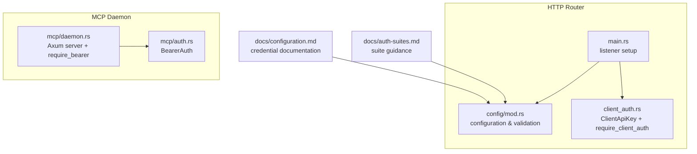
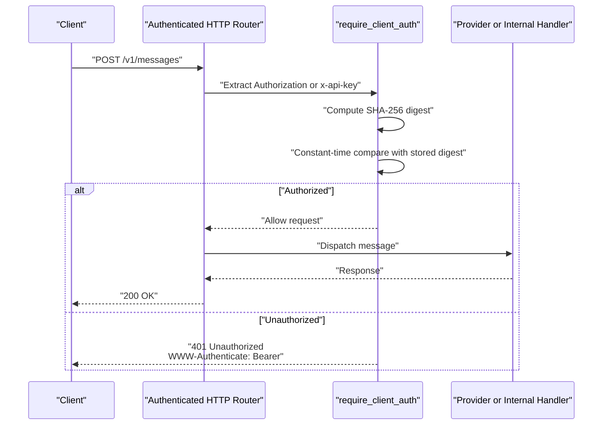
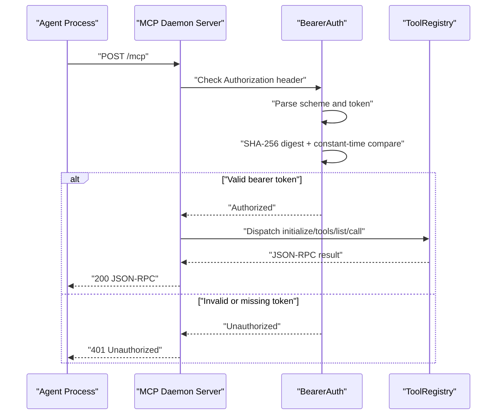
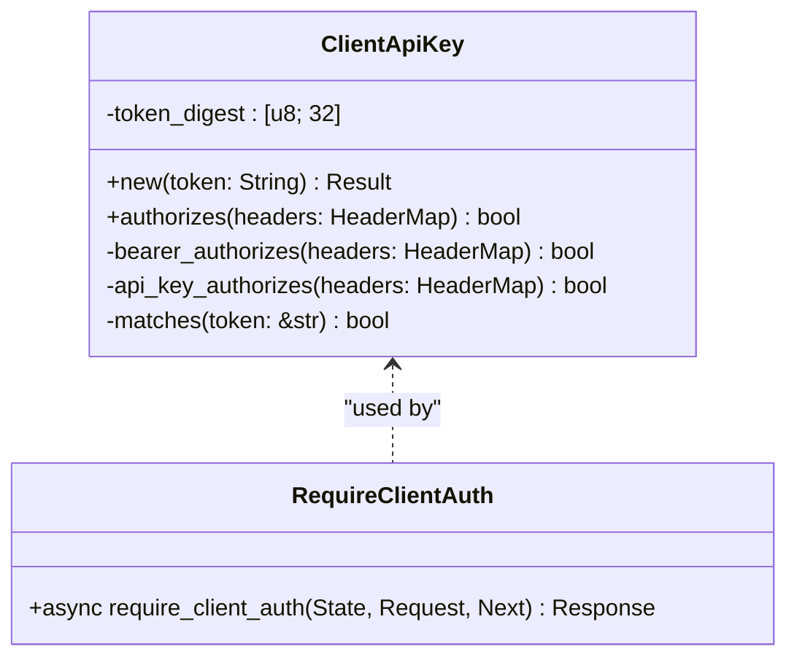
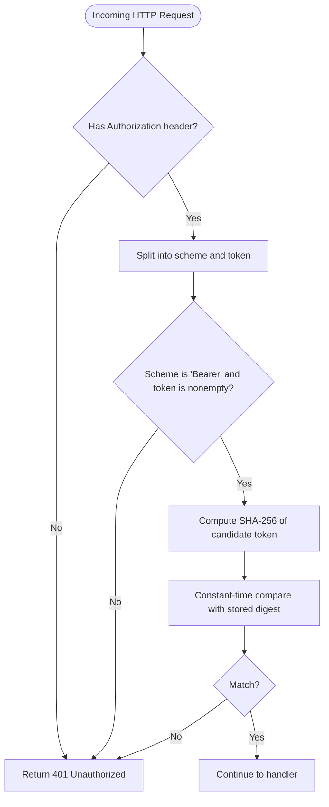
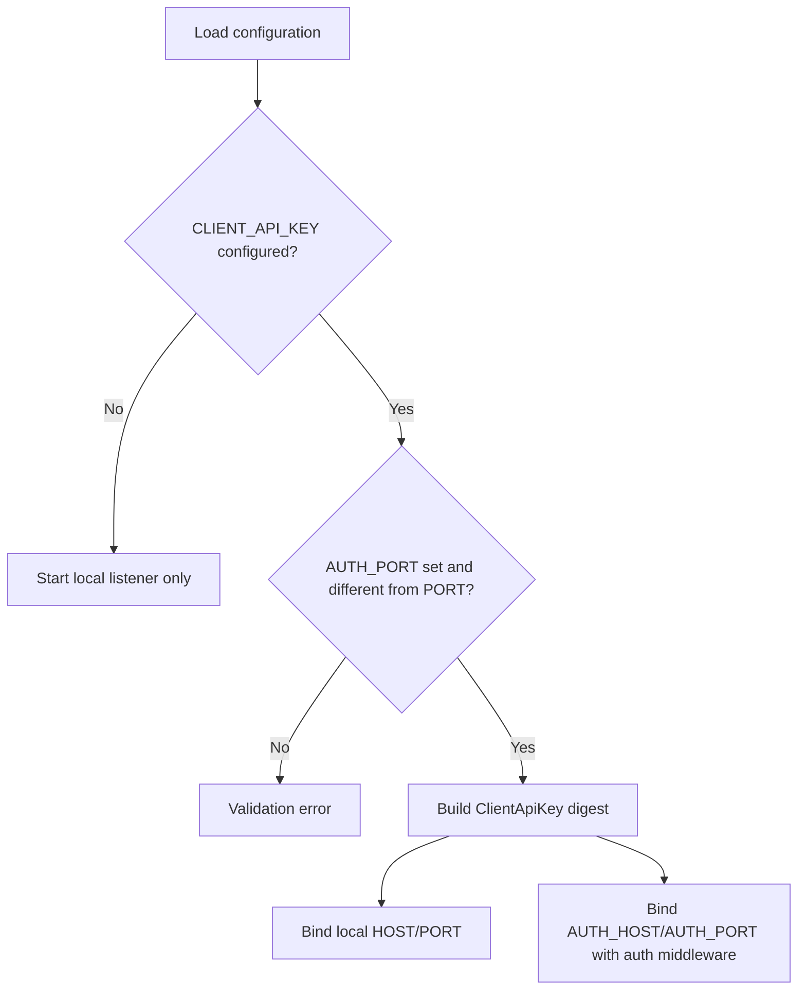
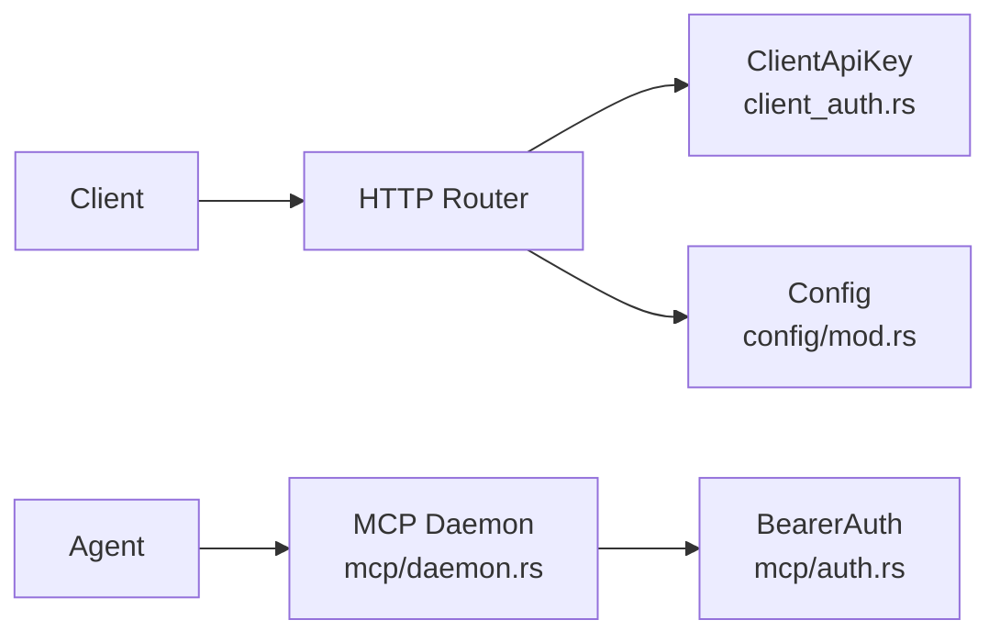

# Authentication and Security

<cite>
**Referenced Files in This Document**
- [src/client_auth.rs](file://src/client_auth.rs)
- [src/mcp/auth.rs](file://src/mcp/auth.rs)
- [src/mcp/daemon.rs](file://src/mcp/daemon.rs)
- [src/config/mod.rs](file://src/config/mod.rs)
- [src/config/types.rs](file://src/config/types.rs)
- [src/main.rs](file://src/main.rs)
- [tests/client_api_auth.rs](file://tests/client_api_auth.rs)
- [docs/auth-suites.md](file://docs/auth-suites.md)
- [docs/configuration.md](file://docs/configuration.md)
</cite>

## Table of Contents
1. [Introduction](#introduction)
2. [Project Structure](#project-structure)
3. [Core Components](#core-components)
4. [Architecture Overview](#architecture-overview)
5. [Detailed Component Analysis](#detailed-component-analysis)
6. [Dependency Analysis](#dependency-analysis)
7. [Performance Considerations](#performance-considerations)
8. [Troubleshooting Guide](#troubleshooting-guide)
9. [Conclusion](#conclusion)
10. [Appendices](#appendices)

## Introduction
This document explains the authentication and security mechanisms implemented in the project, focusing on:
- Bearer token authentication for the MCP daemon.
- Client API key authentication for the main HTTP router.
- Token validation using SHA-256 digests and constant-time comparison.
- Configuration requirements for enabling authenticated listeners.
- Management of API keys and environment-based credential loading.
- Access control boundaries between local and authenticated endpoints.
- Best practices for secure storage, token rotation, network exposure, and integration with external systems.
- Error handling for unauthorized requests and common security vulnerabilities.

The system supports two distinct authentication surfaces:
- **Main HTTP router**: Gated by an optional client API key when `CLIENT_API_KEY` and `AUTH_PORT` are configured.
- **MCP Streamable HTTP daemon**: Gated by a separate bearer token passed through `DaemonArgs.auth_token`.

## Project Structure
Authentication-related code is concentrated in three areas:
- Client-facing API key middleware and model.
- MCP daemon bearer authentication and HTTP server.
- Configuration parsing, validation, and runtime listener setup.

**Diagram sources**
- [src/main.rs:500-640](file://src/main.rs#L500-L640)
- [src/config/mod.rs:380-490](file://src/config/mod.rs#L380-L490)
- [src/client_auth.rs:1-144](file://src/client_auth.rs#L1-L144)
- [src/mcp/daemon.rs:1-200](file://src/mcp/daemon.rs#L1-L200)
- [src/mcp/auth.rs:1-81](file://src/mcp/auth.rs#L1-L81)

**Section sources**
- [src/main.rs:500-640](file://src/main.rs#L500-L640)
- [src/config/mod.rs:380-490](file://src/config/mod.rs#L380-L490)
- [src/client_auth.rs:1-144](file://src/client_auth.rs#L1-L144)
- [src/mcp/daemon.rs:1-200](file://src/mcp/daemon.rs#L1-L200)
- [src/mcp/auth.rs:1-81](file://src/mcp/auth.rs#L1-L81)

## Core Components
The authentication surface consists of:
- `ClientApiKey`: A digest-only representation of a client API key that accepts both standard `Authorization: Bearer` and Anthropic-style `x-api-key` headers.
- `require_client_auth`: Axum middleware that gates most routes while allowing `/health`.
- `BearerAuth`: A digest-only bearer token validator used by the MCP daemon.
- `require_bearer`: MCP daemon middleware enforcing bearer authentication.
- Configuration layer: Validates presence and expansion of `CLIENT_API_KEY`, enforces a dedicated authenticated listener port, and constructs the runtime `ClientApiKey`.

Key properties:
- Tokens are never stored in plaintext; only SHA-256 digests are retained.
- Comparison uses constant-time equality to reduce timing side-channel risk.
- The normal `HOST`/`PORT` listener remains unauthenticated unless explicitly replaced by deployment design; the authenticated listener must be exposed intentionally.
- Health endpoints are treated differently depending on the service.

**Section sources**
- [src/client_auth.rs:1-144](file://src/client_auth.rs#L1-L144)
- [src/mcp/auth.rs:1-81](file://src/mcp/auth.rs#L1-L81)
- [src/config/mod.rs:160-220](file://src/config/mod.rs#L160-L220)
- [src/config/mod.rs:380-490](file://src/config/mod.rs#L380-L490)

## Architecture Overview
There are two independent authentication flows.

### Client API Key Flow
Clients authenticate against the authenticated listener by sending either:
- `Authorization: Bearer <CLIENT_API_KEY>`
- `x-api-key: <CLIENT_API_KEY>`

**Diagram sources**
- [src/client_auth.rs:33-108](file://src/client_auth.rs#L33-L108)
- [tests/client_api_auth.rs:1-137](file://tests/client_api_auth.rs#L1-L137)

### MCP Daemon Bearer Token Flow
The MCP daemon requires a bearer token supplied at startup. Requests without a valid token receive a 401 response.

**Diagram sources**
- [src/mcp/daemon.rs:1-200](file://src/mcp/daemon.rs#L1-L200)
- [src/mcp/auth.rs:1-81](file://src/mcp/auth.rs#L1-L81)

## Detailed Component Analysis

### Client API Key Authentication
`ClientApiKey` is designed for the public-facing HTTP API. It:
- Rejects empty tokens, non-ASCII tokens, and tokens containing ASCII whitespace or control characters.
- Accepts both `Authorization: Bearer` and `x-api-key`.
- Compares candidate tokens against a stored SHA-256 digest using constant-time comparison.
- Is consumed by `require_client_auth`, which allows `/health` without credentials but otherwise rejects unauthorized requests with a structured error and `WWW-Authenticate: Bearer`.

**Diagram sources**
- [src/client_auth.rs:1-144](file://src/client_auth.rs#L1-L144)

Security characteristics:
- No plaintext secret retention.
- Constant-time comparison reduces timing leakage.
- Supports multiple header forms for compatibility with OpenAI and Anthropic clients.

Operational characteristics:
- `/health` bypasses authentication.
- Unauthorized responses return status 401 with a JSON error object.
- The health endpoint test verifies that unauthenticated access still succeeds.

**Section sources**
- [src/client_auth.rs:1-144](file://src/client_auth.rs#L1-L144)
- [tests/client_api_auth.rs:1-137](file://tests/client_api_auth.rs#L1-L137)

### MCP Daemon Bearer Authentication
`BearerAuth` is simpler than `ClientApiKey` and is used exclusively by the MCP daemon:
- Validates the configured token during construction.
- Requires nonempty ASCII input without whitespace or control characters.
- Parses the `Authorization` header and expects a `Bearer` scheme followed by a token.
- Compares the incoming token’s SHA-256 digest against the stored digest using constant-time equality.

The MCP daemon attaches `require_bearer` as middleware over all routes, including `/mcp` and `/health`. Unlike the main router, the MCP daemon’s `/health` is not explicitly exempted from bearer authentication in the middleware implementation shown.

**Diagram sources**
- [src/mcp/auth.rs:1-81](file://src/mcp/auth.rs#L1-L81)
- [src/mcp/daemon.rs:1-200](file://src/mcp/daemon.rs#L1-L200)

**Section sources**
- [src/mcp/auth.rs:1-81](file://src/mcp/auth.rs#L1-L81)
- [src/mcp/daemon.rs:1-200](file://src/mcp/daemon.rs#L1-L200)

### Configuration and Listener Boundaries
Configuration controls whether an authenticated listener is started:
- `CLIENT_API_KEY` enables client API key authentication.
- `AUTH_HOST` and `AUTH_PORT` define the dedicated authenticated listener.
- Validation requires `AUTH_PORT` when `CLIENT_API_KEY` is present.
- Validation prevents `AUTH_PORT` from being the same as `PORT`.
- Unexpanded placeholders in `CLIENT_API_KEY` are rejected unless overridden for loopback-only setups.

At runtime, `main.rs` builds two routers:
- Local router: no client auth middleware.
- Authenticated router: wraps routes with `require_client_auth`.

**Diagram sources**
- [src/config/mod.rs:160-220](file://src/config/mod.rs#L160-L220)
- [src/config/mod.rs:380-490](file://src/config/mod.rs#L380-L490)
- [src/main.rs:500-640](file://src/main.rs#L500-L640)

**Section sources**
- [src/config/mod.rs:160-220](file://src/config/mod.rs#L160-L220)
- [src/config/mod.rs:380-490](file://src/config/mod.rs#L380-L490)
- [src/main.rs:500-640](file://src/main.rs#L500-L640)

### API Keys and Provider Credentials
Provider API keys are part of provider configuration and are used when forwarding requests to upstream providers. They are distinct from `CLIENT_API_KEY`:
- `CLIENT_API_KEY` authenticates clients calling CCR.
- Provider `api_key` authenticates CCR calls to upstream providers.
- Environment variable expansion is supported for provider credentials and `CLIENT_API_KEY`.
- Unexpanded placeholders can cause startup or routing errors, with explicit diagnostics.

The configuration schema includes fields such as:
- Provider-level `api_key`.
- Optional `auth_header` behavior.
- Client-facing `CLIENT_API_KEY`.
- Dedicated `AUTH_HOST` and `AUTH_PORT`.

**Section sources**
- [src/config/types.rs:292-319](file://src/config/types.rs#L292-L319)
- [docs/configuration.md:1-200](file://docs/configuration.md#L1-L200)

### Security Policies and Access Control
Current security policy summary:
- The normal local listener does not enforce client API key authentication.
- The authenticated listener enforces client API key authentication for most routes.
- `/health` is allowed without a client API key on the authenticated router.
- MCP daemon routes are protected by bearer authentication.
- Separate suites should use separate processes, ports, and credential stores to avoid cross-account fallback mixing.

Important boundary note:
- Ports alone are not an access-control boundary. If a listener is reachable externally, authentication must be enforced at the transport or proxy layer.

**Section sources**
- [docs/auth-suites.md:1-200](file://docs/auth-suites.md#L1-L200)
- [src/client_auth.rs:72-108](file://src/client_auth.rs#L72-L108)
- [src/mcp/daemon.rs:150-200](file://src/mcp/daemon.rs#L150-L200)

## Dependency Analysis
The authentication components have clear separation:

Coupling notes:
- `main.rs` depends on `config/mod.rs` to parse and validate configuration and construct the router.
- `router::require_client_auth` is re-exported from `client_auth.rs` and applied conditionally based on authentication mode.
- `mcp/daemon.rs` directly depends on `mcp/auth.rs` for bearer validation.
- Tests validate both successful authorization and unauthorized rejection.

**Diagram sources**
- [src/main.rs:500-640](file://src/main.rs#L500-L640)
- [src/client_auth.rs:1-144](file://src/client_auth.rs#L1-L144)
- [src/mcp/daemon.rs:1-200](file://src/mcp/daemon.rs#L1-L200)
- [src/mcp/auth.rs:1-81](file://src/mcp/auth.rs#L1-L81)

**Section sources**
- [src/main.rs:500-640](file://src/main.rs#L500-L640)
- [src/client_auth.rs:1-144](file://src/client_auth.rs#L1-L144)
- [src/mcp/daemon.rs:1-200](file://src/mcp/daemon.rs#L1-L200)
- [src/mcp/auth.rs:1-81](file://src/mcp/auth.rs#L1-L81)

## Performance Considerations
- Each authentication check computes a SHA-256 digest over the candidate token. This is inexpensive compared to upstream provider calls and streaming workloads.
- Constant-time comparison avoids leaking timing information about token matches.
- Storing only digests avoids repeated hashing of secrets at process start, though candidate tokens are hashed per request.
- There is no caching layer for failed authentication attempts; rate limiting should be provided by a reverse proxy or gateway if brute-force protection is required.
- Large request bodies are limited globally through `MAX_REQUEST_BODY_BYTES`; this helps mitigate resource exhaustion.

[No sources needed since this section provides general guidance derived from earlier sections]

## Troubleshooting Guide

### Common Unauthorized Errors
- Missing `Authorization` header on the MCP daemon returns 401.
- Wrong bearer token returns 401.
- Wrong client API key returns 401 with a structured error and `WWW-Authenticate: Bearer`.
- Using the wrong listener: requests sent to the local `HOST`/`PORT` do not require `CLIENT_API_KEY`.

### Configuration Problems
- `CLIENT_API_KEY` without `AUTH_PORT`: configuration validation fails because the authenticated listener is required when a client API key is present.
- `AUTH_PORT` equal to `PORT`: configuration validation fails because the authenticated listener cannot displace the local listener.
- Unexpanded `CLIENT_API_KEY`: startup fails unless explicitly overridden for loopback-only development.

### Diagnostic Steps
1. Verify the correct listener is being targeted:
   - Local unauthenticated listener: `HOST`/`PORT`.
   - Authenticated listener: `AUTH_HOST`/`AUTH_PORT`.
2. Confirm the client sends one of the accepted headers:
   - `Authorization: Bearer <CLIENT_API_KEY>`
   - `x-api-key: <CLIENT_API_KEY>`
3. For MCP daemon, confirm the bearer token was passed at startup and that the client sends a valid `Authorization: Bearer` header.
4. Review logs for listener binding messages indicating whether the authenticated listener started.

**Section sources**
- [src/client_auth.rs:72-108](file://src/client_auth.rs#L72-L108)
- [src/mcp/daemon.rs:150-200](file://src/mcp/daemon.rs#L150-L200)
- [src/config/mod.rs:160-220](file://src/config/mod.rs#L160-L220)
- [tests/client_api_auth.rs:1-137](file://tests/client_api_auth.rs#L1-L137)

## Conclusion
The project implements focused, digest-based authentication for two surfaces:
- The main HTTP router uses a client API key with support for both standard and Anthropic-compatible header formats.
- The MCP daemon uses a bearer token validated through SHA-256 and constant-time comparison.

Security relies on:
- Avoiding plaintext secret retention.
- Enforcing a dedicated authenticated listener.
- Validating configuration constraints before serving traffic.
- Clear separation between local and authenticated endpoints.

For production deployments, additional protections such as TLS termination, reverse-proxy rate limiting, IP allowlisting, audit logging, and centralized secret management should be layered around these built-in mechanisms.

[No sources needed since this section summarizes without analyzing specific files]

## Appendices

### Configuration Options Summary

| Option | Purpose | Behavior |
|---|---|---|
| `CLIENT_API_KEY` | Client-facing API key | Enables authenticated listener and requires bearer or `x-api-key` authentication |
| `AUTH_HOST` | Authenticated listener host | Must be a valid IP address |
| `AUTH_PORT` | Authenticated listener port | Required when `CLIENT_API_KEY` is set; must differ from `PORT` |
| `PORT` | Local listener port | Remains unauthenticated by default |
| `HOST` | Local listener host | Historical local contract |
| Provider `api_key` | Upstream provider credential | Used when forwarding requests to providers |
| Provider `auth_header` | Controls upstream header selection | Defaults affect whether `x-api-key` or `Authorization` is used |

**Section sources**
- [src/config/mod.rs:380-490](file://src/config/mod.rs#L380-L490)
- [src/config/types.rs:292-319](file://src/config/types.rs#L292-L319)
- [docs/configuration.md:1-200](file://docs/configuration.md#L1-L200)

### Best Practices

#### Token Rotation
- Rotate `CLIENT_API_KEY` by updating the environment or secret store and restarting the process so a new digest is loaded.
- Rotate MCP daemon bearer tokens by updating the startup argument or secret source and restarting the daemon.
- Use short-lived tokens where possible at the deployment boundary (reverse proxy, API gateway).
- Ensure old tokens are revoked promptly after rotation.

#### Secure Storage
- Prefer environment variables or a trusted secret manager over hardcoded values.
- Keep `credentials.env` and suite directories outside version control.
- Restrict filesystem permissions to the owning user.
- Avoid printing secrets in logs, CLI flags, issue comments, or documentation.

#### Network Security
- Expose only the authenticated listener externally.
- Bind local listeners to loopback unless explicitly intended for broader access.
- Use TLS termination at a reverse proxy or load balancer.
- Apply rate limiting and IP allowlisting at the network edge.
- Treat ports as convenience boundaries, not security boundaries.

#### External Authentication Integration
- Use a reverse proxy to integrate with OAuth, mTLS, JWT verification, or corporate identity providers.
- Forward the chosen identity downstream as an application-layer header if needed.
- Keep CCR’s `CLIENT_API_KEY` as a secondary defense-in-depth key rather than the sole identity mechanism.

#### Vulnerability Mitigations
- Timing attacks: mitigated by constant-time comparison of token digests.
- Plaintext secret leakage: mitigated by storing only SHA-256 digests.
- Misconfigured listeners: mitigated by validation requiring `AUTH_PORT` and preventing it from equaling `PORT`.
- Cross-account fallback risks: mitigated by running separate processes and disjoint configurations per suite.
- Brute force: not handled by application logic; rely on infrastructure rate limiting.

**Section sources**
- [docs/auth-suites.md:1-200](file://docs/auth-suites.md#L1-L200)
- [src/client_auth.rs:1-144](file://src/client_auth.rs#L1-L144)
- [src/mcp/auth.rs:1-81](file://src/mcp/auth.rs#L1-L81)
- [src/config/mod.rs:160-220](file://src/config/mod.rs#L160-L220)