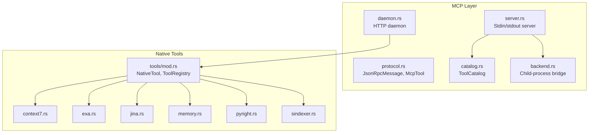
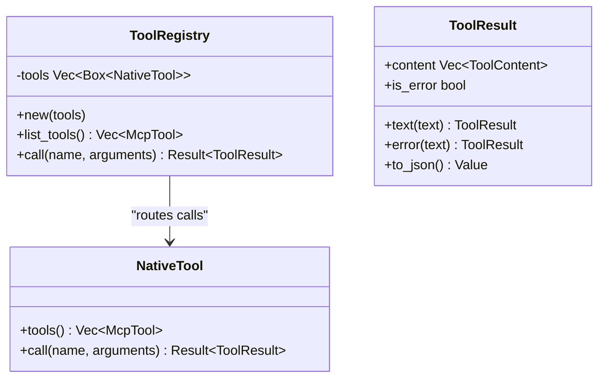
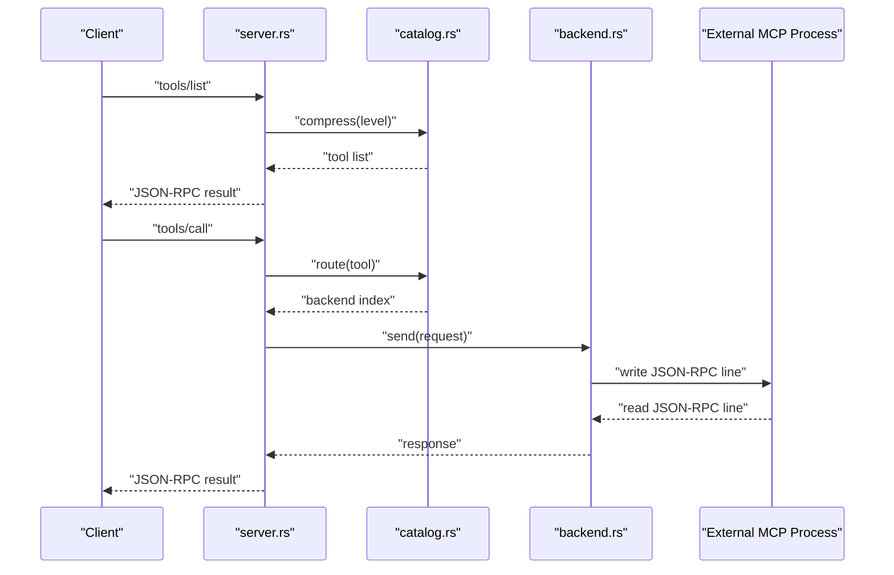
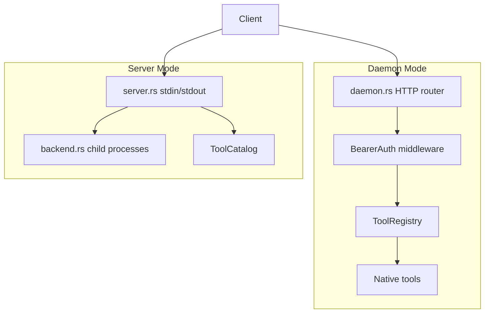
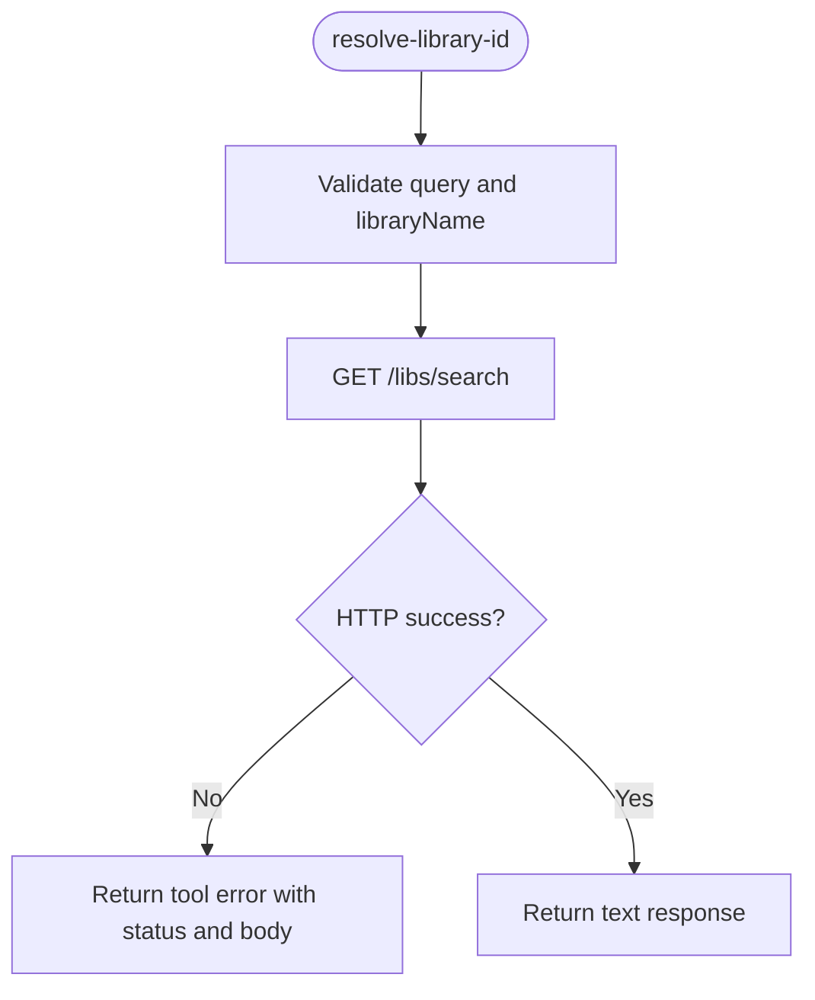
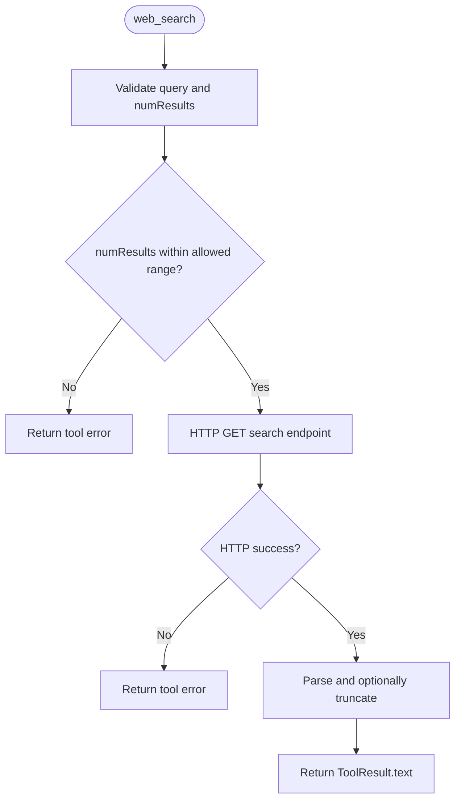
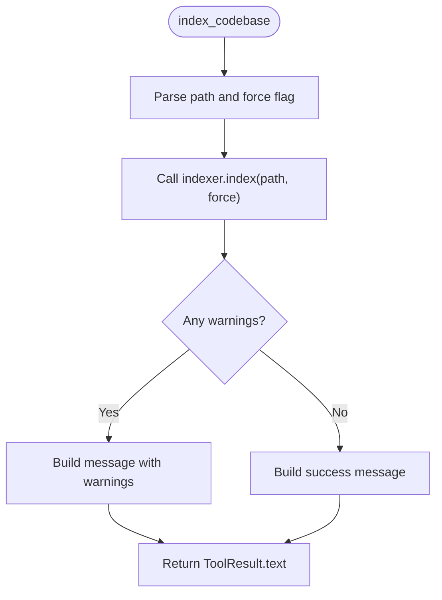
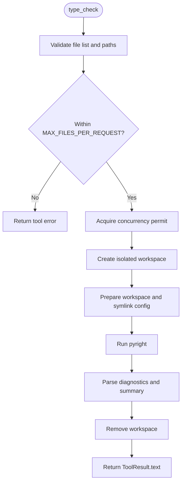
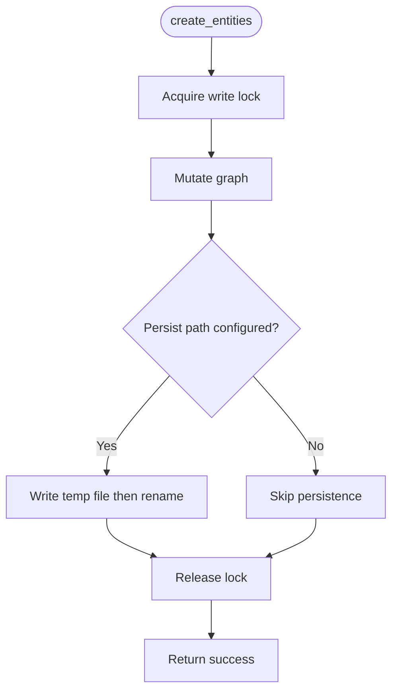
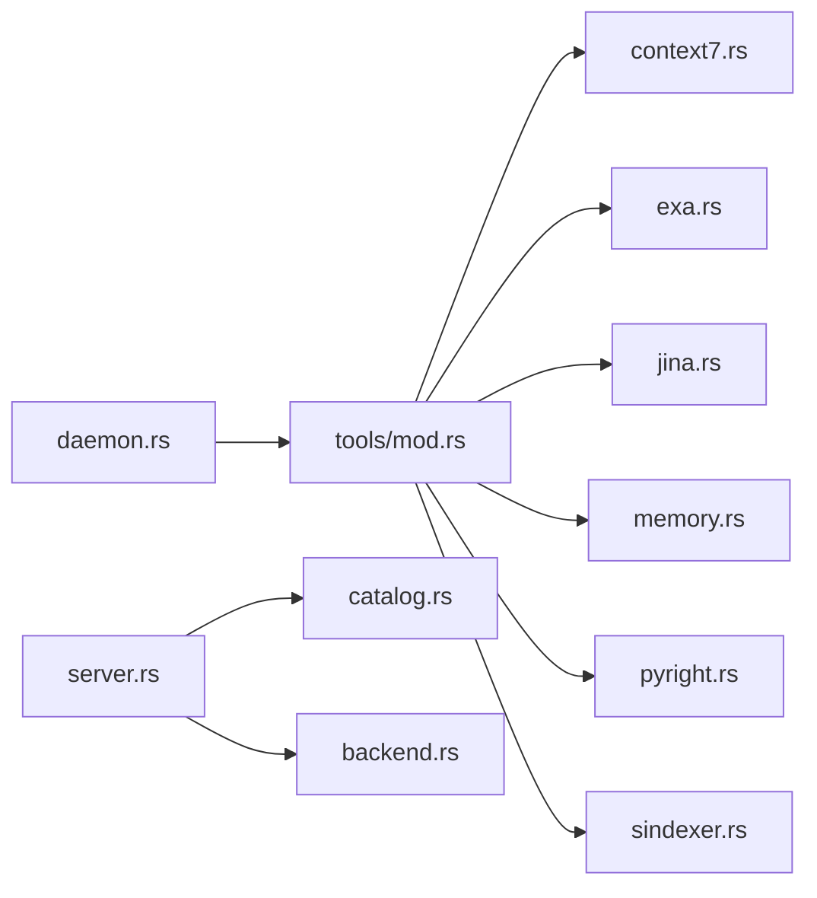

# Custom Tool Development

<cite>
**Referenced Files in This Document**
- [mod.rs](file://src/mcp/mod.rs)
- [protocol.rs](file://src/mcp/protocol.rs)
- [tools/mod.rs](file://src/mcp/tools/mod.rs)
- [catalog.rs](file://src/mcp/catalog.rs)
- [backend.rs](file://src/mcp/backend.rs)
- [server.rs](file://src/mcp/server.rs)
- [daemon.rs](file://src/mcp/daemon.rs)
- [context7.rs](file://src/mcp/tools/context7.rs)
- [exa.rs](file://src/mcp/tools/exa.rs)
- [jina.rs](file://src/mcp/tools/jina.rs)
- [memory.rs](file://src/mcp/tools/memory.rs)
- [pyright.rs](file://src/mcp/tools/pyright.rs)
- [sindexer.rs](file://src/mcp/tools/sindexer.rs)
</cite>

## Table of Contents
1. [Introduction](#introduction)
2. [Project Structure](#project-structure)
3. [Core Components](#core-components)
4. [Architecture Overview](#architecture-overview)
5. [Detailed Component Analysis](#detailed-component-analysis)
6. [Dependency Analysis](#dependency-analysis)
7. [Performance Considerations](#performance-considerations)
8. [Troubleshooting Guide](#troubleshooting-guide)
9. [Conclusion](#conclusion)
10. [Appendices](#appendices)

## Introduction
This document explains how to create custom Model Context Protocol (MCP) tools for the project’s MCP layer. It covers:

- The tool development interface and required trait implementation.
- Two plugin architectures: native Rust tools and external JSON-RPC backends.
- Tool lifecycle, parameter validation, and response formatting.
- Built-in tool patterns: context search, web search, file indexing, code analysis, and memory management.
- Best practices for design, error handling, testing, debugging, and deployment.

The MCP subsystem exposes a protocol for listing and calling tools. Tools can be implemented directly in Rust or delegated to child processes that communicate over JSON-RPC.

## Project Structure
The MCP feature is organized under `src/mcp`. The key directories and files are:

- `src/mcp/mod.rs`: Module declarations.
- `src/mcp/protocol.rs`: JSON-RPC message model and tool schema types.
- `src/mcp/tools/mod.rs`: Native tool trait, result wrapper, and registry.
- `src/mcp/tools/*.rs`: Built-in native tools.
- `src/mcp/backend.rs`: External MCP backend process bridge.
- `src/mcp/catalog.rs`: Tool catalog with routing and description compression.
- `src/mcp/server.rs`: Stdin/stdout MCP server proxying calls to backends.
- `src/mcp/daemon.rs`: HTTP daemon hosting native tools behind bearer authentication.

**Diagram sources**
- [protocol.rs:1-40](file://src/mcp/protocol.rs#L1-L40)
- [catalog.rs:1-72](file://src/mcp/catalog.rs#L1-L72)
- [server.rs:1-227](file://src/mcp/server.rs#L1-L227)
- [daemon.rs:1-319](file://src/mcp/daemon.rs#L1-L319)
- [backend.rs:1-136](file://src/mcp/backend.rs#L1-L136)
- [tools/mod.rs:1-98](file://src/mcp/tools/mod.rs#L1-L98)
- [context7.rs:1-164](file://src/mcp/tools/context7.rs#L1-L164)
- [exa.rs:1-177](file://src/mcp/tools/exa.rs#L1-L177)
- [jina.rs:1-200](file://src/mcp/tools/jina.rs#L1-L200)
- [memory.rs:1-200](file://src/mcp/tools/memory.rs#L1-L200)
- [pyright.rs:1-200](file://src/mcp/tools/pyright.rs#L1-L200)
- [sindexer.rs:1-200](file://src/mcp/tools/sindexer.rs#L1-L200)

**Section sources**
- [mod.rs:1-8](file://src/mcp/mod.rs#L1-L8)

## Core Components
This section defines the core interfaces you need to implement when creating a custom tool.

### Tool Schema and Protocol Types
- `JsonRpcMessage` models JSON-RPC messages with optional fields such as `jsonrpc`, `id`, `method`, `params`, `result`, and `error`.
- `McpTool` describes a tool’s name, description, and JSON Schema input definition.
- `McpToolCallParams` carries the tool name and arguments for a call.

These types are used by both the native daemon and the external backend pipeline.

**Section sources**
- [protocol.rs:1-40](file://src/mcp/protocol.rs#L1-L40)

### Native Tool Interface
The native tool API is defined by the `NativeTool` trait:

- `tools() -> Vec<McpTool>`: declares available tool names, descriptions, and schemas.
- `call(name, arguments) -> Result<ToolResult>`: executes a named tool with structured arguments.

A `ToolRegistry` aggregates multiple tools and routes calls by name. If no tool matches, it returns an error result rather than panicking.

`ToolResult` provides:

- `text(text)` for successful text responses.
- `error(text)` for tool-level errors surfaced to callers.
- `to_json()` for serialization into the standard MCP tool result shape.

**Diagram sources**
- [tools/mod.rs:1-98](file://src/mcp/tools/mod.rs#L1-L98)

**Section sources**
- [tools/mod.rs:1-98](file://src/mcp/tools/mod.rs#L1-L98)

### External Backend Bridge
An external MCP backend is a separate process started from a shell command. Communication uses line-delimited JSON-RPC messages:

- The server writes one JSON object per line followed by a newline.
- Responses are read line-by-line; notifications and unmatched IDs are skipped.
- `list_tools()` sends a standardized `tools/list` request and decodes the result.
- On drop, the child process is killed.

**Diagram sources**
- [server.rs:1-227](file://src/mcp/server.rs#L1-L227)
- [catalog.rs:1-72](file://src/mcp/catalog.rs#L1-L72)
- [backend.rs:1-136](file://src/mcp/backend.rs#L1-L136)

**Section sources**
- [backend.rs:1-136](file://src/mcp/backend.rs#L1-L136)

### Tool Catalog
The catalog maintains:

- A list of `McpTool` entries.
- A route mapping from tool name to backend index.
- Description compression based on a level string (`none`, `minimal`/`min`/`high`/`aggressive`, `medium`/`light`, `full`).

It also supports include/exclude filtering at startup for the stdin/stdout server.

**Section sources**
- [catalog.rs:1-72](file://src/mcp/catalog.rs#L1-L72)

## Architecture Overview
There are two runtime modes:

1. **Daemon mode**: an HTTP service exposing `/mcp` and `/health`, authenticating requests via Bearer token, and dispatching `tools/list` and `tools/call` to native tools registered through `ToolRegistry`.
2. **Server mode**: a stdin/stdout JSON-RPC proxy that starts one or more external backends, builds a catalog, compresses descriptions, and forwards `tools/list` and `tools/call` to the appropriate backend.

**Diagram sources**
- [daemon.rs:1-319](file://src/mcp/daemon.rs#L1-L319)
- [server.rs:1-227](file://src/mcp/server.rs#L1-L227)
- [backend.rs:1-136](file://src/mcp/backend.rs#L1-L136)
- [catalog.rs:1-72](file://src/mcp/catalog.rs#L1-L72)
- [tools/mod.rs:1-98](file://src/mcp/tools/mod.rs#L1-L98)

**Section sources**
- [daemon.rs:1-319](file://src/mcp/daemon.rs#L1-L319)
- [server.rs:1-227](file://src/mcp/server.rs#L1-L227)

## Detailed Component Analysis

### Tool Development Interface
To implement a custom native tool:

1. Create a struct holding any shared state, such as an HTTP client or configuration.
2. Implement `NativeTool`:
   - Return tool definitions in `tools()`.
   - Validate parameters in `call()`.
   - Return `ToolResult::text(...)` for success and `ToolResult::error(...)` for tool-level failures.
3. Register the tool in the daemon by pushing it into the tools vector before constructing `ToolRegistry`.

Recommended validation strategy:

- Use `serde_json::Value` accessors such as `get().and_then(|v| v.as_str())`.
- Treat missing required fields as tool errors using `ToolResult::error(...)`.
- Enforce bounds and allowed values before making external calls.

Response formatting:

- Prefer plain text responses serialized with `ToolResult::text(...)`.
- For structured outputs, serialize to a JSON string and wrap it in text content.
- Avoid returning arbitrary nested objects directly from tool implementations; let `ToolResult.to_json()` produce the canonical MCP envelope.

Best practices:

- Keep tool names stable and descriptive.
- Write concise but complete descriptions so clients can understand tool purpose.
- Provide a precise JSON Schema for inputs, including `required`, `type`, and constraints where possible.
- Log diagnostics with tracing at debug/info/warn levels.
- Never return unbounded data without limits; truncate or summarize when needed.

**Section sources**
- [tools/mod.rs:1-98](file://src/mcp/tools/mod.rs#L1-L98)

### Built-in Tool Patterns

#### Context Search Pattern
The Context7 tool demonstrates a library documentation lookup workflow:

- `resolve-library-id`: resolves a query and library name into a library identifier.
- `query-docs`: retrieves documentation and examples using the resolved library ID.

Validation and flow:

- Required fields are validated before issuing HTTP requests.
- Non-success HTTP statuses are converted into tool errors with status and response body.
- Successful responses are returned as text.

**Diagram sources**
- [context7.rs:1-164](file://src/mcp/tools/context7.rs#L1-L164)

**Section sources**
- [context7.rs:1-164](file://src/mcp/tools/context7.rs#L1-L164)

#### Web Search Pattern
Two built-in web search tools illustrate consistent patterns:

- Exa: `web_search_exa` and `web_fetch_exa`.
- Jina: `web_search_jina` and `web_fetch_jina`.

Common elements:

- Natural language query validation.
- Optional numeric parameters with defaults and bounds.
- HTTP requests authenticated via bearer tokens.
- Non-success statuses returned as tool errors.
- Fetch endpoints accepting URL arrays with batch size limits.

Jina-specific notes:

- Enforces maximum concurrent fetches and per-request timeouts.
- Applies headers to avoid caching and tracking.
- Truncates search results to respect configured limits.

**Diagram sources**
- [exa.rs:1-177](file://src/mcp/tools/exa.rs#L1-L177)
- [jina.rs:1-200](file://src/mcp/tools/jina.rs#L1-L200)

**Section sources**
- [exa.rs:1-177](file://src/mcp/tools/exa.rs#L1-L177)
- [jina.rs:1-200](file://src/mcp/tools/jina.rs#L1-L200)

#### File Indexing Pattern
The optional sindexer tool provides semantic code indexing:

- `index_codebase`: indexes a directory, optionally forcing re-index.
- `search_code`: searches indexed collections with natural language queries.
- `get_indexing_status`, `clear_index`, `list_collections`, `collection_stats`, `drop_collection`: manage index state.

Implementation pattern:

- Wrap an external indexer type behind a simple native tool interface.
- Convert indexer results into user-friendly JSON strings.
- Expose all operations as distinct tool names.

**Diagram sources**
- [sindexer.rs:1-200](file://src/mcp/tools/sindexer.rs#L1-L200)

**Section sources**
- [sindexer.rs:1-200](file://src/mcp/tools/sindexer.rs#L1-L200)

#### Code Analysis Pattern
The Pyright tool performs Python type checking:

- Accepts relative file paths and content snapshots.
- Creates an isolated workspace, symlinks project configuration, and runs pyright.
- Parses diagnostics and returns a summary plus structured diagnostic records.
- Uses a semaphore to limit concurrency.
- Cleans up temporary workspaces after execution.

Security and safety:

- Rejects absolute paths and parent-directory traversal.
- Limits maximum files per request.
- Isolates workspace directories per invocation.

**Diagram sources**
- [pyright.rs:1-200](file://src/mcp/tools/pyright.rs#L1-L200)

**Section sources**
- [pyright.rs:1-200](file://src/mcp/tools/pyright.rs#L1-L200)

#### Memory Management Pattern
The memory tool implements an in-memory knowledge graph backed by optional persistent JSON:

- Entities and relations are modeled explicitly.
- Read/write operations are protected by a reader-writer lock.
- Persistence writes atomically using a temporary file followed by rename.
- Supports create, update, delete, and read operations across entities, observations, and relations.

**Diagram sources**
- [memory.rs:1-200](file://src/mcp/tools/memory.rs#L1-L200)

**Section sources**
- [memory.rs:1-200](file://src/mcp/tools/memory.rs#L1-L200)

### Step-by-Step Guides for Built-in Patterns

#### Context Search Tool Template
1. Define tool names and schemas for library resolution and documentation queries.
2. Validate required parameters before making HTTP requests.
3. Handle non-success HTTP responses as tool errors.
4. Return successful responses as text.
5. Register the tool in the daemon’s tools vector.

Key references:
- Tool declaration and registration: [daemon.rs:1-200](file://src/mcp/daemon.rs#L1-L200)
- Context7 implementation: [context7.rs:1-164](file://src/mcp/tools/context7.rs#L1-L164)

#### Web Search Tool Template
1. Choose a provider pattern: search-only, fetch-only, or both.
2. Validate query and numeric parameters with clear bounds.
3. Attach authentication headers.
4. Enforce batch limits for fetch endpoints.
5. Normalize errors into tool errors with actionable messages.

Key references:
- Exa tool: [exa.rs:1-177](file://src/mcp/tools/exa.rs#L1-L177)
- Jina tool: [jina.rs:1-200](file://src/mcp/tools/jina.rs#L1-L200)
- Daemon configuration: [daemon.rs:1-200](file://src/mcp/daemon.rs#L1-L200)

#### File Indexing Tool Template
1. Wrap an external indexer abstraction.
2. Expose indexing, searching, status, cleanup, and collection management tools.
3. Serialize indexer results into readable JSON strings.
4. Mark optional features behind compile-time flags if needed.

Key references:
- Sindexer tool: [sindexer.rs:1-200](file://src/mcp/tools/sindexer.rs#L1-L200)
- Conditional compilation: [tools/mod.rs:1-20](file://src/mcp/tools/mod.rs#L1-L20)

#### Code Analysis Tool Template
1. Validate input files and reject unsafe paths.
2. Limit concurrency with a semaphore.
3. Use isolated workspaces for each request.
4. Parse analyzer output into structured diagnostics.
5. Clean up temporary resources.

Key references:
- Pyright tool: [pyright.rs:1-200](file://src/mcp/tools/pyright.rs#L1-L200)

#### Memory Management Tool Template
1. Model your domain with explicit structs.
2. Protect mutable state with a reader-writer lock.
3. Optionally persist changes atomically.
4. Provide CRUD-like tool operations.
5. Surface errors for invalid entity references or malformed inputs.

Key references:
- Memory tool: [memory.rs:1-200](file://src/mcp/tools/memory.rs#L1-L200)

### Parameter Validation Strategy
Across built-in tools, parameter validation follows these principles:

- Require essential fields and treat their absence as tool errors.
- Clamp numeric ranges and enforce type constraints.
- Sanitize filesystem paths to prevent traversal and absolute-path escapes.
- Fail fast before performing expensive I/O or subprocess calls.
- Preserve human-readable error messages for clients.

Validation examples appear in:
- Context7 required-field checks: [context7.rs:80-164](file://src/mcp/tools/context7.rs#L80-L164)
- Exa/Jina numeric bounds: [exa.rs:120-177](file://src/mcp/tools/exa.rs#L120-L177), [jina.rs:120-200](file://src/mcp/tools/jina.rs#L120-L200)
- Pyright path and count limits: [pyright.rs:120-200](file://src/mcp/tools/pyright.rs#L120-L200)
- Sindexer required-field parsing: [sindexer.rs:150-200](file://src/mcp/tools/sindexer.rs#L150-L200)

**Section sources**
- [context7.rs:80-164](file://src/mcp/tools/context7.rs#L80-L164)
- [exa.rs:120-177](file://src/mcp/tools/exa.rs#L120-L177)
- [jina.rs:120-200](file://src/mcp/tools/jina.rs#L120-L200)
- [pyright.rs:120-200](file://src/mcp/tools/pyright.rs#L120-L200)
- [sindexer.rs:150-200](file://src/mcp/tools/sindexer.rs#L150-L200)

### Response Formatting
All native tools return `ToolResult`, which serializes into a standard MCP envelope containing:

- `content`: an array of content items, typically text.
- `isError`: indicates whether the tool reported an error.

For external backends, the server forwards the child process’s JSON-RPC response directly, while the daemon wraps native tool results through `ToolResult.to_json()`.

References:
- Native result wrapper: [tools/mod.rs:14-63](file://src/mcp/tools/mod.rs#L14-L63)
- Daemon response wrapping: [daemon.rs:230-319](file://src/mcp/daemon.rs#L230-L319)
- Server JSON-RPC framing: [server.rs:150-227](file://src/mcp/server.rs#L150-L227)

**Section sources**
- [tools/mod.rs:14-63](file://src/mcp/tools/mod.rs#L14-L63)
- [daemon.rs:230-319](file://src/mcp/daemon.rs#L230-L319)
- [server.rs:150-227](file://src/mcp/server.rs#L150-L227)

## Dependency Analysis
The MCP subsystem has two main dependency directions:

- Daemon mode depends on concrete native tool implementations and bearer authentication.
- Server mode depends on the external backend bridge and the tool catalog.

**Diagram sources**
- [daemon.rs:1-200](file://src/mcp/daemon.rs#L1-L200)
- [tools/mod.rs:1-98](file://src/mcp/tools/mod.rs#L1-L98)
- [server.rs:1-227](file://src/mcp/server.rs#L1-L227)
- [catalog.rs:1-72](file://src/mcp/catalog.rs#L1-L72)
- [backend.rs:1-136](file://src/mcp/backend.rs#L1-L136)

Coupling notes:

- `ToolRegistry` couples call routing to tool names declared by each tool.
- `ToolCatalog` couples tool discovery to backend indices.
- External backends depend on strict JSON-RPC framing conventions.
- Native tools should remain independent of transport details.

Potential circular dependencies:

- None observed between MCP modules; tools depend only on protocol types and the native tool interface.

**Section sources**
- [daemon.rs:1-200](file://src/mcp/daemon.rs#L1-L200)
- [server.rs:1-227](file://src/mcp/server.rs#L1-L227)
- [catalog.rs:1-72](file://src/mcp/catalog.rs#L1-L72)
- [backend.rs:1-136](file://src/mcp/backend.rs#L1-L136)
- [tools/mod.rs:1-98](file://src/mcp/tools/mod.rs#L1-L98)

## Performance Considerations
- Concurrency control: use semaphores for CPU-bound or I/O-heavy tools, as seen with Pyright.
- Batch limits: constrain arrays like URL lists and file lists to avoid oversized payloads.
- Streaming considerations: current tools return complete text responses; consider streaming for very large outputs.
- Resource cleanup: remove temporary workspaces promptly after tool execution.
- Backend process lifecycle: external backends are killed on drop; ensure long-running backends handle graceful shutdown if extended.
- Catalog compression: reduce description sizes for constrained contexts to lower token usage.

[No sources needed since this section provides general guidance]

## Troubleshooting Guide

### Common Errors and Resolutions
- Unknown tool name:
  - Native daemon: routed through `ToolRegistry.call`; unknown names return a tool error.
  - External server: `catalog.route` returns no route, resulting in an unknown-tool JSON-RPC error.
- Invalid JSON-RPC frame:
  - Server mode returns parse errors for malformed frames.
  - External backend rejects invalid frames during deserialization.
- Missing parameters:
  - Tools should validate required fields and return tool errors rather than panicking.
- Backend process exits unexpectedly:
  - The backend bridge detects EOF and reports the child’s exit status.
- Authentication failures:
  - Daemon mode requires a valid Bearer token; unauthorized requests receive a 401 challenge.

Operational tips:

- Enable tracing logs around tool entry points and HTTP requests.
- Inspect `ToolResult.isError` to distinguish tool errors from system errors.
- Verify tool schemas match actual argument structures.
- Test external backends independently by sending JSON-RPC lines to their stdin.

**Section sources**
- [tools/mod.rs:65-98](file://src/mcp/tools/mod.rs#L65-L98)
- [catalog.rs:45-72](file://src/mcp/catalog.rs#L45-L72)
- [server.rs:60-150](file://src/mcp/server.rs#L60-L150)
- [backend.rs:40-120](file://src/mcp/backend.rs#L40-L120)
- [daemon.rs:200-319](file://src/mcp/daemon.rs#L200-L319)

## Conclusion
Custom MCP tools in this project follow a consistent pattern: declare tool metadata, validate inputs strictly, perform bounded work, and return structured `ToolResult` values. Native tools integrate through `ToolRegistry`, while external tools integrate through the JSON-RPC backend bridge. The built-in tools provide reusable templates for context search, web search, code indexing, code analysis, and memory management. When designing new tools, prioritize clear schemas, robust validation, safe resource handling, informative errors, and measurable performance characteristics.

[No sources needed since this section summarizes without analyzing specific files]

## Appendices

### A. Native Tool Checklist
- Implement `NativeTool`.
- Return stable tool names and concise descriptions.
- Provide accurate JSON Schema inputs.
- Validate all required parameters.
- Bound and sanitize sensitive inputs.
- Return `ToolResult::text` for success and `ToolResult::error` for failures.
- Register the tool in the daemon’s tools vector.
- Add tracing for entry, success, and failure paths.

**Section sources**
- [tools/mod.rs:1-98](file://src/mcp/tools/mod.rs#L1-L98)
- [daemon.rs:1-200](file://src/mcp/daemon.rs#L1-L200)

### B. External Backend Checklist
- Spawn a child process implementing the MCP JSON-RPC protocol.
- Support `tools/list` and `tools/call`.
- Emit one JSON-RPC object per line.
- Match request IDs and ignore notifications.
- Handle unexpected process termination.
- Serialize tool results compatible with the MCP envelope.

**Section sources**
- [backend.rs:1-136](file://src/mcp/backend.rs#L1-L136)
- [server.rs:1-227](file://src/mcp/server.rs#L1-L227)

### C. Deployment Notes
- Daemon mode binds an HTTP listener and requires bearer authentication.
- Optional features such as Jina base URLs and Pyright workspace configuration must be provided together.
- External backends inherit stderr to the parent process for visibility.
- Health endpoint provides a simple readiness check.

**Section sources**
- [daemon.rs:1-200](file://src/mcp/daemon.rs#L1-L200)
- [backend.rs:1-136](file://src/mcp/backend.rs#L1-L136)