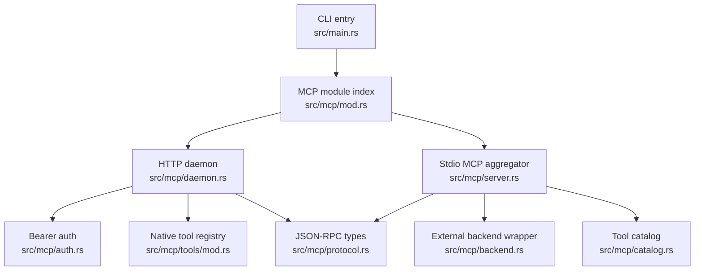
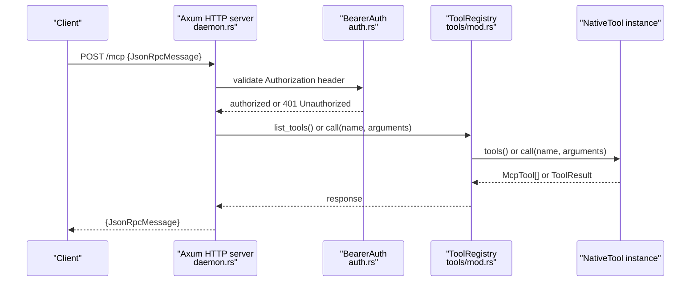
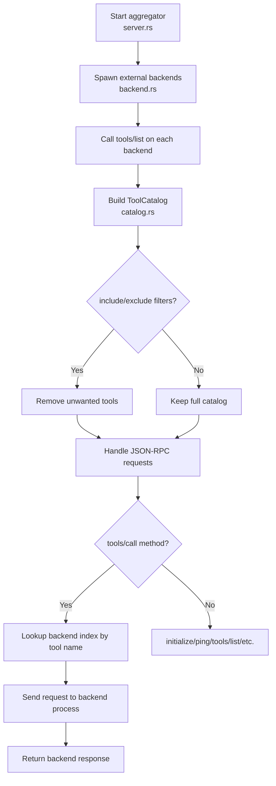
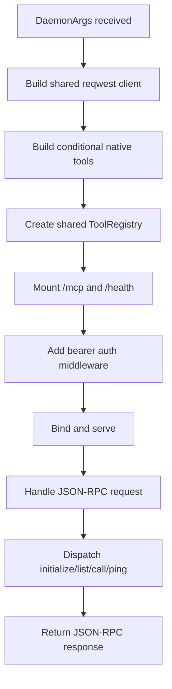
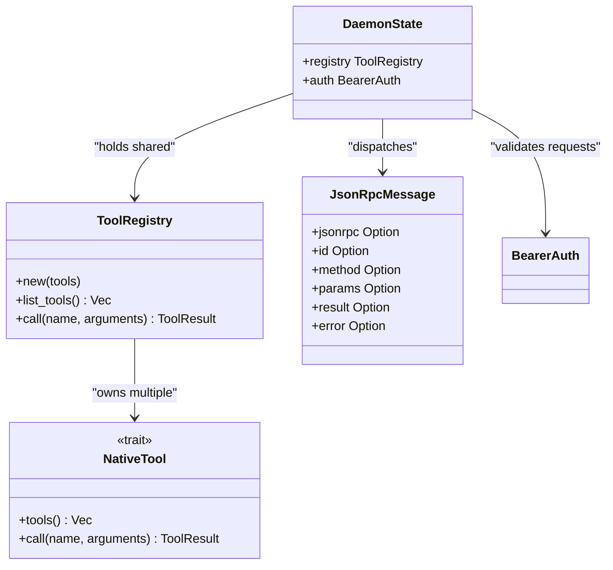
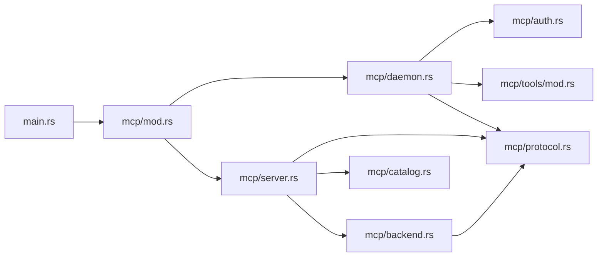

# Daemon Mode and Shared Tools

<cite>
**Referenced Files in This Document**
- [README.md](file://README.md)
- [main.rs](file://src/main.rs)
- [mod.rs](file://src/mcp/mod.rs)
- [daemon.rs](file://src/mcp/daemon.rs)
- [server.rs](file://src/mcp/server.rs)
- [backend.rs](file://src/mcp/backend.rs)
- [catalog.rs](file://src/mcp/catalog.rs)
- [protocol.rs](file://src/mcp/protocol.rs)
- [auth.rs](file://src/mcp/auth.rs)
- [tools/mod.rs](file://src/mcp/tools/mod.rs)
- [test_mcp_daemon.rs](file://tests/test_mcp_daemon.rs)
- [local-operation.md](file://docs/local-operation.md)
</cite>

## Table of Contents
1. Introduction
2. Project Structure
3. Core Components
4. Architecture Overview
5. Detailed Component Analysis
6. Dependency Analysis
7. Performance Considerations
8. Troubleshooting Guide
9. Conclusion

## Introduction
This document explains the MCP daemon mode and shared tool aggregation capabilities in CCR-Rust. It covers two related modes:

- **Daemon mode**: A single HTTP server process that owns native tool instances (for example, context search, memory graph, Jina web tools, Pyright type checking, and optional Sindexer). Multiple clients can call the same daemon, share its tool state, and avoid duplicating expensive resources.
- **Shared backend aggregation**: An MCP server that spawns one or more external MCP backends, aggregates their `tools/list` results into a unified catalog, and routes `tools/call` requests to the appropriate backend.

The daemon mode is especially useful when several agents or CLI sessions need access to the same tooling without each process independently initializing heavy libraries, downloading models, opening network connections, or managing separate persistent stores.

## Project Structure
MCP-related code lives under `src/mcp/`. The module layout separates transport, protocol, lifecycle, authentication, and tool implementation concerns:



**Diagram sources**
- [main.rs:180-260](file://src/main.rs#L180-L260)
- [mod.rs:1-8](file://src/mcp/mod.rs#L1-L8)
- [daemon.rs:1-319](file://src/mcp/daemon.rs#L1-L319)
- [server.rs:1-227](file://src/mcp/server.rs#L1-L227)
- [backend.rs:1-136](file://src/mcp/backend.rs#L1-L136)
- [catalog.rs:1-72](file://src/mcp/catalog.rs#L1-L72)
- [protocol.rs:1-40](file://src/mcp/protocol.rs#L1-L40)
- [auth.rs:1-81](file://src/mcp/auth.rs#L1-L81)
- [tools/mod.rs:1-98](file://src/mcp/tools/mod.rs#L1-L98)

**Section sources**
- [mod.rs:1-8](file://src/mcp/mod.rs#L1-L8)
- [main.rs:180-260](file://src/main.rs#L180-L260)

## Core Components
The MCP subsystem provides two distinct entry points:

| Mode | Purpose | Transport | Tool ownership | State sharing |
|---|---|---|---|---|
| `ccr-rust mcp-daemon` | Runs a shared HTTP daemon with native tools | HTTP `/mcp` JSON-RPC over Axum | Owned by one daemon process | Yes, through shared `ToolRegistry` and tool instances |
| `ccr-rust mcp --wrap ...` | Aggregates one or more external MCP backends | Stdio line-delimited JSON-RPC | Each backend process owns its own tools | No; backends are isolated per aggregator process |

Key component responsibilities:

- **CLI routing (`main.rs`)**: Parses `Mcp` and `McpDaemon` commands and forwards arguments to either `mcp::server::run` or `mcp::daemon::run`.
- **Daemon (`daemon.rs`)**: Starts an Axum HTTP server, authenticates requests, builds a shared `ToolRegistry`, and dispatches JSON-RPC methods.
- **Server (`server.rs`)**: Spawns external MCP processes, collects their tool catalogs, applies include/exclude filtering, and proxies requests to backends.
- **Backend (`backend.rs`)**: Wraps a child process communicating via stdio JSON-RPC frames.
- **Catalog (`catalog.rs`)**: Stores aggregated tools and supports description compression for different client contexts.
- **Protocol (`protocol.rs`)**: Defines the shared JSON-RPC message and tool shapes.
- **Auth (`auth.rs`)**: Validates Bearer tokens using constant-time comparison.
- **Tools (`tools/mod.rs`)**: Declares the `NativeTool` trait and a registry that finds and invokes tools by name.

**Section sources**
- [main.rs:850-900](file://src/main.rs#L850-L900)
- [daemon.rs:1-319](file://src/mcp/daemon.rs#L1-L319)
- [server.rs:1-227](file://src/mcp/server.rs#L1-L227)
- [backend.rs:1-136](file://src/mcp/backend.rs#L1-L136)
- [catalog.rs:1-72](file://src/mcp/catalog.rs#L1-L72)
- [protocol.rs:1-40](file://src/mcp/protocol.rs#L1-L40)
- [auth.rs:1-81](file://src/mcp/auth.rs#L1-L81)
- [tools/mod.rs:1-98](file://src/mcp/tools/mod.rs#L1-L98)

## Architecture Overview
There are two deployment patterns.

### Daemon Pattern: One Process, Many Clients
In daemon mode, a single process owns native tools. Clients authenticate with a Bearer token and send JSON-RPC requests to `/mcp`.



**Diagram sources**
- [daemon.rs:1-319](file://src/mcp/daemon.rs#L1-L319)
- [auth.rs:1-81](file://src/mcp/auth.rs#L1-L81)
- [tools/mod.rs:1-98](file://src/mcp/tools/mod.rs#L1-L98)
- [protocol.rs:1-40](file://src/mcp/protocol.rs#L1-L40)

### Aggregator Pattern: One Process, Many Backends
In aggregator mode, the server spawns one or more external MCP backend processes. It lists tools from each backend, merges them into a catalog, and routes calls to the backend associated with each tool.



**Diagram sources**
- [server.rs:1-227](file://src/mcp/server.rs#L1-L227)
- [backend.rs:1-136](file://src/mcp/backend.rs#L1-L136)
- [catalog.rs:1-72](file://src/mcp/catalog.rs#L1-L72)

**Section sources**
- [server.rs:1-227](file://src/mcp/server.rs#L1-L227)
- [backend.rs:1-136](file://src/mcp/backend.rs#L1-L136)

## Detailed Component Analysis

### Daemon Lifecycle Management
The daemon lifecycle has three phases: startup, request handling, and shutdown.

1. **Startup**
   - Parse `DaemonArgs`: port, host, memory directory, Pyright paths, bearer token, and optional Jina configuration.
   - Create a shared HTTP client with a fixed user agent and timeout.
   - Build the native tool list conditionally:
     - Exa if `EXA_API_KEY` is set.
     - Jina if `JINA_API_KEY` is set; base URLs may be supplied explicitly.
     - Context7 is always enabled.
     - Memory tool is always enabled; persistence path is optional.
     - Sindexer is enabled only with the `sindexer` Cargo feature.
     - Pyright is enabled only when both project root and workspace directory are provided.
   - Wrap all tools in a shared `ToolRegistry`.
   - Mount `/mcp`, `/health`, and bearer-auth middleware.
   - Bind TCP listener and serve with Axum.

2. **Request Handling**
   - Middleware checks the `Authorization` header against the configured token.
   - Body is parsed as JSON-RPC.
   - Dispatch handles `initialize`, `notifications/initialized`, `ping`, `tools/list`, and `tools/call`.
   - Unknown methods return `-32601`; missing parameters return `-32000`; unknown tools are wrapped as tool errors rather than protocol errors.

3. **Shutdown**
   - The current daemon implementation does not implement explicit graceful shutdown hooks.
   - Shutdown behavior follows Axum/Tokio semantics: when the serving task ends, the process exits.



**Diagram sources**
- [daemon.rs:1-319](file://src/mcp/daemon.rs#L1-L319)

**Section sources**
- [daemon.rs:1-319](file://src/mcp/daemon.rs#L1-L319)

### Process Isolation
Process isolation differs between the two MCP modes:

| Aspect | Daemon mode | Aggregator mode |
|---|---|---|
| Tool execution | Native Rust tools run inside the daemon process | External MCP backends run as separate child processes |
| Failure containment | A panic in one tool can affect the whole daemon unless caught at the tool boundary | A crashed backend is isolated; the aggregator can detect exit status |
| Resource sharing | All tools share one HTTP client, one registry, and any in-process state | Each backend manages its own resources |
| Monitoring surface | Health endpoint, logs, metrics available on the daemon process | Child process exit status and stderr are observable |

The aggregator uses `tokio::process::Child` and kills children during drop, which provides basic cleanup when the aggregator exits.

**Section sources**
- [backend.rs:1-136](file://src/mcp/backend.rs#L1-L136)
- [daemon.rs:1-319](file://src/mcp/daemon.rs#L1-L319)

### Communication Protocols
Both modes use JSON-RPC-style messages, but transports differ.

| Mode | Transport | Framing | Authentication |
|---|---|---|---|
| Daemon | HTTP POST to `/mcp` | Single JSON body per request | Bearer token via `Authorization` header |
| Aggregator | Stdio | One JSON-RPC frame per newline-separated line | No built-in transport authentication |

Common JSON-RPC fields:

| Field | Type | Meaning |
|---|---|---|
| `jsonrpc` | String | Always `"2.0"` in these implementations |
| `id` | Value or null | Request identifier used to match responses |
| `method` | String or null | RPC method such as `initialize`, `tools/list`, `tools/call`, or `ping` |
| `params` | Object or null | Method parameters |
| `result` | Object or null | Successful result |
| `error` | Object or null | Error object with `code` and `message` |

For `tools/call`, parameters must include:

| Field | Type | Meaning |
|---|---|---|
| `name` | String | Tool name |
| `arguments` | Object | Tool-specific arguments |

**Section sources**
- [protocol.rs:1-40](file://src/mcp/protocol.rs#L1-L40)
- [daemon.rs:1-319](file://src/mcp/daemon.rs#L1-L319)
- [server.rs:1-227](file://src/mcp/server.rs#L1-L227)
- [backend.rs:1-136](file://src/mcp/backend.rs#L1-L136)

### Shared Tool Aggregation and State Sharing
The daemon’s shared state comes from constructing one `ToolRegistry` and holding it in shared `Arc<DaemonState>`:

- Every registered `NativeTool` exposes metadata through `tools()`.
- `list_tools()` flattens all tool schemas across tools.
- `call()` iterates tools until one recognizes the requested name, then delegates invocation.
- Because the registry and tool instances are shared across requests, stateful tools can retain data between clients.

The memory tool is the clearest example of cross-client state sharing: it can persist entities to a file and return a serialized graph. Tests verify create, read, and search operations through the daemon.



**Diagram sources**
- [tools/mod.rs:1-98](file://src/mcp/tools/mod.rs#L1-L98)
- [daemon.rs:1-319](file://src/mcp/daemon.rs#L1-L319)
- [protocol.rs:1-40](file://src/mcp/protocol.rs#L1-L40)
- [auth.rs:1-81](file://src/mcp/auth.rs#L1-L81)

**Section sources**
- [tools/mod.rs:1-98](file://src/mcp/tools/mod.rs#L1-L98)
- [daemon.rs:1-319](file://src/mcp/daemon.rs#L1-L319)
- [test_mcp_daemon.rs:1-418](file://tests/test_mcp_daemon.rs#L1-L418)

### Configuration Options
The daemon command is `ccr-rust mcp-daemon`. Relevant options and environment variables:

| Option | Environment Variable | Default | Description |
|---|---|---|---|
| `--port` | None | `3457` | HTTP listen port |
| `--host` | `CCR_MCP_DAEMON_HOST` | `127.0.0.1` | HTTP listen address |
| `--auth-token` | `CCR_MCP_AUTH_TOKEN` | Required | Bearer token for health and MCP endpoints |
| `--memory-dir` | `CCR_MCP_MEMORY_DIR` | None | Directory for memory graph persistence |
| `--pyright-root` | `PYRIGHT_PROJECT_ROOT` | None | Project root for Pyright tool |
| `--pyright-workspace-dir` | `CCR_MCP_PYRIGHT_WORKSPACE_DIR` | None | Ephemeral workspace directory for Pyright requests |

Additional tool configuration:

| Tool | Trigger | Notes |
|---|---|---|
| Exa | `EXA_API_KEY` set and nonempty | Network tool; disabled by default |
| Jina | `JINA_API_KEY` set and nonempty | Optional custom search and reader base URLs |
| Context7 | Always enabled | No API key required |
| Memory | Always enabled | Persistence is optional |
| Sindexer | Cargo feature `sindexer` enabled | Optional tool |
| Pyright | Both `--pyright-root` and `--pyright-workspace-dir` present | Requires valid project and workspace directories |

Important validation rules:

- If Jina base URLs are supplied, both search and reader bases must be present together.
- If only one Pyright path is supplied, startup fails.
- The bearer token must be nonempty ASCII without whitespace or control characters.

**Section sources**
- [main.rs:180-260](file://src/main.rs#L180-L260)
- [daemon.rs:1-319](file://src/mcp/daemon.rs#L1-L319)
- [auth.rs:1-81](file://src/mcp/auth.rs#L1-L81)

### Resource Limits and Monitoring
Observed resource-related behaviors:

- **HTTP client timeout**: The daemon constructs a `reqwest::Client` with a 30-second timeout.
- **Concurrency model**: The daemon uses Axum with Tokio; concurrent HTTP requests are processed asynchronously within the same process.
- **Memory persistence**: The memory tool can write to a directory specified by `--memory-dir`.
- **Process isolation**: Only the aggregator mode isolates backends into child processes.
- **Authentication**: Bearer token validation prevents unauthenticated access to `/mcp` and `/health`.

Explicit resource limits such as per-tool CPU quotas, maximum concurrent tool calls, memory budgets, or rate limits are not implemented in the daemon itself. Scaling should therefore rely on external orchestration: container resource constraints, reverse proxy limits, process supervisors, and monitoring.

Monitoring recommendations:

- Use the `/health` endpoint for liveness checks.
- Monitor daemon process memory, CPU, and restart count.
- Log tool invocation success/failure through tracing.
- Observe upstream tool dependencies (Exa, Jina, Pyright, Sindexer) separately.
- For aggregator mode, monitor child process health and stderr output.

**Section sources**
- [daemon.rs:1-319](file://src/mcp/daemon.rs#L1-L319)
- [backend.rs:1-136](file://src/mcp/backend.rs#L1-L136)
- [test_mcp_daemon.rs:201-418](file://tests/test_mcp_daemon.rs#L201-L418)

### Deploying Shared Tools
Recommended deployment steps:

1. **Build the binary** using the repository build instructions.
2. **Prepare credentials**:
   - Set `CCR_MCP_AUTH_TOKEN`.
   - Optionally set `EXA_API_KEY` and `JINA_API_KEY`.
3. **Choose tools**:
   - Enable Pyright by providing both project root and workspace directory.
   - Enable Sindexer through the appropriate Cargo feature.
   - Omit unused tools to reduce startup cost.
4. **Start the daemon**:
   ```bash
   ccr-rust mcp-daemon
   ```
5. **Verify health**:
   ```bash
   curl --fail --silent http://127.0.0.1:3457/health
   ```
6. **Connect clients**:
   - Point clients to `http://127.0.0.1:3457/mcp`.
   - Include `Authorization: Bearer <token>`.
   - Use `initialize`, `tools/list`, and `tools/call`.

For local operation guidance and verification examples, see the local operation documentation.

**Section sources**
- [README.md:1-200](file://README.md#L1-L200)
- [local-operation.md:1-166](file://docs/local-operation.md#L1-L166)
- [test_mcp_daemon.rs:1-200](file://tests/test_mcp_daemon.rs#L1-L200)

### Managing Tool Lifecycles
Current lifecycle characteristics:

- Tools are constructed once during daemon startup.
- There is no built-in runtime mechanism to add, remove, reload, or hot-replace tools.
- Tool failures during `call()` are returned as tool errors rather than causing the entire daemon to fail.
- In aggregator mode, backend processes are killed when the aggregator drops them.

Best practices:

- Treat daemon restart as the lifecycle boundary for tool reloading.
- Use a supervisor (systemd, launchd, Kubernetes) to restart failed daemons.
- For backends, ensure external MCP processes exit cleanly so the aggregator can observe termination.
- Persist durable state through supported mechanisms such as the memory tool’s file-based store.

**Section sources**
- [daemon.rs:1-319](file://src/mcp/daemon.rs#L1-L319)
- [backend.rs:1-136](file://src/mcp/backend.rs#L1-L136)
- [tools/mod.rs:1-98](file://src/mcp/tools/mod.rs#L1-L98)

### Troubleshooting Daemon Issues
Common issues and diagnostics:

| Symptom | Likely Cause | Diagnostic Step |
|---|---|---|
| 401 Unauthorized on `/health` or `/mcp` | Missing or wrong Bearer token | Check `Authorization: Bearer <token>` and `CCR_MCP_AUTH_TOKEN` |
| Daemon fails to start | Invalid host, missing required Pyright paths, invalid Jina base URL combination | Inspect startup logs and configuration |
| Jina tools absent from `tools/list` | `JINA_API_KEY` not set or empty | Verify environment variable |
| Pyright tool absent | Either project root or workspace directory is missing | Provide both flags |
| `tools/call` returns unknown tool error | Tool name mismatch or tool not enabled | Compare requested name with `tools/list` |
| Daemon becomes unresponsive | Heavy tool workloads or slow upstream dependencies | Check process resources and upstream tool latency |
| Aggregator loses connection to backend | Backend process exited | Check stderr and child process status |

Useful tests demonstrate expected behavior:

- Initialize and list tools.
- Call memory CRUD operations.
- Validate health endpoint.
- Confirm bearer auth enforcement.
- Confirm Jina tools appear only when configured.

**Section sources**
- [test_mcp_daemon.rs:1-418](file://tests/test_mcp_daemon.rs#L1-L418)
- [daemon.rs:1-319](file://src/mcp/daemon.rs#L1-L319)
- [auth.rs:1-81](file://src/mcp/auth.rs#L1-L81)

## Dependency Analysis
The MCP module depends on external crates and internal modules as follows:



Coupling observations:

- `daemon.rs` depends on `auth.rs`, `tools/mod.rs`, and `protocol.rs`.
- `server.rs` depends on `backend.rs`, `catalog.rs`, and `protocol.rs`.
- `backend.rs` depends only on `protocol.rs`.
- `catalog.rs` depends only on `protocol.rs`.
- `protocol.rs` is a low-level shared dependency with no MCP-specific coupling.
- Tools are decoupled behind the `NativeTool` trait, making new tools additive without changing the daemon dispatcher.

Potential risks:

- The daemon is a single point of failure because all native tools share one process.
- Adding many tools increases startup time and memory usage.
- The aggregator creates one child process per backend; too many backends can increase process overhead.

**Diagram sources**
- [main.rs:180-260](file://src/main.rs#L180-L260)
- [mod.rs:1-8](file://src/mcp/mod.rs#L1-L8)
- [daemon.rs:1-319](file://src/mcp/daemon.rs#L1-L319)
- [server.rs:1-227](file://src/mcp/server.rs#L1-L227)
- [backend.rs:1-136](file://src/mcp/backend.rs#L1-L136)
- [catalog.rs:1-72](file://src/mcp/catalog.rs#L1-L72)
- [protocol.rs:1-40](file://src/mcp/protocol.rs#L1-L40)
- [auth.rs:1-81](file://src/mcp/auth.rs#L1-L81)
- [tools/mod.rs:1-98](file://src/mcp/tools/mod.rs#L1-L98)

**Section sources**
- [mod.rs:1-8](file://src/mcp/mod.rs#L1-L8)
- [daemon.rs:1-319](file://src/mcp/daemon.rs#L1-L319)
- [server.rs:1-227](file://src/mcp/server.rs#L1-L227)

## Performance Considerations
### Daemon Mode
Advantages:

- **Reduced duplication**: Multiple clients share one HTTP client, one tool registry, and one set of native tool instances.
- **Cross-client state**: Tools like memory can share persisted state between clients.
- **Lower process overhead**: One daemon process serves many clients instead of one process per client.

Costs:

- **Single process bottleneck**: All requests compete for the same event loop and shared mutable state.
- **No built-in concurrency limits**: High load can saturate the process.
- **Failure amplification**: A misbehaving tool can affect other clients sharing the same process.
- **Fixed HTTP client timeout**: Long-running tool calls may hit the 30-second timeout.

Optimization recommendations:

- Enable only tools actually needed by clients.
- Place the daemon behind a reverse proxy for TLS termination, rate limiting, and connection pooling.
- Monitor memory growth from shared tool state.
- Use separate daemon instances for isolated workload classes if tools are expensive or stateful.
- Persist long-lived state explicitly through supported tools rather than relying on accidental in-memory caches.

### Aggregator Mode
Advantages:

- **Isolation**: Each backend runs in its own process.
- **Catalog flexibility**: Include/exclude filters allow different clients to receive tailored tool sets.
- **Backward compatibility**: Works with external MCP servers that speak the standard JSON-RPC framing.

Costs:

- **Per-backend process overhead**: Each backend consumes OS resources.
- **No shared state across backends**: Cross-backend tool coordination is not possible.
- **Sequential frame handling per backend**: Each backend wrapper reads one response per request.

Scaling implications:

- Scale horizontally by running multiple daemon or aggregator instances behind a load balancer.
- Use process supervision to restart failed instances.
- Prefer daemon mode when tools are expensive to initialize and safe to share.
- Prefer aggregator mode when tools are unsafe to share or belong to third-party processes.

[No sources needed since this section provides general guidance]

## Troubleshooting Guide
### Health and Authentication Checks
- Call `/health` without a token to confirm reachability.
- Call `/health` with the correct token to confirm authorization.
- Verify that `WWW-Authenticate: Bearer` appears on unauthorized responses.

### Tool Discovery
- Call `initialize` to confirm protocol negotiation.
- Call `tools/list` and compare returned names with expected tools.
- Remember that some tools require environment variables or flags.

### Tool Invocation
- Ensure `tools/call` includes both `name` and `arguments`.
- Match the exact tool name returned by `tools/list`.
- Inspect `result.isError` and `result.content` for tool-level errors.

### Daemon-Specific Diagnostics
- Confirm the bearer token matches `CCR_MCP_AUTH_TOKEN`.
- Confirm Jina tools are absent unless `JINA_API_KEY` is set.
- Confirm Pyright requires both project root and workspace directory.
- Check whether memory persistence is configured through `--memory-dir`.

### Aggregator-Specific Diagnostics
- Confirm at least one backend command is provided.
- Check backend stderr for startup failures.
- Validate that backend responses match the expected JSON-RPC frame format.

**Section sources**
- [test_mcp_daemon.rs:1-418](file://tests/test_mcp_daemon.rs#L1-L418)
- [daemon.rs:1-319](file://src/mcp/daemon.rs#L1-L319)
- [server.rs:1-227](file://src/mcp/server.rs#L1-L227)
- [backend.rs:1-136](file://src/mcp/backend.rs#L1-L136)

## Conclusion
CCR-Rust provides two complementary MCP capabilities:

- **Daemon mode** enables multiple clients to share native tool instances, reducing resource consumption and enabling cross-client state sharing. It is best suited for trusted environments where tools can safely share state and resources.
- **Aggregator mode** enables shared tool discovery across multiple external MCP backends while keeping backend processes isolated.

Production deployments should combine daemon-mode benefits with external safeguards: authentication, process supervision, resource limits, observability, and horizontal scaling. When tools are expensive to initialize or contain meaningful shared state, prefer daemon mode. When tools are untrusted, stateless, or managed externally, prefer aggregator mode.

[No sources needed since this section summarizes without analyzing specific files]