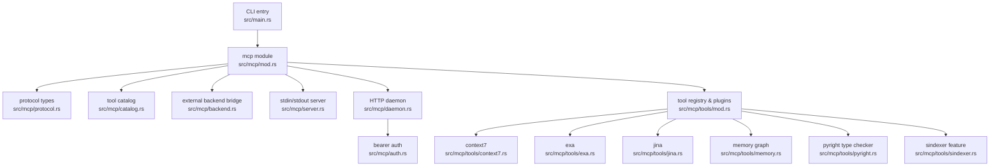
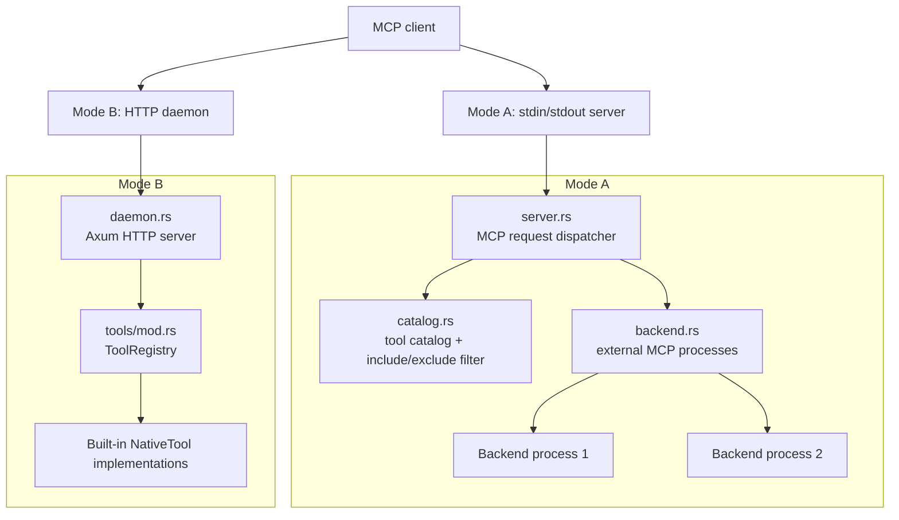
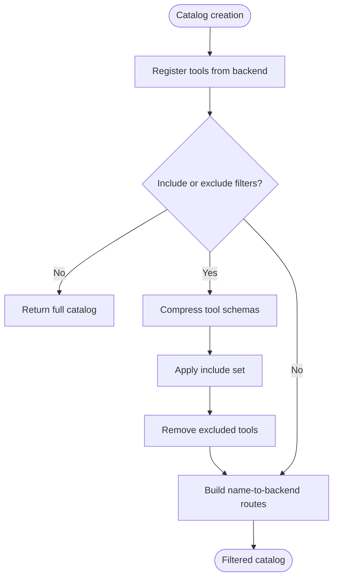
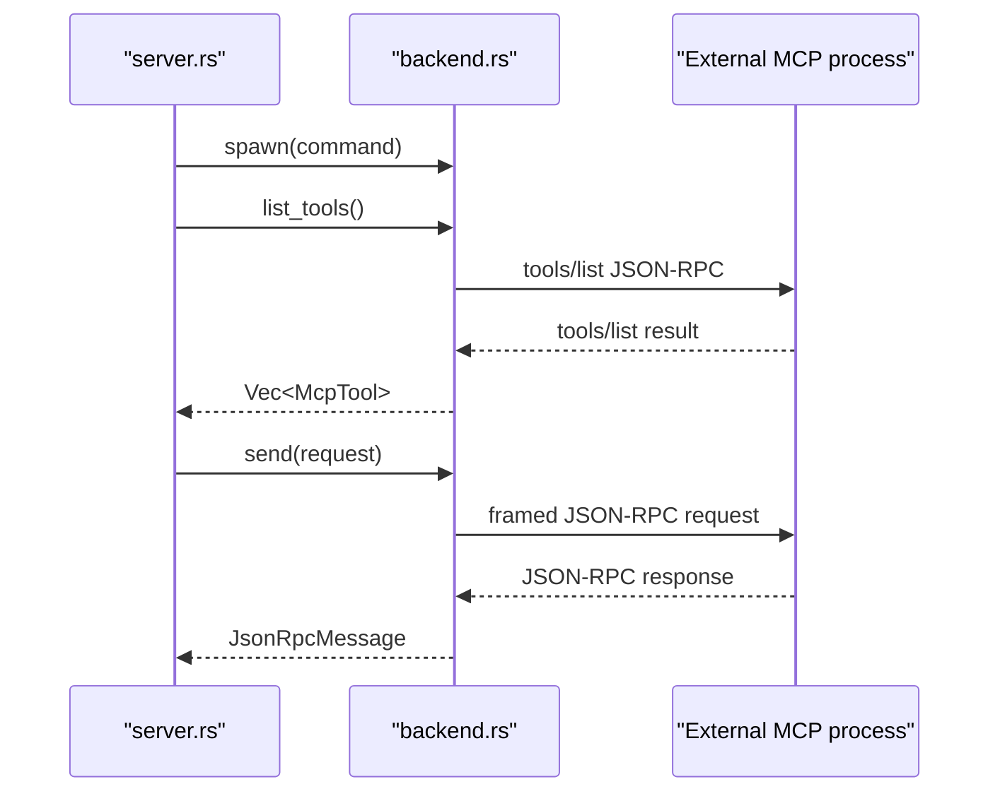
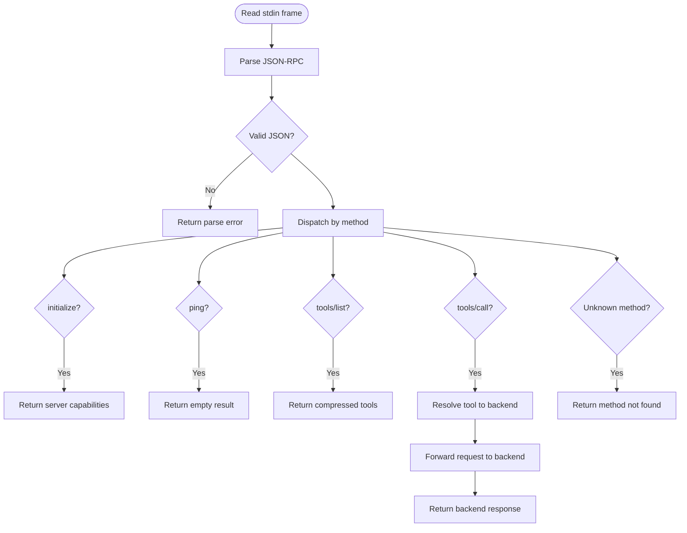
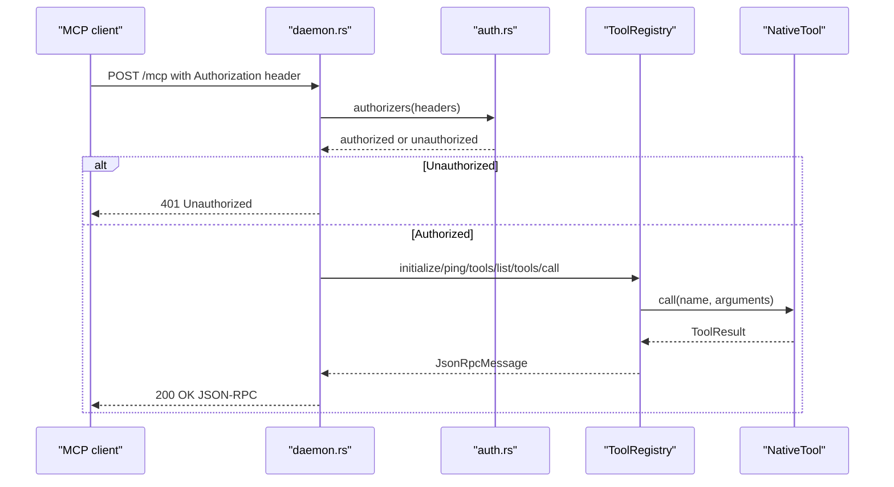
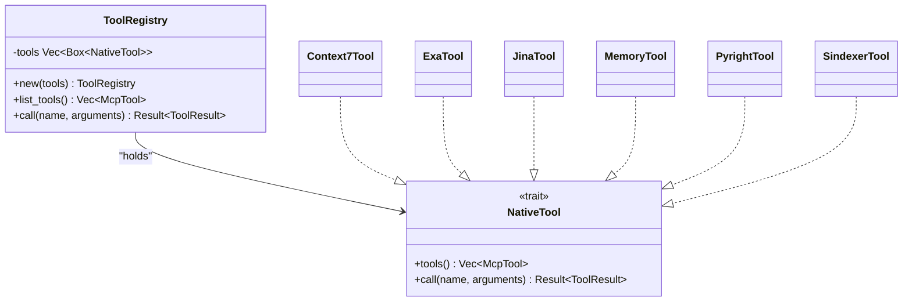
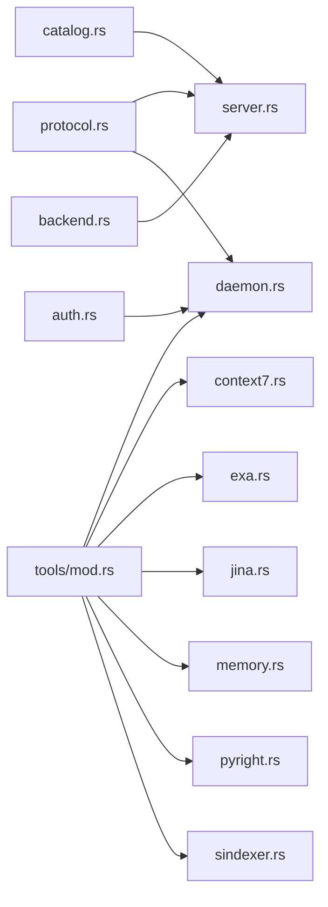

# MCP (Model Context Protocol)

<cite>
**Referenced Files in This Document**
- [README.md](file://README.md)
- [Cargo.toml](file://Cargo.toml)
- [src/main.rs](file://src/main.rs)
- [src/mcp/mod.rs](file://src/mcp/mod.rs)
- [src/mcp/protocol.rs](file://src/mcp/protocol.rs)
- [src/mcp/catalog.rs](file://src/mcp/catalog.rs)
- [src/mcp/backend.rs](file://src/mcp/backend.rs)
- [src/mcp/server.rs](file://src/mcp/server.rs)
- [src/mcp/daemon.rs](file://src/mcp/daemon.rs)
- [src/mcp/auth.rs](file://src/mcp/auth.rs)
- [src/mcp/tools/mod.rs](file://src/mcp/tools/mod.rs)
- [src/mcp/tools/context7.rs](file://src/mcp/tools/context7.rs)
- [src/mcp/tools/exa.rs](file://src/mcp/tools/exa.rs)
- [src/mcp/tools/jina.rs](file://src/mcp/tools/jina.rs)
- [src/mcp/tools/memory.rs](file://src/mcp/tools/memory.rs)
- [src/mcp/tools/pyright.rs](file://src/mcp/tools/pyright.rs)
- [src/mcp/tools/sindexer.rs](file://src/mcp/tools/sindexer.rs)
- [tests/test_mcp_daemon.rs](file://tests/test_mcp_daemon.rs)
</cite>

## Table of Contents
1. [Introduction](#introduction)
2. [Project Structure](#project-structure)
3. [Core Components](#core-components)
4. [Architecture Overview](#architecture-overview)
5. [Detailed Component Analysis](#detailed-component-analysis)
6. [Dependency Analysis](#dependency-analysis)
7. [Performance Considerations](#performance-considerations)
8. [Troubleshooting Guide](#troubleshooting-guide)
9. [Conclusion](#conclusion)
10. [Appendices](#appendices)

## Introduction
This document explains CCR-Rust’s Model Context Protocol implementation. It covers:
- What the MCP layer provides inside CCR-Rust.
- Two deployment modes: a JSON-RPC over stdin/stdout server and a shared HTTP daemon with native tools.
- Tool catalog management, bearer-token authentication, and the plugin-style tool architecture.
- Built-in tools: context7, exa, jina, memory, pyright, and sindexer.
- MCP connection protocols, message formats, error handling, client integration, custom tool development, lifecycle management, security considerations, and operational best practices.

CCR-Rust is primarily an LLM router; its MCP layer adds optional tool aggregation so coding agents can discover and invoke tools through standardized MCP messages. The main README describes the broader router purpose and features, including “MCP aggregation as an optional Model Context Protocol server and shared daemon for tool proxying.”

**Section sources**
- [README.md:1-120](file://README.md#L1-L120)

## Project Structure
The MCP implementation lives under `src/mcp/`. The module entry point declares submodules for authentication, backend spawning, catalog management, protocol types, the stdin/stdout server, the HTTP daemon, and the built-in tools.

**Diagram sources**
- [src/mcp/mod.rs:1-8](file://src/mcp/mod.rs#L1-L8)
- [src/mcp/protocol.rs:1-40](file://src/mcp/protocol.rs#L1-L40)
- [src/mcp/catalog.rs:1-72](file://src/mcp/catalog.rs#L1-L72)
- [src/mcp/backend.rs:1-136](file://src/mcp/backend.rs#L1-L136)
- [src/mcp/server.rs:1-227](file://src/mcp/server.rs#L1-L227)
- [src/mcp/daemon.rs:1-319](file://src/mcp/daemon.rs#L1-L319)
- [src/mcp/auth.rs:1-81](file://src/mcp/auth.rs#L1-L81)
- [src/mcp/tools/mod.rs:1-98](file://src/mcp/tools/mod.rs#L1-L98)
- [src/mcp/tools/context7.rs:1-164](file://src/mcp/tools/context7.rs#L1-L164)
- [src/mcp/tools/exa.rs:1-177](file://src/mcp/tools/exa.rs#L1-L177)
- [src/mcp/tools/jina.rs:1-676](file://src/mcp/tools/jina.rs#L1-L676)
- [src/mcp/tools/memory.rs:1-479](file://src/mcp/tools/memory.rs#L1-L479)
- [src/mcp/tools/pyright.rs:1-572](file://src/mcp/tools/pyright.rs#L1-L572)
- [src/mcp/tools/sindexer.rs:1-332](file://src/mcp/tools/sindexer.rs#L1-L332)

**Section sources**
- [src/mcp/mod.rs:1-8](file://src/mcp/mod.rs#L1-L8)

## Core Components
| Component | Responsibility | Key Details |
|---|---|---|
| CLI commands | Expose MCP entry points | `ccr-rust mcp` and `ccr-rust mcp-daemon` are defined in the main CLI. |
| Protocol types | Define MCP JSON-RPC envelopes and tool schemas | `JsonRpcMessage`, `McpTool`, `McpToolCallParams`. |
| Tool catalog | Aggregates and filters tools from external backends | Name-to-backend routing and schema compression levels. |
| Backend bridge | Spawns and communicates with external MCP processes | Line-delimited JSON-RPC over stdin/stdout. |
| Stdin/stdout server | Wraps one or more backends behind MCP methods | `initialize`, `ping`, `tools/list`, `tools/call`. |
| HTTP daemon | Shared process hosting native tools | Axum server on `/mcp` and `/health` with bearer authentication. |
| Bearer authentication | Validates authorization headers securely | SHA-256 digest comparison using constant-time equality. |
| Tool registry | Dispatches calls to registered native tools | Implements `NativeTool` for each built-in or custom tool. |

**Section sources**
- [src/main.rs:201-240](file://src/main.rs#L201-L240)
- [src/mcp/protocol.rs:1-40](file://src/mcp/protocol.rs#L1-L40)
- [src/mcp/catalog.rs:1-72](file://src/mcp/catalog.rs#L1-L72)
- [src/mcp/backend.rs:1-136](file://src/mcp/backend.rs#L1-L136)
- [src/mcp/server.rs:1-227](file://src/mcp/server.rs#L1-L227)
- [src/mcp/daemon.rs:1-319](file://src/mcp/daemon.rs#L1-L319)
- [src/mcp/auth.rs:1-81](file://src/mcp/auth.rs#L1-L81)
- [src/mcp/tools/mod.rs:1-98](file://src/mcp/tools/mod.rs#L1-L98)

## Architecture Overview
CCR-Rust exposes two complementary MCP deployment styles.

**Diagram sources**
- [src/mcp/server.rs:1-227](file://src/mcp/server.rs#L1-L227)
- [src/mcp/catalog.rs:1-72](file://src/mcp/catalog.rs#L1-L72)
- [src/mcp/backend.rs:1-136](file://src/mcp/backend.rs#L1-L136)
- [src/mcp/daemon.rs:1-319](file://src/mcp/daemon.rs#L1-L319)
- [src/mcp/tools/mod.rs:1-98](file://src/mcp/tools/mod.rs#L1-L98)

### Connection Protocols
| Deployment mode | Transport | Endpoint / I/O | Authentication |
|---|---|---|---|
| MCP server | Standard input/output line framing | Read JSON-RPC frames from stdin; write one JSON object per line to stdout. | None by default; intended for local pipes or trusted clients. |
| MCP daemon | HTTP POST over TCP | `POST /mcp` for MCP requests; `GET /health` for liveness checks. | Required `Authorization: Bearer <token>` header. |

Both modes implement the same core MCP method surface:
- `initialize`: returns server capabilities and protocol version.
- `notifications/initialized`: accepted without response.
- `ping`: returns an empty result.
- `tools/list`: returns available tools.
- `tools/call`: invokes a named tool with structured arguments.

**Section sources**
- [src/mcp/server.rs:70-170](file://src/mcp/server.rs#L70-L170)
- [src/mcp/daemon.rs:201-319](file://src/mcp/daemon.rs#L201-L319)
- [tests/test_mcp_daemon.rs:1-120](file://tests/test_mcp_daemon.rs#L1-L120)

## Detailed Component Analysis

### MCP Protocol Types
The protocol layer defines the minimal JSON-RPC envelope used by both deployment modes.

| Field | Meaning |
|---|---|
| `jsonrpc` | JSON-RPC version string, typically `"2.0"`. |
| `id` | Optional request identifier; omitted for notifications. |
| `method` | Request method name such as `tools/list` or `tools/call`. |
| `params` | Optional request parameters. |
| `result` | Successful response payload. |
| `error` | Error response with `code` and `message`. |

Tool descriptions use `McpTool`, containing `name`, `description`, and `inputSchema`. Tool invocation uses `McpToolCallParams`, carrying the tool name and arguments.

**Section sources**
- [src/mcp/protocol.rs:1-40](file://src/mcp/protocol.rs#L1-L40)

### Tool Catalog Management
The catalog aggregates tools discovered from external backends and supports filtering.

Key behaviors:
- `add_backend_tools` maps tool names to backend indices and merges duplicate tool definitions.
- `compress` reduces schema verbosity according to a level:
  - `none`: removes description and replaces schema with an empty object.
  - `minimal`/`min`/`high`/`aggressive`: removes description.
  - `medium`/`light`: normalizes whitespace and truncates description length.
  - Other levels preserve full metadata.
- `route` resolves a tool name to the backend index that owns it.

**Diagram sources**
- [src/mcp/catalog.rs:1-72](file://src/mcp/catalog.rs#L1-L72)
- [src/mcp/server.rs:40-68](file://src/mcp/server.rs#L40-L68)

**Section sources**
- [src/mcp/catalog.rs:1-72](file://src/mcp/catalog.rs#L1-L72)
- [src/mcp/server.rs:40-68](file://src/mcp/server.rs#L40-L68)

### External Backend Bridge
The backend bridge starts child processes and forwards JSON-RPC frames.

Important details:
- Each backend is spawned via `bash -lc "<command>"`, inheriting stderr and piping stdin/stdout.
- Requests are serialized, newline-framed, flushed, and then read until a matching response arrives.
- Notifications (messages with `method` but no `id`) are skipped.
- Responses with mismatched `id`s are ignored.
- If the child exits before responding, the bridge reports the exit status.
- On drop, the child process is killed.

**Diagram sources**
- [src/mcp/backend.rs:1-136](file://src/mcp/backend.rs#L1-L136)
- [src/mcp/server.rs:1-70](file://src/mcp/server.rs#L1-L70)

**Section sources**
- [src/mcp/backend.rs:1-136](file://src/mcp/backend.rs#L1-L136)

### MCP Server Mode
The server mode runs a loop reading line-delimited JSON-RPC frames from stdin.

Request handling:
- Empty lines are ignored.
- Malformed JSON becomes a JSON-RPC parse error.
- Supported methods:
  - `initialize`: responds with protocol version, server info, and MCP tool capabilities.
  - `notifications/initialized`: no-op.
  - `ping`: empty result.
  - `tools/list`: returns the compressed catalog.
  - `tools/call`: validates params, resolves the backend index, and forwards the original JSON-RPC request to the selected backend.
- Unknown methods return `-32601 method not found` when the request has an `id`.

Configuration options:
- `level`: controls catalog compression.
- `backends`: required list of backend commands.
- `include`: whitelist of tool names.
- `exclude`: blacklist of tool names.

**Diagram sources**
- [src/mcp/server.rs:1-227](file://src/mcp/server.rs#L1-L227)

**Section sources**
- [src/mcp/server.rs:1-227](file://src/mcp/server.rs#L1-L227)

### MCP Daemon Mode
The daemon mode is a shared HTTP server exposing native tools to multiple agents.

Server setup:
- Routes:
  - `POST /mcp`: MCP JSON-RPC endpoint.
  - `GET /health`: liveness check returning `200 ok`.
- Middleware: bearer token authentication applied to all routes.
- State:
  - `ToolRegistry` containing enabled native tools.
  - `BearerAuth` instance.

Tool enablement rules:
- `context7`: always enabled.
- `memory`: always enabled; optionally persists a knowledge graph to a directory.
- `exa`: enabled when `EXA_API_KEY` is set and nonempty.
- `jina`: enabled when `JINA_API_KEY` is provided; supports custom search and reader base URLs.
- `sindexer`: enabled when the `sindexer` Cargo feature is active.
- `pyright`: enabled only when both project root and workspace directory are configured.

Authentication:
- All endpoints require `Authorization: Bearer <token>`.
- Missing or invalid credentials return `401 Unauthorized` with `WWW-Authenticate: Bearer`.
- Token validation rejects empty tokens and tokens containing ASCII whitespace or control characters.
- Comparison uses SHA-256 digests and constant-time equality to avoid timing leaks.

**Diagram sources**
- [src/mcp/daemon.rs:1-319](file://src/mcp/daemon.rs#L1-L319)
- [src/mcp/auth.rs:1-81](file://src/mcp/auth.rs#L1-L81)
- [src/mcp/tools/mod.rs:1-98](file://src/mcp/tools/mod.rs#L1-L98)

**Section sources**
- [src/mcp/daemon.rs:1-319](file://src/mcp/daemon.rs#L1-L319)
- [src/mcp/auth.rs:1-81](file://src/mcp/auth.rs#L1-L81)

### Plugin Architecture for Custom Tools
Tools are implemented through the `NativeTool` trait in the tools module.

Contract:
- `tools()`: returns the list of MCP tool declarations exposed by this plugin.
- `call(name, arguments)`: executes the named tool and returns a `ToolResult`.

Lifecycle:
1. The daemon constructs a vector of boxed `NativeTool` instances.
2. Each tool registers its own MCP schema declarations.
3. `ToolRegistry::list_tools` flattens all declared tools.
4. `ToolRegistry::call` finds the first tool whose declaration includes the requested name and delegates execution.
5. Errors from unknown tools are returned as tool-level errors rather than transport errors.

**Diagram sources**
- [src/mcp/tools/mod.rs:1-98](file://src/mcp/tools/mod.rs#L1-L98)
- [src/mcp/tools/context7.rs:1-164](file://src/mcp/tools/context7.rs#L1-L164)
- [src/mcp/tools/exa.rs:1-177](file://src/mcp/tools/exa.rs#L1-L177)
- [src/mcp/tools/jina.rs:1-676](file://src/mcp/tools/jina.rs#L1-L676)
- [src/mcp/tools/memory.rs:1-479](file://src/mcp/tools/memory.rs#L1-L479)
- [src/mcp/tools/pyright.rs:1-572](file://src/mcp/tools/pyright.rs#L1-L572)
- [src/mcp/tools/sindexer.rs:1-332](file://src/mcp/tools/sindexer.rs#L1-L332)

**Section sources**
- [src/mcp/tools/mod.rs:1-98](file://src/mcp/tools/mod.rs#L1-L98)

### Built-in Tools

#### Context7
Purpose:
- Library documentation lookup through the Context7 API.

Tools:
- `resolve-library-id`: resolves a package or product name to a Context7 library ID.
- `query-docs`: retrieves documentation and code examples for a library ID.

Configuration:
- No API key is required by the implementation; it calls the fixed Context7 API base.

Error behavior:
- Non-success HTTP responses are returned as tool errors with status and body text.

**Section sources**
- [src/mcp/tools/context7.rs:1-164](file://src/mcp/tools/context7.rs#L1-L164)

#### Exa
Purpose:
- Web search and web page fetching via the Exa API.

Tools:
- `web_search_exa`: natural language search with optional result count.
- `web_fetch_exa`: fetches one or more URLs as clean content.

Configuration:
- Enabled only when `EXA_API_KEY` is present.
- Uses bearer authentication against the Exa API.

Limits:
- Search defaults to 10 results.
- Fetch defaults to 3000 characters per page.

**Section sources**
- [src/mcp/tools/exa.rs:1-177](file://src/mcp/tools/exa.rs#L1-L177)

#### Jina
Purpose:
- Live web search and Markdown page reading via Jina services.

Tools:
- `web_search_jina`: search query with result count between 1 and 20.
- `web_fetch_jina`: batch URL fetch with concurrency and timeout controls.

Configuration:
- Enabled when `JINA_API_KEY` is provided.
- Supports custom `jina_search_base` and `jina_reader_base`; both must be set together or neither.
- Reader base URL is normalized to include a trailing slash.

Security and safety:
- Adds privacy-oriented headers to bypass caching and tracking.
- Forbids private, loopback, unspecified, multicast, link-local, and other unsafe hosts.
- Limits concurrent fetches and enforces per-URL and batch timeouts.

Validation:
- Rejects malformed or non-string URLs.
- Enforces maximum number of URLs.
- Truncates search results to the requested count.

**Section sources**
- [src/mcp/tools/jina.rs:1-676](file://src/mcp/tools/jina.rs#L1-L676)

#### Memory
Purpose:
- In-memory knowledge graph with optional persistence.

Data model:
- Entities: name, entity type, observations.
- Relations: source, target, relation type.

Tools:
- `create_entities`: create or merge entities and observations.
- `create_relations`: add relations with deduplication.
- `add_observations`: append observations to existing entities.
- `delete_entities`: remove entities and related edges.
- `delete_observations`: remove specific observations.
- `delete_relations`: remove specific relations.
- `read_graph`: serialize the entire graph.
- `search_nodes`: substring search across names, types, and observations.
- `open_nodes`: select entities by name and include related relations.

Persistence:
- When a directory is configured, the graph is persisted to `memory.json`.
- Writes use a temporary file followed by rename for atomic updates.
- Concurrency is protected by a read-write lock.

**Section sources**
- [src/mcp/tools/memory.rs:1-479](file://src/mcp/tools/memory.rs#L1-L479)

#### Pyright
Purpose:
- Run Python type checking through the Pyright command-line tool.

Tools:
- `type_check`: submit files relative to a project root, optionally with inline content overlays.

Configuration:
- Requires both project root and a private workspace directory.
- Maximum 50 files per request.
- Uses a semaphore to limit concurrent Pyright executions.

Safety:
- Rejects absolute paths and parent-directory traversal.
- Creates an isolated workspace with symlinks into the project.
- Removes the workspace after execution.
- Strips `CCR_MCP_AUTH_TOKEN` from the Pyright child environment.

Output:
- Parses Pyright JSON diagnostics into structured errors, warnings, and information.
- Produces a human-readable summary.

**Section sources**
- [src/mcp/tools/pyright.rs:1-572](file://src/mcp/tools/pyright.rs#L1-L572)

#### Sindexer
Purpose:
- Codebase indexing and semantic search backed by the optional `sindexer` crate.

Tools:
- `index_codebase`: index a directory, optionally forcing re-indexing.
- `search_code`: search indexed collections with query, limit, and extension filters.
- `get_indexing_status`: inspect indexing status.
- `clear_index`: remove an index.
- `list_collections`: list indexed collections.
- `collection_stats`: get statistics for a collection.
- `drop_collection`: drop a collection.

Feature gating:
- Compiled only when the `sindexer` Cargo feature is enabled.

**Section sources**
- [src/mcp/tools/sindexer.rs:1-332](file://src/mcp/tools/sindexer.rs#L1-L332)

### MCP Message Formats and Error Handling

#### JSON-RPC Messages
All messages follow the `JsonRpcMessage` structure:
- Success responses contain `result`.
- Error responses contain `error.code` and `error.message`.
- Notifications have a `method` but no `id`.

#### Common Error Codes
| Code | Meaning | Typical Source |
|---|---|---|
| `-32700` | Parse error | Invalid JSON-RPC frame. |
| `-32601` | Method not found | Unsupported MCP method. |
| `-32000` | Internal/tool error | Daemon dispatch, tool execution, or catalog routing failures. |

#### Error Propagation
- Server mode wraps most failures in `-32000` and writes a JSON-RPC error frame.
- Daemon mode converts tool errors into MCP tool-result errors with `isError: true`.
- Authentication failures return HTTP `401 Unauthorized`.
- Backend process failures include the command and exit status.

**Section sources**
- [src/mcp/protocol.rs:1-40](file://src/mcp/protocol.rs#L1-L40)
- [src/mcp/server.rs:70-227](file://src/mcp/server.rs#L70-L227)
- [src/mcp/daemon.rs:201-319](file://src/mcp/daemon.rs#L201-L319)
- [src/mcp/backend.rs:1-136](file://src/mcp/backend.rs#L1-L136)

### MCP Server Setup and CLI
The CLI defines two MCP commands.

| Command | Purpose | Key Options |
|---|---|---|
| `ccr-rust mcp` | Run as a JSON-RPC-over-stdin/stdout server wrapping external MCP backends. | `--level`, `--wrap`, `--include`, `--exclude`. |
| `ccr-rust mcp-daemon` | Run as a shared HTTP daemon with native tools. | `--port`, `--host`, `--auth-token`, `--memory-dir`, `--pyright-root`, `--pyright-workspace-dir`. Environment overrides are supported. |

Environment variables relevant to MCP:
- `CCR_CONFIG`: path to the router configuration file.
- `CCR_MCP_AUTH_TOKEN`: bearer token for the MCP daemon.
- `CCR_MCP_DAEMON_HOST`: daemon listen host.
- `CCR_MCP_MEMORY_DIR`: directory for memory graph persistence.
- `PYRIGHT_PROJECT_ROOT`: project root for Pyright.
- `CCR_MCP_PYRIGHT_WORKSPACE_DIR`: ephemeral workspace directory for Pyright.
- `EXA_API_KEY`: enables the Exa tool.
- `JINA_API_KEY`: enables the Jina tool.

**Section sources**
- [src/main.rs:201-240](file://src/main.rs#L201-L240)

### Integrating MCP Clients

#### HTTP Daemon Client
Use a standard HTTP client to send JSON-RPC messages to `POST /mcp`.

Recommended steps:
1. Set the `Authorization: Bearer` header to the configured token.
2. Send an `initialize` request with `protocolVersion`, `capabilities`, and optional `clientInfo`.
3. Use `tools/list` to discover tools.
4. Use `tools/call` with `name` and `arguments`.
5. Handle `result.isError` in tool results.

Example flow based on tests:
- Initialize successfully.
- List tools and verify expected tool names.
- Call a tool and assert that the result contains structured content.

**Section sources**
- [tests/test_mcp_daemon.rs:1-200](file://tests/test_mcp_daemon.rs#L1-L200)

#### Stdin/Stdout Server Client
Connect to the server’s standard input and output streams:
- Write one JSON-RPC frame per line.
- Read one JSON-RPC frame per line.
- Support `initialize`, `ping`, `tools/list`, and `tools/call`.

This mode is useful for embedding MCP servers in pipelines or testing environments where process isolation is preferred over HTTP.

**Section sources**
- [src/mcp/server.rs:1-227](file://src/mcp/server.rs#L1-L227)
- [src/mcp/backend.rs:1-136](file://src/mcp/backend.rs#L1-L136)

### Developing Custom Tools
To add a custom native tool:

1. Create a new Rust module implementing `NativeTool`.
2. Return accurate MCP tool declarations from `tools()`.
3. Implement `call(name, arguments)` to validate inputs, perform work, and return `ToolResult`.
4. Register the tool in the daemon’s tool initialization vector.
5. Test the tool through the daemon’s `tools/list` and `tools/call` endpoints.

Best practices:
- Validate all required fields before making network or filesystem calls.
- Return tool errors for user input problems rather than panicking.
- Use tracing for important lifecycle events.
- Keep secrets out of logs; pass them through struct fields or environment variables.
- Limit resource usage such as file counts, URL counts, concurrency, and timeouts.

**Section sources**
- [src/mcp/tools/mod.rs:1-98](file://src/mcp/tools/mod.rs#L1-L98)

### Managing Tool Lifecycles
| Lifecycle Phase | Behavior |
|---|---|
| Startup | CLI parses arguments and selects MCP mode. |
| Tool discovery | Daemon builds `ToolRegistry`; server discovers tools from backends. |
| Listing | `tools/list` returns flattened tool declarations. |
| Invocation | `tools/call` resolves the tool and executes it. |
| Failure | Errors become MCP tool errors or JSON-RPC errors depending on failure location. |
| Shutdown | Backend children are killed; daemon stops serving. |

For external backends:
- Each backend process is started once and kept alive while the server runs.
- `Drop` ensures child processes are terminated.

For native tools:
- Tools are created once at daemon startup.
- Stateful tools like `MemoryTool` and `PyrightTool` manage internal state and resources.

**Section sources**
- [src/mcp/backend.rs:110-136](file://src/mcp/backend.rs#L110-L136)
- [src/mcp/daemon.rs:1-120](file://src/mcp/daemon.rs#L1-L120)
- [src/mcp/tools/mod.rs:1-98](file://src/mcp/tools/mod.rs#L1-L98)

## Dependency Analysis
The MCP layer depends on:
- Tokio for async I/O and process management.
- Serde and serde_json for JSON serialization.
- Axum for the HTTP daemon.
- Reqwest for external API calls.
- Sha2 and subtle for secure bearer token comparison.
- Optional `sindexer` crate gated by a Cargo feature.

**Diagram sources**
- [src/mcp/protocol.rs:1-40](file://src/mcp/protocol.rs#L1-L40)
- [src/mcp/server.rs:1-227](file://src/mcp/server.rs#L1-L227)
- [src/mcp/daemon.rs:1-319](file://src/mcp/daemon.rs#L1-L319)
- [src/mcp/catalog.rs:1-72](file://src/mcp/catalog.rs#L1-L72)
- [src/mcp/backend.rs:1-136](file://src/mcp/backend.rs#L1-L136)
- [src/mcp/auth.rs:1-81](file://src/mcp/auth.rs#L1-L81)
- [src/mcp/tools/mod.rs:1-98](file://src/mcp/tools/mod.rs#L1-L98)

**Section sources**
- [Cargo.toml:1-87](file://Cargo.toml#L1-L87)

## Performance Considerations
- **Catalog compression**: Use lower-complexity levels such as `low`, `medium`, or `none` to reduce tool schema size for clients that do not need full descriptions.
- **Concurrent fetches**: Jina fetch runs up to four concurrent URL reads with a per-URL timeout and a batch timeout.
- **Process isolation**: External backends run as separate processes, which improves fault isolation at the cost of inter-process communication overhead.
- **Workspace isolation**: Pyright creates per-request workspaces and cleans them afterward, avoiding cross-request contamination.
- **Concurrency limits**: Pyright uses a semaphore to bound concurrent type-checking jobs.
- **Atomic persistence**: Memory graph writes use a temp file plus rename to reduce corruption risk.

[No sources needed since this section provides general guidance]

## Troubleshooting Guide

### Daemon Returns 401 Unauthorized
Symptoms:
- Health or MCP endpoints reject requests.
- Response includes `WWW-Authenticate: Bearer`.

Checks:
- Confirm the `Authorization: Bearer` header matches the configured token.
- Ensure the token does not contain whitespace or control characters.
- Verify the daemon was started with a nonempty `--auth-token` or `CCR_MCP_AUTH_TOKEN`.

**Section sources**
- [src/mcp/auth.rs:1-81](file://src/mcp/auth.rs#L1-L81)
- [src/mcp/daemon.rs:120-180](file://src/mcp/daemon.rs#L120-L180)

### tools/call Reports Unknown Tool
Symptoms:
- Tool name is not found.
- Server mode returns `-32601 method not found` only if the method itself is unsupported; tool lookup failure returns a tool-routing error.
- Daemon mode returns a tool error indicating the tool is unknown.

Checks:
- Compare the requested name against `tools/list`.
- For server mode, verify include/exclude filters did not remove the tool.
- For daemon mode, verify the tool is enabled by configuration or feature flags.

**Section sources**
- [src/mcp/server.rs:120-170](file://src/mcp/server.rs#L120-L170)
- [src/mcp/catalog.rs:50-72](file://src/mcp/catalog.rs#L50-L72)
- [src/mcp/tools/mod.rs:60-98](file://src/mcp/tools/mod.rs#L60-L98)

### Backend Process Exits Before Responding
Symptoms:
- Error mentioning backend exit status.
- JSON-RPC response never arrives.

Checks:
- Validate the backend command.
- Confirm the backend reads line-delimited JSON-RPC from stdin and writes one JSON object per line to stdout.
- Check stderr, which is inherited by the bridge process.

**Section sources**
- [src/mcp/backend.rs:1-136](file://src/mcp/backend.rs#L1-L136)

### Pyright Type Checking Fails
Symptoms:
- Workspace setup errors.
- Pyright produces no output.
- Path validation errors.

Checks:
- Provide both `--pyright-root` and `--pyright-workspace-dir`.
- Use relative paths without `..`.
- Ensure Pyright is installed and executable in the daemon process environment.
- Inspect workspace setup and cleanup logs.

**Section sources**
- [src/mcp/tools/pyright.rs:1-572](file://src/mcp/tools/pyright.rs#L1-L572)

### Jina Fetch Fails for Private URLs
Symptoms:
- Fetch returns an error for localhost, private IP ranges, or local domains.

Checks:
- Confirm URLs use `http` or `https`.
- Confirm the host is public and resolvable.
- Reduce URL count and concurrency if timeouts occur.

**Section sources**
- [src/mcp/tools/jina.rs:201-676](file://src/mcp/tools/jina.rs#L201-L676)

## Conclusion
CCR-Rust’s MCP implementation provides two complementary deployment models:
- A lightweight stdin/stdout server for wrapping external MCP backends.
- A shared HTTP daemon for exposing built-in native tools with bearer-token authentication.

The system separates concerns cleanly:
- Protocol types define a stable message contract.
- The catalog manages tool discovery and filtering.
- The backend bridge isolates external processes.
- The daemon centralizes tool registration, authentication, and HTTP routing.
- Each tool implements a consistent plugin interface.

Operational success depends on correct authentication, careful tool selection, appropriate configuration of external dependencies, and monitoring of process and network failures.

[No sources needed since this section summarizes without analyzing specific files]

## Appendices

### MCP Server vs Daemon Comparison
| Aspect | MCP Server | MCP Daemon |
|---|---|---|
| Transport | stdin/stdout | HTTP POST |
| Authentication | Not enforced | Bearer token required |
| Tool source | External backend processes | Native Rust tools |
| Best fit | Process-isolated third-party MCP servers | Shared tool aggregation for multiple agents |
| Primary endpoints | JSON-RPC frames over stdio | `/mcp`, `/health` |

**Section sources**
- [src/mcp/server.rs:1-227](file://src/mcp/server.rs#L1-L227)
- [src/mcp/daemon.rs:1-319](file://src/mcp/daemon.rs#L1-L319)

### Security and Access Control Checklist
- Always set a strong, random `CCR_MCP_AUTH_TOKEN` for the daemon.
- Bind the daemon to loopback unless explicitly proxied through a trusted reverse proxy.
- Restrict access to `/mcp` and `/health` at the network boundary.
- Avoid logging bearer tokens or sensitive tool payloads.
- Validate tool inputs early.
- Prefer least-privilege filesystem access for tools like Pyright and Memory.
- Review external tool integrations for outbound network access.

**Section sources**
- [src/mcp/auth.rs:1-81](file://src/mcp/auth.rs#L1-L81)
- [src/mcp/daemon.rs:1-180](file://src/mcp/daemon.rs#L1-L180)
- [src/mcp/tools/pyright.rs:1-200](file://src/mcp/tools/pyright.rs#L1-L200)
- [src/mcp/tools/jina.rs:201-676](file://src/mcp/tools/jina.rs#L201-L676)