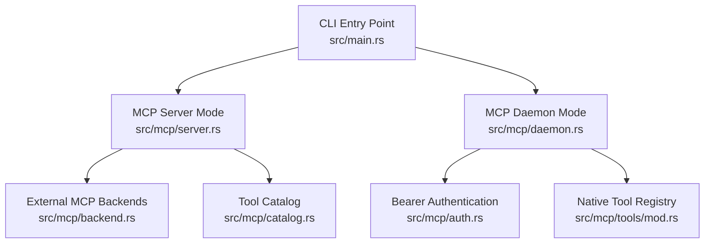
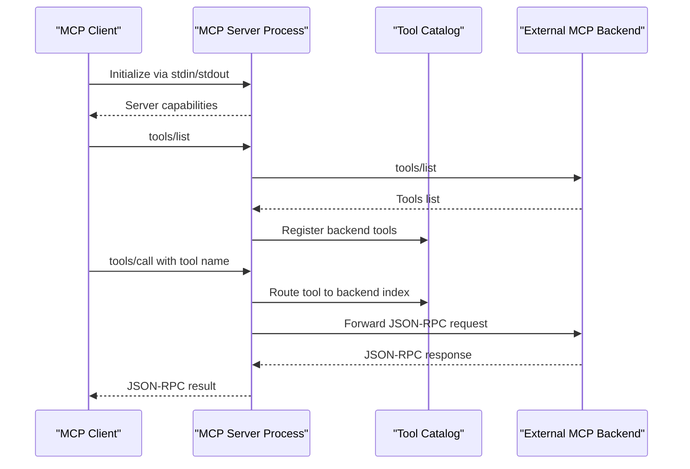
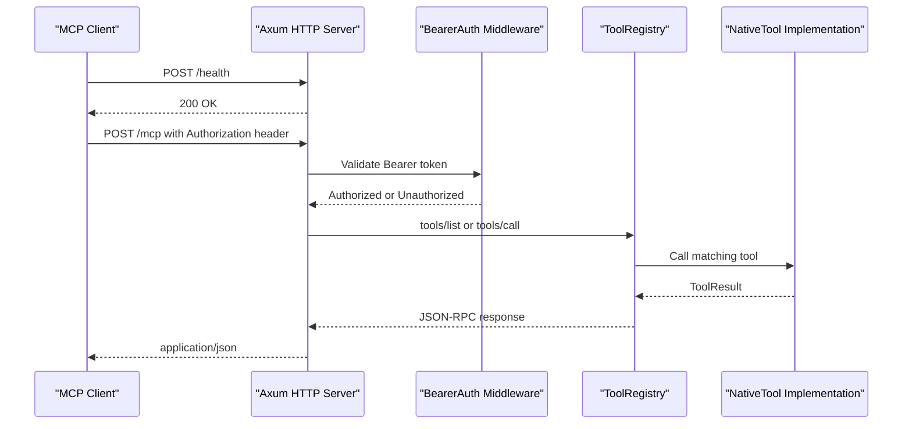
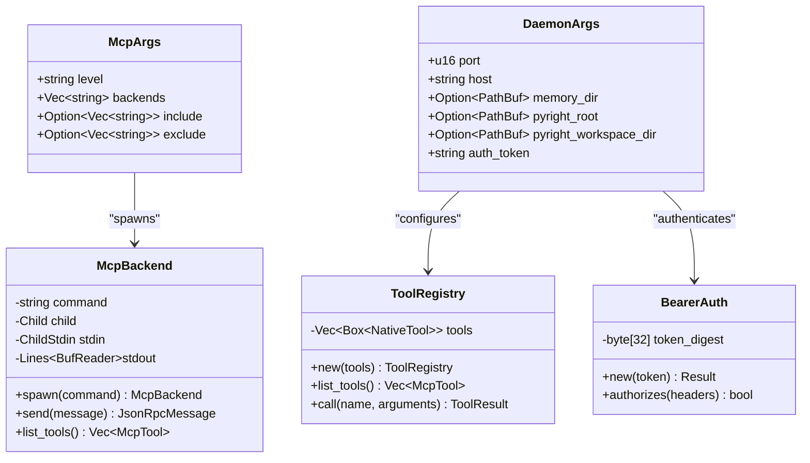
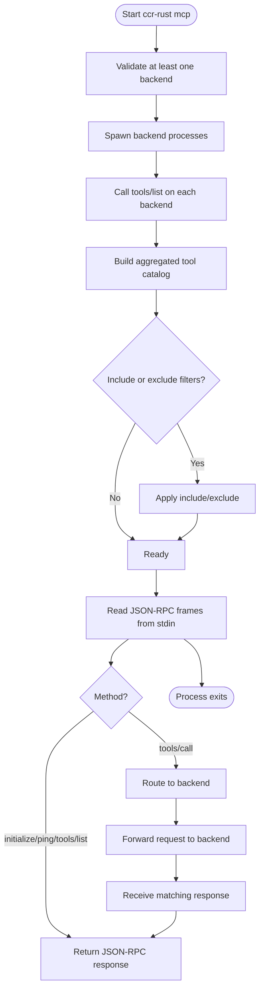
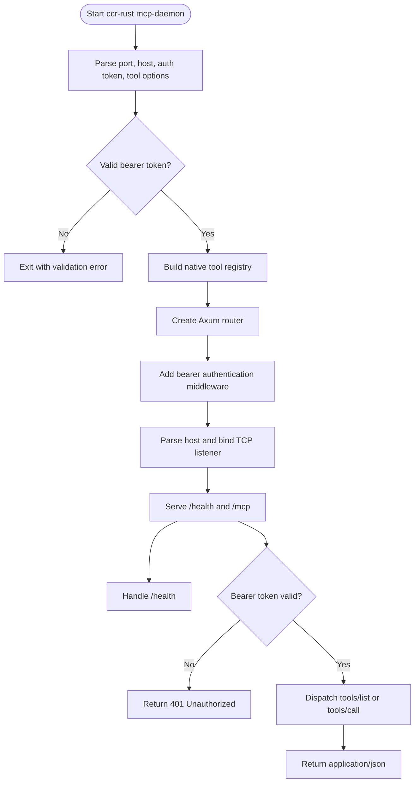

# MCP Server Setup and Configuration

<cite>
**Referenced Files in This Document**
- [README.md](file://README.md)
- [src/main.rs](file://src/main.rs)
- [src/mcp/mod.rs](file://src/mcp/mod.rs)
- [src/mcp/server.rs](file://src/mcp/server.rs)
- [src/mcp/daemon.rs](file://src/mcp/daemon.rs)
- [src/mcp/backend.rs](file://src/mcp/backend.rs)
- [src/mcp/catalog.rs](file://src/mcp/catalog.rs)
- [src/mcp/auth.rs](file://src/mcp/auth.rs)
- [src/mcp/tools/mod.rs](file://src/mcp/tools/mod.rs)
- [docs/configuration.md](file://docs/configuration.md)
- [docs/deployment.md](file://docs/deployment.md)
- [docs/local-operation.md](file://docs/local-operation.md)
- [k8s/deployment.yaml](file://k8s/deployment.yaml)
</cite>

## Table of Contents
1. [Introduction](#introduction)
2. [Project Structure](#project-structure)
3. [Core Components](#core-components)
4. [Architecture Overview](#architecture-overview)
5. [Detailed Component Analysis](#detailed-component-analysis)
6. [Configuration Reference](#configuration-reference)
7. [Deployment Scenarios](#deployment-scenarios)
8. [Server Lifecycle Management](#server-lifecycle-management)
9. [Troubleshooting Guide](#troubleshooting-guide)
10. [Conclusion](#conclusion)

## Introduction
This document explains how to set up, configure, and operate the CCR-Rust Model Context Protocol (MCP) server components. CCR-Rust provides two distinct MCP entry points:

- **MCP server mode**: A JSON-RPC over stdin/stdout proxy that spawns external MCP backend processes and aggregates their tools.
- **MCP daemon mode**: An HTTP server exposing a shared native tool registry behind bearer authentication.

The MCP layer is optional and separate from the main CCR-Rust router listener. It does not replace the provider routing endpoint; it adds a tool-discovery and tool-execution surface for clients that speak the MCP protocol.

Key distinctions:
- The main CCR-Rust router listens on `PORT` and `HOST`, typically `127.0.0.1:3456`.
- The MCP daemon defaults to port `3457` and its own host configuration.
- The MCP server mode has no HTTP listener; it communicates with clients through standard input and output.

**Section sources**
- [README.md:1-80](file://README.md#L1-L80)
- [docs/local-operation.md:1-40](file://docs/local-operation.md#L1-L40)

## Project Structure
The MCP implementation lives under `src/mcp/` and is exposed as a module group. The top-level binary dispatches into either MCP server mode or MCP daemon mode based on CLI commands.



**Diagram sources**
- [src/main.rs:187-227](file://src/main.rs#L187-L227)
- [src/mcp/server.rs:1-40](file://src/mcp/server.rs#L1-L40)
- [src/mcp/daemon.rs:1-40](file://src/mcp/daemon.rs#L1-L40)

**Section sources**
- [src/mcp/mod.rs:1-8](file://src/mcp/mod.rs#L1-L8)
- [src/main.rs:187-227](file://src/main.rs#L187-L227)

## Core Components
CCR-Rust exposes two MCP entry points through its CLI:

| Command | Transport | Purpose | Default Port |
|---|---|---|---|
| `ccr-rust mcp` | stdin/stdout JSON-RPC | Proxy calls to one or more external MCP backends | None |
| `ccr-rust mcp-daemon` | HTTP POST `/mcp` | Serve native tools with bearer authentication | `3457` |

### MCP Server Mode
The MCP server process:
- Spawns one or more external MCP backend commands.
- Discovers tools by calling `tools/list` on each backend.
- Aggregates tools into a catalog.
- Routes `tools/call` requests to the correct backend.
- Supports include/exclude filtering and description compression levels.

### MCP Daemon Mode
The MCP daemon process:
- Starts an Axum HTTP server.
- Requires a Bearer token for all protected endpoints.
- Registers built-in native tools such as context search, memory, Exa, Jina, Pyright, and optionally Sindexer.
- Exposes `/health` and `/mcp`.

**Section sources**
- [src/main.rs:187-227](file://src/main.rs#L187-L227)
- [src/main.rs:861-887](file://src/main.rs#L861-L887)
- [src/mcp/server.rs:1-40](file://src/mcp/server.rs#L1-L40)
- [src/mcp/daemon.rs:1-40](file://src/mcp/daemon.rs#L1-L40)

## Architecture Overview
The two MCP modes follow different architectural patterns.

### MCP Server Mode Flow


**Diagram sources**
- [src/mcp/server.rs:41-120](file://src/mcp/server.rs#L41-L120)
- [src/mcp/backend.rs:20-90](file://src/mcp/backend.rs#L20-L90)
- [src/mcp/catalog.rs:1-40](file://src/mcp/catalog.rs#L1-L40)

### MCP Daemon Mode Flow


**Diagram sources**
- [src/mcp/daemon.rs:140-200](file://src/mcp/daemon.rs#L140-L200)
- [src/mcp/auth.rs:10-50](file://src/mcp/auth.rs#L10-L50)
- [src/mcp/tools/mod.rs:60-98](file://src/mcp/tools/mod.rs#L60-L98)

**Section sources**
- [src/mcp/server.rs:41-120](file://src/mcp/server.rs#L41-L120)
- [src/mcp/daemon.rs:140-200](file://src/mcp/daemon.rs#L140-L200)

## Detailed Component Analysis

### MCP Server Process
The MCP server is a lightweight orchestrator. It does not implement tools itself; instead, it delegates to external processes launched through `bash -lc`.

#### Key Responsibilities
- Validate that at least one backend command is configured.
- Spawn each backend and attach piped stdin/stdout.
- Discover tools through `tools/list`.
- Apply include/exclude filters.
- Compress tool descriptions according to a level.
- Handle JSON-RPC methods: `initialize`, `ping`, `tools/list`, `tools/call`.
- Map unknown tools to JSON-RPC error code `-32601`.
- Map malformed frames to JSON-RPC error code `-32700`.

#### Startup Parameters
| Parameter | CLI Flag | Environment Variable | Default | Description |
|---|---|---|---|---|
| Level | `--level` | None | `low` | Controls tool description compression. Valid values include `none`, `minimal`, `min`, `medium`, `light`, `high`, `aggressive`, `full`. |
| Backends | `--wrap` | None | Required | One or more external MCP backend commands. |
| Include | `--include` | None | None | Comma-separated tool names to keep. |
| Exclude | `--exclude` | None | None | Comma-separated tool names to remove. |

#### Error Handling
- Missing backend commands produce an explicit startup error.
- Failed backend spawn returns a contextual error including the command.
- Failed `tools/list` returns a contextual error identifying the backend index.
- Unknown tool names return JSON-RPC error `-32601`.
- Invalid JSON frames return JSON-RPC error `-32700`.
- Backend process exit before responding produces a detailed error including exit status.

**Section sources**
- [src/mcp/server.rs:1-120](file://src/mcp/server.rs#L1-L120)
- [src/mcp/server.rs:121-190](file://src/mcp/server.rs#L121-L190)
- [src/mcp/backend.rs:1-90](file://src/mcp/backend.rs#L1-L90)
- [src/mcp/catalog.rs:1-72](file://src/mcp/catalog.rs#L1-L72)

### External MCP Backend Manager
Each backend is a child process managed through Tokio’s asynchronous process interface.

#### Lifecycle
1. Spawn through `bash -lc` with the configured command.
2. Capture stdout as line-delimited JSON-RPC frames.
3. Write serialized JSON-RPC messages followed by a newline.
4. Read responses until a matching `id` arrives.
5. Skip notifications (messages with `method` but no `id`).
6. Kill the child process on drop.

#### Complexity
- Tool discovery is O(n) per backend where n is the number of tools returned.
- Request forwarding is O(1) per message once the matching response frame is found.
- Resource cleanup occurs during garbage collection through `Drop`.

**Section sources**
- [src/mcp/backend.rs:1-136](file://src/mcp/backend.rs#L1-L136)

### MCP Daemon Process
The MCP daemon is a self-contained HTTP service using Axum and Tokio.

#### Endpoints
| Endpoint | Method | Authentication | Response |
|---|---|---|---|
| `/health` | GET | None | `200 OK` with body `ok` |
| `/mcp` | POST | Bearer token required | JSON-RPC response with `application/json` |

#### Native Tools
The daemon conditionally registers these tools:

| Tool | Enablement | Notes |
|---|---|---|
| Exa | `EXA_API_KEY` present and nonempty | Web/search capability |
| Jina | `JINA_API_KEY` or `jina_api_key` argument | Search and reader base URLs can be configured together |
| Context7 | Always enabled | Context retrieval tool |
| Memory | Always enabled | Persists to `memory_dir/memory.json` when provided |
| Pyright | Both project root and workspace directory provided | Type-checking tool |
| Sindexer | Enabled with `sindexer` Cargo feature | Optional indexing tool |

#### Authentication Contract
- Token must be nonempty ASCII without whitespace or control characters.
- Clients send `Authorization: Bearer <token>`.
- Scheme comparison is case-insensitive.
- Tokens are compared using SHA-256 digests with constant-time comparison.
- Unauthorized requests receive `401 Unauthorized` with `WWW-Authenticate: Bearer`.

**Section sources**
- [src/mcp/daemon.rs:1-140](file://src/mcp/daemon.rs#L1-L140)
- [src/mcp/daemon.rs:201-319](file://src/mcp/daemon.rs#L201-L319)
- [src/mcp/auth.rs:1-81](file://src/mcp/auth.rs#L1-L81)
- [src/mcp/tools/mod.rs:1-98](file://src/mcp/tools/mod.rs#L1-L98)

### Class Relationships


**Diagram sources**
- [src/mcp/server.rs:13-20](file://src/mcp/server.rs#L13-L20)
- [src/mcp/daemon.rs:24-40](file://src/mcp/daemon.rs#L24-L40)
- [src/mcp/backend.rs:10-20](file://src/mcp/backend.rs#L10-L20)
- [src/mcp/tools/mod.rs:60-98](file://src/mcp/tools/mod.rs#L60-L98)
- [src/mcp/auth.rs:10-30](file://src/mcp/auth.rs#L10-L30)

## Configuration Reference

### Main Router vs MCP Configuration
Most CCR-Rust router configuration options live in the JSON config file and apply to the main router listener. The MCP components are primarily controlled through CLI flags and environment variables rather than the same JSON schema.

| Area | Where Configured | Primary Controls |
|---|---|---|
| Main router listener | JSON config and global CLI flags | `HOST`, `PORT`, `AUTH_HOST`, `AUTH_PORT`, API timeouts, client keys |
| MCP server mode | CLI flags only | `--level`, `--wrap`, `--include`, `--exclude` |
| MCP daemon mode | CLI flags and environment variables | `--port`, `--host`, `--auth-token`, `--memory-dir`, Pyright paths |

### MCP Server Mode Options
| Option | CLI Flag | Default | Description |
|---|---|---|---|
| Description level | `--level` | `low` | Controls how much detail appears in `tools/list`. Levels range from omitting schemas (`none`) to full tool metadata (`full`). |
| Backend commands | `--wrap` | Required | External process command(s). Each backend runs independently. |
| Include filter | `--include` | None | Keep only listed tool names. |
| Exclude filter | `--exclude` | None | Remove listed tool names. |

### MCP Daemon Mode Options
| Option | CLI Flag | Environment Variable | Default | Description |
|---|---|---|---|---|
| Port | `--port` | None | `3457` | TCP port for the HTTP server. |
| Host | `--host` | `CCR_MCP_DAEMON_HOST` | `127.0.0.1` | Bind address. |
| Auth token | `--auth-token` | `CCR_MCP_AUTH_TOKEN` | Required | Bearer token for `/mcp` and protected behavior. |
| Memory directory | `--memory-dir` | `CCR_MCP_MEMORY_DIR` | None | Directory for persistent memory graph storage. |
| Pyright project root | `--pyright-root` | `PYRIGHT_PROJECT_ROOT` | None | Project root for Pyright type checking. |
| Pyright workspace dir | `--pyright-workspace-dir` | `CCR_MCP_PYRIGHT_WORKSPACE_DIR` | None | Private ephemeral workspace for Pyright requests. |

### Environment Variables Used by MCP Components
| Variable | Component | Purpose |
|---|---|---|
| `CCR_MCP_AUTH_TOKEN` | MCP daemon | Bearer token for protected endpoints |
| `CCR_MCP_DAEMON_HOST` | MCP daemon | Daemon listen host |
| `CCR_MCP_MEMORY_DIR` | MCP daemon | Memory persistence directory |
| `CCR_MCP_PYRIGHT_WORKSPACE_DIR` | MCP daemon | Pyright workspace directory |
| `PYRIGHT_PROJECT_ROOT` | MCP daemon | Pyright project root |
| `EXA_API_KEY` | MCP daemon | Enables Exa tool |
| `JINA_API_KEY` | MCP daemon | Enables Jina tool |

**Section sources**
- [src/main.rs:187-227](file://src/main.rs#L187-L227)
- [src/mcp/daemon.rs:24-40](file://src/mcp/daemon.rs#L24-L40)
- [src/mcp/auth.rs:10-30](file://src/mcp/auth.rs#L10-L30)
- [docs/configuration.md:1-80](file://docs/configuration.md#L1-L80)

## Deployment Scenarios

### Standalone MCP Server Mode
Use this mode when you want CCR-Rust to proxy calls to existing external MCP servers.

Steps:
1. Prepare your external MCP backend command(s).
2. Choose a description level appropriate for your client.
3. Optionally filter tools with `--include` or `--exclude`.
4. Run the MCP server with at least one `--wrap` backend.

Example pattern:
```bash
ccr-rust mcp --level low --wrap "your-mcp-backend-command"
```

For multiple backends:
```bash
ccr-rust mcp --wrap "backend-a" --wrap "backend-b" --exclude "tool-to-remove"
```

Operational notes:
- No HTTP listener is created.
- The process exits if stdin/stdout communication fails.
- Child backends are killed when the MCP server exits.

### Standalone MCP Daemon Mode
Use this mode when you need a local HTTP MCP server with built-in tools and bearer authentication.

Steps:
1. Export a secure random token.
2. Configure optional tools through environment variables or flags.
3. Start the daemon on loopback unless a reverse proxy requires otherwise.
4. Verify health and authenticated MCP access.

Example pattern:
```bash
export CCR_MCP_AUTH_TOKEN="a-private-random-token"
ccr-rust mcp-daemon --port 3457
```

With Pyright:
```bash
ccr-rust mcp-daemon \
  --pyright-root /path/to/project \
  --pyright-workspace-dir ~/.cache/ccr-rust/pyright-workspaces
```

With Jina:
```bash
export JINA_API_KEY="your-jina-key"
ccr-rust mcp-daemon
```

### Embedded in CCR-Rust
The MCP components are compiled into the same CCR-Rust binary. They do not require a separate installation. You run them as subcommands of the installed `ccr-rust` binary.

This means:
- The MCP server and MCP daemon share the same binary version.
- Feature flags such as `sindexer` affect the daemon’s available tools.
- The main router and MCP services remain separate listeners/process responsibilities.

### Containerized Deployment
The repository includes Docker support for the main router. For MCP deployment inside containers:
- Use the same container image.
- Pass MCP CLI flags through `ENTRYPOINT` or `CMD`.
- Inject `CCR_MCP_AUTH_TOKEN` through container secrets.
- Mount configuration and runtime directories as needed.
- Open the MCP port separately from the main router port.

Kubernetes example for the main router shows resource requests, limits, probes, and volume mounts. Adapt those patterns for MCP deployments.

**Section sources**
- [src/main.rs:187-227](file://src/main.rs#L187-L227)
- [docs/deployment.md:1-50](file://docs/deployment.md#L1-L50)
- [k8s/deployment.yaml:1-50](file://k8s/deployment.yaml#L1-L50)

## Server Lifecycle Management

### MCP Server Lifecycle


**Diagram sources**
- [src/mcp/server.rs:24-120](file://src/mcp/server.rs#L24-L120)
- [src/mcp/backend.rs:20-90](file://src/mcp/backend.rs#L20-L90)

### MCP Daemon Lifecycle


**Diagram sources**
- [src/mcp/daemon.rs:41-140](file://src/mcp/daemon.rs#L41-L140)
- [src/mcp/daemon.rs:140-200](file://src/mcp/daemon.rs#L140-L200)

### Runtime Behavior
- The MCP server uses buffered stdin/stdout and flushes after every response.
- The MCP daemon uses Axum’s request pipeline with a custom bearer middleware.
- Both modes use JSON-RPC 2.0-style framing.
- The daemon sets `content-type: application/json` for all MCP responses.
- The daemon returns `202 Accepted` with an empty body for notification-style requests without an ID.

**Section sources**
- [src/mcp/server.rs:120-227](file://src/mcp/server.rs#L120-L227)
- [src/mcp/daemon.rs:140-200](file://src/mcp/daemon.rs#L140-L200)

## Troubleshooting Guide

### Common MCP Server Issues

| Symptom | Likely Cause | Resolution |
|---|---|---|
| Startup fails with missing backend | No `--wrap` flag provided | Provide at least one backend command. |
| Backend fails to start | Command invalid or unavailable | Test the backend command outside CCR-Rust first. |
| `tools/list` fails | Backend did not return a valid tools list | Check backend logs; ensure it implements `tools/list`. |
| Unknown tool error | Tool name not registered by any backend | Use `tools/list` to inspect available tools; adjust include/exclude filters. |
| Invalid JSON-RPC frame error | Client sent malformed JSON | Inspect client framing; ensure one JSON object per line. |
| Backend exits unexpectedly | Child process terminated | Review stderr inheritance and backend stability. |

### Common MCP Daemon Issues

| Symptom | Likely Cause | Resolution |
|---|---|---|
| `401 Unauthorized` | Missing or incorrect `Authorization: Bearer` header | Set `CCR_MCP_AUTH_TOKEN` and send the matching token. |
| Token validation fails at startup | Token contains whitespace, control characters, or is empty | Use a clean ASCII token without spaces. |
| Pyright tool not enabled | Only one of project root or workspace directory is set | Provide both `--pyright-root` and `--pyright-workspace-dir`. |
| Jina tool fails | Base URL mismatch or incomplete Jina configuration | Set both search and reader bases together, or neither. |
| `/health` works but `/mcp` fails | Authentication issue | Confirm bearer token matches `CCR_MCP_AUTH_TOKEN`. |
| Daemon binds to wrong address | Incorrect host or environment variable | Check `--host` and `CCR_MCP_DAEMON_HOST`. |

### Diagnostic Commands
- Check MCP daemon health:
  ```bash
  curl http://127.0.0.1:3457/health
  ```
- Test authenticated MCP access:
  ```bash
  curl -X POST http://127.0.0.1:3457/mcp \
    -H "Authorization: Bearer YOUR_TOKEN" \
    -H "Content-Type: application/json" \
    -d '{"jsonrpc":"2.0","id":"1","method":"ping"}'
  ```
- Inspect available tools:
  ```bash
  curl -X POST http://127.0.0.1:3457/mcp \
    -H "Authorization: Bearer YOUR_TOKEN" \
    -H "Content-Type: application/json" \
    -d '{"jsonrpc":"2.0","id":"1","method":"tools/list"}'
  ```

### Logging and Observability
- The MCP daemon builds an internal HTTP client with timeout and user agent configuration.
- Tool registration and calls emit tracing events.
- Backend spawning and tool routing log backend indices and tool names.
- Authentication tests verify rejected tokens, accepted tokens, and unsafe token validation.

**Section sources**
- [src/mcp/server.rs:24-120](file://src/mcp/server.rs#L24-L120)
- [src/mcp/backend.rs:20-136](file://src/mcp/backend.rs#L20-L136)
- [src/mcp/daemon.rs:41-140](file://src/mcp/daemon.rs#L41-L140)
- [src/mcp/auth.rs:1-81](file://src/mcp/auth.rs#L1-L81)

## Conclusion
CCR-Rust’s MCP layer provides two complementary integration points:

- Use **MCP server mode** when you already have external MCP backends and want CCR-Rust to aggregate, filter, and proxy their tools.
- Use **MCP daemon mode** when you want a ready-made HTTP MCP server with native tools, bearer authentication, and a simple health check.

Both modes are part of the same binary and are controlled through CLI flags and environment variables rather than the main router’s JSON configuration. For production deployments, always:
- Restrict MCP daemon access to trusted clients.
- Generate a secure random bearer token.
- Run on loopback unless a reverse proxy handles TLS and access control.
- Validate tool availability before relying on specific tools.
- Monitor backend stability for MCP server mode since backends are external child processes.

**Section sources**
- [src/main.rs:187-227](file://src/main.rs#L187-L227)
- [src/mcp/server.rs:1-120](file://src/mcp/server.rs#L1-L120)
- [src/mcp/daemon.rs:1-140](file://src/mcp/daemon.rs#L1-L140)