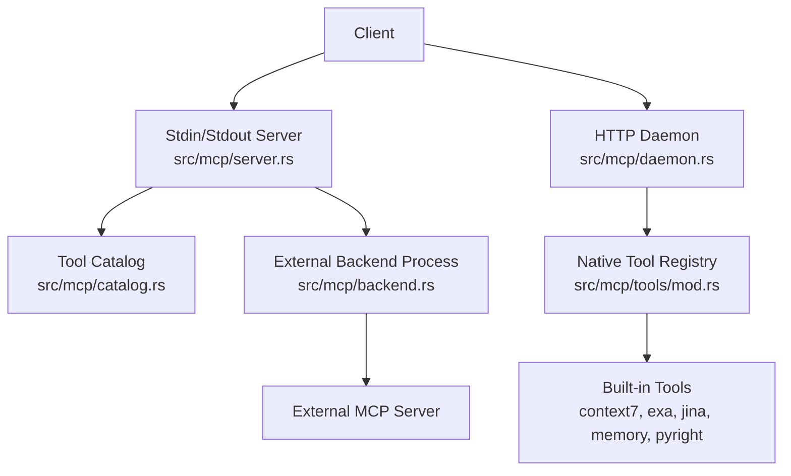
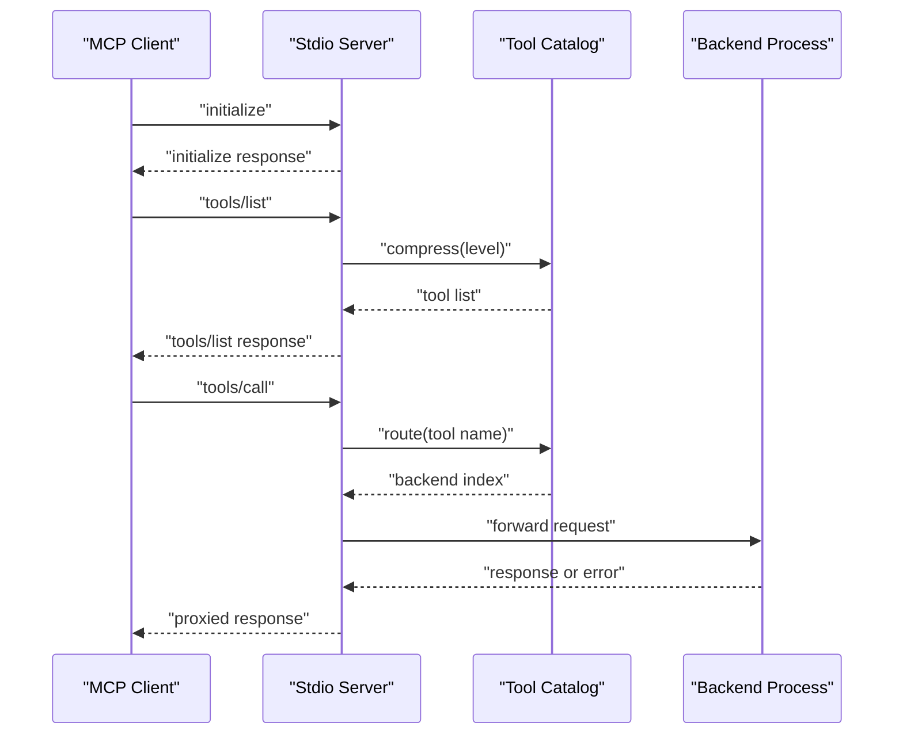
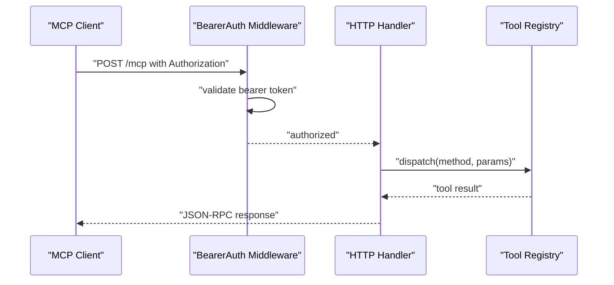
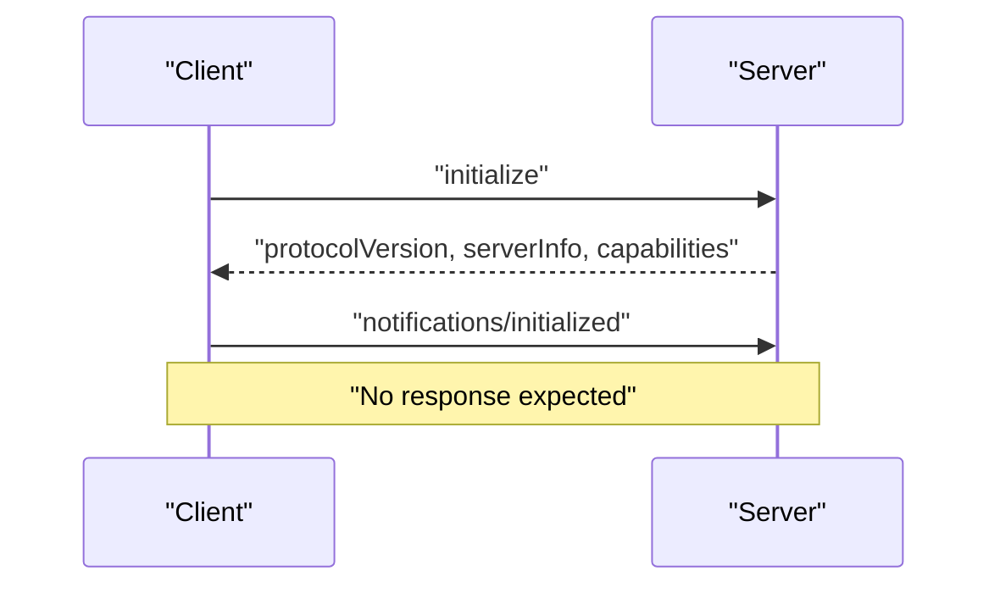
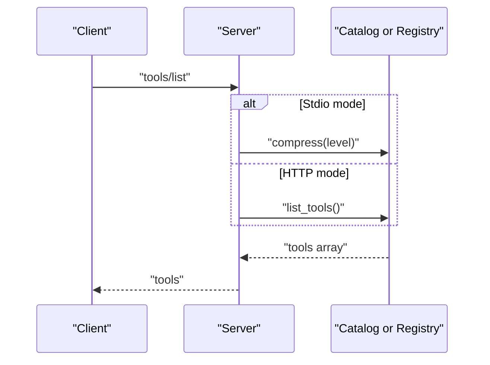
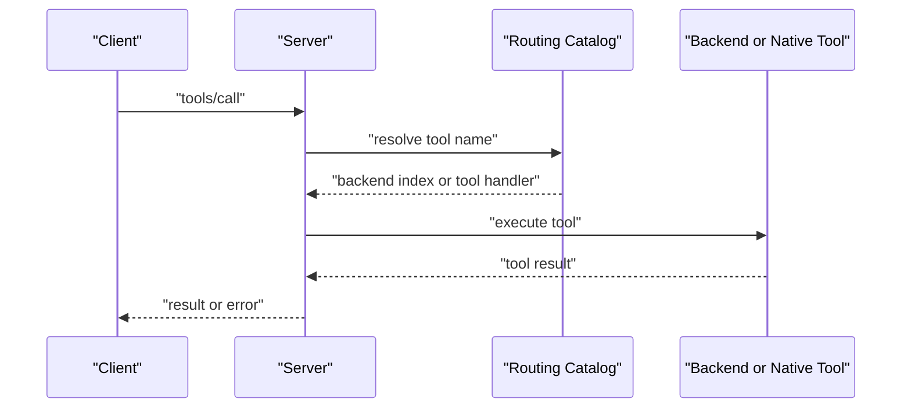
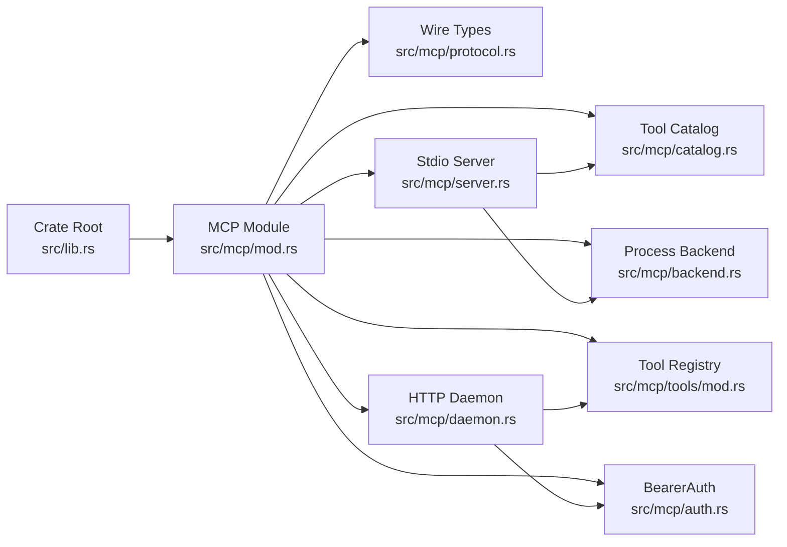

# Protocol Reference and Message Formats

<cite>
**Referenced Files in This Document**
- [README.md](file://README.md)
- [protocol.rs](file://src/mcp/protocol.rs)
- [server.rs](file://src/mcp/server.rs)
- [backend.rs](file://src/mcp/backend.rs)
- [catalog.rs](file://src/mcp/catalog.rs)
- [daemon.rs](file://src/mcp/daemon.rs)
- [auth.rs](file://src/mcp/auth.rs)
- [tools/mod.rs](file://src/mcp/tools/mod.rs)
- [lib.rs](file://src/lib.rs)
- [test_mcp_daemon.rs](file://tests/test_mcp_daemon.rs)
- [streaming_incremental_design.md](file://docs/streaming_incremental_design.md)
</cite>

## Table of Contents
1. [Introduction](#introduction)
2. [Project Structure](#project-structure)
3. [Core Components](#core-components)
4. [Architecture Overview](#architecture-overview)
5. [Detailed Component Analysis](#detailed-component-analysis)
6. [Protocol Schema Reference](#protocol-schema-reference)
7. [Connection, Handshake, and Session Management](#connection-handshake-and-session-management)
8. [Message Exchange Patterns](#message-exchange-patterns)
9. [Streaming, Progress, and Error Propagation](#streaming-progress-and-error-propagation)
10. [Dependency Analysis](#dependency-analysis)
11. [Performance Considerations](#performance-considerations)
12. [Troubleshooting Guide](#troubleshooting-guide)
13. [Conclusion](#conclusion)

## Introduction
This document is the protocol reference for the Model Context Protocol (MCP) integration in CCR-Rust. It describes the JSON-RPC message formats, supported methods, request/response schemas, tool catalog behavior, transport framing, authentication, error responses, and streaming expectations.

CCR-Rust provides two MCP entry points:
- A line-oriented stdin/stdout server that proxies requests to one or more external MCP backend processes.
- An HTTP daemon that exposes a `/mcp` endpoint over JSON and a `/health` liveness endpoint.

The core wire format is JSON-RPC 2.0 with method names aligned to the MCP tools namespace. The implementation declares protocol version `2024-11-05`, but its own transport framing and response shapes are defined by this repository rather than being a full generic MCP client stack.

**Section sources**
- [README.md:1-60](file://README.md#L1-L60)
- [server.rs:20-120](file://src/mcp/server.rs#L20-L120)
- [daemon.rs:1-120](file://src/mcp/daemon.rs#L1-L120)

## Project Structure
The MCP subsystem lives under `src/mcp`. Its public surface is exposed through the crate root module.

**Diagram sources**
- [lib.rs:1-27](file://src/lib.rs#L1-L27)
- [server.rs:1-120](file://src/mcp/server.rs#L1-L120)
- [daemon.rs:1-120](file://src/mcp/daemon.rs#L1-L120)
- [catalog.rs:1-72](file://src/mcp/catalog.rs#L1-L72)
- [backend.rs:1-136](file://src/mcp/backend.rs#L1-L136)
- [tools/mod.rs:1-98](file://src/mcp/tools/mod.rs#L1-L98)

**Section sources**
- [lib.rs:1-27](file://src/lib.rs#L1-L27)
- [mod.rs](file://src/mcp/mod.rs)

## Core Components
| Component | Responsibility | Transport | Key Behaviors |
|---|---|---|---|
| `JsonRpcMessage` | Wire envelope for all MCP messages | Stdio lines and HTTP JSON bodies | Optional `jsonrpc`, `id`, `method`, `params`, `result`, `error` |
| Stdio server | Accepts MCP clients over standard I/O | One JSON-RPC frame per newline-delimited line | Initializes, lists tools, routes `tools/call` to backends |
| HTTP daemon | Exposes MCP over HTTP | POST JSON body; GET health | Bearer-authenticated, native tool registry, JSON-RPC dispatch |
| Backend process manager | Spawns and communicates with external MCP servers | Child process stdin/stdout | Request-response matching, notification filtering, exit detection |
| Tool catalog | Aggregates tool metadata from backends | In-memory | Include/exclude filtering, compression levels |
| Native tool registry | Dispatches built-in tools | In-process | Typed result shape with content array and error flag |
| Authentication | Validates bearer tokens | HTTP middleware | Constant-time digest comparison, strict token validation |

**Section sources**
- [protocol.rs:1-40](file://src/mcp/protocol.rs#L1-L40)
- [server.rs:1-227](file://src/mcp/server.rs#L1-L227)
- [daemon.rs:1-319](file://src/mcp/daemon.rs#L1-L319)
- [backend.rs:1-136](file://src/mcp/backend.rs#L1-L136)
- [catalog.rs:1-72](file://src/mcp/catalog.rs#L1-L72)
- [tools/mod.rs:1-98](file://src/mcp/tools/mod.rs#L1-L98)
- [auth.rs:1-81](file://src/mcp/auth.rs#L1-L81)

## Architecture Overview
There are two distinct MCP transports implemented in this repository.

### Stdio Proxy Mode
A CLI-invoked server reads frames from stdin, parses them as JSON-RPC, handles local methods such as initialization and tool listing, and forwards tool calls to one or more externally spawned MCP backend processes. Each backend is launched as a shell command and communicates via newline-delimited JSON.

**Diagram sources**
- [server.rs:20-160](file://src/mcp/server.rs#L20-L160)
- [catalog.rs:1-72](file://src/mcp/catalog.rs#L1-L72)
- [backend.rs:1-136](file://src/mcp/backend.rs#L1-L136)

### HTTP Daemon Mode
The daemon runs an Axum HTTP server with bearer-token authentication. Clients send JSON-RPC payloads to `/mcp`; the daemon dispatches to the native tool registry. A separate `/health` endpoint returns plain text when authorized.

**Diagram sources**
- [daemon.rs:1-200](file://src/mcp/daemon.rs#L1-L200)
- [auth.rs:1-81](file://src/mcp/auth.rs#L1-L81)
- [tools/mod.rs:1-98](file://src/mcp/tools/mod.rs#L1-L98)

## Detailed Component Analysis

### JSON-RPC Envelope and Tool Types
The wire envelope is intentionally minimal. It carries the optional fields required by both request-response and notification patterns.

| Field | Type | Required | Meaning |
|---|---|---:|---|
| `jsonrpc` | String | No | Must be `"2.0"` for valid responses produced by this implementation |
| `id` | Any JSON value | Conditional | Present on requests that expect a response; omitted for notifications |
| `method` | String | Conditional | Present on requests and server-to-client notifications; absent on normal responses |
| `params` | Object | Conditional | Method parameters; structure depends on method |
| `result` | Any JSON value | Conditional | Successful response payload |
| `error` | Object | Conditional | Failure payload containing `code` and `message` |

For tool metadata, each tool has:
- `name`: string identifier used by `tools/call`.
- `description`: human-readable summary, optionally compressed.
- `inputSchema`: schema describing accepted arguments.

For tool invocation:
- `name`: must match a registered tool.
- `arguments`: object passed to the tool handler.

**Section sources**
- [protocol.rs:1-40](file://src/mcp/protocol.rs#L1-L40)

### Stdio Server Lifecycle
The stdio server performs these steps at startup:
1. Validates that at least one backend command is configured.
2. Spawns each backend process.
3. Requests `tools/list` from every backend.
4. Merges backend tool catalogs into a shared catalog.
5. Applies include/exclude filters.
6. Reads stdin line-by-line and dispatches JSON-RPC frames.

Error handling:
- Invalid JSON frames produce JSON-RPC parse error `-32700`.
- Unhandled request errors produce JSON-RPC server error `-32000`.
- Unknown methods without an `id` are silently ignored; unknown methods with an `id` return `-32601`.

Transport framing:
- Every response is serialized to JSON, followed by a newline, then flushed.

**Section sources**
- [server.rs:20-120](file://src/mcp/server.rs#L20-L120)
- [server.rs:120-227](file://src/mcp/server.rs#L120-L227)

### HTTP Daemon Lifecycle
The daemon:
1. Builds a bearer authenticator from the configured token.
2. Registers enabled tools based on environment variables and configuration.
3. Creates an Axum router with `/mcp` and `/health`.
4. Wraps routes with bearer authentication middleware.
5. Starts listening on the configured host and port.

Authentication rules:
- Tokens must be nonempty ASCII without whitespace or control characters.
- Comparison uses constant-time digest comparison.
- Missing or invalid `Authorization: Bearer <token>` returns HTTP `401 Unauthorized` with `WWW-Authenticate: Bearer`.

**Section sources**
- [daemon.rs:1-120](file://src/mcp/daemon.rs#L1-L120)
- [auth.rs:1-81](file://src/mcp/auth.rs#L1-L81)
- [test_mcp_daemon.rs:250-340](file://tests/test_mcp_daemon.rs#L250-L340)

### Backend Process Manager
The backend manager wraps an external MCP server process:
- Launches the command through `bash -lc`.
- Pipes child stdin/stdout.
- Sends JSON-RPC frames as newline-delimited lines.
- Reads responses until it finds one whose `id` matches the request.
- Skips server-to-client notifications and empty lines.
- Reports backend termination if no matching response arrives.

Tool discovery:
- The manager sends `tools/list` with a fixed request id during catalog initialization.
- It accepts either `{ tools: [...] }` or a bare array as the result.

**Section sources**
- [backend.rs:1-136](file://src/mcp/backend.rs#L1-L136)

### Tool Catalog
The catalog aggregates tools from multiple backends:
- Later backend registrations can overwrite earlier tool entries with the same name.
- Each tool is mapped to a backend index for routing.
- Compression modes reduce description length or remove schemas for smaller tool listings.

Compression levels:
- `none`: clears description and replaces schema with an empty object.
- `minimal`, `min`, `high`, `aggressive`: clears description.
- `medium`, `light`: truncates normalized whitespace description to 256 characters.
- Default: preserves original descriptions and schemas.

**Section sources**
- [catalog.rs:1-72](file://src/mcp/catalog.rs#L1-L72)

### Native Tool Registry
The daemon’s tool registry holds instances of built-in tools implementing a common trait. When a tool call arrives:
1. The registry iterates registered tool providers.
2. If a provider exposes the requested tool name, it invokes the handler.
3. Success returns a structured result with a content array and `isError: false`.
4. Errors return a structured result with `isError: true`.
5. Unknown tool names return an error content result rather than a transport-level failure.

Result shape:
- `content`: array of content objects.
- Each content object has `type` and `text`.
- `isError`: boolean indicating whether the tool execution was considered an error.

**Section sources**
- [tools/mod.rs:1-98](file://src/mcp/tools/mod.rs#L1-L98)

## Protocol Schema Reference

### Supported Methods

| Method | Transport | Direction | Parameters | Response | Notes |
|---|---|---|---|---|---|
| `initialize` | Stdio, HTTP | Client to server | `protocolVersion`, `capabilities`, `clientInfo` | Server info and capabilities | First handshake request |
| `notifications/initialized` | Stdio, HTTP | Client to server | None | None | Notification; no response expected |
| `ping` | Stdio, HTTP | Client to server | None | Empty object | Liveness probe |
| `tools/list` | Stdio, HTTP | Client to server | Empty object | Array of tools | Stdio may compress output |
| `tools/call` | Stdio, HTTP | Client to server | `name`, `arguments` | Tool result | Stdio forwards to backend; HTTP executes native tool |

### Initialize Response Fields

| Field | Type | Description |
|---|---|---|
| `protocolVersion` | String | Declared MCP protocol version |
| `serverInfo.name` | String | Server identity |
| `serverInfo.version` | String | Build version |
| `capabilities.tools.listChanged` | Boolean | Indicates whether the tool list changes dynamically |

### Tool Metadata Schema

| Field | Type | Validation |
|---|---|---|
| `name` | String | Nonempty; must match a registered tool |
| `description` | String | Human-readable; may be truncated by compression |
| `inputSchema` | Object | JSON Schema describing accepted arguments |

### Tool Call Request Schema

| Field | Type | Validation |
|---|---|---|
| `name` | String | Must be present and registered |
| `arguments` | Object | Defaults to empty object when absent |

### Tool Result Schema

| Field | Type | Description |
|---|---|---|
| `content` | Array | List of content items returned by the tool |
| `isError` | Boolean | True when the tool considers its execution unsuccessful |

Each content item contains:
| Field | Type | Description |
|---|---|---|
| `type` | String | Content kind, typically `"text"` |
| `text` | String | Serialized or plain text content |

**Section sources**
- [server.rs:60-160](file://src/mcp/server.rs#L60-L160)
- [daemon.rs:200-319](file://src/mcp/daemon.rs#L200-L319)
- [protocol.rs:1-40](file://src/mcp/protocol.rs#L1-L40)
- [tools/mod.rs:1-98](file://src/mcp/tools/mod.rs#L1-L98)

## Connection, Handshake, and Session Management

### Connection Establishment

#### Stdio Transport
- The client writes newline-delimited JSON-RPC frames to the server’s stdin.
- The server reads one line at a time.
- Empty lines are skipped.
- Responses are written to stdout as one JSON line per message, flushed after each write.

#### HTTP Transport
- The client posts a JSON-RPC request body to `/mcp`.
- Every request requires a valid `Authorization: Bearer <token>` header.
- The server responds with `application/json`.
- A separate `/health` GET endpoint returns plain text when authenticated.

### Handshake Protocol
The handshake is a single request-response exchange:
1. Client sends `initialize` with protocol version and client information.
2. Server replies with its declared protocol version, server identity, and capabilities.
3. Client may send `notifications/initialized` as a follow-up notification.

Declared protocol version: `2024-11-05`.

### Session Semantics
- There is no explicit session lifecycle, connection ID, or stateful handshake beyond initialization.
- Each request is independent and identified by its `id`.
- Notifications have no `id` and receive no response.
- The daemon does not maintain per-request state across unrelated calls.
- Backends are long-lived child processes managed by the stdio server; they are not re-spawned per request.

### Authentication
- HTTP bearer tokens are validated before route handlers run.
- Token validation rejects empty tokens, non-ASCII tokens, and tokens containing whitespace or control characters.
- Comparison is constant-time against a SHA-256 digest to reduce timing side-channel risk.
- Failed authentication returns HTTP `401` with `WWW-Authenticate: Bearer`.

**Section sources**
- [server.rs:20-60](file://src/mcp/server.rs#L20-L60)
- [server.rs:160-227](file://src/mcp/server.rs#L160-L227)
- [daemon.rs:120-200](file://src/mcp/daemon.rs#L120-L200)
- [daemon.rs:200-240](file://src/mcp/daemon.rs#L200-L240)
- [auth.rs:1-81](file://src/mcp/auth.rs#L1-L81)
- [test_mcp_daemon.rs:250-340](file://tests/test_mcp_daemon.rs#L250-L340)

## Message Exchange Patterns

### Initialization Pattern

**Diagram sources**
- [server.rs:80-120](file://src/mcp/server.rs#L80-L120)
- [daemon.rs:220-260](file://src/mcp/daemon.rs#L220-L260)

### Tool Discovery Pattern

**Diagram sources**
- [server.rs:100-140](file://src/mcp/server.rs#L100-L140)
- [catalog.rs:1-72](file://src/mcp/catalog.rs#L1-L72)
- [daemon.rs:240-280](file://src/mcp/daemon.rs#L240-L280)
- [tools/mod.rs:60-98](file://src/mcp/tools/mod.rs#L60-L98)

### Tool Execution Pattern

**Diagram sources**
- [server.rs:120-160](file://src/mcp/server.rs#L120-L160)
- [daemon.rs:260-319](file://src/mcp/daemon.rs#L260-L319)
- [tools/mod.rs:60-98](file://src/mcp/tools/mod.rs#L60-L98)

### Valid Request Examples
- Initialize: a JSON-RPC request with method `initialize`, an `id`, and a params object containing `protocolVersion`, `capabilities`, and `clientInfo`.
- Tool list: a JSON-RPC request with method `tools/list`, an `id`, and an empty params object.
- Tool call: a JSON-RPC request with method `tools/call`, an `id`, and params containing `name` and `arguments`.

### Valid Response Examples
- Initialize response: success with server info and capabilities.
- Tool list response: success with a `tools` array.
- Tool call response: success with a tool result containing `content` and `isError`.

**Section sources**
- [test_mcp_daemon.rs:40-120](file://tests/test_mcp_daemon.rs#L40-L120)
- [test_mcp_daemon.rs:120-200](file://tests/test_mcp_daemon.rs#L120-L200)
- [test_mcp_daemon.rs:200-250](file://tests/test_mcp_daemon.rs#L200-L250)

### Error Responses

| Scenario | JSON-RPC Code | HTTP Status | Behavior |
|---|---:|---:|---|
| Invalid JSON frame | `-32700` | N/A (stdio) or `200` (HTTP) | Parse error returned as JSON-RPC error |
| Missing or malformed request parameters | `-32000` | N/A (stdio) or `200` (HTTP) | Server-side parameter validation error |
| Unknown method | `-32601` | N/A (stdio) or `200` (HTTP) | Returned only when request has an `id` |
| Unknown tool name | `-32601` | N/A (stdio) or `200` (HTTP) | Stdio path returns JSON-RPC error |
| Native tool failure | `-32000` | `200` | Daemon wraps tool error in JSON-RPC error |
| Unknown tool name in native registry | None | `200` | Returns tool result with `isError: true` |
| Backend process exits prematurely | None | N/A | Transport-level error propagated to caller |
| Missing bearer token or wrong token | N/A | `401` | HTTP-only; includes `WWW-Authenticate: Bearer` |

Error envelope:
| Field | Type | Description |
|---|---:|---|
| `code` | Integer | JSON-RPC error code |
| `message` | String | Human-readable error description |

**Section sources**
- [server.rs:40-60](file://src/mcp/server.rs#L40-L60)
- [server.rs:140-200](file://src/mcp/server.rs#L140-L200)
- [daemon.rs:200-319](file://src/mcp/daemon.rs#L200-L319)
- [backend.rs:60-120](file://src/mcp/backend.rs#L60-L120)
- [tools/mod.rs:60-98](file://src/mcp/tools/mod.rs#L60-L98)
- [auth.rs:1-81](file://src/mcp/auth.rs#L1-L81)

## Streaming, Progress, and Error Propagation

### Current MCP Transport Capabilities
Neither the stdio proxy nor the HTTP daemon implements incremental event streaming over SSE. Both transports use request-response semantics:
- Stdio: one JSON-RPC frame per line.
- HTTP: one JSON-RPC request maps to one JSON-RPC response.

Progress reporting and real-time tool execution deltas are therefore not part of the current MCP transport contract in this repository.

### Repository Streaming Context
The broader CCR-Rust project documents streaming design for model API adapters, including incremental SSE decoding, delta coalescing, backpressure, and terminal error events. That design applies to the main router’s Anthropic/OpenAI/Responses streams, not to the MCP JSON-RPC layer described here.

Key streaming concepts documented elsewhere:
- Incremental SSE frame decoding with carry-over buffers.
- Coalescing high-frequency deltas while preserving lifecycle events.
- Bounded channels for backpressure.
- Terminal failure events instead of mixed JSON bodies.

These concepts should be treated as architectural guidance for future MCP streaming extensions rather than current MCP behavior.

**Section sources**
- [server.rs:1-60](file://src/mcp/server.rs#L1-L60)
- [daemon.rs:120-200](file://src/mcp/daemon.rs#L120-L200)
- [streaming_incremental_design.md:1-177](file://docs/streaming_incremental_design.md#L1-L177)

## Dependency Analysis

**Diagram sources**
- [lib.rs:1-27](file://src/lib.rs#L1-L27)
- [mod.rs](file://src/mcp/mod.rs)
- [protocol.rs:1-40](file://src/mcp/protocol.rs#L1-L40)
- [server.rs:1-40](file://src/mcp/server.rs#L1-L40)
- [daemon.rs:1-40](file://src/mcp/daemon.rs#L1-L40)
- [backend.rs:1-40](file://src/mcp/backend.rs#L1-L40)
- [catalog.rs:1-20](file://src/mcp/catalog.rs#L1-L20)
- [auth.rs:1-20](file://src/mcp/auth.rs#L1-L20)
- [tools/mod.rs:1-40](file://src/mcp/tools/mod.rs#L1-L40)

Coupling notes:
- The stdio server depends on the backend process manager and the tool catalog.
- The HTTP daemon depends on the native tool registry and bearer authentication.
- The backend manager depends on the wire protocol types.
- The tool catalog depends only on protocol types.
- The native tool registry owns tool implementations and their result serialization.

**Section sources**
- [lib.rs:1-27](file://src/lib.rs#L1-L27)
- [mod.rs](file://src/mcp/mod.rs)
- [server.rs:1-40](file://src/mcp/server.rs#L1-L40)
- [daemon.rs:1-40](file://src/mcp/daemon.rs#L1-L40)

## Performance Considerations
- Stdio framing is line-based and flushes after each response. This keeps latency predictable but avoids batching.
- The backend manager reads one response line at a time and matches by `id`. Long-running backends are kept alive as child processes.
- The tool catalog compression reduces metadata size for `tools/list`, which helps clients with large tool sets.
- The HTTP daemon builds a single synchronous HTTP client with a timeout for external tool integrations.
- The daemon’s tool registry iterates providers sequentially until it finds the requested tool name.

Optimization opportunities:
- Add bounded buffering or async response queues if tool execution becomes highly concurrent.
- Cache tool schemas when compression level does not change.
- Add request timeouts around backend communication.
- Instrument tool dispatch latency and error rates at the registry boundary.

**Section sources**
- [server.rs:160-227](file://src/mcp/server.rs#L160-L227)
- [backend.rs:60-120](file://src/mcp/backend.rs#L60-L120)
- [catalog.rs:20-72](file://src/mcp/catalog.rs#L20-L72)
- [daemon.rs:1-120](file://src/mcp/daemon.rs#L1-L120)
- [tools/mod.rs:60-98](file://src/mcp/tools/mod.rs#L60-L98)

## Troubleshooting Guide

| Symptom | Likely Cause | Resolution |
|---|---|---|
| Stdio server reports invalid JSON-RPC frame | Client sent malformed JSON or non-newline-delimited frames | Ensure one valid JSON-RPC object per line |
| Backend exits before responding | External MCP process crashed or closed its stdout | Check backend command, logs, and process status |
| `tools/call` returns unknown tool | Tool name not registered or filtered out | Verify backend tool registration and include/exclude filters |
| HTTP `/mcp` returns `401 Unauthorized` | Missing or incorrect bearer token | Configure matching `Authorization: Bearer` header |
| HTTP `/health` returns `401` | Same bearer token requirement applies | Use the daemon’s configured token |
| `tools/list` returns unexpected tools | Multiple backends register overlapping names | Check backend ordering and catalog overwrite behavior |
| Tool result indicates error but HTTP status is `200` | Native tool failure is represented inside the result object | Inspect `isError` and `content` |
| No response for notification | Notifications intentionally have no response | Send only when no `id` is present |

Validation tips:
- Confirm `jsonrpc` is `"2.0"` for responses produced by this implementation.
- Confirm `id` is present for requests expecting a response.
- Confirm `method` is one of the supported MCP methods.
- For HTTP, verify bearer authentication before inspecting response bodies.
- For stdio, verify that each response is terminated by a newline.

**Section sources**
- [server.rs:40-60](file://src/mcp/server.rs#L40-L60)
- [server.rs:140-200](file://src/mcp/server.rs#L140-L200)
- [backend.rs:60-120](file://src/mcp/backend.rs#L60-L120)
- [daemon.rs:200-319](file://src/mcp/daemon.rs#L200-L319)
- [auth.rs:1-81](file://src/mcp/auth.rs#L1-L81)
- [test_mcp_daemon.rs:250-340](file://tests/test_mcp_daemon.rs#L250-L340)

## Conclusion
CCR-Rust’s MCP implementation provides two concrete transports over a shared JSON-RPC envelope:
- A simple, robust stdio proxy for aggregating external MCP backends.
- An authenticated HTTP daemon for built-in tools such as context lookup, web search, memory, and code analysis.

The protocol supports initialization, ping, tool discovery, and tool execution. It uses JSON-RPC error codes for transport and method-level failures, and represents native tool failures as structured result objects where appropriate. Streaming is not currently implemented for MCP; the repository’s streaming documentation applies to the broader model API adapter layer rather than this MCP protocol surface.

For compatibility:
- Treat `2024-11-05` as the declared protocol version.
- Expect request-response semantics for all current methods.
- Do not assume server-initiated streaming events.
- Validate bearer tokens for HTTP access.
- Handle both JSON-RPC errors and native tool result errors depending on the transport path.