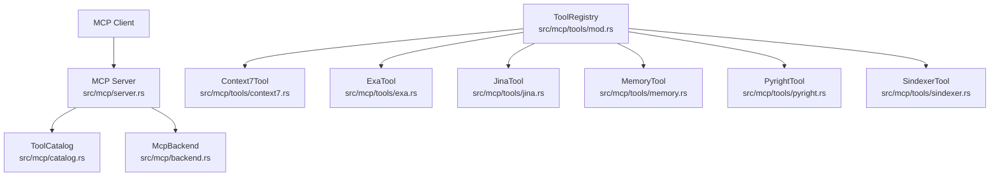
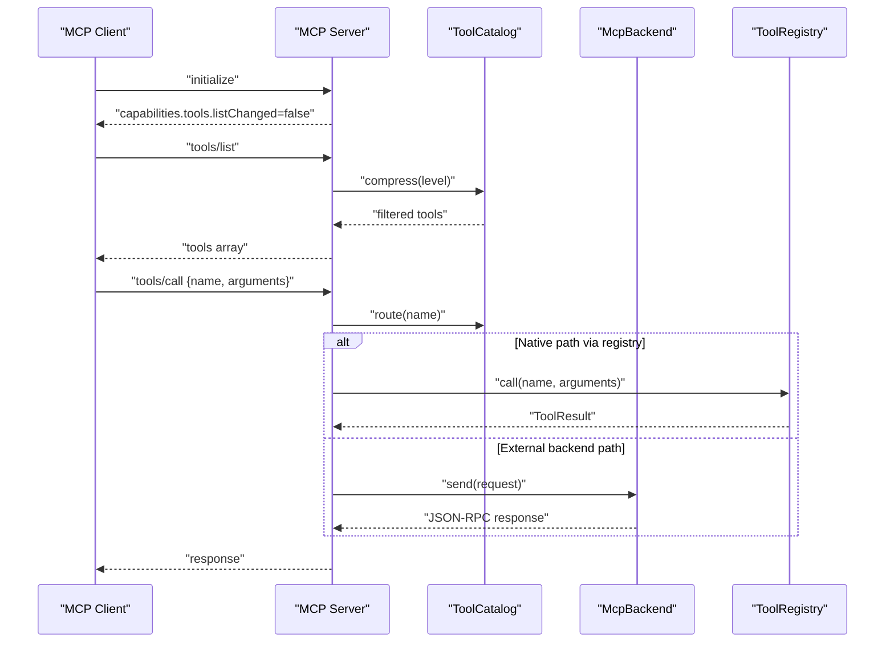
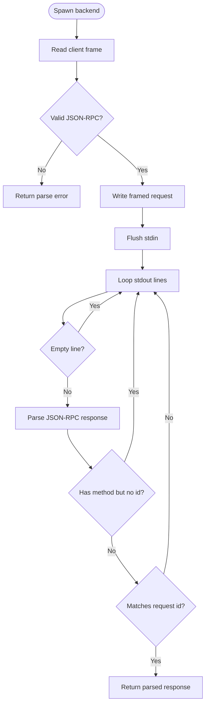
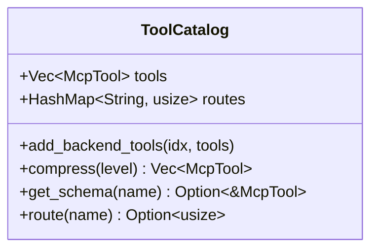
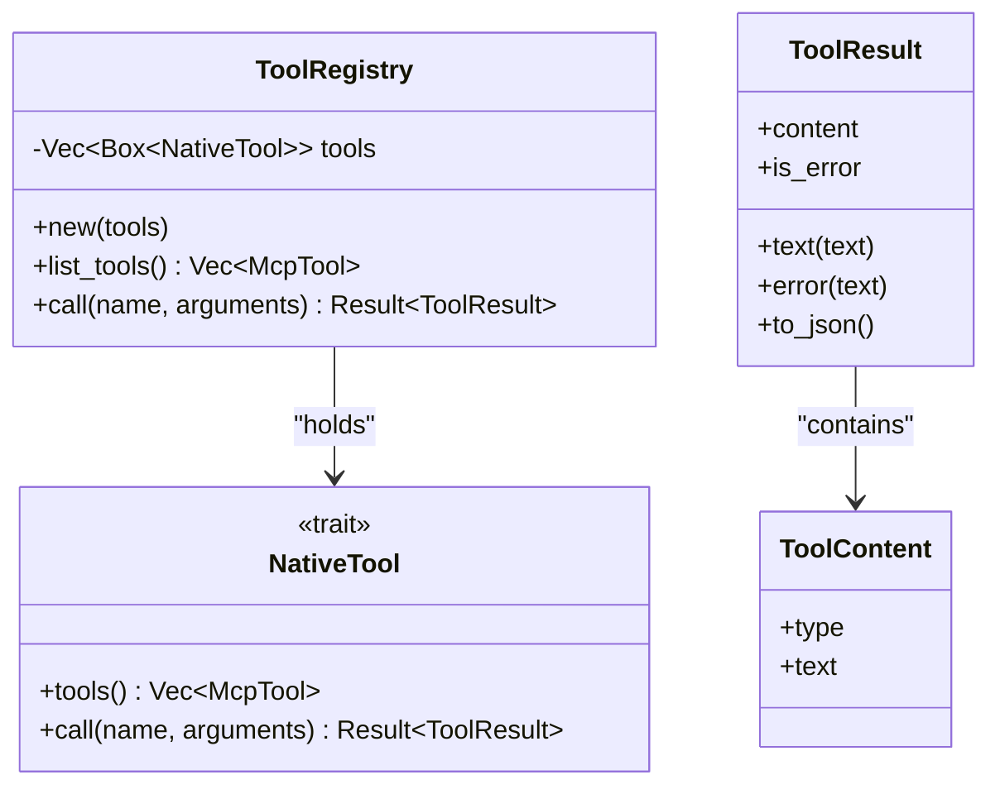
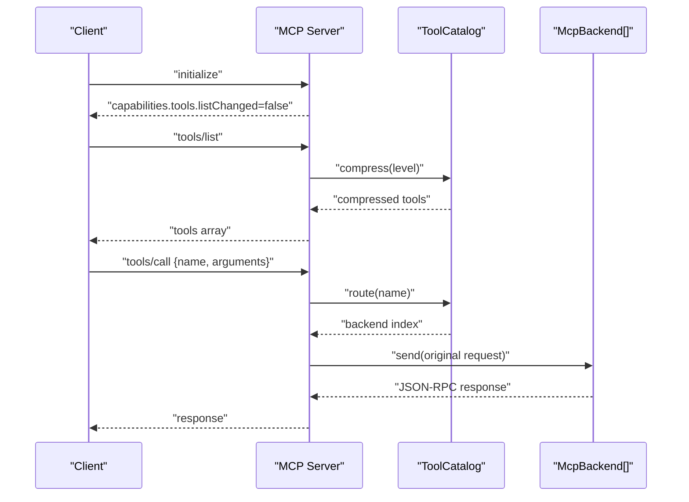
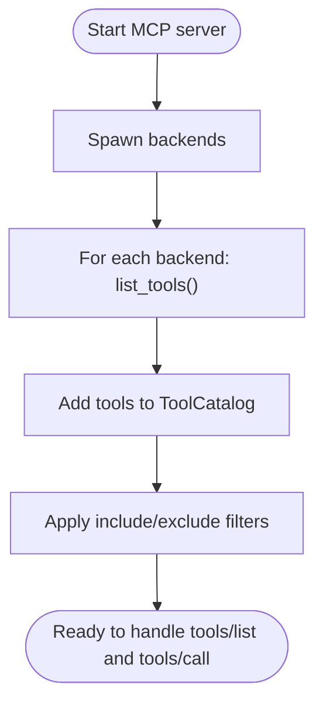
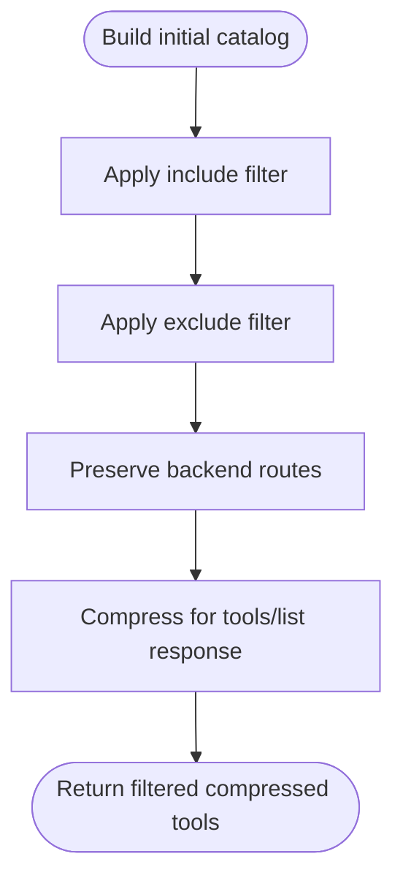
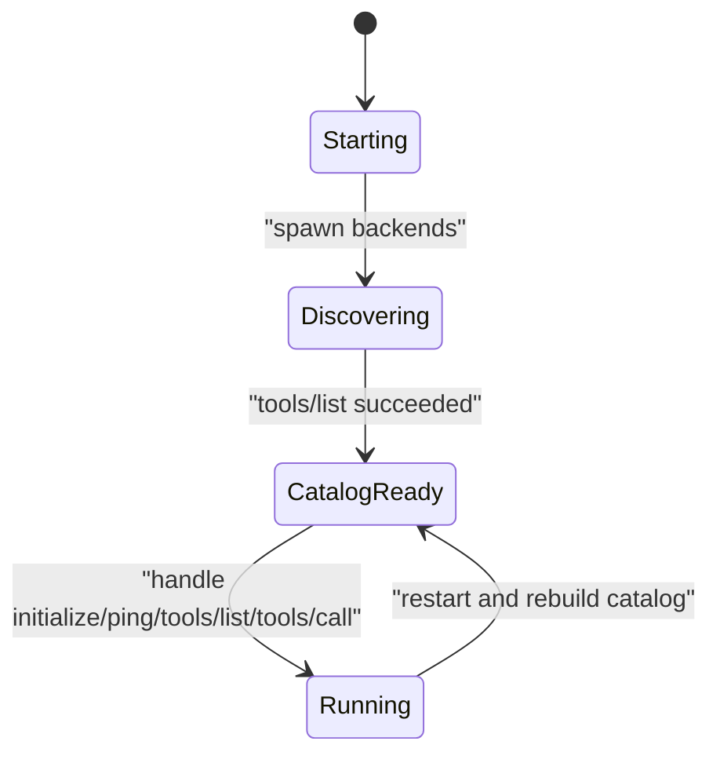

# Tool Catalog Management

<cite>
**Referenced Files in This Document**
- [mod.rs](file://src/mcp/mod.rs)
- [catalog.rs](file://src/mcp/catalog.rs)
- [protocol.rs](file://src/mcp/protocol.rs)
- [backend.rs](file://src/mcp/backend.rs)
- [server.rs](file://src/mcp/server.rs)
- [tools/mod.rs](file://src/mcp/tools/mod.rs)
- [context7.rs](file://src/mcp/tools/context7.rs)
- [exa.rs](file://src/mcp/tools/exa.rs)
- [jina.rs](file://src/mcp/tools/jina.rs)
- [memory.rs](file://src/mcp/tools/memory.rs)
- [pyright.rs](file://src/mcp/tools/pyright.rs)
- [sindexer.rs](file://src/mcp/tools/sindexer.rs)
</cite>

## Table of Contents
1. [Introduction](#introduction)
2. [Project Structure](#project-structure)
3. [Core Components](#core-components)
4. [Architecture Overview](#architecture-overview)
5. [Detailed Component Analysis](#detailed-component-analysis)
6. [Tool Discovery and Registration](#tool-discovery-and-registration)
7. [Built-in Tools](#built-in-tools)
8. [Catalog Synchronization and Filtering](#catalog-synchronization-and-filtering)
9. [Dependency Resolution and Version Compatibility](#dependency-resolution-and-version-compatibility)
10. [Operational Examples](#operational-examples)
11. [Performance Considerations](#performance-considerations)
12. [Troubleshooting Guide](#troubleshooting-guide)
13. [Conclusion](#conclusion)

## Introduction
This document explains the MCP tool catalog management system used by the project. It covers how tools are discovered, registered, exposed through a JSON-RPC server, and executed either as native Rust implementations or through external MCP backends. It documents the metadata model for tools, capability declarations, lifecycle management, filtering behavior, and the built-in tool implementations including context7, exa, jina, memory, pyright, and sindexer.

## Project Structure
The MCP subsystem is organized under `src/mcp` and exposes:
- A protocol layer defining JSON-RPC messages and tool schemas.
- A backend layer for communicating with external MCP processes.
- A catalog layer that aggregates tool schemas and routes calls to backends.
- A server layer that implements the MCP JSON-RPC interface.
- A native tool registry and individual tool modules.

**Diagram sources**
- [server.rs:1-200](file://src/mcp/server.rs#L1-L200)
- [catalog.rs:1-72](file://src/mcp/catalog.rs#L1-L72)
- [backend.rs:1-136](file://src/mcp/backend.rs#L1-L136)
- [tools/mod.rs:1-98](file://src/mcp/tools/mod.rs#L1-L98)
- [context7.rs:1-164](file://src/mcp/tools/context7.rs#L1-L164)
- [exa.rs:1-177](file://src/mcp/tools/exa.rs#L1-L177)
- [jina.rs:1-200](file://src/mcp/tools/jina.rs#L1-L200)
- [memory.rs:1-200](file://src/mcp/tools/memory.rs#L1-L200)
- [pyright.rs:1-200](file://src/mcp/tools/pyright.rs#L1-L200)
- [sindexer.rs:1-200](file://src/mcp/tools/sindexer.rs#L1-L200)

**Section sources**
- [mod.rs:1-8](file://src/mcp/mod.rs#L1-L8)

## Core Components
- Protocol definitions: JSON-RPC message envelope and tool schema.
- External backend manager: spawns and communicates with child MCP processes.
- Catalog: stores tool schemas, compresses descriptions, and routes tool names to backend indices.
- Native tool registry: holds multiple native tool implementations and dispatches calls by name.
- Built-in tool modules: each implements the native tool trait and declares its capabilities.

Key responsibilities:
- `protocol.rs`: Defines `JsonRpcMessage`, `McpTool`, and `McpToolCallParams`.
- `backend.rs`: Spawns subprocesses, sends JSON-RPC frames, parses responses, and lists remote tools.
- `catalog.rs`: Aggregates tool schemas and supports compression levels.
- `server.rs`: Implements MCP endpoints such as `initialize`, `ping`, `tools/list`, and `tools/call`.
- `tools/mod.rs`: Defines `NativeTool`, `ToolRegistry`, and shared result types.

**Section sources**
- [protocol.rs:1-40](file://src/mcp/protocol.rs#L1-L40)
- [backend.rs:1-136](file://src/mcp/backend.rs#L1-L136)
- [catalog.rs:1-72](file://src/mcp/catalog.rs#L1-L72)
- [server.rs:1-200](file://src/mcp/server.rs#L1-L200)
- [tools/mod.rs:1-98](file://src/mcp/tools/mod.rs#L1-L98)

## Architecture Overview
The runtime has two paths for executing tools:
1. Native tools: implemented directly in Rust and managed by `ToolRegistry`.
2. External MCP backends: launched as child processes; their tools are discovered via `tools/list` and routed by name through `ToolCatalog`.

**Diagram sources**
- [server.rs:100-200](file://src/mcp/server.rs#L100-L200)
- [catalog.rs:1-72](file://src/mcp/catalog.rs#L1-L72)
- [backend.rs:60-136](file://src/mcp/backend.rs#L60-L136)
- [tools/mod.rs:55-98](file://src/mcp/tools/mod.rs#L55-L98)

## Detailed Component Analysis

### Protocol Layer
The protocol layer defines the JSON-RPC frame shape and the tool schema contract:
- `JsonRpcMessage`: fields include optional `jsonrpc`, `id`, `method`, `params`, `result`, and `error`.
- `McpTool`: fields include `name`, `description`, and `inputSchema`.
- `McpToolCallParams`: fields include `name` and `arguments`.

These structures support both internal tool metadata and inter-process communication with external MCP servers.

**Section sources**
- [protocol.rs:1-40](file://src/mcp/protocol.rs#L1-L40)

### External MCP Backend Manager
`McpBackend` manages a child process running an arbitrary command. It:
- Spawns a shell-invoked command and pipes stdin/stdout.
- Writes framed JSON-RPC requests followed by newline delimiters.
- Reads newline-delimited JSON-RPC responses from stdout.
- Filters out notifications and unmatched request IDs.
- Provides `list_tools` by sending a `tools/list` request and decoding the returned tools array.

Error handling includes detailed context around spawn failures, I/O errors, invalid JSON frames, missing results, and unexpected backend exits.

**Diagram sources**
- [backend.rs:1-136](file://src/mcp/backend.rs#L1-L136)

**Section sources**
- [backend.rs:1-136](file://src/mcp/backend.rs#L1-L136)

### Tool Catalog
`ToolCatalog` maintains:
- A vector of all discovered `McpTool` schemas.
- A name-to-backend-index route map.

Operations:
- `add_backend_tools`: merges tools from a backend, updating existing entries or appending new ones.
- `compress`: reduces description size and clears input schemas based on level.
- `get_schema`: finds a tool by name.
- `route`: resolves a tool name to a backend index.

Compression levels:
- `none`: clear description and empty input schema.
- `minimal/min/high/aggressive`: clear description.
- `medium/light`: normalize whitespace and truncate description to 256 characters.
- Other values: no transformation.

**Diagram sources**
- [catalog.rs:1-72](file://src/mcp/catalog.rs#L1-L72)

**Section sources**
- [catalog.rs:1-72](file://src/mcp/catalog.rs#L1-L72)

### Native Tool Registry
The registry owns a list of boxed native tool implementations. It:
- Aggregates tool schemas through each implementation’s `tools()` method.
- Dispatches calls by matching the requested tool name against the first implementation that advertises it.
- Returns a standardized error when a tool name is unknown.

Shared result types:
- `ToolResult`: contains content items and an error flag.
- `ToolContent`: typed content item (for example, text).

**Diagram sources**
- [tools/mod.rs:1-98](file://src/mcp/tools/mod.rs#L1-L98)

**Section sources**
- [tools/mod.rs:1-98](file://src/mcp/tools/mod.rs#L1-L98)

### MCP Server Endpoints
The server runs over standard input/output and implements these JSON-RPC methods:
- `initialize`: returns protocol version, server info, and capabilities indicating tool support without dynamic change notifications.
- `notifications/initialized`: accepted but produces no response.
- `ping`: responds with an empty result.
- `tools/list`: returns the compressed tool catalog according to the configured level.
- `tools/call`: validates parameters, resolves the backend index via catalog routing, forwards the original JSON-RPC request to the selected backend, and returns its response.

Filtering supports:
- `include`: restricts the catalog to specific tool names.
- `exclude`: removes specific tool names.
- Filtered catalogs preserve routing information so calls remain mapped to the correct backend.

**Diagram sources**
- [server.rs:1-200](file://src/mcp/server.rs#L1-L200)
- [catalog.rs:1-72](file://src/mcp/catalog.rs#L1-L72)
- [backend.rs:60-136](file://src/mcp/backend.rs#L60-L136)

**Section sources**
- [server.rs:1-200](file://src/mcp/server.rs#L1-L200)

## Tool Discovery and Registration
Discovery and registration occur during server startup:
1. For every configured backend command, the server spawns `McpBackend`.
2. It calls `list_tools` on each backend, receiving a vector of `McpTool`.
3. Each backend’s tools are added to `ToolCatalog`, which records the mapping from tool name to backend index.
4. The catalog is then filtered by include/exclude options.
5. When listing tools, the server compresses the catalog according to the requested level.

External tool discovery uses the MCP `tools/list` endpoint. Native tools are discovered through the registry’s `list_tools`, which flattens all implementations’ declared schemas.

**Diagram sources**
- [server.rs:20-80](file://src/mcp/server.rs#L20-L80)
- [backend.rs:90-136](file://src/mcp/backend.rs#L90-L136)
- [catalog.rs:10-35](file://src/mcp/catalog.rs#L10-L35)

**Section sources**
- [server.rs:20-80](file://src/mcp/server.rs#L20-L80)
- [backend.rs:90-136](file://src/mcp/backend.rs#L90-L136)
- [catalog.rs:10-35](file://src/mcp/catalog.rs#L10-L35)

## Built-in Tools

### Context7
Purpose:
- Resolve library identifiers using the Context7 API.
- Query documentation and code examples for programming libraries.

Declared tools:
- `resolve-library-id`: requires `query` and `libraryName`.
- `query-docs`: requires `libraryId` and `query`; optional `researchMode`.

Configuration:
- Base URL constant for the Context7 API.
- HTTP client instance injected into the tool.

Behavior:
- Validates required fields.
- Sends GET requests and interprets non-success status codes as tool errors.
- Returns textual responses wrapped in a standardized tool result.

**Section sources**
- [context7.rs:1-164](file://src/mcp/tools/context7.rs#L1-L164)

### Exa
Purpose:
- Search the web using the Exa search API.
- Fetch full webpage content as clean markdown.

Declared tools:
- `web_search_exa`: requires `query`; optional `numResults`.
- `web_fetch_exa`: requires `urls`; optional `maxCharacters`.

Configuration:
- Base URL constant for the Exa API.
- Bearer authentication token.

Behavior:
- Validates inputs and constructs API payloads.
- Uses bearer authorization headers.
- Treats non-success HTTP statuses as tool errors and logs warnings.

**Section sources**
- [exa.rs:1-177](file://src/mcp/tools/exa.rs#L1-L177)

### Jina
Purpose:
- Perform live web searches via Jina Search.
- Read public URLs as Markdown via Jina Reader.

Declared tools:
- `web_search_jina`: requires `query`; optional `numResults` constrained between 1 and 20.
- `web_fetch_jina`: requires `urls` array with bounded length.

Configuration:
- Separate base URLs for search and reader services.
- Bearer authentication token.
- Request headers to bypass caching and tracking.

Behavior:
- Enforces strict parameter validation.
- Limits concurrent fetch operations and batch sizes.
- Handles network errors and non-success responses as tool errors.
- Truncates and validates search results before returning them.

**Section sources**
- [jina.rs:1-200](file://src/mcp/tools/jina.rs#L1-L200)

### Memory
Purpose:
- Provide an in-process knowledge graph with entities, relations, and observations.
- Optionally persist the graph to disk atomically.

Declared tools:
- `create_entities`
- `create_relations`
- `add_observations`
- `delete_entities`
- `delete_observations`
- `delete_relations`
- `read_graph`

Data model:
- `Entity`: name, entity type, and observation list.
- `Relation`: source entity, target entity, and relation type.
- `Graph`: collection of entities and relations.

Behavior:
- Initializes graph state from an optional persistence file.
- Uses a read-write lock for concurrent access.
- Persists changes atomically by writing to a temporary file and renaming.

**Section sources**
- [memory.rs:1-200](file://src/mcp/tools/memory.rs#L1-L200)

### Pyright
Purpose:
- Run Python type checking using Pyright within isolated workspace directories.
- Enforce file constraints and concurrency limits.

Declared tools:
- Type-checking operation that accepts a list of files with relative paths and optional contents.

Configuration:
- Project root path.
- Workspace directory preparation utility.
- Concurrency semaphore limiting parallel work.
- Maximum files per request and timeout constants.

Behavior:
- Validates that paths are relative and do not escape the project tree.
- Creates a private workspace directory per request.
- Symlinks configuration and project structure as needed.
- Executes Pyright, parses diagnostics, and summarizes counts.
- Cleans up workspace directories after execution.

**Section sources**
- [pyright.rs:1-200](file://src/mcp/tools/pyright.rs#L1-L200)

### Sindexer
Purpose:
- Index codebases and perform semantic code search.
- Manage vector database collections for indexed code.

Declared tools:
- `index_codebase`
- `search_code`
- `get_indexing_status`
- `clear_index`
- `list_collections`
- `collection_stats`
- `drop_collection`

Configuration:
- Constructs an `Sindexer` instance from environment variables.

Behavior:
- Delegates indexing, searching, and collection management to the underlying `sindexer` crate.
- Normalizes success and warning messages.
- Supports force re-indexing and optional extension filtering.

**Section sources**
- [sindexer.rs:1-200](file://src/mcp/tools/sindexer.rs#L1-L200)

## Catalog Synchronization and Filtering
Synchronization is not continuous; it occurs at server startup:
- All configured backends are queried once for their tool schemas.
- The resulting schemas are merged into a single catalog.
- Include and exclude filters produce a secondary catalog preserving routing.

Filtering rules:
- If no include set is provided and no exclude set exists, the catalog remains unchanged.
- Include sets retain only matching tool names.
- Exclude sets remove matching tool names.
- Routing is preserved by copying tools into a new catalog alongside their backend indices.

Catalog compression affects the output of `tools/list` and does not mutate the internal catalog permanently.

**Diagram sources**
- [server.rs:80-120](file://src/mcp/server.rs#L80-L120)
- [catalog.rs:20-45](file://src/mcp/catalog.rs#L20-L45)

**Section sources**
- [server.rs:80-120](file://src/mcp/server.rs#L80-L120)
- [catalog.rs:20-45](file://src/mcp/catalog.rs#L20-L45)

## Dependency Resolution and Version Compatibility
Current design characteristics:
- There is no explicit dependency resolver between tools.
- Tool discovery is static per backend at startup.
- Version compatibility is not negotiated dynamically; the server reports a fixed protocol version and capabilities.
- Capability declaration indicates tool support and whether tool lists can change dynamically; here, `listChanged` is disabled.

Implications:
- Adding or removing tools requires restarting the MCP server so that backends can be respawned and catalogs rebuilt.
- Clients should treat the tool list as stable across a session unless the server restarts.

**Diagram sources**
- [server.rs:20-60](file://src/mcp/server.rs#L20-L60)
- [server.rs:120-180](file://src/mcp/server.rs#L120-L180)

**Section sources**
- [server.rs:20-60](file://src/mcp/server.rs#L20-L60)
- [server.rs:120-180](file://src/mcp/server.rs#L120-L180)

## Operational Examples

### Listing Available Tools
To list available tools:
- Send an `initialize` request if your client requires initialization.
- Send a `tools/list` request with an appropriate level to control description size.
- Inspect the returned `tools` array and use `name`, `description`, and `inputSchema` to guide subsequent calls.

Example request outline:
- Method: `tools/list`
- Parameters: none
- Response: object containing a `tools` array

Expected behavior:
- The server compresses the catalog according to the configured level.
- Only tools present in the filtered catalog are returned.

**Section sources**
- [server.rs:140-170](file://src/mcp/server.rs#L140-L170)
- [catalog.rs:25-45](file://src/mcp/catalog.rs#L25-L45)

### Querying Tool Capabilities
Capabilities are advertised during `initialize`:
- Protocol version is reported.
- Server name and package version are included.
- Tool capabilities indicate support for tools, with `listChanged` set to false.

Clients can rely on this to know that tool listings are static for the lifetime of the server process.

**Section sources**
- [server.rs:150-170](file://src/mcp/server.rs#L150-L170)

### Managing Tool Configurations
There is no dedicated configuration endpoint. Configuration is supplied at server start:
- `level`: controls catalog compression for `tools/list`.
- `backends`: list of commands used to spawn external MCP backends.
- `include`: restricts the catalog to specified tool names.
- `exclude`: excludes specified tool names.

After starting the server, tool configurations cannot be changed without restarting.

**Section sources**
- [server.rs:10-40](file://src/mcp/server.rs#L10-L40)
- [server.rs:40-80](file://src/mcp/server.rs#L40-L80)

### Calling a Tool
To call a tool:
- Determine the tool name from `tools/list`.
- Construct a `tools/call` request with `name` and `arguments`.
- For external backends, the server forwards the request to the backend associated with the tool name.
- For native tools, the server would use the registry dispatch mechanism.

Example request outline:
- Method: `tools/call`
- Parameters: `{ "name": "<tool>", "arguments": {} }`
- Response: backend-specific JSON-RPC result

**Section sources**
- [server.rs:170-200](file://src/mcp/server.rs#L170-L200)
- [backend.rs:90-136](file://src/mcp/backend.rs#L90-L136)
- [tools/mod.rs:70-98](file://src/mcp/tools/mod.rs#L70-L98)

## Performance Considerations
- Catalog operations are linear scans for lookup and compression.
- Compression avoids heavy transformations by manipulating strings and clearing fields.
- External backend communication uses buffered I/O and newline framing.
- Native tools may introduce external dependencies:
  - HTTP clients for context7, exa, and jina.
  - Filesystem operations and concurrency control for pyright.
  - Vector database interactions for sindexer.
- Memory tool uses a read-write lock and atomic file updates.

Optimization opportunities:
- Cache compressed catalogs when filtering options are unchanged.
- Precompute route maps for frequently called tools.
- Batch tool listing queries if multiple clients connect concurrently.
- Use connection pooling for HTTP-based tools where supported.

[No sources needed since this section provides general guidance]

## Troubleshooting Guide

Common issues and resolutions:
- Unknown tool name:
  - Cause: tool not present in the filtered catalog or backend did not register it.
  - Action: verify include/exclude filters and confirm backend tool registration.
- Backend exited before responding:
  - Cause: external MCP process crashed or closed its stream.
  - Action: inspect stderr and restart the backend; validate the command string.
- Invalid JSON-RPC frame:
  - Cause: malformed client input.
  - Action: ensure frames are valid JSON objects following the protocol envelope.
- Missing required parameters:
  - Cause: caller omitted required fields in tool arguments.
  - Action: consult `inputSchema` and supply required properties.
- Non-success HTTP status from external APIs:
  - Cause: upstream service error or invalid request.
  - Action: check logs for status codes and response bodies; validate API keys and payloads.

Relevant logging locations:
- Backend spawn and I/O errors.
- Tool call completion and unknown tool warnings.
- Catalog route resolution warnings.
- Tool-specific debug/info/warn traces.

**Section sources**
- [backend.rs:20-90](file://src/mcp/backend.rs#L20-L90)
- [catalog.rs:47-72](file://src/mcp/catalog.rs#L47-L72)
- [tools/mod.rs:70-98](file://src/mcp/tools/mod.rs#L70-L98)
- [server.rs:160-200](file://src/mcp/server.rs#L160-L200)

## Conclusion
The MCP tool catalog management system combines a lightweight JSON-RPC server, an external backend manager, a central catalog, and a registry for native tools. Tools are discovered at startup, registered into a unified catalog, optionally filtered, and then exposed through standardized MCP endpoints. Built-in tools cover documentation lookup, web search, web fetching, in-memory knowledge graphs, Python type checking, and semantic code indexing. Because tool discovery is static per process, changes require server restarts. Clients should rely on `initialize` capabilities, `tools/list` for schema inspection, and `tools/call` for execution, while respecting include/exclude filtering and compression behavior.

[No sources needed since this section summarizes without analyzing specific files]