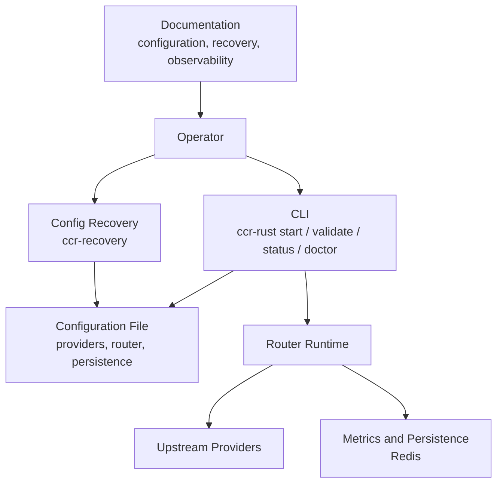
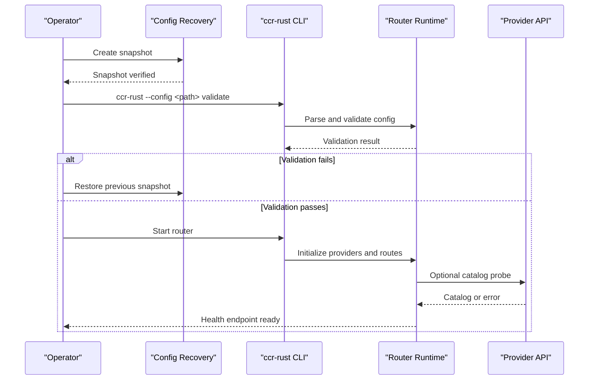
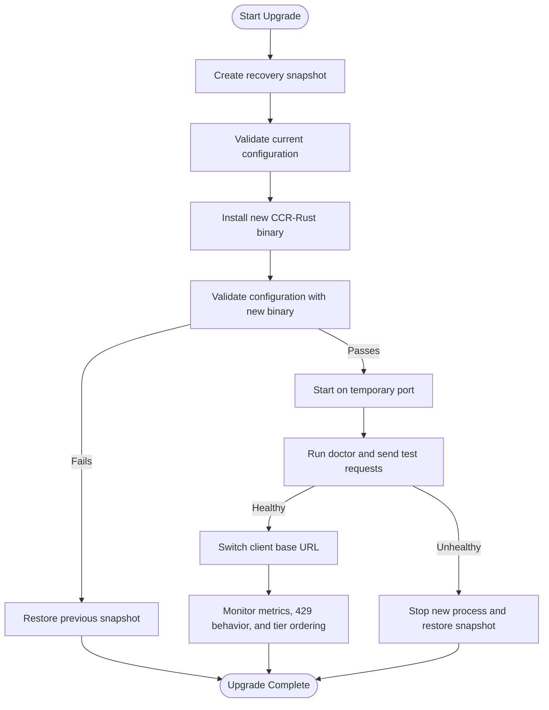
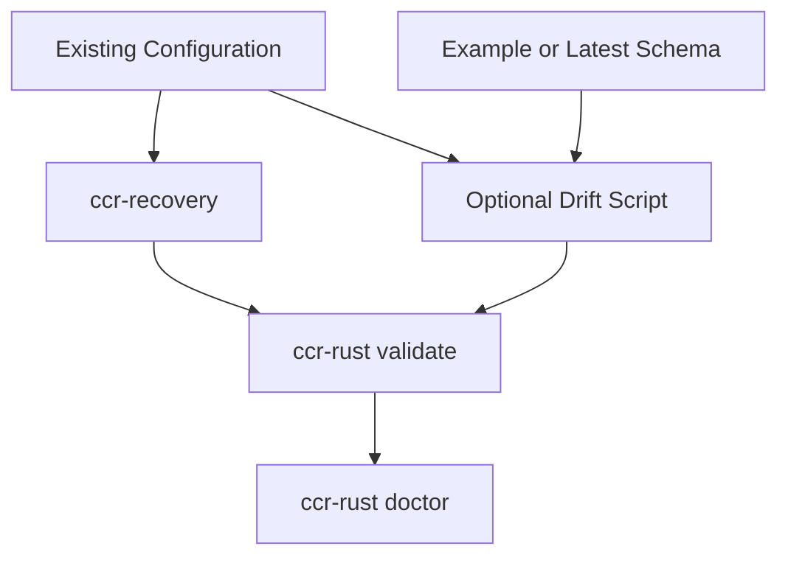
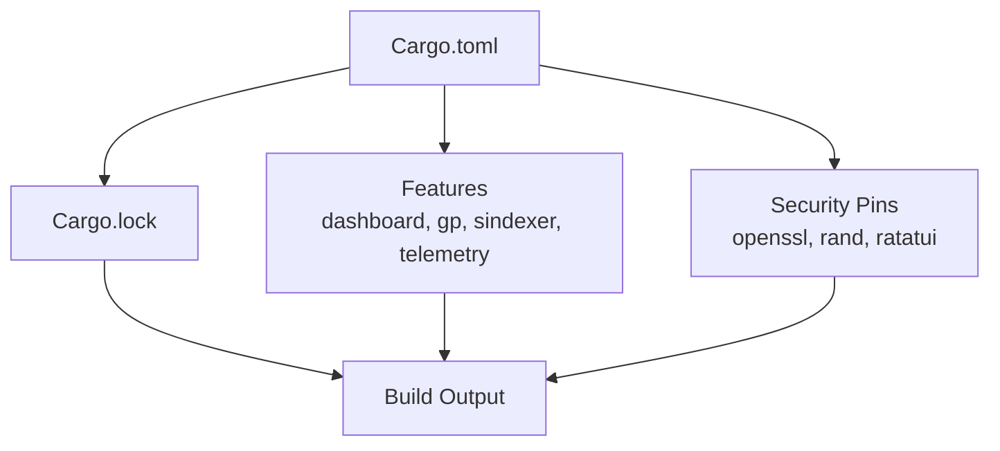

# Migration and Upgrade Guides

<cite>
**Referenced Files in This Document**
- [README.md](file://README.md)
- [Cargo.toml](file://Cargo.toml)
- [CHANGELOG.md](file://CHANGELOG.md)
- [docs/configuration.md](file://docs/configuration.md)
- [docs/config-recovery.md](file://docs/config-recovery.md)
- [docs/observability.md](file://docs/observability.md)
- [docs/troubleshooting.md](file://docs/troubleshooting.md)
- [examples/README.md](file://examples/README.md)
- [src/main.rs](file://src/main.rs)
- [src/config/types.rs](file://src/config/types.rs)
- [src/doctor.rs](file://src/doctor.rs)
</cite>

## Table of Contents
1. [Introduction](#introduction)
2. [Project Structure](#project-structure)
3. [Core Components](#core-components)
4. [Architecture Overview](#architecture-overview)
5. [Detailed Component Analysis](#detailed-component-analysis)
6. [Dependency Analysis](#dependency-analysis)
7. [Performance Considerations](#performance-considerations)
8. [Troubleshooting Guide](#troubleshooting-guide)
9. [Conclusion](#conclusion)
10. [Appendices](#appendices)

## Introduction
This document is the operational migration and upgrade guide for CCR-Rust, the self-hosted LLM router that sits between coding tools such as Claude Code or Codex and model providers. It focuses on:

- Upgrading between major releases.
- Migrating configuration files when schema fields change.
- Handling breaking changes documented in the changelog.
- Validating new deployments before switching traffic.
- Backing up and restoring configuration state.
- Rolling back to a known-good configuration.
- Preserving observability data through restarts.
- Resolving common upgrade issues.

The current repository package version is 1.3.0. The project follows Semantic Versioning and records notable behavior changes in its changelog.

**Section sources**
- [Cargo.toml:1-10](file://Cargo.toml#L1-L10)
- [README.md:1-40](file://README.md#L1-L40)
- [CHANGELOG.md:1-12](file://CHANGELOG.md#L1-L12)

## Project Structure
CCR-Rust is organized around a Rust application with configuration types, HTTP routing, provider transformers, diagnostics, documentation, examples, deployment helpers, and tests. For upgrade work, the most relevant areas are:

- `Cargo.toml`: Package metadata, dependencies, and optional features.
- `src/config/types.rs`: Configuration data models, including providers, protocol settings, admission controls, persistence, and routing structures.
- `src/main.rs`: CLI entry points, including `validate`, `start`, `status`, and `doctor`.
- `src/doctor.rs`: Offline and live diagnostic reporting for providers and listeners.
- `docs/configuration.md`: Full configuration reference, environment variable expansion, providers, routing, retries, hedging, and persistence.
- `docs/config-recovery.md`: Snapshot, restore, verify, sanitize, and doctor commands for the broader operator surface.
- `docs/observability.md`: Redis-backed persistence for metrics and dashboard state.
- `docs/troubleshooting.md`: Known runtime behaviors, rate limiting, SSE failure events, pseudo-SSE tool-use issues, and request bypass patterns.
- `examples/README.md`: Copy-paste example configurations and smoke-test workflow.

**Diagram sources**
- [src/main.rs:580-760](file://src/main.rs#L580-L760)
- [docs/configuration.md:1-120](file://docs/configuration.md#L1-L120)
- [docs/config-recovery.md:1-120](file://docs/config-recovery.md#L1-L120)
- [docs/observability.md:1-80](file://docs/observability.md#L1-L80)

**Section sources**
- [README.md:110-170](file://README.md#L110-L170)
- [examples/README.md:1-60](file://examples/README.md#L1-L60)

## Core Components
This section maps the core components involved in an upgrade.

| Component | Role During Upgrade | Key Source |
|---|---|---|
| Configuration loader | Parses JSON, expands `${VAR_NAME}` environment variables, validates required and constrained fields, and rejects invalid combinations at load time. | `src/config/types.rs` |
| Provider model | Defines upstream endpoint, protocol, authentication headers, transformer chain, pricing, admission limits, streaming policy, and rate-limit header behavior. | `src/config/types.rs` |
| Router model | Holds default routes, tier retries, non-streaming overrides, direct-routing control, strict ordering, model aliases, GP routing, retry sweeps, stickiness, and hedging. | `docs/configuration.md` |
| CLI | Provides `validate`, `start`, `status`, and `doctor` commands used during pre-flight and post-deployment checks. | `src/main.rs` |
| Doctor | Probes provider credentials and live model catalogs, reports stale models, listener health, and whether the in-memory tier order matches the file. | `src/doctor.rs` |
| Recovery tool | Snapshots, verifies, restores, sanitizes, and optionally restarts the operator surface under `~/.local/share/ccr-recovery/snapshots`. | `docs/config-recovery.md` |
| Observability persistence | Stores metrics, dashboards, token drift, audit ring, and EWMA latency state in memory by default; can persist to Redis. | `docs/observability.md` |

**Section sources**
- [src/config/types.rs:201-420](file://src/config/types.rs#L201-L420)
- [docs/configuration.md:1-200](file://docs/configuration.md#L1-L200)
- [src/main.rs:580-760](file://src/main.rs#L580-L760)
- [src/doctor.rs:1-120](file://src/doctor.rs#L1-L120)
- [docs/config-recovery.md:1-120](file://docs/config-recovery.md#L1-L120)
- [docs/observability.md:1-80](file://docs/observability.md#L1-L80)

## Architecture Overview
An upgrade has two layers:

1. **Binary upgrade**: Replace the running CCR-Rust process with a newer build.
2. **Configuration migration**: Update the configuration file to match the expected schema and behavior.

**Diagram sources**
- [docs/config-recovery.md:1-120](file://docs/config-recovery.md#L1-L120)
- [src/main.rs:580-760](file://src/main.rs#L580-L760)
- [src/doctor.rs:1-120](file://src/doctor.rs#L1-L120)

## Detailed Component Analysis

### Version Migration Procedures

#### Identify Current and Target Versions
- Inspect the installed binary version using the CLI.
- Compare it against the target release in the changelog.
- Treat the package version declared in `Cargo.toml` as the repository version identifier.

#### Pre-Upgrade Checklist
1. Read the full changelog for the target version.
2. Record the current configuration path and location.
3. Create a recovery snapshot.
4. Validate the existing configuration with the current binary.
5. Confirm all configured providers authenticate and list pinned models.
6. Verify the running listener’s health and latency endpoints.
7. If persistence is enabled, confirm Redis connectivity and key prefix.

#### Post-Upgrade Checklist
1. Run `ccr-rust validate` against the migrated configuration.
2. Start the router on a test port or secondary host if possible.
3. Run `ccr-rust doctor` to check provider catalogs and listener consistency.
4. Send a small Anthropic-style and OpenAI-style request.
5. Check Prometheus metrics and `/v1/latencies`.
6. Switch client base URLs only after verification.
7. Monitor for 429 pass-through behavior and tier ordering.

**Section sources**
- [README.md:110-170](file://README.md#L110-L170)
- [CHANGELOG.md:1050-1172](file://CHANGELOG.md#L1050-L1172)
- [docs/config-recovery.md:1-120](file://docs/config-recovery.md#L1-L120)
- [docs/observability.md:1-80](file://docs/observability.md#L1-L80)

### Configuration Schema Updates

#### Environment Variables
Configuration uses `${VAR_NAME}` expansion from the router process environment. Do not rely on automatic `.env` loading unless your service manager exports those values first.

Migration guidance:
- Export every required provider key before starting the router.
- Prefer service-manager environment injection over shell-sourced `.env` files in production.
- Validate that variables expand to nonempty values.

#### Provider Fields
Important provider fields include:

| Field | Purpose | Migration Note |
|---|---|---|
| `name` | Unique provider identity used by routes | Must match route targets. |
| `api_base_url` | Upstream endpoint | Change only when the provider endpoint moves. |
| `api_key` | Authentication credential | Keep out of source control; use environment expansion. |
| `models` | Allowed model names | Update when a vendor rotates or retires a model ID. |
| `protocol` | `openai`, `anthropic`, or `responses` | Explicitly set if the provider no longer behaves like the default. |
| `auth_header` | Header style for Anthropic-compatible providers | Use `authorization` for providers requiring `Authorization: Bearer`. |
| `honor_ratelimit_headers` | Proactively skip tiers reporting zero remaining quota | Default changed to `true`; set to `false` only for providers whose headers are informational. |
| `allow_streaming` | Force streaming even when globally disabled | Useful for providers where non-streaming adds excessive latency. |
| `force_reasoning_effort` | Override reasoning effort on OpenAI-protocol requests | Only valid for `openai` protocol; unsupported values are rejected. |
| `force_adaptive_thinking` | Insert adaptive thinking marker for providers that require it | Intended for providers such as SenseNova when reasoning is disabled. |
| `max_inflight` | AIMD admission limit per route | Range 1–64; affects how aggressively concurrent attempts grow or shrink. |
| `max_inflight_tokens` | Static token budget for collision-prone providers | Range 1,000–4,000,000; defers requests that would exceed reserved tokens. |
| `transformer` | Request/response transformation chain | Updated entries may be required for new providers or protocol compatibility. |
| `extra_headers` | Additional upstream headers | Invalid entries now fail at config load rather than being silently dropped. |

#### Router Fields
Important router fields include:

| Field | Purpose | Migration Note |
|---|---|---|
| `default` | Default provider,model route | Required. |
| `background`, `think`, `webSearch` | Traffic-class routes | Optional but recommended for separating workloads. |
| `tierRetries` | Per-tier retry parameters | Keep transient failures separate from 429 handling. |
| `forceNonStreaming` | Disable streaming globally | Can cause tool_use or thinking blocks to be lost depending on protocol. |
| `ignoreDirect` | Enforce configured tier order | Recommended when clients cache successful model strings. |
| `strictTierOrder` | Disables EWMA, cold-start shuffling, and GP reordering | Cannot be combined with `topK`; validated at load. |
| `modelAliases` | Bare model IDs mapped to provider,model routes | Aliases support simple strings or detailed objects with display metadata. |
| `gpRouting` | Optional cost-aware GP reranking | Requires explicit enablement. |
| `retrySweeps` | Hold exhausted requests open for re-cascade | Requires positive cooldown and respects hold caps. |
| `stickySessions` | Remember successful provider family per conversation | Disabled by default while behavior is qualified. |
| `hedging` | Launch next eligible tier after a threshold | Requires a positive `ttftThresholdMs`. |

#### Persistence
Persistence defaults to in-memory. When enabled:

| Field | Purpose |
|---|---|
| `mode` | `none` or `redis` |
| `redis_url` | Redis connection URL |
| `redis_prefix` | Key prefix for CCR-Rust persistence |

After enabling or changing persistence, verify Redis connectivity and clear stats only when necessary.

**Section sources**
- [docs/configuration.md:1-200](file://docs/configuration.md#L1-L200)
- [docs/configuration.md:200-500](file://docs/configuration.md#L200-L500)
- [src/config/types.rs:201-420](file://src/config/types.rs#L201-L420)
- [docs/observability.md:1-80](file://docs/observability.md#L1-L80)

### Breaking Changes and Migration Paths

#### 429 Pass-Through Instead of Internal Tier Cascade
In version 1.3.0, the router no longer silently cascades to the next tier when a provider returns HTTP 429. Instead, it forwards a normalized rate-limit error to the client along with upstream headers.

Migration steps:
1. Review the changelog entry for version 1.3.0.
2. Ensure clients or external orchestrators implement their own retry logic for 429 responses.
3. Verify that downstream proxies also respect 429 semantics if they sit in front of CCR-Rust.
4. Check response bodies for the normalized rate-limit type and code.
5. Inspect `x-ccr-tier` to identify the rate-limited tier.
6. Retain `tierRetries` for transient non-429 failures such as timeouts and 5xx errors.

If you previously relied on internal cascade behavior without noticing it, add client-side retry logic or configure your proxy layer accordingly.

**Section sources**
- [CHANGELOG.md:1070-1085](file://CHANGELOG.md#L1070-L1085)
- [CHANGELOG.md:1050-1172](file://CHANGELOG.md#L1050-L1172)
- [docs/troubleshooting.md:1-80](file://docs/troubleshooting.md#L1-L80)

#### Rate-Limit Header Default Change
The per-provider setting `honor_ratelimit_headers` now defaults to `true`. This causes CCR-Rust to proactively skip tiers that report `X-RateLimit-Remaining: 0` on successful responses.

Migration steps:
1. Audit each provider entry for rate-limit header behavior.
2. Set `honor_ratelimit_headers: false` only for providers that include rate-limit headers on every 200 response without actually rejecting at quota zero.
3. Test failover paths after changing this field.
4. Monitor whether expected tiers are skipped.

**Section sources**
- [CHANGELOG.md:1085-1095](file://CHANGELOG.md#L1085-L1095)
- [src/config/types.rs:280-360](file://src/config/types.rs#L280-L360)
- [docs/configuration.md:1-120](file://docs/configuration.md#L1-L120)

#### Removed Legacy Fields
Version 1.1.1 removed `longContext` and `longContextThreshold`. These were replaced by explicit presets and documentation-driven context compression.

Migration steps:
1. Remove `longContext` and `longContextThreshold` from configuration.
2. Use the documented preset or transformer approach for context compression.
3. Validate the configuration after removal.

**Section sources**
- [CHANGELOG.md:1120-1140](file://CHANGELOG.md#L1120-L1140)
- [docs/configuration.md:1-120](file://docs/configuration.md#L1-L120)

#### Simplified Configuration
Version 1.1.0 simplified configuration by removing deprecated fields and improving validation.

Migration steps:
1. Start from the latest example configuration.
2. Compare your current configuration against the full schema.
3. Remove deprecated fields.
4. Run `ccr-rust validate`.
5. Run `ccr-rust doctor` to confirm provider contracts.

**Section sources**
- [CHANGELOG.md:1140-1160](file://CHANGELOG.md#L1140-L1160)
- [examples/README.md:1-60](file://examples/README.md#L1-L60)

### Step-by-Step Upgrade Procedure

#### Small Single-Provider Deployment
1. Stop the current router if you are replacing a running process.
2. Copy the current configuration to a backup location.
3. Build or pull the new CCR-Rust binary.
4. Run `ccr-rust validate` against the current configuration.
5. Start the new binary on the same address and port.
6. Run `ccr-rust status`.
7. Send one Anthropic-style and one OpenAI-style request.
8. Check `/metrics`, `/v1/latencies`, and provider-specific logs.

#### Multi-Provider Fallback Deployment
1. Take a recovery snapshot before any change.
2. Validate the current configuration with the old binary.
3. Upgrade the binary.
4. Validate again.
5. Start the new process on a temporary port if possible.
6. Point a single test client at the new port.
7. Run `ccr-rust doctor`.
8. Switch the canonical client base URL only after verification.
9. Monitor rate-limit pass-through and tier ordering.
10. Roll back immediately if validation or provider probes fail.

**Diagram sources**
- [docs/config-recovery.md:1-120](file://docs/config-recovery.md#L1-L120)
- [src/main.rs:580-760](file://src/main.rs#L580-L760)
- [docs/observability.md:1-80](file://docs/observability.md#L1-L80)

**Section sources**
- [README.md:110-170](file://README.md#L110-L170)
- [examples/README.md:1-60](file://examples/README.md#L1-L60)
- [docs/config-recovery.md:1-120](file://docs/config-recovery.md#L1-L120)

### Data Migration for Stored Runs, Configuration Backups, and State Preservation

#### Configuration Backups
Use `ccr-recovery` to capture the complete operator surface, including consumer configs, launchd entries, credentials wrappers, launcher scripts, tunnel configurations, and local binaries.

Recommended workflow:
1. Run `ccr-recovery snapshot --label <name>` before editing configuration.
2. Edit configuration in place.
3. Validate with `ccr-rust validate`.
4. If validation fails, dry-run restore first.
5. Apply restore only after confirming the snapshot is valid.
6. With `--restart`, idle-gated restart preserves active turns where supported.

#### State Preservation During Upgrades
Observability state is in-memory by default. To preserve metrics, dashboards, token drift, audit ring, and EWMA latency across restarts, enable Redis persistence.

Recommended workflow:
1. Provision Redis.
2. Add `Persistence` configuration with mode, URL, and prefix.
3. Restart the router.
4. Verify `/metrics`, `/v1/usage`, `/v1/token-drift`, and `/v1/frontend-metrics`.
5. Reset persisted state only when necessary using `ccr-rust clear-stats`.

#### Stored Runs and Worker Reports
Worker reports and run directories are treated as untrusted evidence. Recovery and inspection helpers prefer timestamped run directories and exclude malformed manual directories from automatic selection. Operators should not treat a saved report as proof of correctness.

**Section sources**
- [docs/config-recovery.md:1-120](file://docs/config-recovery.md#L1-L120)
- [docs/observability.md:1-80](file://docs/observability.md#L1-L80)
- [CHANGELOG.md:200-300](file://CHANGELOG.md#L200-L300)

### Automated Migration Tools
There is no dedicated automated configuration migrator that rewrites legacy JSON into a newer schema. The recommended automation path is:

1. Use `ccr-recovery` for snapshot, verify, restore, sanitize, and doctor operations.
2. Use `ccr-rust validate` for schema validation.
3. Use `ccr-rust doctor` for provider catalog and listener diagnosis.
4. Use example configurations as authoritative templates.
5. Write a lightweight comparison script against `docs/configuration.md` and `src/config/types.rs` if your organization requires automated drift detection.

**Diagram sources**
- [docs/config-recovery.md:1-120](file://docs/config-recovery.md#L1-L120)
- [src/main.rs:580-760](file://src/main.rs#L580-L760)
- [examples/README.md:1-60](file://examples/README.md#L1-L60)

**Section sources**
- [docs/config-recovery.md:1-120](file://docs/config-recovery.md#L1-L120)
- [src/main.rs:580-760](file://src/main.rs#L580-L760)
- [examples/README.md:1-60](file://examples/README.md#L1-L60)

### Rollback Procedures
Rollback is safest when paired with a recovery snapshot.

Procedure:
1. Stop the new process.
2. List snapshots with `ccr-recovery list`.
3. Verify the desired snapshot with `ccr-recovery verify`.
4. Dry-run restore with `ccr-recovery restore <name>`.
5. Apply restore with `ccr-recovery restore <name> --apply`.
6. Optionally restart listeners with `--restart`.
7. Validate the restored configuration.
8. Start the router and verify health.

A rollback restores the captured files and parsed configuration; it does not prove that the captured state was correct at capture time.

**Section sources**
- [docs/config-recovery.md:1-120](file://docs/config-recovery.md#L1-L120)
- [src/main.rs:580-760](file://src/main.rs#L580-L760)

### Compatibility Matrix
The following matrix summarizes current compatibility signals derived from the repository.

| Area | Current Behavior | Upgrade Implication |
|---|---|---|
| Package version | 1.3.0 | Treat major-version boundaries as candidate breaking-change locations. |
| Protocol support | Anthropic Messages, OpenAI Chat Completions, OpenAI Responses | Keep provider `protocol` aligned with the actual upstream endpoint. |
| 429 handling | Passed through to client with normalized error | Clients or proxies must handle rate-limit retries. |
| Rate-limit headers | Proactive skip enabled by default | Tune `honor_ratelimit_headers` per provider. |
| Environment expansion | `${VAR_NAME}` from process environment | Configure keys through service manager or exported environment. |
| Observability persistence | In-memory by default | Enable Redis if state must survive restarts. |
| Configuration validation | Strong schema and invariant checks | Always run `ccr-rust validate` before switching traffic. |
| Provider catalog checking | Doctor probes live model catalogs | Expect `stale_model` warnings when vendors rotate model IDs. |
| Example configurations | Minimal, multi-tier, OpenRouter-free, coding plans, SenseNova, Meta Model API | Use examples as migration baselines. |

**Section sources**
- [Cargo.toml:1-10](file://Cargo.toml#L1-L10)
- [CHANGELOG.md:1050-1172](file://CHANGELOG.md#L1050-L1172)
- [docs/configuration.md:1-200](file://docs/configuration.md#L1-L200)
- [docs/observability.md:1-80](file://docs/observability.md#L1-L80)
- [examples/README.md:1-60](file://examples/README.md#L1-L60)

## Dependency Analysis
Dependencies can affect upgrades in three ways:

1. **Rust toolchain and edition**: The package uses edition 2021.
2. **Security-sensitive dependencies**: OpenSSL, rand, and ratatui have explicit pins or advisories documented in the lockfile and changelog.
3. **Optional features**: Dashboard, GP routing, sindexer, and telemetry are feature-gated.

Upgrade recommendations:
- Rebuild with `cargo build --release` or use the provided Docker image.
- Do not mix a newer binary with an older configuration without validating both.
- Avoid upgrading only dependency versions manually; prefer the repository’s locked graph unless you understand the security implications.
- Feature-gated capabilities such as telemetry and dashboard may change behavior; rebuild with the intended feature set.

**Diagram sources**
- [Cargo.toml:1-87](file://Cargo.toml#L1-L87)
- [CHANGELOG.md:1050-1172](file://CHANGELOG.md#L1050-L1172)

**Section sources**
- [Cargo.toml:1-87](file://Cargo.toml#L1-L87)
- [CHANGELOG.md:1050-1172](file://CHANGELOG.md#L1050-L1172)

## Performance Considerations
Upgrades can affect performance characteristics:

- **Failover and retries**: Newer versions refine retry budgets, 429 pass-through, and sweep behavior. Monitor latency and retry counts.
- **Admission control**: Per-route `max_inflight` and `max_inflight_tokens` influence concurrency and token-volume collisions.
- **Hedging and stickiness**: Hedging adds parallel attempts; stickiness remembers successful provider families.
- **Persistence overhead**: Redis-backed observability avoids metric loss but adds a backend dependency.
- **Streaming vs non-streaming**: Global non-streaming can degrade tool-use and thinking workflows.

Recommended monitoring:
- Track `ccr_requests_total`, `ccr_failures_total`, `ccr_active_streams`, `ccr_tier_ewma_latency_seconds`, and `ccr_token_drift_pct`.
- Watch for synthetic 429 or 503 responses when all tiers are exhausted.
- Use `/v1/latencies` to detect slow tiers.

**Section sources**
- [docs/configuration.md:200-500](file://docs/configuration.md#L200-L500)
- [docs/observability.md:1-120](file://docs/observability.md#L1-L120)
- [docs/troubleshooting.md:1-120](file://docs/troubleshooting.md#L1-L120)

## Troubleshooting Guide

### Configuration Does Not Load
Common causes:
- Missing or empty environment variables.
- Invalid provider contract.
- Invalid extra headers.
- Invalid routing combination such as strict tier order with unsupported options.
- Unsupported reasoning effort for the configured protocol.

Resolution:
1. Run `ccr-rust validate`.
2. Expand and export environment variables before starting.
3. Remove unsupported or deprecated fields.
4. Check provider protocol and header configuration.
5. Use the latest example configuration as a baseline.

### All Tiers Exhausted Response Changed
Since 429s are passed through, the “all tiers exhausted” path now consistently returns HTTP 503 for non-rate-limit failures.

Resolution:
1. Add additional provider tiers.
2. Adjust tier order.
3. Verify provider availability.
4. Keep `tierRetries` for transient failures.
5. Implement client-side retry logic for 429 responses.

### Pseudo-SSE Tool Blocks Dropped
When `forceNonStreaming` is enabled, non-streaming Anthropic responses are converted to SSE events. A past fix ensures `ToolUse` and `Thinking` blocks are emitted; verify your binary includes the fix.

Resolution:
1. Upgrade to a version that includes the pseudo-SSE fix.
2. Prefer streaming where possible.
3. Capture and inspect response bodies if tool calls appear absent.

### Requests Bypass Tier Order
Clients may cache successful model strings, causing direct routing to a lower-priority tier.

Resolution:
1. Enable `Router.ignoreDirect`.
2. Restart the router.
3. Verify tier order with `/v1/latencies` and logs.

### Listener Is Healthy but Routing Is Stale
The doctor command compares the listener’s in-memory tier order with the file. A mismatch means a restart is pending.

Resolution:
1. Drain active streams.
2. Restart the router.
3. Use recovery’s idle-gated restart where available.

**Section sources**
- [docs/troubleshooting.md:1-200](file://docs/troubleshooting.md#L1-L200)
- [src/main.rs:580-760](file://src/main.rs#L580-L760)
- [src/doctor.rs:1-120](file://src/doctor.rs#L1-L120)
- [CHANGELOG.md:1050-1172](file://CHANGELOG.md#L1050-L1172)

## Conclusion
CCR-Rust upgrades should be treated as two coordinated operations: binary replacement and configuration migration. The strongest safety boundary is the combination of `ccr-recovery` snapshots, `ccr-rust validate`, `ccr-rust doctor`, and live verification through health and latency endpoints.

For major releases:
- Read the changelog carefully.
- Preserve configuration backups.
- Validate before switching traffic.
- Handle 429 pass-through at the client or proxy layer.
- Tune rate-limit header behavior per provider.
- Enable Redis persistence if state preservation matters.
- Roll back to a verified snapshot when validation or provider probing fails.

[No sources needed since this section summarizes without analyzing specific files]

## Appendices

### Quick Reference Commands

| Command | Purpose |
|---|---|
| `ccr-rust validate` | Validate configuration without starting. |
| `ccr-rust start` | Start the router. |
| `ccr-rust status` | Check whether the router is running. |
| `ccr-rust doctor` | Diagnose configuration, providers, and listener. |
| `ccr-recovery snapshot --label <name>` | Capture operator surface. |
| `ccr-recovery list` | List snapshots. |
| `ccr-recovery verify [name]` | Verify snapshot integrity. |
| `ccr-recovery restore [name] [--apply] [--restart]` | Restore configuration and optionally restart listeners. |
| `ccr-recovery sanitize [name]` | Create a secret-free verified copy. |
| `ccr-rust clear-stats` | Reset persisted observability state. |

**Section sources**
- [README.md:110-170](file://README.md#L110-L170)
- [docs/config-recovery.md:1-120](file://docs/config-recovery.md#L1-L120)
- [docs/observability.md:1-80](file://docs/observability.md#L1-L80)