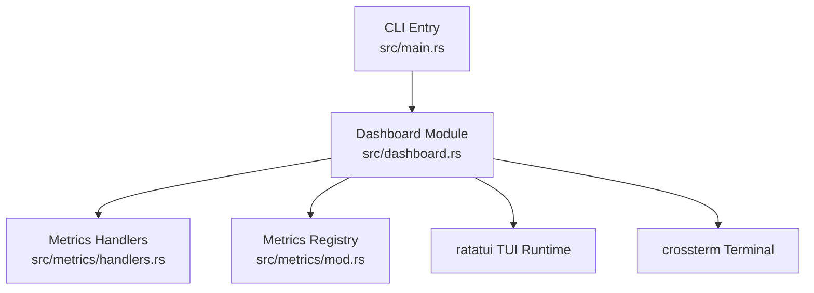
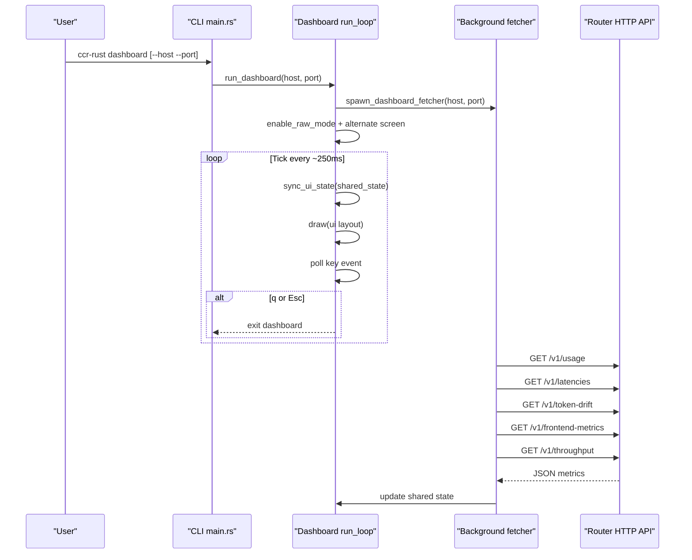
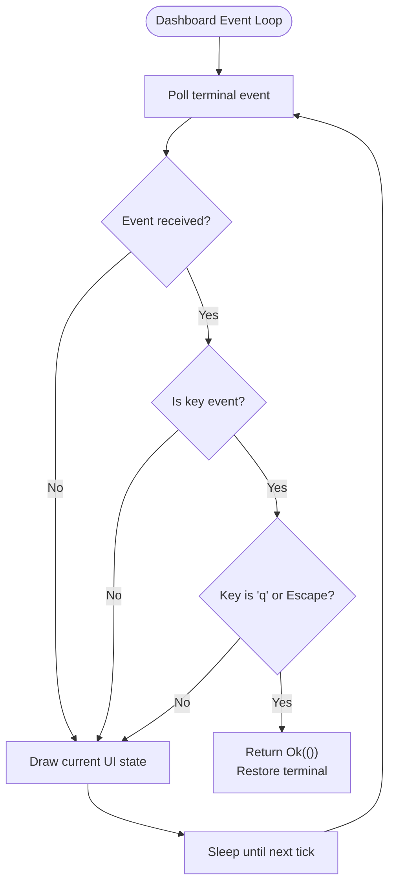
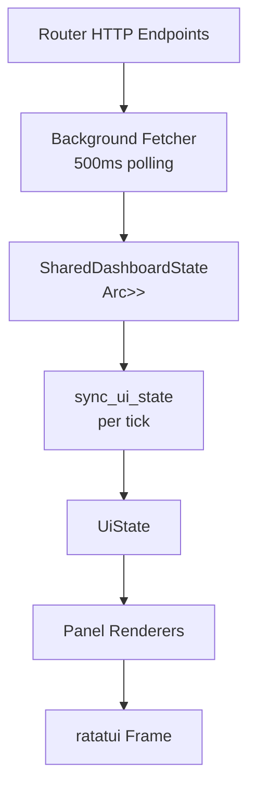
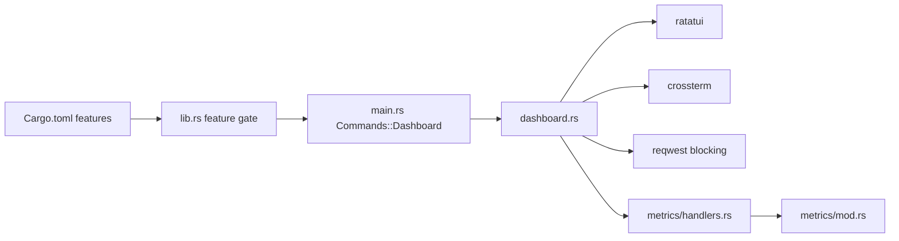

# Live Terminal Dashboard

<cite>
**Referenced Files in This Document**
- [dashboard.rs](file://src/dashboard.rs)
- [main.rs](file://src/main.rs)
- [lib.rs](file://src/lib.rs)
- [Cargo.toml](file://Cargo.toml)
- [handlers.rs](file://src/metrics/handlers.rs)
- [mod.rs](file://src/metrics/mod.rs)
</cite>

## Table of Contents
1. [Introduction](#introduction)
2. [Project Structure](#project-structure)
3. [Core Components](#core-components)
4. [Architecture Overview](#architecture-overview)
5. [Detailed Component Analysis](#detailed-component-analysis)
6. [Dependency Analysis](#dependency-analysis)
7. [Performance Considerations](#performance-considerations)
8. [Troubleshooting Guide](#troubleshooting-guide)
9. [Operational Monitoring Examples](#operational-monitoring-examples)
10. [Incident Response Scenarios](#incident-response-scenarios)
11. [Conclusion](#conclusion)

## Introduction
The CCR-Rust live terminal dashboard is an interactive, ratatui-based user interface for monitoring a running CCR-Rust router. It connects to the router’s HTTP endpoints and displays real-time operational data such as active request volume, token throughput, per-tier latency, token drift, frontend breakdown, and tier statistics. The dashboard runs as a separate `ccr-rust dashboard` command and is gated behind the `dashboard` Cargo feature.

Key characteristics:
- Interactive terminal UI using crossterm and ratatui.
- Background fetcher polling the router every 500 milliseconds.
- UI redraw loop at approximately 250 milliseconds.
- Keyboard exit via `q` or Escape.
- No built-in mouse navigation; interaction is keyboard-driven.
- Data sources are JSON metrics endpoints exposed by the router.

## Project Structure
The dashboard is implemented primarily in one module, with integration points in the CLI entry point and the shared metrics subsystem.

**Diagram sources**
- [main.rs:842-845](file://src/main.rs#L842-L845)
- [dashboard.rs:245-268](file://src/dashboard.rs#L245-L268)
- [handlers.rs:50-55](file://src/metrics/handlers.rs#L50-L55)

**Section sources**
- [main.rs:69-73](file://src/main.rs#L69-L73)
- [main.rs:155-172](file://src/main.rs#L155-L172)
- [dashboard.rs:1-22](file://src/dashboard.rs#L1-L22)

## Core Components
The dashboard consists of several cooperating parts:

| Component | Responsibility | Key Details |
|---|---|---|
| Dashboard data model | Holds fetched usage, latencies, token drifts, frontend metrics, throughput, and update time | Defined as `DashboardData` |
| Shared state | Thread-safe snapshot of latest dashboard data | `Arc<RwLock<Option<DashboardData>>>` |
| Background fetcher | Polls `/v1/usage`, `/v1/latencies`, `/v1/token-drift`, `/v1/frontend-metrics`, `/v1/throughput` | 500 ms interval, 5 second HTTP timeout |
| UI state | Local renderable copy of dashboard data | `UiState` with global stats, error message, and last update time |
| Terminal runner | Sets up raw mode, alternate screen, and event loop | Uses crossterm and ratatui |
| Layout renderer | Draws header, token drift table, frontend breakdown, session info, and tier statistics | Pure rendering functions |
| Color/style helpers | Apply threshold-based colors for drift, latency, tokens/sec, failure rate | Hardcoded thresholds in renderer |

**Section sources**
- [dashboard.rs:27-43](file://src/dashboard.rs#L27-L43)
- [dashboard.rs:44-51](file://src/dashboard.rs#L44-L51)
- [dashboard.rs:52-127](file://src/dashboard.rs#L52-L127)
- [dashboard.rs:201-244](file://src/dashboard.rs#L201-L244)
- [dashboard.rs:245-313](file://src/dashboard.rs#L245-L313)

## Architecture Overview
The dashboard follows a producer-consumer pattern:

1. The CLI parses `Commands::Dashboard`.
2. `run_dashboard` initializes the terminal and starts the background fetcher.
3. The fetcher polls the router’s metrics endpoints on a fixed schedule.
4. The UI thread reads the shared state on each tick and renders panels.
5. Keyboard input is polled once per tick; only `q` and Escape terminate the dashboard.

**Diagram sources**
- [main.rs:842-845](file://src/main.rs#L842-L845)
- [dashboard.rs:52-127](file://src/dashboard.rs#L52-L127)
- [dashboard.rs:245-313](file://src/dashboard.rs#L245-L313)
- [handlers.rs:50-55](file://src/metrics/handlers.rs#L50-L55)

## Detailed Component Analysis

### Launching the Dashboard
The dashboard is available through the `dashboard` subcommand. It is conditionally compiled when the `dashboard` Cargo feature is enabled.

Usage patterns:
- Local router: `ccr-rust dashboard`
- Remote router: `ccr-rust dashboard --host <ip>`
- Environment overrides: `CCR_DASHBOARD_HOST` and `CCR_DASHBOARD_PORT`

Default values:
- Host: `127.0.0.1`
- Port: `3456`

The command path is:
1. `Cli` parses the `Dashboard` variant.
2. `run_dashboard` is invoked with host and port.
3. The terminal enters raw mode and alternate screen.
4. A background fetcher begins polling the router.
5. The UI loop renders until the user exits.

**Section sources**
- [main.rs:155-172](file://src/main.rs#L155-L172)
- [main.rs:842-845](file://src/main.rs#L842-L845)
- [lib.rs:5-6](file://src/lib.rs#L5-L6)
- [Cargo.toml:70-86](file://Cargo.toml#L70-L86)

### Navigation and Keyboard Shortcuts
The dashboard has minimal interactivity:

| Action | Key | Behavior |
|---|---:|---|
| Exit dashboard | `q` | Terminates the TUI loop and restores terminal state |
| Exit dashboard | Escape | Same behavior as `q` |

There is no scroll, tab switching, zoom, or pane resizing implemented. Panels are rendered statically according to their size constraints.

**Diagram sources**
- [dashboard.rs:278-313](file://src/dashboard.rs#L278-L313)

**Section sources**
- [dashboard.rs:278-313](file://src/dashboard.rs#L278-L313)

### Real-Time Visualization Components

#### Header Panel
The header shows three columns:

| Column | Meaning | Visual Behavior |
|---|---|---|
| Active Requests | Current number of in-flight requests | Green bold when greater than zero; gray otherwise |
| Traffic | Total requests, total failures, and success percentage | Success color changes based on percentage thresholds |
| Token Throughput | Input and output tokens shown in thousands | Cyan for input label, magenta for output label |

Success-rate coloring:
- At least 90%: green
- At least 80%: yellow
- Below 80%: red

**Section sources**
- [dashboard.rs:314-409](file://src/dashboard.rs#L314-L409)

#### Token Drift Monitor
The token drift panel shows per-tier drift information:

| Column | Description |
|---|---|
| Tier | Provider tier name |
| Samples | Number of drift samples |
| Cumulative Drift % | Running drift percentage |
| Last Sample Drift % | Most recent drift sample |

Color rules:
- Absolute drift above 25%: red and bold
- Absolute drift above 10%: yellow
- Otherwise: white

An empty dataset shows “No data available.” An error state from the fetcher is appended to the panel title.

**Section sources**
- [dashboard.rs:410-493](file://src/dashboard.rs#L410-L493)

#### Frontend Breakdown
This panel summarizes per-frontend request volume and average latency:

| Column | Description |
|---|---|
| Frontend | Frontend identifier |
| Requests | Request count formatted with thousands separators |
| Avg Latency (ms) | Average frontend latency in milliseconds |

Latency coloring:
- Above 5000 ms: red and bold
- Above 1000 ms: yellow
- Otherwise: green

**Section sources**
- [dashboard.rs:717-789](file://src/dashboard.rs#L717-L789)

#### Session Info Panel
The left-bottom panel shows environment context:

| Field | Source |
|---|---|
| CWD | Current working directory |
| Git Branch | `GIT_BRANCH` build-time environment variable |
| Version | `CARGO_PKG_VERSION` build-time environment variable |

This helps operators identify which deployment they are monitoring.

**Section sources**
- [dashboard.rs:182-200](file://src/dashboard.rs#L182-L200)

#### Tier Statistics Panel
The right-bottom panel merges multiple metric streams into one table:

| Column | Meaning | Color Thresholds |
|---|---|---|
| Tier | Tier name | None |
| EWMA Latency (ms) | Exponentially weighted moving average latency converted from seconds to milliseconds | Red above 7000 ms; yellow above 5000 ms; green otherwise |
| TTFT (ms) | Time-to-first-token average in milliseconds | Red above 5000 ms; yellow above 2000 ms; green otherwise |
| tok/s | Average tokens per second | Red below 5; yellow below 20; green at 20 or above |
| Requests (S/F) | Success count and failure count | Failure-rate red above 10%; yellow above 1%; green otherwise |
| Tokens (In/Out) | Input and output token totals | Plain text |

If any underlying metric is missing, the corresponding cell may show a dash rather than a value.

**Section sources**
- [dashboard.rs:494-716](file://src/dashboard.rs#L494-L716)

### Data Flow and Rendering Pipeline

**Diagram sources**
- [dashboard.rs:52-127](file://src/dashboard.rs#L52-L127)
- [dashboard.rs:201-244](file://src/dashboard.rs#L201-L244)
- [dashboard.rs:245-313](file://src/dashboard.rs#L245-L313)

**Section sources**
- [dashboard.rs:52-127](file://src/dashboard.rs#L52-L127)
- [dashboard.rs:201-244](file://src/dashboard.rs#L201-L244)
- [dashboard.rs:245-313](file://src/dashboard.rs#L245-L313)

## Dependency Analysis
The dashboard depends on:

- **CLI layer**: Parses arguments and dispatches to `dashboard::run_dashboard`.
- **Ratatui/crossterm**: Provides the terminal UI runtime, raw mode, alternate screen, and drawing primitives.
- **reqwest blocking client**: Used by the background fetcher to call router endpoints.
- **Metrics handlers**: Provide the JSON payloads consumed by the dashboard.
- **Prometheus metrics registry**: Supplies the counters, gauges, and histograms that handlers aggregate.

**Diagram sources**
- [Cargo.toml:70-86](file://Cargo.toml#L70-L86)
- [lib.rs:5-6](file://src/lib.rs#L5-L6)
- [main.rs:25-28](file://src/main.rs#L25-L28)
- [main.rs:155-172](file://src/main.rs#L155-L172)
- [main.rs:842-845](file://src/main.rs#L842-L845)
- [dashboard.rs:1-22](file://src/dashboard.rs#L1-L22)

**Section sources**
- [Cargo.toml:70-86](file://Cargo.toml#L70-L86)
- [lib.rs:5-6](file://src/lib.rs#L5-L6)
- [main.rs:25-28](file://src/main.rs#L25-L28)
- [main.rs:842-845](file://src/main.rs#L842-L845)
- [dashboard.rs:1-22](file://src/dashboard.rs#L1-L22)
- [handlers.rs:50-55](file://src/metrics/handlers.rs#L50-L55)

## Performance Considerations
The dashboard is designed to be lightweight, but its performance depends on both the TUI loop and the background HTTP polling.

| Area | Current Behavior | Implication | Optimization Guidance |
|---|---|---|---|
| Dashboard refresh rate | UI redraw loop targets 250 ms per tick | Smooth enough for operational monitoring without excessive CPU use | Keep default; do not reduce below 200 ms unless necessary |
| Data fetch interval | Background fetcher sleeps to maintain 500 ms between polls | Balances freshness with network overhead | For large deployments, consider increasing the interval if endpoint load becomes noticeable |
| HTTP timeout | 5 seconds per fetcher request | Prevents stalled requests from blocking the background thread | Tune only if upstream metrics endpoints are unusually slow |
| Concurrent HTTP calls | All five endpoints are fetched sequentially inside one loop iteration | Lower memory and connection pressure | Acceptable for typical dashboard use; avoid adding more heavy polling work |
| Shared state access | Single `Arc<RwLock<Option<DashboardData>>>` | Simple and safe, but read/write contention can occur under heavy rendering | Keep render logic cheap; avoid cloning unnecessary data |
| Number formatting | Custom thousands-separator formatter used for tables | Adds small per-cell allocation | Acceptable; avoid recomputing if table rows become very large |
| Feature flag | Dashboard requires `dashboard` feature | Keeps non-dashboard builds smaller | Use default features or explicitly include `dashboard` when building |

**Section sources**
- [dashboard.rs:52-127](file://src/dashboard.rs#L52-L127)
- [dashboard.rs:245-276](file://src/dashboard.rs#L245-L276)
- [dashboard.rs:278-313](file://src/dashboard.rs#L278-L313)
- [dashboard.rs:790-819](file://src/dashboard.rs#L790-L819)
- [Cargo.toml:70-86](file://Cargo.toml#L70-L86)

## Troubleshooting Guide

### Dashboard Command Not Available
If `ccr-rust dashboard` is unavailable:
- Confirm the binary was built with the `dashboard` feature.
- The default feature set includes `dashboard`, so a normal `cargo install` should expose it.
- If building manually with `--no-default-features`, add `--features dashboard`.

**Section sources**
- [Cargo.toml:70-86](file://Cargo.toml#L70-L86)
- [lib.rs:5-6](file://src/lib.rs#L5-L6)

### Cannot Connect to Router
Symptoms:
- Header shows traffic and token counts, but tables show “No data available.”
- Token drift monitor shows “Waiting for data...” in its title.

Likely causes:
- Router is not running.
- Wrong host or port.
- Router metrics endpoints are blocked or returning unexpected data.

Resolution steps:
1. Verify the router is listening: `ccr-rust status --host <host> --port <port>`.
2. Check dashboard arguments: `ccr-rust dashboard --host <host> --port <port>`.
3. Inspect environment overrides: `CCR_DASHBOARD_HOST`, `CCR_DASHBOARD_PORT`.
4. Confirm the router exposes `/v1/usage`, `/v1/latencies`, `/v1/token-drift`, `/v1/frontend-metrics`, and `/v1/throughput`.

**Section sources**
- [main.rs:155-172](file://src/main.rs#L155-L172)
- [dashboard.rs:52-127](file://src/dashboard.rs#L52-L127)
- [dashboard.rs:201-244](file://src/dashboard.rs#L201-L244)
- [handlers.rs:50-55](file://src/metrics/handlers.rs#L50-L55)

### Terminal Display Issues
Symptoms:
- Output appears garbled after exiting the dashboard.
- Cursor remains hidden.
- Alternate screen does not restore correctly.

Cause:
- The dashboard enables raw mode, enters alternate screen, and captures the mouse.
- It attempts to restore raw mode, leave alternate screen, release mouse capture, and show the cursor on exit.

Resolution:
- Restart the terminal emulator if restoration fails.
- Avoid forcing the process to terminate externally during initialization; allow graceful shutdown.
- Ensure the terminal supports raw mode and alternate screen (most modern terminals do).

**Section sources**
- [dashboard.rs:245-276](file://src/dashboard.rs#L245-L276)

### High CPU Usage
Possible causes:
- Very fast terminal redraws combined with frequent backend updates.
- Large volumes of metrics data causing repeated allocations.

Recommendations:
- Do not lower the tick interval below 250 ms.
- Reduce workload or increase the fetcher interval if needed.
- Close the dashboard when not actively watching.
- Avoid running many dashboard instances against the same router simultaneously.

**Section sources**
- [dashboard.rs:278-313](file://src/dashboard.rs#L278-L313)

### Missing Metrics Columns
If TTFT, tok/s, or other tier columns show dashes:
- The corresponding metric stream may be empty or missing for that tier.
- The dashboard gracefully falls back to a dash instead of crashing.

Check:
- Whether the tier has generated throughput or latency data.
- Whether the relevant router metrics endpoints return entries for that tier.

**Section sources**
- [dashboard.rs:494-716](file://src/dashboard.rs#L494-L716)

## Operational Monitoring Examples

### Daily Health Check
Use the dashboard alongside the router to verify baseline health:
1. Start the router.
2. Run `ccr-rust dashboard`.
3. Observe the header:
   - Active requests should rise and fall with workload.
   - Success rate should remain high.
   - Token throughput should reflect expected input/output balance.
4. Review the Tier Statistics panel:
   - EWMA latency should be stable.
   - Failure rates should be low.
   - Tokens per second should match provider capability.

### Provider Degradation Detection
Watch for:
- Rising EWMA latency on a specific tier.
- Increasing failure counts in the Requests column.
- Red-highlighted TTFT values.
- Negative token drift turning yellow or red.

Actions:
- Identify whether the issue is isolated to one tier.
- Compare frontend breakdown latency to determine whether degradation is client-side or provider-side.
- Prepare to reroute traffic or adjust routing tiers.

### Capacity Planning
Use these dashboard signals:
- Sustained high active request counts.
- Declining tokens per second under load.
- Increasing latency across tiers.
- Growing cumulative token drift indicating token accounting divergence.

These observations help decide whether to add capacity, adjust admission limits, or rebalance providers.

[No sources needed since this section provides operational guidance based on previously analyzed components]

## Incident Response Scenarios

### Sudden Spike in Failures
Indicator:
- Traffic column shows rising failures.
- Tier Statistics failure-rate column turns yellow or red.
- Success rate drops below 90%.

Response workflow:
1. Identify affected tiers from the Tier Statistics panel.
2. Check whether failures correlate with latency spikes.
3. Review frontend breakdown to confirm whether the problem is localized to one client.
4. Escalate to provider or routing configuration review.

**Section sources**
- [dashboard.rs:314-409](file://src/dashboard.rs#L314-L409)
- [dashboard.rs:494-716](file://src/dashboard.rs#L494-L716)

### Slow First-Token Latency
Indicator:
- TTFT column shows yellow or red values.
- EWMA latency may also rise.
- Tokens per second may drop because responses are delayed.

Response workflow:
1. Determine whether slowdown is per-tier or system-wide.
2. Compare frontend latency to see if clients are experiencing broader slowness.
3. Check token drift for possible response-shaping or streaming issues.
4. Consider temporarily shifting traffic away from degraded tiers.

**Section sources**
- [dashboard.rs:494-716](file://src/dashboard.rs#L494-L716)
- [dashboard.rs:717-789](file://src/dashboard.rs#L717-L789)

### Token Accounting Divergence
Indicator:
- Token drift percentages turn yellow or red.
- Cumulative drift increases over time.

Response workflow:
1. Inspect drift by tier to identify problematic providers.
2. Correlate drift with failure or latency anomalies.
3. Validate upstream provider token accounting or response parsing.
4. Treat significant drift as a potential billing or quota risk.

**Section sources**
- [dashboard.rs:410-493](file://src/dashboard.rs#L410-L493)

## Conclusion
The CCR-Rust live terminal dashboard provides a focused, real-time view of router operations. It is intentionally simple: a single interactive window with keyboard-only exit, a background fetcher, and static panels for drift, frontend breakdown, session context, and tier statistics. For most operational needs, it offers enough visibility to detect provider degradation, track token throughput, and guide incident response without requiring external observability tools. For large-scale or heavily customized deployments, operators should combine it with Prometheus metrics, structured logging, and automated alerting.

[No sources needed since this section summarizes without analyzing specific files]