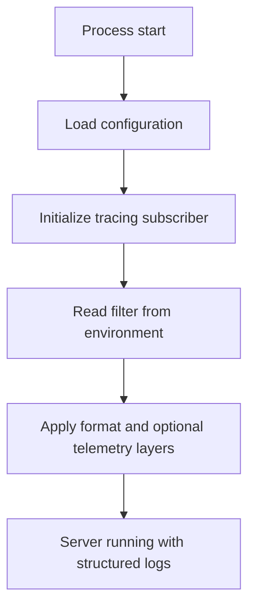
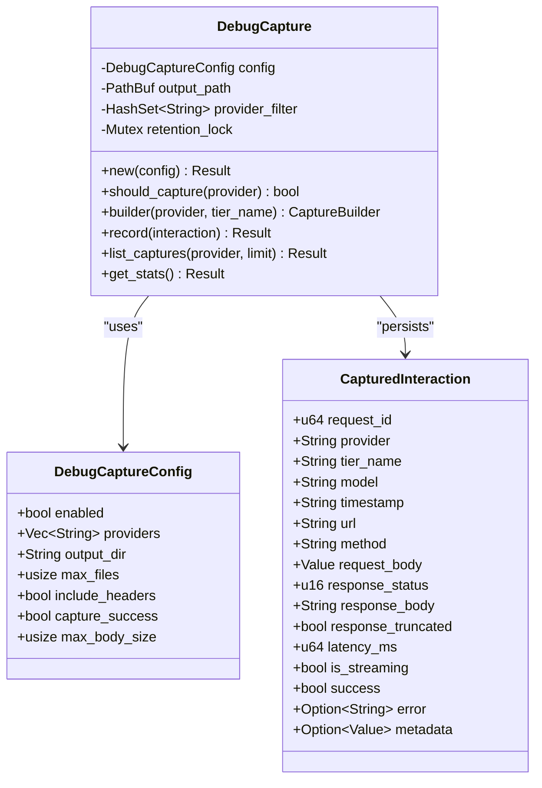
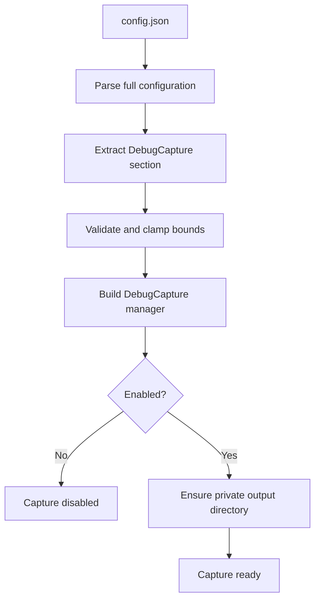
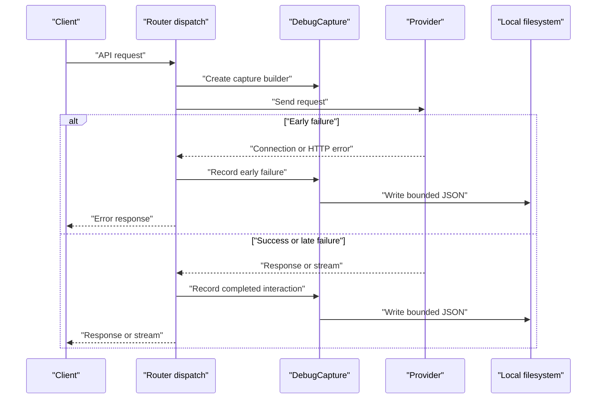
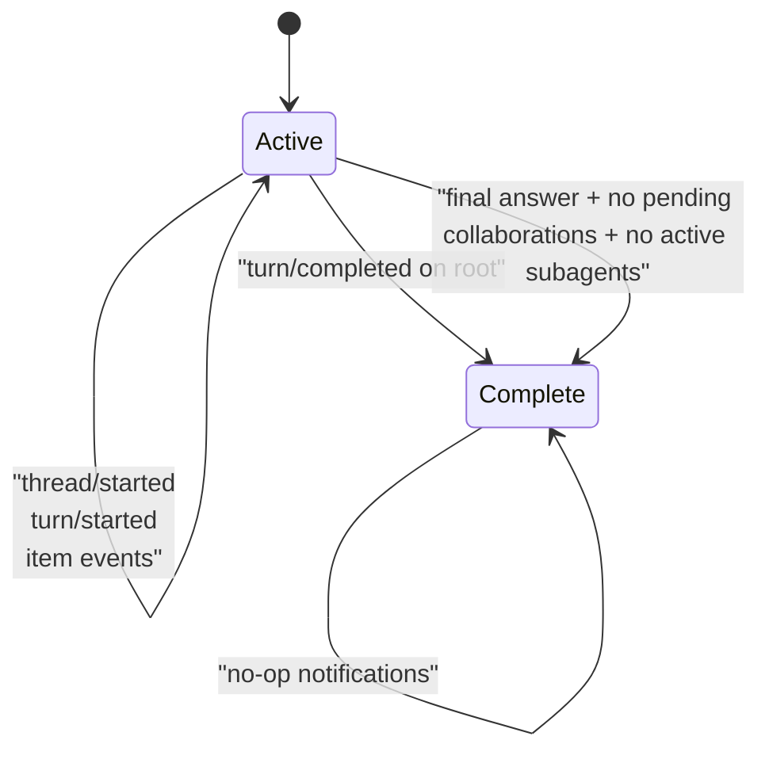
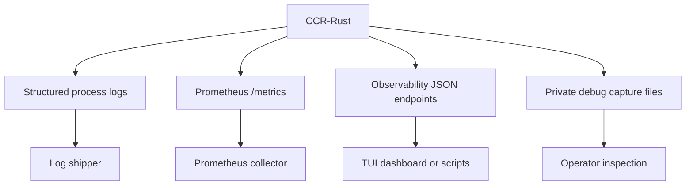

# Logging and Debug Capture

<cite>
**Referenced Files in This Document**
- [debug_capture.rs](file://src/debug_capture.rs)
- [turn_capture.rs](file://src/turn_capture.rs)
- [main.rs](file://src/main.rs)
- [lib.rs](file://src/lib.rs)
- [config/types.rs](file://src/config/types.rs)
- [config/mod.rs](file://src/config/mod.rs)
- [router/streaming.rs](file://src/router/streaming.rs)
- [router/dispatch.rs](file://src/router/dispatch.rs)
- [Cargo.toml](file://Cargo.toml)
- [observability.md](file://docs/observability.md)
- [troubleshooting.md](file://docs/troubleshooting.md)
- [debug_capture.md](file://docs/debug_capture.md)
</cite>

## Table of Contents
1. [Introduction](#introduction)
2. [Logging System Overview](#logging-system-overview)
3. [Structured Logging Configuration](#structured-logging-configuration)
4. [Log Levels and Filtering](#log-levels-and-filtering)
5. [Output Formatting and Storage](#output-formatting-and-storage)
6. [Debug Capture Architecture](#debug-capture-architecture)
7. [Configuring Debug Capture](#configuring-debug-capture)
8. [Request and Response Recording](#request-and-response-recording)
9. [Turn Capture for Multi-Thread Conversations](#turn-capture-for-multi-thread-conversations)
10. [Analyzing Captured Data](#analyzing-captured-data)
11. [Troubleshooting with Debug Capture](#troubleshooting-with-debug-capture)
12. [Rotation, Retention, and Storage Policies](#rotation-retention-and-storage-policies)
13. [Log Aggregation and External Integration](#log-aggregation-and-external-integration)
14. [Performance and Security Considerations](#performance-and-security-considerations)
15. [Operational Checklist](#operational-checklist)
16. [Conclusion](#conclusion)

## Introduction

CCR-Rust provides two complementary debugging mechanisms:

| Mechanism | Purpose | Primary Output |
|---|---|---|
| Structured logging | Runtime behavior, lifecycle events, routing decisions, rate limits, stream health, and errors | `tracing` log records written to standard output or forwarded through a tracing subscriber |
| Debug capture | Bounded, file-based recording of provider request/response interactions | JSON files under a private local directory |
| Turn capture | In-memory state tracking for multi-thread streaming conversations | State consumed by streaming and diagnostic code; not persisted as standalone logs |

The project uses the Rust `tracing` ecosystem for structured logging, with `tracing-subscriber` initializing a filtering layer from the environment. Debug capture is opt-in, disabled by default, and intentionally isolated from HTTP routes: it exposes no debug-capture endpoints and is primarily accessed through the local `ccr-rust captures` CLI.

**Section sources**
- [lib.rs:1-27](file://src/lib.rs#L1-L27)
- [debug_capture.md:1-127](file://docs/debug_capture.md#L1-L127)
- [Cargo.toml:1-87](file://Cargo.toml#L1-L87)

## Logging System Overview

At startup, CCR-Rust constructs a `tracing` subscriber using `tracing-subscriber`. The logger reads its effective filter from the environment rather than hardcoding a global log level. The relevant dependencies are:

- `tracing`: application-wide structured logging API used throughout the codebase.
- `tracing-subscriber`: formatting, filtering, and subscriber initialization.
- `env_logger` and `log`: present as dependencies but the server initializes logging through `tracing_subscriber`, so environment-driven configuration is controlled via `tracing` filters.
- Optional OpenTelemetry integration when the `telemetry` feature is enabled, which adds an OpenTelemetry tracing layer.



**Diagram sources**
- [main.rs:763-777](file://src/main.rs#L763-L777)
- [Cargo.toml:1-87](file://Cargo.toml#L1-L87)

**Section sources**
- [main.rs:763-777](file://src/main.rs#L763-L777)
- [Cargo.toml:1-87](file://Cargo.toml#L1-L87)

## Structured Logging Configuration

### Environment Variables

The most important variable for controlling log verbosity is `RUST_LOG`. It is passed to `tracing_subscriber::EnvFilter::try_from_default_env()`. Typical usage patterns include:

| Goal | Environment setting |
|---|---|
| Show only CCR-Rust logs at info level | `RUST_LOG=info` |
| Show CCR-Rust debug logs | `RUST_LOG=ccr_rust=debug` |
| Add network-level diagnostics | `RUST_LOG=reqwest=debug` |
| Enable detailed tower HTTP tracing | `RUST_LOG=tower_http=debug` |
| Combine multiple modules | `RUST_LOG=ccr_rust=debug,tower_http=debug` |

This approach follows the standard Rust tracing convention: module names map to crate paths, and levels can be specified per module.

### Optional Telemetry Layer

When built with the `telemetry` feature, CCR-Rust can install an OpenTelemetry tracing layer. This is separate from the normal process logs and is intended for exporting traces to external systems such as OTLP collectors. The feature is optional and does not affect basic `tracing` stdout logging.

**Section sources**
- [main.rs:763-777](file://src/main.rs#L763-L777)
- [Cargo.toml:1-87](file://Cargo.toml#L1-L87)

## Log Levels and Filtering

The repository uses several tracing levels:

| Level | Typical use in CCR-Rust |
|---|---|
| `trace` | Very low-volume protocol framing details |
| `debug` | Diagnostic information such as capture filtering, rotation warnings, internal state transitions |
| `info` | Lifecycle events such as config loading, listener address, successful capture writes, turn completion |
| `warn` | Recoverable problems such as invalid retention bounds, failed file removal, initialization failures |
| `error` | Failures propagated through `anyhow::Result` and surfaced by callers |

Examples of where these levels appear include:

- Config loading and listener startup use `info`.
- Debug capture enablement and successful writes use `info`.
- Invalid `max_files` or `max_body_size` values produce `warn`.
- Provider capture filtering decisions use `debug`.
- Stream idle timeouts and backpressure-related conditions use `warn`.

For troubleshooting, start with `info` and increase to `debug` only while diagnosing a specific issue. Keep verbose logging short-lived because it increases CPU usage, disk I/O, and log volume.

**Section sources**
- [main.rs:441-444](file://src/main.rs#L441-L444)
- [main.rs:465-468](file://src/main.rs#L465-L468)
- [debug_capture.rs:201-260](file://src/debug_capture.rs#L201-L260)
- [streaming.rs:1-120](file://src/router/streaming.rs#L1-L120)
- [troubleshooting.md:1-200](file://docs/troubleshooting.md#L1-L200)

## Output Formatting and Storage

By default, the formatter layer writes human-readable structured logs to standard output. The format includes timestamp, target module, level, and key-value fields emitted through `tracing` macros.

There is no built-in log rotation for the main process logs. Operators should integrate with their host system or container runtime:

- On Linux services, use systemd journal, journald rotation, or a log shipper such as Fluent Bit, Vector, or rsyslog.
- In containers, prefer writing to stdout/stderr and letting the orchestrator collect logs.
- For OpenTelemetry-enabled builds, configure the OTLP exporter according to the selected backend.

The observability documentation describes metrics and dashboard endpoints separately from general process logs. Metrics are scraped from `/metrics`; they are not the same as `tracing` logs.

**Section sources**
- [main.rs:775-777](file://src/main.rs#L775-L777)
- [observability.md:1-200](file://docs/observability.md#L1-L200)

## Debug Capture Architecture

Debug capture is implemented as a bounded, opt-in subsystem that serializes provider interactions into private JSON files. Its main components are:

| Component | Responsibility |
|---|---|
| `DebugCaptureConfig` | Deserializes `DebugCapture` configuration from JSON |
| `DebugCapture` | Manages enabled state, provider filtering, output directory, retention, and persistence |
| `CapturedInteraction` | Represents one request/response pair |
| `CaptureBuilder` | Applies configured privacy and size limits before recording |
| CLI `captures` command | Reads existing captures without starting the server |



**Diagram sources**
- [debug_capture.rs:1-200](file://src/debug_capture.rs#L1-L200)
- [debug_capture.rs:201-500](file://src/debug_capture.rs#L201-L500)

**Section sources**
- [debug_capture.rs:1-200](file://src/debug_capture.rs#L1-L200)
- [debug_capture.rs:201-500](file://src/debug_capture.rs#L201-L500)

## Configuring Debug Capture

Add a `DebugCapture` section to your CCR-Rust configuration only while diagnosing a specific provider failure. The feature is disabled by default.

| Option | Default | Meaning |
|---|---:|---|
| `enabled` | `false` | Turns capture on or off globally |
| `providers` | `[]` | Empty list means every provider; otherwise capture only listed providers |
| `output_dir` | `~/.ccr-rust/captures` | Local directory for captured JSON files |
| `max_files` | `100` | Number of current-format captures retained |
| `include_headers` | `false` | Whether to store sanitized headers |
| `capture_success` | `false` | Whether to persist successful non-streaming interactions |
| `max_body_size` | `1048576` | Maximum captured response body bytes |

Configuration is loaded through the shared config system:



**Diagram sources**
- [config/types.rs:1-260](file://src/config/types.rs#L1-L260)
- [config/mod.rs:437-517](file://src/config/mod.rs#L437-L517)
- [debug_capture.rs:1-200](file://src/debug_capture.rs#L1-L200)

On Unix, CCR-Rust enforces strict permissions:

- Capture directory mode `0700`.
- New capture file mode `0600`.
- Symlink directories are refused.
- Existing files are never overwritten through exclusive creation.

**Section sources**
- [debug_capture.md:1-127](file://docs/debug_capture.md#L1-L127)
- [config/mod.rs:437-517](file://src/config/mod.rs#L437-L517)
- [debug_capture.rs:1-200](file://src/debug_capture.rs#L1-L200)

## Request and Response Recording

### When Capture Is Triggered

For non-streaming requests, capture records:

- Connection errors.
- Non-success HTTP responses.
- Provider errors embedded in HTTP 200 bodies.
- Successful responses only when `capture_success` is true.

For streaming requests, capture is deliberately limited. It captures failures known before the response stream is handed to the client, such as connection failures, non-success HTTP responses, and errors detected during an initial bounded stream peek. Successful stream bodies and errors that occur later in an active stream are not persisted.

### How Capture Integrates Into Routing

The router creates a `CaptureBuilder` when debug capture is enabled. The builder applies configured header inclusion and maximum body size. At appropriate points in the dispatch pipeline, the router persists either a partial interaction (for early failures) or a completed interaction after the upstream response is processed.



**Diagram sources**
- [router/dispatch.rs:813-892](file://src/router/dispatch.rs#L813-L892)
- [router/dispatch.rs:917-1043](file://src/router/dispatch.rs#L917-L1043)
- [router/dispatch.rs:1218-1412](file://src/router/dispatch.rs#L1218-L1412)

### Captured Interaction Fields

Each captured file contains identity and context fields plus bounded request and response data:

| Field group | Example fields |
|---|---|
| Identity | `request_id`, `provider`, `tier_name`, `model`, `timestamp` |
| Request | `url`, `method`, `request_body`, optional `request_headers` |
| Response | `response_status`, optional `response_headers`, `response_body`, `response_truncated` |
| Diagnostics | `latency_ms`, `is_streaming`, `success`, `error`, optional `metadata` |

Headers are omitted unless explicitly enabled. Even then, common credential and cookie names are redacted.

**Section sources**
- [debug_capture.rs:1-200](file://src/debug_capture.rs#L1-L200)
- [debug_capture.rs:201-500](file://src/debug_capture.rs#L201-L500)
- [debug_capture.md:1-127](file://docs/debug_capture.md#L1-L127)
- [router/dispatch.rs:813-1043](file://src/router/dispatch.rs#L813-L1043)

## Turn Capture for Multi-Thread Conversations

Turn capture tracks the state of a proxied streaming turn across multiple threads and subagent collaborations. It is inspired by equivalent logic in the codex plugin and is designed around SSE notification processing.

### Core State

`TurnCaptureState` maintains:

- Root thread ID.
- Known thread IDs.
- Thread-to-turn mappings.
- Human-readable thread labels.
- Current root turn ID.
- Pending collaboration tool call IDs.
- Active subagent turns.
- Final answer detection.
- Completion flag.
- Last agent message text.
- Reasoning summary sections.
- Recorded file changes and command executions.
- Captured error value.

### Supported Notifications

| Notification | Behavior |
|---|---|
| `thread/started` | Registers a new thread and derives a label if available |
| `thread/name/updated` | Updates thread label from name |
| `turn/started` | Registers thread, maps turn ID, marks non-root threads as subagent turns |
| `item/started` | Records item lifecycle and collaborator receiver threads |
| `item/completed` | Records completed items such as messages, reasoning, file changes, commands |
| `error` | Stores error payload |
| `turn/completed` | Marks root turn complete |

### Completion Logic

A turn is complete when:

1. `turn/completed` is received on the root thread, **or**
2. A final answer has been seen **and** there are no pending collaborations **and** no active subagent turns.



**Diagram sources**
- [turn_capture.rs:1-200](file://src/turn_capture.rs#L1-L200)
- [turn_capture.rs:201-540](file://src/turn_capture.rs#L201-L540)

**Section sources**
- [turn_capture.rs:1-200](file://src/turn_capture.rs#L1-L200)
- [turn_capture.rs:201-540](file://src/turn_capture.rs#L201-L540)

## Analyzing Captured Data

### Using the CLI

The `ccr-rust captures` command reads existing capture files without requiring the server to be running.

| Command | Purpose |
|---|---|
| `ccr-rust captures --limit 10` | List recent failures and metadata |
| `ccr-rust captures --provider minimax --limit 20` | Filter by provider |
| `ccr-rust captures --stats` | Aggregate statistics |
| `ccr-rust captures --full` | Include bounded response body in terminal output |
| `ccr-rust captures --output-dir /path` | Override capture directory |

The CLI reads only regular files whose names begin with `ccr_capture_v1_`. It ignores symlinks, legacy files, task captures, and unrelated JSON. Statistics and listing are bounded to protect the operator’s machine.

### File Naming Contract

Files follow this contract:

```
ccr_capture_v1_{provider}_{tier_name}_{timestamp}_{request_id}.json
```

Example:

```
ccr_capture_v1_minimax_ccr-mm_20260709_183742_123456789_42.json
```

### Statistics

Statistics include total captures, success count, error count, average latency, and counts by provider. They are computed by scanning managed capture files up to bounded limits.

**Section sources**
- [main.rs:230-245](file://src/main.rs#L230-L245)
- [main.rs:305-363](file://src/main.rs#L305-L363)
- [debug_capture.md:1-127](file://docs/debug_capture.md#L1-L127)
- [debug_capture.rs:201-500](file://src/debug_capture.rs#L201-L500)

## Troubleshooting with Debug Capture

### Diagnosing Provider API Issues

Use debug capture when a provider returns unexpected content, drifts over time, or embeds errors inside HTTP 200 responses.

Recommended workflow:

1. Temporarily enable debug capture for the affected provider.
2. Reproduce the failing request.
3. Run `ccr-rust captures --provider <provider> --stats` to confirm captures were recorded.
4. Inspect the latest capture with `--full` if needed.
5. Disable capture immediately after diagnosis.

Focus on:

- `response_status`.
- `response_body`.
- `error`.
- `success`.
- `is_streaming`.
- `latency_ms`.

### Diagnosing Routing Problems

Routing issues often appear indirectly in captures because captures include provider, tier name, model, URL, and status. Useful checks include:

- Is the request routed to the expected tier?
- Did the selected provider return an error or unexpected body?
- Was the response marked successful even though downstream behavior was wrong?
- Did streaming vs non-streaming handling differ between providers?

If clients cache model strings and bypass tier order, consult the routing troubleshooting guidance. Debug capture confirms what reached the provider; routing policy explains why that provider was chosen.

### Analyzing Streaming Response Behavior

Streaming capture is intentionally conservative. It captures early failures and initial stream inspection results, but not successful streamed bodies. When analyzing streaming behavior:

1. Use `tracing` logs at `debug` or `info` to observe stream lifecycle, idle timeouts, and backpressure signals.
2. Use debug capture to inspect early transport or HTTP-layer failures.
3. Use metrics and `/v1/latencies` to assess overall streaming health.
4. Use turn capture state logic to reason about multi-thread conversations and completion inference.

For pseudo-SSE conversion issues, the troubleshooting documentation shows how to detect whether tool-use blocks were dropped and how to verify SSE event ordering.

**Section sources**
- [debug_capture.md:1-127](file://docs/debug_capture.md#L1-L127)
- [troubleshooting.md:1-200](file://docs/troubleshooting.md#L1-L200)
- [streaming.rs:1-120](file://src/router/streaming.rs#L1-L120)

## Rotation, Retention, and Storage Policies

### Automatic Rotation

After every successful write, CCR-Rust attempts to enforce retention:

1. Read the capture directory.
2. Select only current-format managed files.
3. Sort by modification time.
4. Delete oldest files until `max_files` is satisfied.
5. If deletion cannot enforce the bound, remove the newly written file and report an error instead of leaving unbounded growth.

Retention runs under a lock to avoid concurrent cleanup races.

### Hard Limits

| Limit | Value | Purpose |
|---|---:|---|
| `DEFAULT_MAX_FILES` | `100` | Default retention bound |
| `HARD_MAX_FILES` | `1000` | Clamped maximum for `max_files` |
| `MAX_CAPTURE_FILE_BYTES` | `4 MiB` | Hard serialized file size cap |
| `HARD_MAX_BODY_BYTES` | `2 MiB` | Clamped maximum for `max_body_size` |
| `MAX_LIST_FILES` | `100` | Bounded scan for listing/statistics |
| `MAX_LIST_BYTES` | `16 MiB` | Bounded accepted input for listing/statistics |

Zero values are normalized:

- `max_files == 0` becomes the default.
- `max_body_size == 0` becomes 1 MiB.

Values exceeding hard limits are clamped and logged as warnings.

### Manual Cleanup

To remove only current-format captures:

```bash
find ~/.ccr-rust/captures -type f -name 'ccr_capture_v1_*.json' -delete
```

Legacy and unrelated files are intentionally left for manual review.

**Section sources**
- [debug_capture.rs:1-200](file://src/debug_capture.rs#L1-L200)
- [debug_capture.rs:201-500](file://src/debug_capture.rs#L201-L500)
- [debug_capture.md:1-127](file://docs/debug_capture.md#L1-L127)

## Log Aggregation and External Integration

### Process Logs

Process logs are produced by `tracing`. Recommended integration patterns:

| Environment | Strategy |
|---|---|
| systemd service | Let journald collect stdout; rotate with journald settings |
| Docker | Collect stdout/stderr via container runtime logs |
| Kubernetes | Use sidecar log shippers or platform-native log collection |
| Centralized logging | Forward structured logs with a shipper that understands key-value fields |
| Traces | Use the optional `telemetry` feature to export OpenTelemetry traces |

Do not treat process logs as a substitute for debug capture. Process logs describe system behavior; debug capture preserves bounded provider payloads for protocol-level analysis.

### Metrics and Observability

Metrics are separate from logs and debug captures:

- Prometheus endpoint: `/metrics`.
- Usage aggregates: `/v1/usage`.
- Latency EWMA: `/v1/latencies`.
- Token drift: `/v1/token-drift`.
- Token audit: `/v1/token-audit`.
- Health: `/health`.

Persistence can be backed by Redis so counters, histograms, token drift state, and latency state survive restarts.



**Diagram sources**
- [observability.md:1-200](file://docs/observability.md#L1-L200)
- [main.rs:763-777](file://src/main.rs#L763-L777)

**Section sources**
- [observability.md:1-200](file://docs/observability.md#L1-L200)
- [main.rs:763-777](file://src/main.rs#L763-L777)

## Performance and Security Considerations

### Performance

- Debug capture is disabled by default to avoid unnecessary serialization and disk I/O.
- Capture writes are bounded by file size and body size.
- Listing and statistics scans are bounded by file count and byte budget.
- Retention runs after each successful write; failed retention removes the new file rather than growing disk usage.
- Streaming capture avoids persisting successful streams, reducing overhead during long-running sessions.

### Security

- Capture directory is created with restrictive Unix permissions.
- New files are created exclusively to prevent overwriting existing paths.
- Symlink directories are rejected.
- Headers are omitted by default and redacted when included.
- Sensitive data such as prompts, source code, and model output may still appear in request/response bodies.
- Do not redirect `--full` output into world-readable locations.
- Enable capture only for bounded diagnostic sessions.

### Operational Best Practices

1. Treat debug capture as temporary diagnostic state.
2. Scope capture to specific providers when possible.
3. Avoid enabling `include_headers` unless required.
4. Review captured files before sharing them externally.
5. Remove captures after investigation.
6. Keep verbose tracing logs short-lived.
7. Use metrics and `/v1/latencies` for ongoing operational monitoring.
8. Use Redis persistence only when you need observability state across restarts.

**Section sources**
- [debug_capture.rs:1-200](file://src/debug_capture.rs#L1-L200)
- [debug_capture.rs:201-500](file://src/debug_capture.rs#L201-L500)
- [debug_capture.md:1-127](file://docs/debug_capture.md#L1-L127)
- [observability.md:1-200](file://docs/observability.md#L1-L200)

## Operational Checklist

### Before Enabling Debug Capture

- Confirm you need provider payload inspection.
- Decide whether to scope to specific providers.
- Choose a private `output_dir`.
- Accept that request/response bodies may contain sensitive data.

### During Diagnosis

- Set `DebugCapture.enabled = true`.
- Optionally set `providers` to the failing provider.
- Reproduce the issue.
- Run `ccr-rust captures --stats`.
- Inspect captures with `ccr-rust captures --full` locally.
- Check `tracing` logs for routing, rate limiting, and stream behavior.

### After Diagnosis

- Set `DebugCapture.enabled = false`.
- Verify retention is working.
- Remove old captures if necessary.
- Reduce log verbosity if `RUST_LOG` was increased.
- Correlate findings with metrics and `/v1/latencies`.

**Section sources**
- [debug_capture.md:1-127](file://docs/debug_capture.md#L1-L127)
- [main.rs:305-363](file://src/main.rs#L305-L363)
- [troubleshooting.md:1-200](file://docs/troubleshooting.md#L1-L200)

## Conclusion

CCR-Rust separates concerns between three observable surfaces:

1. **Structured logs** provide runtime context, lifecycle events, and diagnostic hints through `tracing`.
2. **Debug capture** provides bounded, file-based snapshots of provider interactions for protocol-level troubleshooting.
3. **Turn capture** provides in-memory state for multi-thread streaming conversations, including subagent collaboration and completion inference.

For production operations, keep logging and metrics enabled, but leave debug capture disabled. Enable it only for targeted investigations, scope it narrowly, and clean it up promptly. Use metrics and `/v1/latencies` for continuous health, debug capture for provider-specific anomalies, and turn capture state for complex streaming conversations.