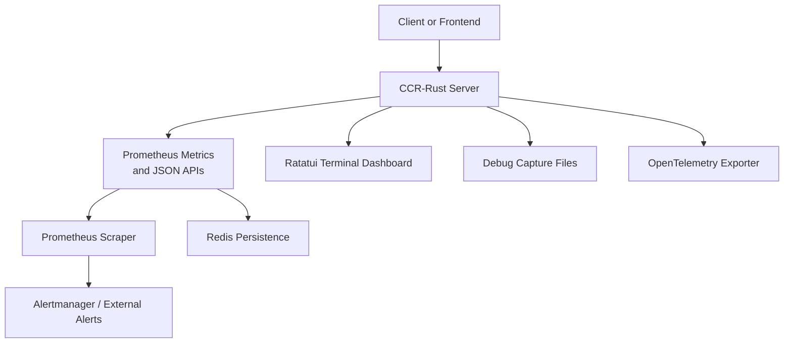
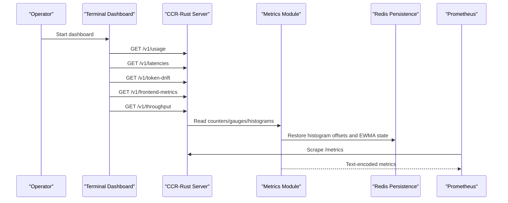
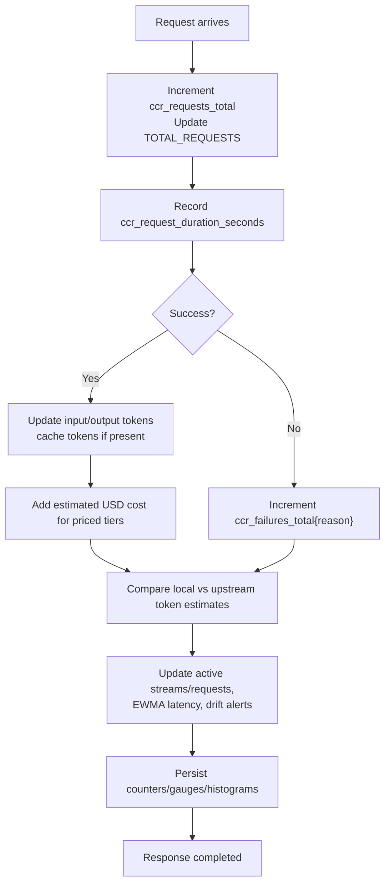
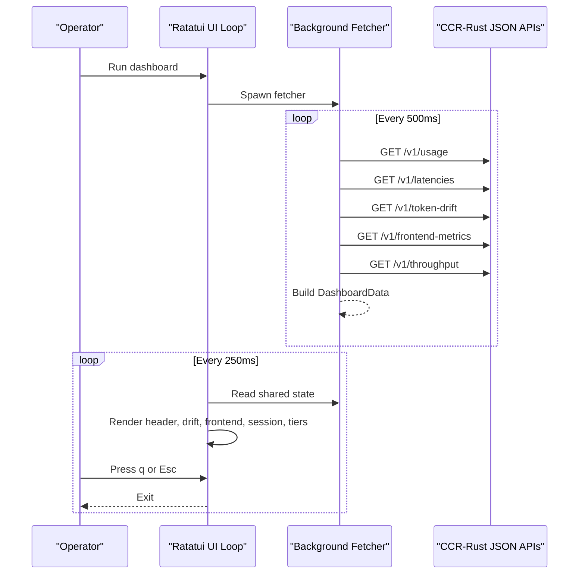
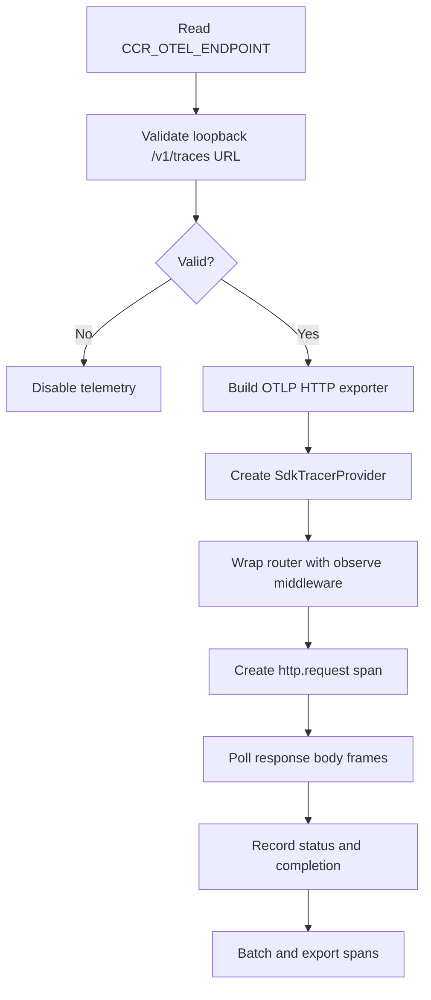
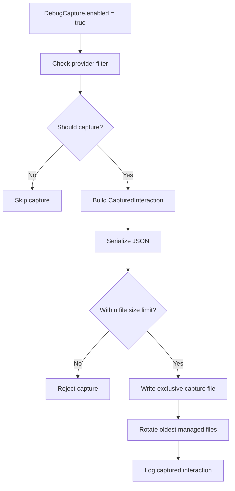
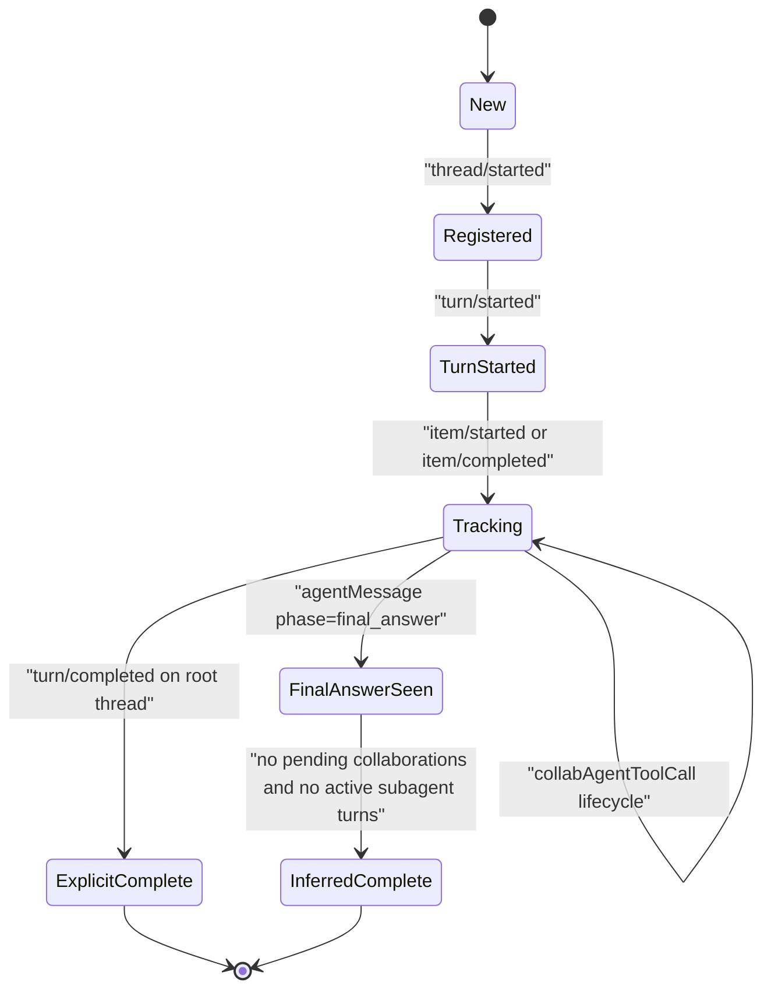
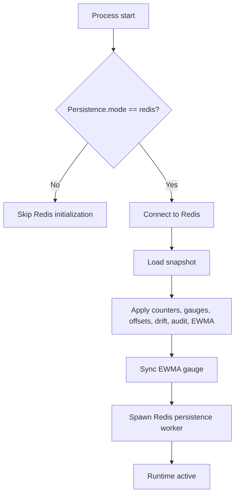
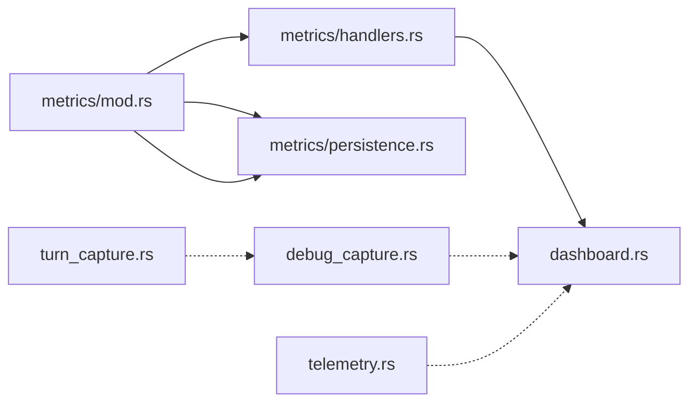

# Observability and Monitoring

<cite>
**Referenced Files in This Document**   
- [observability.md](file://docs/observability.md)
- [debug_capture.md](file://docs/debug_capture.md)
- [telemetry.md](file://docs/telemetry.md)
- [prometheus-snippet.yml](file://monitoring/prometheus-snippet.yml)
- [mod.rs](file://src/metrics/mod.rs)
- [handlers.rs](file://src/metrics/handlers.rs)
- [persistence.rs](file://src/metrics/persistence.rs)
- [dashboard.rs](file://src/dashboard.rs)
- [debug_capture.rs](file://src/debug_capture.rs)
- [turn_capture.rs](file://src/turn_capture.rs)
- [telemetry.rs](file://src/telemetry.rs)
</cite>

## Table of Contents
1. [Introduction](#introduction)
2. [Project Structure](#project-structure)
3. [Core Components](#core-components)
4. [Architecture Overview](#architecture-overview)
5. [Detailed Component Analysis](#detailed-component-analysis)
6. [Dependency Analysis](#dependency-analysis)
7. [Performance Considerations](#performance-considerations)
8. [Troubleshooting Guide](#troubleshooting-guide)
9. [Conclusion](#conclusion)
10. [Appendices](#appendices)

## Introduction
This document explains the observability surface of CCR-Rust. It covers Prometheus metrics, structured telemetry spans, live terminal dashboards, debug capture, token drift verification, cost tracking, persistence through Redis, and integration with external monitoring systems. The goal is to help operators monitor request throughput, latency, token usage, provider health, and cost while providing actionable diagnostics for routing, streaming, rate limiting, and provider failures.

## Project Structure
Observability-related code is primarily organized under:
- `src/metrics` — Prometheus counters, gauges, histograms, JSON API handlers, and Redis-backed persistence.
- `src/dashboard.rs` — Ratatui-based interactive terminal dashboard that polls CCR-Rust JSON endpoints.
- `src/debug_capture.rs` — Local file-based request/response capture for debugging provider interactions.
- `src/turn_capture.rs` — Streaming turn state machine for multi-threaded agent conversations.
- `src/telemetry.rs` — Optional OpenTelemetry span exporter to a local loopback endpoint.
- `monitoring/prometheus-snippet.yml` — Example Prometheus scrape configuration.
- `docs/observability.md`, `docs/debug_capture.md`, `docs/telemetry.md` — Operational documentation.

**Diagram sources**
- [mod.rs:22-198](file://src/metrics/mod.rs#L22-L198)
- [handlers.rs:1-25](file://src/metrics/handlers.rs#L1-L25)
- [persistence.rs:1-40](file://src/metrics/persistence.rs#L1-L40)
- [dashboard.rs:1-35](file://src/dashboard.rs#L1-L35)
- [debug_capture.rs:1-25](file://src/debug_capture.rs#L1-L25)
- [telemetry.rs:1-20](file://src/telemetry.rs#L1-L20)
- [prometheus-snippet.yml:1-7](file://monitoring/prometheus-snippet.yml#L1-L7)

**Section sources**
- [observability.md:1-200](file://docs/observability.md#L1-L200)
- [prometheus-snippet.yml:1-7](file://monitoring/prometheus-snippet.yml#L1-L7)

## Core Components
- **Prometheus metrics**: Counters, gauges, and histograms record request volume, failures, duration, active streams, tokens, cache usage, costs, TTFT, throughput, admission control, retries, hedges, and token drift.
- **JSON observation endpoints**: `/v1/usage`, `/v1/token-drift`, `/v1/token-audit`, `/v1/frontend-metrics`, `/v1/throughput`, `/v1/latencies`.
- **Live terminal dashboard**: A ratatui TUI that polls `/v1/usage`, `/v1/latencies`, `/v1/token-drift`, `/v1/frontend-metrics`, and `/v1/throughput` every 500 ms.
- **Structured telemetry**: Optional bounded OpenTelemetry HTTP export to a loopback collector.
- **Debug capture**: Bounded, opt-in JSON files capturing request/response metadata and bodies for diagnostic review.
- **Streaming turn capture**: State machine tracking multi-threaded agent turns, subagent collaboration, completion inference, and captured items.
- **Persistence**: Optional Redis-backed snapshot and restore for Prometheus histogram offsets, EWMA latency state, token drift state, audit log, and related counters/gauges.

**Section sources**
- [mod.rs:22-198](file://src/metrics/mod.rs#L22-L198)
- [handlers.rs:1-120](file://src/metrics/handlers.rs#L1-L120)
- [dashboard.rs:36-120](file://src/dashboard.rs#L36-L120)
- [debug_capture.rs:1-80](file://src/debug_capture.rs#L1-L80)
- [turn_capture.rs:1-60](file://src/turn_capture.rs#L1-L60)
- [persistence.rs:1-40](file://src/metrics/persistence.rs#L1-L40)
- [telemetry.rs:1-60](file://src/telemetry.rs#L1-L60)

## Architecture Overview
CCR-Rust exposes a Prometheus text-scrape endpoint and several JSON APIs. A background fetcher powers the terminal dashboard by polling those APIs. Metrics can optionally be persisted to Redis so restarts preserve histogram offsets, EWMA latencies, token drift aggregates, and audit records. Debug capture writes bounded files locally; telemetry exports minimal request spans to a local OpenTelemetry Collector.

**Diagram sources**
- [dashboard.rs:36-120](file://src/dashboard.rs#L36-L120)
- [handlers.rs:121-200](file://src/metrics/handlers.rs#L121-L200)
- [persistence.rs:80-160](file://src/metrics/persistence.rs#L80-L160)
- [prometheus-snippet.yml:1-7](file://monitoring/prometheus-snippet.yml#L1-L7)

## Detailed Component Analysis

### Prometheus Metrics Collection System
The metrics module registers all observable counters, gauges, and histograms under the `ccr_` namespace. Key metric families include:

| Area | Metric family | Purpose |
|---|---|---|
| Request throughput | `ccr_requests_total{tier}` | Total requests per tier |
| Failures | `ccr_failures_total{tier,reason}` | Failure counts by reason |
| Latency | `ccr_request_duration_seconds{tier}` | Histogram of total request duration |
| Active concurrency | `ccr_active_streams`, `ccr_active_requests` | Current streaming and in-flight request counts |
| Stream health | `ccr_stream_backpressure_total`, `ccr_rejected_streams_total` | Backpressure and concurrency-limit rejections |
| Token accounting | `ccr_input_tokens_total{tier}`, `ccr_output_tokens_total{tier}` | Input and output tokens per tier |
| Prompt caching | `ccr_cache_read_tokens_total{tier}`, `ccr_cache_creation_tokens_total{tier}` | Provider prompt-cache reads and creations |
| Cost tracking | `ccr_cost_usd_total{tier}` | Estimated USD cost for priced tiers |
| Pre-request estimation | `ccr_pre_request_tokens_total{tier,component}`, `ccr_pre_request_tokens{tier}` | Estimated input tokens before dispatch |
| Rate limiting | `ccr_rate_limit_hits_total{tier}`, `ccr_rate_limit_backoffs_total{tier}` | Backend 429 responses and backoff activity |
| Admission control | `ccr_tier_inflight{tier}`, `ccr_tier_limit{tier}`, `ccr_tier_inflight_tokens{tier}`, `ccr_admission_defers_total{tier}` | AIMD admission limits and deferrals |
| Retry and hedge behavior | `ccr_retry_sweeps_total`, `ccr_retry_budget_overflow_total`, `ccr_hedges_launched_total`, `ccr_hedge_wins_total{tier}`, `ccr_primary_hedge_wins_total{tier}` | Cascade retry sweeps, budget overflow, hedging outcomes |
| First-token latency | `ccr_ttft_seconds{tier}` | Time-to-first-token distribution |
| Output throughput | `ccr_output_tokens_per_second{tier}` | Tokens-per-second distribution |
| Tier latency model | `ccr_tier_ewma_latency_seconds{tier}` | Exponentially weighted moving average latency per tier |
| Token drift | `ccr_token_drift_absolute{tier}`, `ccr_token_drift_pct{tier}`, `ccr_token_drift_alerts_total{tier,severity}` | Difference between local estimate and upstream report |
| Hold behavior | `ccr_hold_wait_seconds` | Wall-clock time held when exhausting retries |

#### Metrics Recording Flow
Recording functions update both Prometheus atomics and optional Redis persistence events. For example, request recording increments tier-specific counters and global totals; duration recording updates the histogram; failure recording labels failures by reason.

**Diagram sources**
- [mod.rs:300-580](file://src/metrics/mod.rs#L300-L580)
- [handlers.rs:121-200](file://src/metrics/handlers.rs#L121-L200)

#### Available JSON Observation Endpoints
| Endpoint | Description |
|---|---|
| `GET /metrics` | Prometheus text scrape endpoint |
| `GET /health` | Health check |
| `GET /v1/usage` | Aggregate token usage, costs, active streams, and per-tier statistics |
| `GET /v1/latencies` | Per-tier EWMA latency and sample count |
| `GET /v1/token-drift` | Per-tier cumulative and last-sample drift percentages |
| `GET /v1/token-audit` | Recent pre-request token breakdown entries |
| `GET /v1/frontend-metrics` | Per-frontend request counts and average latency |
| `GET /v1/throughput` | Per-tier TTFT percentiles, average tokens per second, and recent samples |

The `/v1/usage` handler aggregates Prometheus counters into a structured summary, including cached token splits and estimated USD cost. The `/v1/throughput` handler computes approximate percentiles from histograms and merges recent TTFT and tokens-per-second samples.

**Section sources**
- [mod.rs:22-198](file://src/metrics/mod.rs#L22-L198)
- [mod.rs:201-580](file://src/metrics/mod.rs#L201-L580)
- [handlers.rs:1-200](file://src/metrics/handlers.rs#L1-L200)
- [handlers.rs:201-577](file://src/metrics/handlers.rs#L201-L577)
- [observability.md:60-120](file://docs/observability.md#L60-L120)

### Live Terminal Dashboard Built with Ratatui
The dashboard starts a background fetcher that polls CCR-Rust endpoints every 500 ms and stores results in shared state. The UI thread renders panels at a 250 ms tick rate using ratatui widgets.

Key panels:
- **Header**: Active requests, success rate, and token throughput.
- **Token Drift Monitor**: Per-tier cumulative and last-sample drift with color-coded severity.
- **Frontend Metrics**: Per-frontend request counts and average latency.
- **Session Info**: Working directory, Git branch, and build version.
- **Tier Statistics**: EWMA latency, TTFT, tokens per second, successful/failed request counts, and input/output tokens.

Navigation:
- Exit with `q` or `Esc`.
- There are no tabbed views; the dashboard displays all panels simultaneously.
- Data refresh is automatic; the operator does not manually navigate between screens.

Environment variables:
- `CCR_DASHBOARD_HOST` and `CCR_DASHBOARD_PORT` configure the target server.
- Defaults are `127.0.0.1:3456`.

**Diagram sources**
- [dashboard.rs:36-120](file://src/dashboard.rs#L36-L120)
- [dashboard.rs:250-420](file://src/dashboard.rs#L250-L420)
- [dashboard.rs:420-658](file://src/dashboard.rs#L420-L658)

**Section sources**
- [dashboard.rs:1-120](file://src/dashboard.rs#L1-L120)
- [dashboard.rs:201-420](file://src/dashboard.rs#L201-L420)
- [dashboard.rs:420-658](file://src/dashboard.rs#L420-L658)
- [observability.md:120-180](file://docs/observability.md#L120-L180)

### Structured Logging and Telemetry
Local logging uses the standard Rust tracing ecosystem. Telemetry in this project refers to optional OpenTelemetry span export, not general application logs.

OpenTelemetry characteristics:
- Enabled via `CCR_OTEL_ENDPOINT`.
- Only loopback HTTP endpoints ending in `/v1/traces` are accepted.
- Spans record method, matched route template, response status, and stream completion.
- Sensitive data such as URLs, query strings, headers, bodies, error strings, and tool outputs are intentionally excluded.
- Uses a batch processor with queue size 1024, batch size 128, and 2-second scheduled delay.
- Export failures do not block request handling.
- Service name is `ccr-rust`.

**Diagram sources**
- [telemetry.rs:1-60](file://src/telemetry.rs#L1-L60)
- [telemetry.rs:60-140](file://src/telemetry.rs#L60-L140)
- [telemetry.rs:140-198](file://src/telemetry.rs#L140-L198)

For operational guidance on log aggregation strategies, see the repository’s troubleshooting and deployment documents. This codebase explicitly separates Prometheus metrics (for scraping), optional OpenTelemetry spans (for traces), and debug capture (for bounded diagnostic files).

**Section sources**
- [telemetry.rs:1-198](file://src/telemetry.rs#L1-L198)
- [telemetry.md:1-57](file://docs/telemetry.md#L1-L57)

### Debug Capture Functionality
Debug capture is disabled by default and must be enabled explicitly. It writes bounded JSON files to a private directory.

Key behaviors:
- Providers can be filtered; an empty list captures all providers.
- Headers are only recorded when `include_headers` is true.
- Successful non-streaming responses are captured only when `capture_success` is true.
- Streaming capture is limited to pre-response failures.
- File names follow a fixed prefix contract.
- Each serialized capture file has a hard byte limit.
- Retention rotates oldest managed files up to `max_files`.
- On Unix, the capture directory is mode `0700`; new files are mode `0600`.
- Symlink capture directories are rejected.
- CLI commands read bounded lists and statistics without exposing network routes.

**Diagram sources**
- [debug_capture.rs:1-80](file://src/debug_capture.rs#L1-L80)
- [debug_capture.rs:201-360](file://src/debug_capture.rs#L201-L360)
- [debug_capture.rs:360-560](file://src/debug_capture.rs#L360-L560)

**Section sources**
- [debug_capture.rs:1-200](file://src/debug_capture.rs#L1-L200)
- [debug_capture.rs:201-692](file://src/debug_capture.rs#L201-L692)
- [debug_capture.md:1-127](file://docs/debug_capture.md#L1-L127)

### Streaming Turn Capture
The turn capture state machine tracks multi-threaded agent conversations over SSE-like notifications. It maintains root and subagent threads, turn IDs, pending collaborations, completed items, reasoning summaries, file changes, command executions, and errors. Completion can be explicit (`turn/completed`) or inferred after a final answer with no pending work.

**Diagram sources**
- [turn_capture.rs:1-60](file://src/turn_capture.rs#L1-L60)
- [turn_capture.rs:60-180](file://src/turn_capture.rs#L60-L180)
- [turn_capture.rs:180-300](file://src/turn_capture.rs#L180-L300)

**Section sources**
- [turn_capture.rs:1-200](file://src/turn_capture.rs#L1-L200)
- [turn_capture.rs:201-540](file://src/turn_capture.rs#L201-L540)

### Persistence Through Redis
When configured, CCR-Rust loads a Redis snapshot at startup, applies counters, gauges, histogram offsets, token drift state, audit log, and EWMA state, then spawns a background worker to persist future metric events. Operators can clear persisted observability state without affecting unrelated Redis data.

Restored state includes:
- Prometheus counters and gauges.
- Histogram offsets used for latency and token distributions.
- `/v1/token-drift` aggregate state.
- `/v1/token-audit` ring buffer.
- EWMA tier latency state.

**Diagram sources**
- [persistence.rs:1-40](file://src/metrics/persistence.rs#L1-L40)
- [persistence.rs:80-160](file://src/metrics/persistence.rs#L80-L160)
- [persistence.rs:160-240](file://src/metrics/persistence.rs#L160-L240)

**Section sources**
- [persistence.rs:1-200](file://src/metrics/persistence.rs#L1-L200)
- [observability.md:1-59](file://docs/observability.md#L1-L59)

## Dependency Analysis
The observability system has clear boundaries:
- `metrics/mod.rs` defines metric families and recording helpers.
- `metrics/handlers.rs` builds JSON responses from Prometheus collectors.
- `metrics/persistence.rs` bridges metrics and Redis.
- `dashboard.rs` depends on the JSON API contracts.
- `debug_capture.rs` is independent of Prometheus but may be used alongside it.
- `turn_capture.rs` is a streaming state machine used during conversation proxying.
- `telemetry.rs` wraps the Axum router and sends spans independently of Prometheus.

**Diagram sources**
- [mod.rs:1-22](file://src/metrics/mod.rs#L1-L22)
- [handlers.rs:1-25](file://src/metrics/handlers.rs#L1-L25)
- [persistence.rs:1-40](file://src/metrics/persistence.rs#L1-L40)
- [dashboard.rs:1-35](file://src/dashboard.rs#L1-L35)
- [debug_capture.rs:1-25](file://src/debug_capture.rs#L1-L25)
- [turn_capture.rs:1-25](file://src/turn_capture.rs#L1-L25)
- [telemetry.rs:1-20](file://src/telemetry.rs#L1-L20)

**Section sources**
- [mod.rs:1-22](file://src/metrics/mod.rs#L1-L22)
- [handlers.rs:1-25](file://src/metrics/handlers.rs#L1-L25)
- [persistence.rs:1-40](file://src/metrics/persistence.rs#L1-L40)
- [dashboard.rs:1-35](file://src/dashboard.rs#L1-L35)
- [debug_capture.rs:1-25](file://src/debug_capture.rs#L1-L25)
- [turn_capture.rs:1-25](file://src/turn_capture.rs#L1-L25)
- [telemetry.rs:1-20](file://src/telemetry.rs#L1-L20)

## Performance Considerations
- Prefer Prometheus scrapes for production monitoring because counters and gauges are low-overhead and designed for time-series databases.
- Use histograms carefully: they retain bucket state and are more expensive than counters.
- Keep Redis persistence enabled only when cross-restart continuity is required; otherwise, in-memory metrics reduce disk I/O.
- Limit debug capture to short diagnostic sessions because writing JSON files consumes CPU, memory, and disk.
- Avoid enabling `include_headers` and `capture_success` unless needed; both increase payload size and storage pressure.
- Tune Prometheus scrape intervals based on workload; the example uses 10 seconds.
- Use EWMA latency and token drift metrics to detect degraded tiers before they cause cascading failures.
- Monitor `ccr_tier_inflight`, `ccr_tier_limit`, and `ccr_admission_defers_total` together to understand whether capacity constraints are throttling traffic.
- Watch `ccr_stream_backpressure_total` and `ccr_rejected_streams_total` for streaming overload.
- Track `ccr_retry_budget_overflow_total` and `ccr_hedges_launched_total` to understand fallback behavior under load.

[No sources needed since this section provides general guidance]

## Troubleshooting Guide

### High Latency or Degraded Tier
1. Check `/v1/latencies` for EWMA latency per tier.
2. Inspect `ccr_tier_ewma_latency_seconds` and `ccr_request_duration_seconds{tier}`.
3. Review `ccr_tier_inflight{tier}` and `ccr_tier_inflight_tokens{tier}` for concurrency pressure.
4. Look at `ccr_admission_defers_total{tier}` for AIMD throttling.
5. If a later tier becomes faster, verify dynamic tier ordering behavior described in the observability documentation.

**Section sources**
- [handlers.rs:540-577](file://src/metrics/handlers.rs#L540-L577)
- [mod.rs:140-198](file://src/metrics/mod.rs#L140-L198)
- [observability.md:180-200](file://docs/observability.md#L180-L200)

### Unexpected Token Costs or Routing Decisions
1. Query `/v1/token-drift` for cumulative drift percentage.
2. Inspect `ccr_token_drift_pct{tier}` and `ccr_token_drift_absolute{tier}`.
3. Review `/v1/token-audit` for pre-request token breakdowns.
4. Confirm whether `ccr_pre_request_tokens{tier}` distributions match expected prompt sizes.
5. Treat drift warnings above 10% and critical drift above 25% as signals to investigate tokenizer assumptions and provider-reported usage.

**Section sources**
- [handlers.rs:20-80](file://src/metrics/handlers.rs#L20-L80)
- [mod.rs:201-360](file://src/metrics/mod.rs#L201-L360)
- [observability.md:160-180](file://docs/observability.md#L160-L180)

### Streaming Overload or Backpressure
1. Check `ccr_active_streams` and `ccr_peak_active_streams`.
2. Watch `ccr_stream_backpressure_total` for producer blocking.
3. Review `ccr_rejected_streams_total` for concurrency-limit rejections.
4. Verify dashboard header values for active requests and token throughput.

**Section sources**
- [mod.rs:60-120](file://src/metrics/mod.rs#L60-L120)
- [dashboard.rs:420-560](file://src/dashboard.rs#L420-L560)

### Provider Authentication or Header Issues
1. Enable debug capture temporarily.
2. Set `providers` to the affected provider.
3. Run the diagnostic CLI commands to list captures.
4. Inspect the latest capture file for status, latency, and bounded body.
5. Disable capture immediately after diagnosis.

**Section sources**
- [debug_capture.md:1-127](file://docs/debug_capture.md#L1-L127)
- [debug_capture.rs:201-360](file://src/debug_capture.rs#L201-L360)

### Missing Traces in OpenTelemetry Collector
1. Confirm `CCR_OTEL_ENDPOINT` points to a loopback HTTP `/v1/traces` URL.
2. Ensure the Collector is listening on the configured port.
3. Check that the exporter was initialized successfully; invalid endpoints disable export silently.
4. Remember that only `ccr_telemetry` spans are exported.
5. Apply tail sampling at the Collector rather than sampling Prometheus counters.

**Section sources**
- [telemetry.rs:1-60](file://src/telemetry.rs#L1-L60)
- [telemetry.rs:60-140](file://src/telemetry.rs#L60-L140)
- [telemetry.md:1-57](file://docs/telemetry.md#L1-L57)

## Conclusion
CCR-Rust provides a layered observability stack:
- Prometheus metrics for scalable, time-series monitoring.
- JSON APIs for human-readable dashboards and programmatic inspection.
- A live ratatui terminal dashboard for quick operational insight.
- Optional OpenTelemetry trace export for request flow analysis.
- Bounded debug capture for provider diagnostics.
- Streaming turn capture for multi-threaded agent conversations.
- Redis persistence for resilient metric state across restarts.

Operators should use Prometheus for production alerting and dashboards, reserve debug capture for short diagnostic windows, and rely on token drift and EWMA latency metrics to maintain routing quality and cost predictability.

[No sources needed since this section summarizes without analyzing specific files]

## Appendices

### Common Monitoring Scenarios

| Scenario | Recommended Metrics and Tools |
|---|---|
| Detect slow providers | `ccr_tier_ewma_latency_seconds`, `ccr_request_duration_seconds`, `/v1/latencies` |
| Identify token estimation problems | `/v1/token-drift`, `ccr_token_drift_pct`, `/v1/token-audit` |
| Monitor cost growth | `ccr_cost_usd_total`, `/v1/usage` |
| Investigate streaming overload | `ccr_active_streams`, `ccr_stream_backpressure_total`, dashboard header |
| Diagnose rate limiting | `ccr_rate_limit_hits_total`, `ccr_rate_limit_backoffs_total` |
| Understand fallback behavior | `ccr_retry_sweeps_total`, `ccr_hedges_launched_total`, `ccr_retry_budget_overflow_total` |
| Inspect provider payloads | Debug capture files and CLI listing |
| Correlate request traces | OpenTelemetry spans to a local collector |

**Section sources**
- [handlers.rs:121-577](file://src/metrics/handlers.rs#L121-L577)
- [dashboard.rs:250-658](file://src/dashboard.rs#L250-L658)
- [debug_capture.md:1-127](file://docs/debug_capture.md#L1-L127)
- [telemetry.md:1-57](file://docs/telemetry.md#L1-L57)