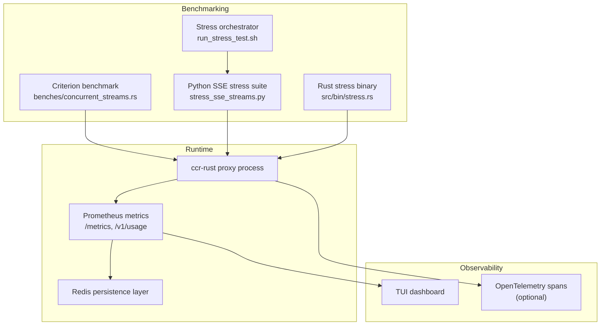
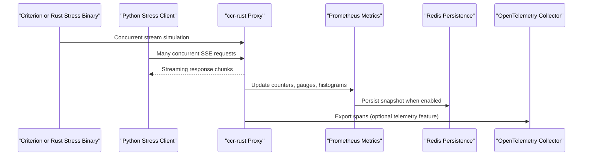
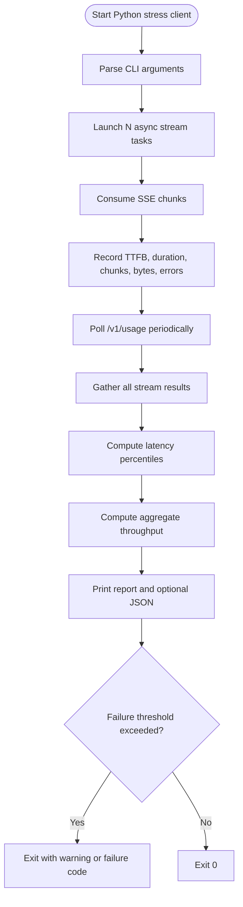
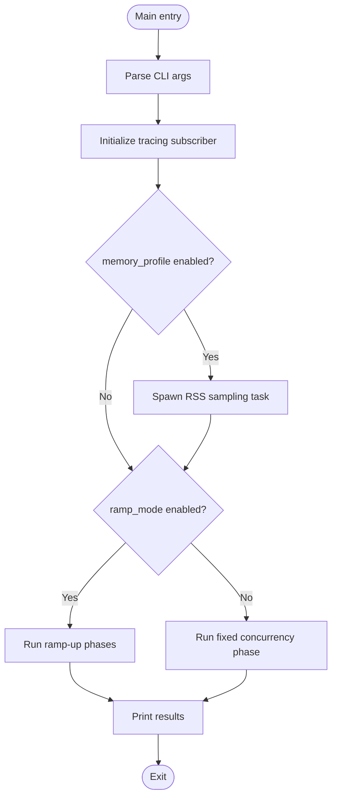
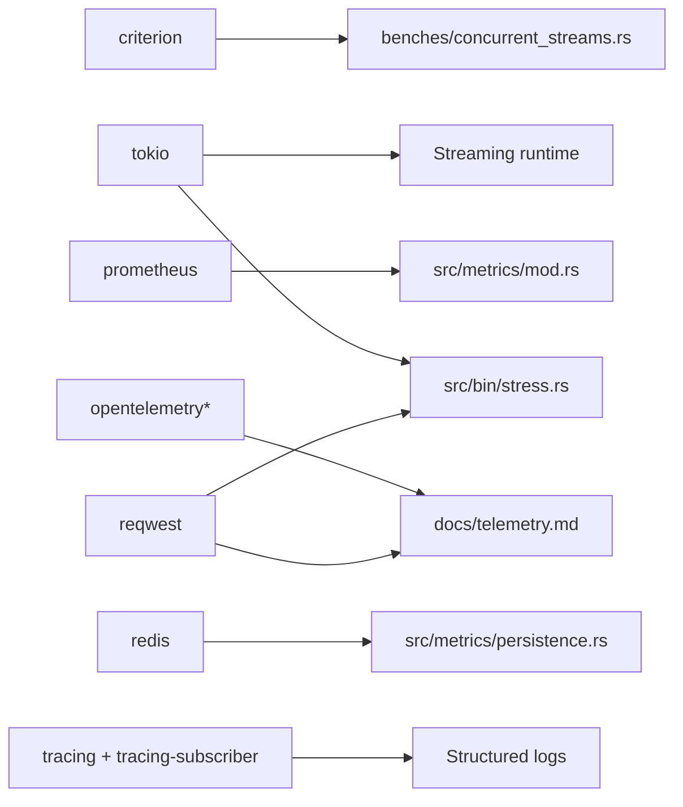

# Performance Profiling and Analysis

<cite>
**Referenced Files in This Document**
- [Cargo.toml](file://Cargo.toml)
- [benches/concurrent_streams.rs](file://benches/concurrent_streams.rs)
- [benchmarks/README.md](file://benchmarks/README.md)
- [benchmarks/run_stress_test.sh](file://benchmarks/run_stress_test.sh)
- [benchmarks/stress_sse_streams.py](file://benchmarks/stress_sse_streams.py)
- [src/bin/stress.rs](file://src/bin/stress.rs)
- [src/metrics/mod.rs](file://src/metrics/mod.rs)
- [src/metrics/handlers.rs](file://src/metrics/handlers.rs)
- [src/metrics/persistence.rs](file://src/metrics/persistence.rs)
- [docs/observability.md](file://docs/observability.md)
- [monitoring/README.md](file://monitoring/README.md)
- [docs/telemetry.md](file://docs/telemetry.md)
- [src/telemetry/runtime.rs](file://src/telemetry/runtime.rs)
</cite>

## Table of Contents
1. [Introduction](#introduction)
2. [Project Structure](#project-structure)
3. [Core Components](#core-components)
4. [Architecture Overview](#architecture-overview)
5. [Detailed Component Analysis](#detailed-component-analysis)
6. [Dependency Analysis](#dependency-analysis)
7. [Performance Considerations](#performance-considerations)
8. [Troubleshooting Guide](#troubleshooting-guide)
9. [Conclusion](#conclusion)
10. [Appendices](#appendices)

## Introduction
This document explains how to profile, benchmark, monitor, and analyze the performance of CCR-Rust, with a focus on concurrent streaming workloads through its SSE proxy. It covers:

- Benchmarking suites for measuring concurrent stream behavior and throughput.
- Rust-native profiling techniques using Criterion and build profiles.
- External profiling guidance for CPU, memory, and distributed tracing.
- Built-in monitoring surfaces for latency percentiles, active streams, token usage, backpressure, and Prometheus metrics.
- Strategies for bottleneck identification, streaming optimization, capacity planning, regression detection, and continuous performance monitoring.

The goal is to help operators and developers validate high-throughput streaming scenarios while keeping regressions visible and actionable.

## Project Structure
The performance-related code and tooling live in several focused areas:

| Area | Purpose | Key Files |
|---|---|---|
| Cargo configuration | Defines dev dependencies, benchmarks, release profile, and optional telemetry feature | [Cargo.toml](file://Cargo.toml) |
| Criterion benchmark harness | Placeholder benchmark entry point for `cargo bench` | [benches/concurrent_streams.rs](file://benches/concurrent_streams.rs) |
| Python-based end-to-end stress suite | Simulates many concurrent SSE clients against a running CCR instance | [benchmarks/README.md](file://benchmarks/README.md), [benchmarks/run_stress_test.sh](file://benchmarks/run_stress_test.sh), [benchmarks/stress_sse_streams.py](file://benchmarks/stress_sse_streams.py) |
| Rust stress binary | In-process concurrency simulator with built-in throughput and memory tracking | [src/bin/stress.rs](file://src/bin/stress.rs) |
| Metrics subsystem | Prometheus counters, gauges, histograms, JSON endpoints, and Redis-backed persistence | [src/metrics/mod.rs](file://src/metrics/mod.rs), [src/metrics/handlers.rs](file://src/metrics/handlers.rs), [src/metrics/persistence.rs](file://src/metrics/persistence.rs) |
| Observability documentation | Operational overview of endpoints, dashboard, and Redis persistence | [docs/observability.md](file://docs/observability.md) |
| Monitoring documentation | Prometheus metric summary and dashboard setup notes | [monitoring/README.md](file://monitoring/README.md) |
| Optional OpenTelemetry tracing | Exporter initialization, span semantics, shutdown guarantees | [docs/telemetry.md](file://docs/telemetry.md), [src/telemetry/runtime.rs](file://src/telemetry/runtime.rs) |

**Diagram sources**
- [benches/concurrent_streams.rs:1-9](file://benches/concurrent_streams.rs#L1-L9)
- [benchmarks/stress_sse_streams.py:1-200](file://benchmarks/stress_sse_streams.py#L1-L200)
- [benchmarks/run_stress_test.sh:1-151](file://benchmarks/run_stress_test.sh#L1-L151)
- [src/bin/stress.rs:1-200](file://src/bin/stress.rs#L1-L200)
- [src/metrics/mod.rs:1-200](file://src/metrics/mod.rs#L1-L200)
- [docs/observability.md:1-200](file://docs/observability.md#L1-L200)
- [docs/telemetry.md:1-57](file://docs/telemetry.md#L1-L57)

**Section sources**
- [Cargo.toml:1-87](file://Cargo.toml#L1-L87)
- [benchmarks/README.md:1-135](file://benchmarks/README.md#L1-L135)

## Core Components
CCR-Rust exposes multiple layers of performance visibility:

1. **Benchmarks:** A Criterion harness is configured for micro-benchmarking, currently with a placeholder benchmark that can be extended.
2. **End-to-end stress testing:** A Python client drives many concurrent SSE streams through CCR, collecting per-stream TTFB, duration, chunks, bytes, errors, and aggregate percentiles.
3. **Built-in Rust stress binary:** An internal `ccr-stress` binary simulates concurrent streams locally, tracks throughput, peak concurrency, and optionally RSS on Linux.
4. **Metrics and endpoints:** Prometheus counters, gauges, and histograms cover request volume, latency, active streams, failures, token accounting, backpressure, admission state, and more. JSON endpoints expose aggregated usage.
5. **Persistence:** Metrics and histogram offsets can be persisted to Redis so they survive restarts and support longer-term trend analysis.
6. **Optional tracing:** OpenTelemetry spans are exported when the telemetry feature is enabled, providing distributed tracing around request handling.

**Section sources**
- [benches/concurrent_streams.rs:1-9](file://benches/concurrent_streams.rs#L1-L9)
- [benchmarks/stress_sse_streams.py:1-200](file://benchmarks/stress_sse_streams.py#L1-L200)
- [src/bin/stress.rs:1-200](file://src/bin/stress.rs#L1-L200)
- [src/metrics/mod.rs:1-200](file://src/metrics/mod.rs#L1-L200)
- [src/metrics/handlers.rs:1-200](file://src/metrics/handlers.rs#L1-L200)
- [docs/observability.md:1-200](file://docs/observability.md#L1-L200)
- [docs/telemetry.md:1-57](file://docs/telemetry.md#L1-L57)

## Architecture Overview
The performance measurement architecture combines local simulation, external load generation, runtime metrics, and optional tracing:

**Diagram sources**
- [src/bin/stress.rs:201-450](file://src/bin/stress.rs#L201-L450)
- [benchmarks/stress_sse_streams.py:201-417](file://benchmarks/stress_sse_streams.py#L201-L417)
- [src/metrics/mod.rs:1-200](file://src/metrics/mod.rs#L1-L200)
- [src/metrics/persistence.rs:1-200](file://src/metrics/persistence.rs#L1-L200)
- [docs/telemetry.md:1-57](file://docs/telemetry.md#L1-L57)

## Detailed Component Analysis

### Criterion Benchmark Harness
The project configures a Criterion benchmark named `concurrent_streams`. The current implementation contains a minimal placeholder benchmark that iterates a simple arithmetic operation. This file should be expanded with real streaming benchmarks once production paths are ready for micro-benchmarking.

Key aspects:
- Criterion is included as a development dependency with HTML reports enabled.
- The benchmark target is declared explicitly in the Cargo manifest.
- The harness is set to false, which is appropriate for custom Criterion setups.

Recommended use:
- Replace the placeholder with micro-benchmarks for token estimation, routing decisions, SSE framing, and stream lifecycle overhead.
- Use Criterion groups to separate warm-up, steady-state, and ramp phases.
- Compare baseline vs branch results using HTML reports.

**Section sources**
- [benches/concurrent_streams.rs:1-9](file://benches/concurrent_streams.rs#L1-L9)
- [Cargo.toml:61-87](file://Cargo.toml#L61-L87)

### Python SSE Stress Suite
The Python stress suite launches concurrent SSE streams against CCR, collects per-stream metrics, computes latency percentiles, and aggregates throughput.

Responsibilities:
- Build Anthropic-compatible streaming requests.
- Track time-to-first-byte, total duration, chunk count, byte count, and error classification.
- Compute p50, p95, p99, and max latency values.
- Poll `/v1/usage` during the test to record peak active streams.
- Print a human-readable report and optionally write structured JSON output.
- Return non-zero exit codes for warning and failure thresholds.

Operational flags include stream count, ramp window, timeout, model string, max tokens, and JSON output path.

**Diagram sources**
- [benchmarks/stress_sse_streams.py:1-200](file://benchmarks/stress_sse_streams.py#L1-L200)
- [benchmarks/stress_sse_streams.py:201-417](file://benchmarks/stress_sse_streams.py#L201-L417)

**Section sources**
- [benchmarks/README.md:1-135](file://benchmarks/README.md#L1-L135)
- [benchmarks/stress_sse_streams.py:1-200](file://benchmarks/stress_sse_streams.py#L1-L200)
- [benchmarks/stress_sse_streams.py:201-417](file://benchmarks/stress_sse_streams.py#L201-L417)

### Rust Stress Binary
The `ccr-stress` binary is an internal load generator designed to scale to hundreds of concurrent streams and measure stability, throughput, and memory behavior. It simulates mock SSE chunks rather than calling external APIs.

Core data structures and responsibilities:
- `MemoryStats`: Tracks current and peak RSS along with stream count at peak memory.
- `MockStream`: Generates realistic-looking SSE chunks with configurable size and delay.
- `StreamStats`: Per-stream lifecycle statistics including start time, chunks sent, bytes sent, and errors.
- `StressTestResults`: Aggregates started/completed/errored streams, chunks, bytes, peak concurrency, timing, memory stats, and sampled per-stream durations.
- `Args`: CLI options for stream count, duration, memory profiling, verbosity, chunk sizing, delay, and ramp mode.

Execution modes:
- Fixed-concurrency mode: run `N` streams for a fixed duration.
- Ramp-up mode: increase concurrency from a start value to an end value in steps, pausing between steps.
- Memory profiling mode: sample RSS on Linux and track peak RSS.

**Diagram sources**
- [src/bin/stress.rs:1-200](file://src/bin/stress.rs#L1-L200)
- [src/bin/stress.rs:201-450](file://src/bin/stress.rs#L201-L450)
- [src/bin/stress.rs:451-685](file://src/bin/stress.rs#L451-L685)

**Section sources**
- [src/bin/stress.rs:1-200](file://src/bin/stress.rs#L1-L200)
- [src/bin/stress.rs:201-450](file://src/bin/stress.rs#L201-L450)
- [src/bin/stress.rs:451-685](file://src/bin/stress.rs#L451-L685)

### Metrics and Monitoring Surface
CCR-Rust publishes rich observability data:

- **Prometheus metrics:** Request counts, latency histograms, failures, active streams, active requests, input/output tokens, cache tokens, EWMA latency, stream backpressure, peak active streams, rejected streams, retry sweeps, deterministic rejections, tier inflight, tier limits, admission defers, retry budget overflow, hedges, and cost estimates.
- **JSON endpoints:** Usage summaries, token drift, token audit log, frontend metrics, and latency data.
- **Dashboard:** Terminal UI panel showing active streams, success rate, token drift, and tier statistics.
- **Persistence:** Redis-backed state restoration for counters, gauges, histogram offsets, token drift, audit logs, and EWMA latency.

Important operational notes:
- Health endpoint: `/health`
- Prometheus scrape endpoint: `/metrics`
- Usage endpoint: `/v1/usage`
- Latency endpoint: `/v1/latencies`
- Token drift endpoint: `/v1/token-drift`
- Token audit endpoint: `/v1/token-audit`
- Frontend metrics endpoint: `/v1/frontend-metrics`

**Section sources**
- [src/metrics/mod.rs:1-200](file://src/metrics/mod.rs#L1-L200)
- [src/metrics/handlers.rs:1-200](file://src/metrics/handlers.rs#L1-L200)
- [docs/observability.md:1-200](file://docs/observability.md#L1-L200)
- [monitoring/README.md:1-26](file://monitoring/README.md#L1-L26)

### Persistence Layer
The persistence module serializes and restores observability state across restarts when Redis is configured. It supports:

- Counter increments.
- Gauge sets and gauge maximums.
- Histogram observations.
- Token drift state.
- Audit log entries.
- EWMA latency state.

It also provides utilities to clear persisted keys under the configured prefix.

**Section sources**
- [src/metrics/persistence.rs:1-200](file://src/metrics/persistence.rs#L1-L200)
- [docs/observability.md:1-200](file://docs/observability.md#L1-L200)

### Optional OpenTelemetry Tracing
When built with the `telemetry` feature, CCR-Rust exports request spans to an OpenTelemetry Collector. Spans capture method, route template, HTTP status, and whether the body reached completion. They exclude sensitive headers, bodies, query strings, and source locations.

Key behaviors:
- Initialization runs off the async runtime to avoid blocking.
- Shutdown flushes spans with a bounded timeout.
- Export failures do not delay request handling.
- Local logging remains independent from exporter configuration.
- Recommended tail sampling strategy is documented.

**Section sources**
- [docs/telemetry.md:1-57](file://docs/telemetry.md#L1-L57)
- [src/telemetry/runtime.rs:1-115](file://src/telemetry/runtime.rs#L1-L115)

## Dependency Analysis
Performance-related dependencies and their roles:

| Dependency | Role |
|---|---|
| `criterion` | Micro-benchmarking framework with HTML reports |
| `tokio` | Async runtime used by stress binaries and streaming handlers |
| `prometheus` | Prometheus metrics registry and exporters |
| `redis` | Persistence backend for long-lived observability state |
| `tracing` and `tracing-subscriber` | Structured logging and tracing subscriber |
| `opentelemetry*` | Optional distributed tracing pipeline |
| `reqwest` | HTTP client used by stress clients and optional telemetry transport |
| `parking_lot` | Fast synchronization primitives used in stress and metrics state |

**Diagram sources**
- [Cargo.toml:1-87](file://Cargo.toml#L1-L87)
- [benches/concurrent_streams.rs:1-9](file://benches/concurrent_streams.rs#L1-L9)
- [src/bin/stress.rs:1-200](file://src/bin/stress.rs#L1-L200)
- [src/metrics/mod.rs:1-200](file://src/metrics/mod.rs#L1-L200)
- [src/metrics/persistence.rs:1-200](file://src/metrics/persistence.rs#L1-L200)
- [docs/telemetry.md:1-57](file://docs/telemetry.md#L1-L57)

**Section sources**
- [Cargo.toml:1-87](file://Cargo.toml#L1-L87)

## Performance Considerations

### Measuring Concurrent Stream Performance
Use both local simulation and external load generation:

- **Criterion benchmarks:** Extend `benches/concurrent_streams.rs` to measure hot-path overhead such as token estimation, routing, header processing, and SSE framing.
- **Python SSE stress suite:** Validate end-to-end behavior under realistic network conditions, including TTFB, stream duration, chunk throughput, and error rates.
- **Rust stress binary:** Perform controlled concurrency tests without external dependencies, useful for CI and reproducible baselines.

Recommended workflow:
1. Establish a baseline with a modest number of streams.
2. Increase concurrency until latency percentiles degrade.
3. Add ramp-up windows to simulate bursty traffic.
4. Compare Python suite results with Prometheus metrics to validate system-level behavior.

**Section sources**
- [benches/concurrent_streams.rs:1-9](file://benches/concurrent_streams.rs#L1-L9)
- [benchmarks/README.md:1-135](file://benchmarks/README.md#L1-L135)
- [src/bin/stress.rs:201-450](file://src/bin/stress.rs#L201-L450)

### Profiling Techniques

#### Rust Native Profiling
- Use `cargo bench` to run Criterion benchmarks and generate HTML reports.
- Build with the existing release profile, which enables optimizations, link-time optimization, and single codegen unit.
- Enable verbose tracing via the stress binary’s verbose flag to correlate high-level events with detailed logs.

#### CPU Profiling
- Profile the Rust stress binary and CCR proxy with tools such as `perf`, `flamegraph`, or `cargo flamegraph`.
- Focus on hot paths: request dispatch, streaming frame assembly, token counting, and upstream forwarding.
- Compare profiles before and after changes to streaming logic.

#### Memory Profiling
- Use the Rust stress binary’s memory profiling mode on Linux to observe RSS growth under load.
- Correlate RSS peaks with active stream counts and chunk sizes.
- Use heap profilers such as `heaptrack` or `jemalloc` profiling hooks if deeper allocation analysis is needed.

#### Distributed Tracing
- Enable the telemetry feature and configure the OpenTelemetry collector endpoint.
- Inspect request spans to understand where latency accumulates: authentication, routing, upstream calls, transformation, and streaming completion.
- Apply tail sampling to retain error traces while limiting successful trace volume.

**Section sources**
- [Cargo.toml:61-87](file://Cargo.toml#L61-L87)
- [src/bin/stress.rs:451-685](file://src/bin/stress.rs#L451-L685)
- [docs/telemetry.md:1-57](file://docs/telemetry.md#L1-L57)

### Monitoring Strategies

#### Latency Percentiles
- Use Python stress suite percentiles for TTFB and stream duration.
- Use Prometheus histograms for request duration distributions.
- Monitor EWMA latency gauges for recent per-tier latency trends.

#### Memory Usage Tracking
- Track RSS with the Rust stress binary in memory profiling mode.
- Correlate memory growth with active streams and chunk buffer sizes.
- Watch for unbounded growth in long-running tests.

#### CPU Utilization Analysis
- Measure CPU usage alongside stream concurrency.
- Identify whether CPU saturation occurs before or after memory pressure.
- Validate that increasing concurrency does not cause excessive context switching or lock contention.

#### Backpressure and Admission Control
- Monitor stream backpressure counters.
- Observe active streams versus peak active streams.
- Check admission defers, tier inflight, and tier limit metrics to understand throttling behavior.

**Section sources**
- [benchmarks/stress_sse_streams.py:201-417](file://benchmarks/stress_sse_streams.py#L201-L417)
- [src/metrics/mod.rs:1-200](file://src/metrics/mod.rs#L1-L200)
- [docs/observability.md:1-200](file://docs/observability.md#L1-L200)

### Identifying Performance Bottlenecks
Common bottlenecks and diagnostic signals:

| Symptom | Likely Area | Diagnostic Signals |
|---|---|---|
| High TTFB with low CPU | Upstream latency or slow first chunk | Elevated latency histograms, high p95/p99, stable active streams |
| Throughput drops under load | Serialization, buffering, or I/O | Rising backpressure counter, declining chunks/sec |
| Memory grows linearly with streams | Stream lifecycle or buffer retention | RSS increases with stream count |
| CPU saturation at moderate concurrency | Transformation, token counting, or routing | High CPU usage, flat throughput curve |
| Frequent retries | Provider degradation or timeouts | Retry sweep counters, failure reasons, EWMA latency spikes |
| Rejected streams | Concurrency limits | Rejected streams counter, admission defers |

**Section sources**
- [src/metrics/mod.rs:1-200](file://src/metrics/mod.rs#L1-L200)
- [src/metrics/handlers.rs:1-200](file://src/metrics/handlers.rs#L1-L200)
- [src/bin/stress.rs:201-450](file://src/bin/stress.rs#L201-L450)

### Optimizing Streaming Performance
Guidance based on observed metrics:

1. Reduce unnecessary allocations in stream frames.
2. Tune chunk sizes and delays to match expected provider behavior.
3. Avoid blocking operations on the async runtime.
4. Use efficient token estimation and caching where applicable.
5. Monitor backpressure and adjust buffer sizes carefully.
6. Validate that streaming completion is recorded even on cancellation or error paths.

**Section sources**
- [src/bin/stress.rs:1-200](file://src/bin/stress.rs#L1-L200)
- [src/metrics/mod.rs:1-200](file://src/metrics/mod.rs#L1-L200)

### Capacity Planning for High-Throughput Scenarios
Use the stress suites and metrics to determine safe operating points:

- Find the concurrency level where p95 latency begins rising sharply.
- Determine the maximum sustainable active streams before backpressure or rejection increases.
- Plan capacity based on peak concurrent streams, not just average throughput.
- Account for upstream variability by including ramp-up tests and burst windows.
- Use Redis-persisted metrics to compare capacity across deployments and versions.

**Section sources**
- [benchmarks/README.md:1-135](file://benchmarks/README.md#L1-L135)
- [src/bin/stress.rs:451-685](file://src/bin/stress.rs#L451-L685)
- [src/metrics/persistence.rs:1-200](file://src/metrics/persistence.rs#L1-L200)

### Regression Detection and Continuous Monitoring
Recommended practices:

- Record baseline percentile latencies and throughput from the Python stress suite.
- Store JSON outputs from stress runs for comparison over time.
- Alert on Prometheus metrics such as increased failure rates, backpressure, rejected streams, and latency histogram growth.
- Use Redis persistence to maintain consistent histogram offsets and EWMA state across restarts.
- Include stress tests in CI where feasible; treat warning or failure exit codes from the Python suite as test failures.

**Section sources**
- [benchmarks/stress_sse_streams.py:201-417](file://benchmarks/stress_sse_streams.py#L201-L417)
- [docs/observability.md:1-200](file://docs/observability.md#L1-L200)
- [monitoring/README.md:1-26](file://monitoring/README.md#L1-L26)

## Troubleshooting Guide

### Stress Test Cannot Connect
- Verify the mock backend or CCR proxy health endpoint responds.
- Confirm ports and URLs match the orchestrator configuration.
- Ensure the CCR binary is built in release mode when required by the orchestrator.

**Section sources**
- [benchmarks/run_stress_test.sh:1-151](file://benchmarks/run_stress_test.sh#L1-L151)

### High Failure Rate Under Load
- Inspect per-stream error classification in the Python report.
- Check Prometheus failure counters and failure reasons.
- Review retry sweep counters and upstream timeout behavior.

**Section sources**
- [benchmarks/stress_sse_streams.py:201-417](file://benchmarks/stress_sse_streams.py#L201-L417)
- [src/metrics/mod.rs:1-200](file://src/metrics/mod.rs#L1-L200)

### Memory Growth Without Clear Cause
- Enable memory profiling in the Rust stress binary.
- Correlate RSS peaks with active stream count and chunk volume.
- Look for leaks in stream lifecycle or buffer retention.

**Section sources**
- [src/bin/stress.rs:201-450](file://src/bin/stress.rs#L201-L450)
- [src/bin/stress.rs:451-685](file://src/bin/stress.rs#L451-L685)

### Metrics Reset After Restart
- Configure Redis persistence for counters, gauges, histograms, token drift, audit logs, and EWMA state.
- Verify Redis connectivity and prefix configuration.
- Use the provided cleanup command only when intentional.

**Section sources**
- [docs/observability.md:1-200](file://docs/observability.md#L1-L200)
- [src/metrics/persistence.rs:1-200](file://src/metrics/persistence.rs#L1-L200)

### Traces Not Appearing in Collector
- Confirm the telemetry feature is enabled at build time.
- Validate the OpenTelemetry endpoint format and reachability.
- Check exporter initialization and shutdown behavior.

**Section sources**
- [docs/telemetry.md:1-57](file://docs/telemetry.md#L1-L57)
- [src/telemetry/runtime.rs:1-115](file://src/telemetry/runtime.rs#L1-L115)

## Conclusion
CCR-Rust provides a layered performance measurement toolkit:

- Criterion benchmarks for micro-level measurements.
- A Python stress suite for realistic concurrent SSE load and percentile reporting.
- A Rust stress binary for controlled, dependency-free concurrency testing.
- Rich Prometheus metrics and JSON endpoints for latency, throughput, memory correlation, backpressure, and token accounting.
- Optional Redis persistence for durable observability state.
- Optional OpenTelemetry tracing for distributed request analysis.

By combining these tools, teams can detect regressions early, identify streaming bottlenecks, plan capacity for high-throughput scenarios, and maintain confidence in performance as CCR-Rust evolves.

## Appendices

### Quick Command Reference

| Task | Command or Endpoint | Notes |
|---|---|---|
| Run Criterion benchmarks | `cargo bench` | Uses `benches/concurrent_streams.rs` |
| Run orchestrated Python stress test | `./benchmarks/run_stress_test.sh` | Starts mock, CCR, and stress client |
| Run Python stress client directly | `uv run python benchmarks/stress_sse_streams.py --streams N` | Requires running CCR |
| Run Rust stress binary | `cargo run --release --bin ccr-stress -- --streams N` | Local stream simulation |
| Check health | `GET /health` | Basic liveness check |
| Scrape Prometheus metrics | `GET /metrics` | Counters, gauges, histograms |
| Get usage summary | `GET /v1/usage` | JSON aggregation |
| View latency stats | `GET /v1/latencies` | EWMA latency data |
| View token drift | `GET /v1/token-drift` | Estimation accuracy |
| View token audit | `GET /v1/token-audit` | Recent pre-request breakdown |
| Start TUI dashboard | `ccr-rust dashboard` | Interactive terminal view |

**Section sources**
- [benchmarks/README.md:1-135](file://benchmarks/README.md#L1-L135)
- [docs/observability.md:1-200](file://docs/observability.md#L1-L200)