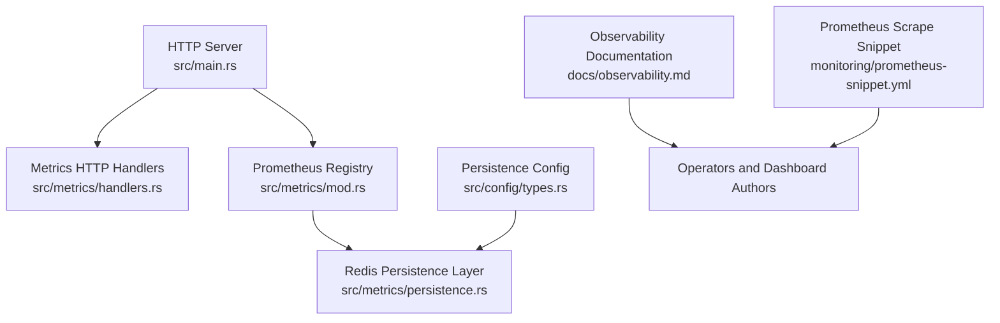
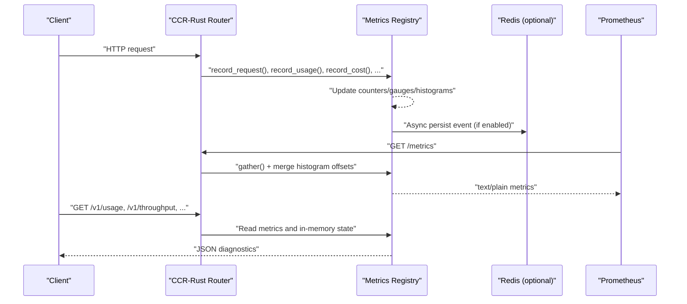
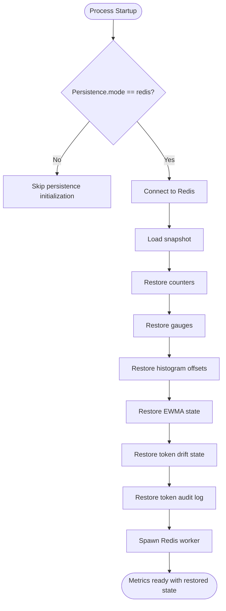
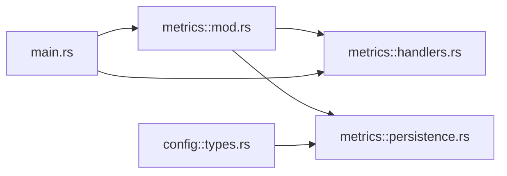

# Prometheus Metrics Collection

<cite>
**Referenced Files in This Document**   
- [mod.rs](file://src/metrics/mod.rs)
- [handlers.rs](file://src/metrics/handlers.rs)
- [persistence.rs](file://src/metrics/persistence.rs)
- [main.rs](file://src/main.rs)
- [types.rs](file://src/config/types.rs)
- [observability.md](file://docs/observability.md)
- [prometheus-snippet.yml](file://monitoring/prometheus-snippet.yml)
- [README.md](file://monitoring/README.md)
- [metrics_startup.rs](file://tests/metrics_startup.rs)
</cite>

## Table of Contents
1. [Introduction](#introduction)
2. [Project Structure](#project-structure)
3. [Core Components](#core-components)
4. [Architecture Overview](#architecture-overview)
5. [Detailed Component Analysis](#detailed-component-analysis)
6. [Dependency Analysis](#dependency-analysis)
7. [Performance Considerations](#performance-considerations)
8. [Troubleshooting Guide](#troubleshooting-guide)
9. [Conclusion](#conclusion)
10. [Appendices](#appendices)

## Introduction
This document explains CCR-Rust’s Prometheus metrics collection system. It covers every exposed metric, naming and label conventions, HTTP endpoints, authentication posture, persistence to Redis, performance characteristics, example Prometheus queries, and guidance for Grafana dashboards and alerting. The goal is to help operators monitor request throughput, latency, token usage, cost estimates, provider health, admission control, streaming behavior, and token estimation accuracy.

## Project Structure
The metrics subsystem lives under `src/metrics` and integrates with the HTTP server through `src/main.rs`. Configuration for persistence is defined in `src/config/types.rs`, while user-facing documentation and monitoring samples are under `docs/observability.md` and `monitoring`.

**Diagram sources**
- [main.rs:447-575](file://src/main.rs#L447-L575)
- [handlers.rs:1-60](file://src/metrics/handlers.rs#L1-L60)
- [mod.rs:1-120](file://src/metrics/mod.rs#L1-L120)
- [persistence.rs:1-60](file://src/metrics/persistence.rs#L1-L60)
- [types.rs:531-560](file://src/config/types.rs#L531-L560)
- [observability.md:1-40](file://docs/observability.md#L1-L40)
- [prometheus-snippet.yml:1-7](file://monitoring/prometheus-snippet.yml#L1-L7)

**Section sources**
- [main.rs:447-575](file://src/main.rs#L447-L575)
- [types.rs:531-560](file://src/config/types.rs#L531-L560)
- [observability.md:1-40](file://docs/observability.md#L1-L40)
- [prometheus-snippet.yml:1-7](file://monitoring/prometheus-snippet.yml#L1-L7)

## Core Components
CCR-Rust exposes a unified Prometheus registry plus JSON diagnostic endpoints. The core responsibilities are:

- **Metric registry**: Registers all counters, gauges, and histograms with stable `ccr_` names and labels.
- **Recording API**: Functions such as `record_request`, `record_usage`, `record_cost`, `record_ttft`, `record_throughput`, and `verify_token_usage` update both live Prometheus state and optional Redis persistence.
- **HTTP handlers**: `/metrics` serves Prometheus text; `/v1/usage`, `/v1/token-drift`, `/v1/token-audit`, `/v1/frontend-metrics`, `/v1/throughput`, and `/v1/latencies` expose aggregated JSON summaries.
- **Persistence layer**: When configured, asynchronously persists counters, gauges, histogram offsets, EWMA state, token drift state, and audit entries to Redis.

Key implementation files:
- Metric definitions and recording functions: [mod.rs](file://src/metrics/mod.rs)
- HTTP endpoint handlers: [handlers.rs](file://src/metrics/handlers.rs)
- Redis persistence: [persistence.rs](file://src/metrics/persistence.rs)
- Server wiring and default port: [main.rs](file://src/main.rs)
- Persistence configuration schema: [types.rs](file://src/config/types.rs)

**Section sources**
- [mod.rs:1-120](file://src/metrics/mod.rs#L1-L120)
- [handlers.rs:1-60](file://src/metrics/handlers.rs#L1-L60)
- [persistence.rs:1-60](file://src/metrics/persistence.rs#L1-L60)
- [main.rs:447-575](file://src/main.rs#L447-L575)
- [types.rs:531-560](file://src/config/types.rs#L531-L560)

## Architecture Overview
The metrics flow has three main paths:

1. **Request path**: Business code calls recording functions in the metrics module. These increment or observe Prometheus metrics and enqueue asynchronous persistence events when Redis is enabled.
2. **Scrape path**: Prometheus scrapes `/metrics`, which gathers the global registry and merges persisted histogram offsets so latency distributions remain accurate across restarts.
3. **Diagnostic path**: JSON endpoints aggregate Prometheus state and in-memory structures into structured responses.

**Diagram sources**
- [mod.rs:400-700](file://src/metrics/mod.rs#L400-L700)
- [handlers.rs:470-577](file://src/metrics/handlers.rs#L470-L577)
- [persistence.rs:201-300](file://src/metrics/persistence.rs#L201-L300)
- [main.rs:572-575](file://src/main.rs#L572-L575)

**Section sources**
- [handlers.rs:470-577](file://src/metrics/handlers.rs#L470-L577)
- [mod.rs:400-700](file://src/metrics/mod.rs#L400-L700)
- [persistence.rs:201-300](file://src/metrics/persistence.rs#L201-L300)

## Detailed Component Analysis

### Metric Naming Conventions and Label Structures
All public metrics use the `ccr_` namespace. Labels are intentionally small and business-meaningful:

| Category | Examples | Common Labels | Meaning |
|---|---|---|---|
| Request throughput | `ccr_requests_total` | `tier` | Number of routed requests per tier |
| Frontend routing | `ccr_frontend_requests_total` | `frontend` | Requests grouped by frontend client type |
| Failures | `ccr_failures_total` | `tier`, `reason` | Terminal failures per tier and reason |
| Latency | `ccr_request_duration_seconds`, `ccr_tier_ewma_latency_seconds` | `tier` | Histogram and EWMA latency per tier |
| Token usage | `ccr_input_tokens_total`, `ccr_output_tokens_total` | `tier` | Prompt and completion tokens per tier |
| Cache accounting | `ccr_cache_read_tokens_total`, `ccr_cache_creation_tokens_total` | `tier` | Provider prompt cache reads and writes |
| Cost | `ccr_cost_usd_total` | `tier` | Estimated USD cost per priced tier |
| Streaming capacity | `ccr_active_streams`, `ccr_peak_active_streams`, `ccr_stream_backpressure_total`, `ccr_rejected_streams_total` | none or `tier` where applicable | Active streams, peak watermark, backpressure, concurrency rejections |
| Admission and retry control | `ccr_tier_inflight`, `ccr_tier_limit`, `ccr_tier_inflight_tokens`, `ccr_admission_defers_total`, `ccr_retry_budget_overflow_total`, `ccr_hedges_launched_total`, `ccr_hedge_wins_total`, `ccr_primary_hedge_wins_total`, `ccr_deterministic_rejections_total` | `tier` | AIMD limits, in-flight counts, deferrals, hedging outcomes |
| Rate limiting | `ccr_rate_limit_hits_total`, `ccr_rate_limit_backoffs_total` | `tier` | Backend 429 hits and backoff state |
| TTFT and throughput | `ccr_ttft_seconds`, `ccr_output_tokens_per_second` | `tier` | Time-to-first-token and output token rate |
| Pre-request estimation | `ccr_pre_request_tokens_total`, `ccr_pre_request_tokens` | `tier`, `component` | Estimated input tokens before dispatch |
| Token drift | `ccr_token_drift_absolute`, `ccr_token_drift_pct`, `ccr_token_drift_alerts_total` | `tier`, `severity` | Local vs upstream token estimate accuracy and alerts |

These conventions come from the static metric registrations and constant name declarations in the metrics module.

**Section sources**
- [mod.rs:1-200](file://src/metrics/mod.rs#L1-L200)
- [mod.rs:201-350](file://src/metrics/mod.rs#L201-L350)
- [mod.rs:350-500](file://src/metrics/mod.rs#L350-L500)

### Request Throughput Counters
- `ccr_requests_total{tier}`: Increments when a request is routed.
- `ccr_frontend_requests_total{frontend}`: Counts requests per frontend type, typically `codex` or `claude_code`.
- `ccr_failures_total{tier,reason}`: Counts terminal failures; useful for error-rate analysis.
- Aggregates `TOTAL_REQUESTS` and `TOTAL_FAILURES` provide process-wide totals used by JSON endpoints.

Example query ideas:
- Error rate per tier over five minutes: `rate(ccr_failures_total[5m]) / rate(ccr_requests_total[5m])`
- Total requests per tier since last restart: `ccr_requests_total`
- Frontend traffic split: `sum by (frontend) (rate(ccr_frontend_requests_total[5m]))`

**Section sources**
- [mod.rs:10-120](file://src/metrics/mod.rs#L10-L120)
- [mod.rs:420-480](file://src/metrics/mod.rs#L420-L480)

### Latency Histograms and EWMA Indicators
- `ccr_request_duration_seconds{tier}`: Histogram of total request duration.
- `ccr_tier_ewma_latency_seconds{tier}`: Exponentially weighted moving average latency gauge synced from the routing tracker.
- `ccr_hold_wait_seconds`: Wall-clock time exhausted requests were held before a terminal response.

Histogram buckets are explicitly configured for request duration, pre-request token estimates, TTFT, and output throughput. The `/metrics` handler merges persisted histogram offsets so latency percentiles remain meaningful after restarts.

Example query ideas:
- P90 request latency per tier: `histogram_quantile(0.90, sum by (le, tier) (rate(ccr_request_duration_seconds_bucket[5m])))`
- EWMA latency trend: `ccr_tier_ewma_latency_seconds`
- Hold-wait distribution: `histogram_quantile(0.95, sum by (le) (rate(ccr_hold_wait_seconds_bucket[5m])))`

**Section sources**
- [mod.rs:10-40](file://src/metrics/mod.rs#L10-L40)
- [mod.rs:201-260](file://src/metrics/mod.rs#L201-L260)
- [handlers.rs:470-577](file://src/metrics/handlers.rs#L470-L577)

### Token Usage Gauges and Accounting
Token accounting distinguishes local estimates from upstream-reported values:

- `ccr_input_tokens_total{tier}`: Full prompt-side tokens, including cached shares when supplied by providers.
- `ccr_output_tokens_total{tier}`: Generated output tokens.
- `ccr_cache_read_tokens_total{tier}`: Tokens served from provider prompt caches.
- `ccr_cache_creation_tokens_total{tier}`: Tokens written into provider prompt caches.
- `ccr_pre_request_tokens_total{tier,component}`: Estimated input tokens before dispatch, broken down by component.
- `ccr_pre_request_tokens{tier}`: Histogram of estimated input token totals.

Usage is recorded through `record_usage`, and pre-request estimation goes through `record_pre_request_tokens`. The system also computes token drift between local tiktoken-based estimates and upstream-reported values.

Example query ideas:
- Input-output token ratio per tier: `sum(rate(ccr_output_tokens_total[5m])) by (tier) / sum(rate(ccr_input_tokens_total[5m])) by (tier)`
- Cache hit contribution: `sum(rate(ccr_cache_read_tokens_total[5m])) by (tier)`
- Drift severity trend: `rate(ccr_token_drift_alerts_total[5m])`

**Section sources**
- [mod.rs:60-120](file://src/metrics/mod.rs#L60-L120)
- [mod.rs:600-800](file://src/metrics/mod.rs#L600-L800)
- [handlers.rs:1-200](file://src/metrics/handlers.rs#L1-L200)

### Cost Tracking Metrics
- `ccr_cost_usd_total{tier}`: Cumulative estimated USD cost per tier.
- Only positive, finite costs are recorded; unpriced tiers contribute zero.
- The `/v1/usage` endpoint aggregates per-tier cost and a process-wide total.

Cost attribution should be interpreted as a lower bound when some providers or models lack pricing configuration.

Example query ideas:
- Cost rate per tier: `rate(ccr_cost_usd_total[5m])`
- Share of total cost by tier: `sum by (tier) (rate(ccr_cost_usd_total[5m])) / sum (rate(ccr_cost_usd_total[5m]))`

**Section sources**
- [mod.rs:40-80](file://src/metrics/mod.rs#L40-L80)
- [mod.rs:780-860](file://src/metrics/mod.rs#L780-L860)
- [handlers.rs:120-220](file://src/metrics/handlers.rs#L120-L220)

### Provider Health and Routing Indicators
Provider health is observable through several related metrics:

- `ccr_failures_total{tier,reason}`: Terminal failure counts.
- `ccr_rate_limit_hits_total{tier}`: Backend 429 responses.
- `ccr_tier_inflight{tier}`: Current in-flight upstream attempts.
- `ccr_tier_limit{tier}`: Current AIMD admission limit.
- `ccr_tier_inflight_tokens{tier}`: In-flight estimated prompt tokens.
- `ccr_admission_defers_total{tier}`: Requests deferred because a tier reached its admission limit.
- `ccr_deterministic_rejections_total{tier}`: Rejections that must not be retried on the same tier.
- `ccr_retry_budget_overflow_total`: Process-wide retries rejected by the retry budget.
- Hedging metrics: `ccr_hedges_launched_total`, `ccr_hedge_wins_total{tier}`, `ccr_primary_hedge_wins_total{tier}`.

These allow operators to distinguish slow providers, overloaded providers, admission throttling, and fallback success.

Example query ideas:
- Tier overload signal: `ccr_tier_inflight_tokens{tier} > ccr_tier_limit{tier}`
- Fallback effectiveness: `rate(ccr_hedge_wins_total[5m])`
- Retry pressure: `rate(ccr_retry_budget_overflow_total[5m])`

**Section sources**
- [mod.rs:120-200](file://src/metrics/mod.rs#L120-L200)
- [mod.rs:480-600](file://src/metrics/mod.rs#L480-L600)

### Streaming Capacity and Backpressure
Streaming metrics describe concurrent SSE stream behavior:

- `ccr_active_streams`: Current active streams.
- `ccr_peak_active_streams`: High-water mark for concurrent streams.
- `ccr_stream_backpressure_total`: Stream producer blocked due to full channel buffer.
- `ccr_rejected_streams_total`: Streams rejected because of concurrency limits.

The active-stream guard ensures increments and decrements match stream lifetimes, even on early returns or disconnects.

Example query ideas:
- Stream saturation: `ccr_active_streams == ccr_peak_active_streams`
- Backpressure frequency: `rate(ccr_stream_backpressure_total[5m])`
- Concurrency rejection rate: `rate(ccr_rejected_streams_total[5m])`

**Section sources**
- [mod.rs:80-120](file://src/metrics/mod.rs#L80-L120)
- [mod.rs:520-600](file://src/metrics/mod.rs#L520-L600)

### TTFT and Output Throughput
- `ccr_ttft_seconds{tier}`: Time from stream start to first content-bearing chunk.
- `ccr_output_tokens_per_second{tier}`: Output token generation rate.
- The `/v1/throughput` endpoint combines these with recent per-tier samples and approximate percentile calculations.

Example query ideas:
- Average TTFT per tier: `avg_over_time(ccr_ttft_seconds_sum[5m]) / avg_over_time(ccr_ttft_seconds_count[5m])`
- Output throughput trend: `ccr_output_tokens_per_second`
- Recent throughput anomalies: Use `/v1/throughput` to inspect recent samples.

**Section sources**
- [mod.rs:260-340](file://src/metrics/mod.rs#L260-L340)
- [mod.rs:600-700](file://src/metrics/mod.rs#L600-L700)
- [handlers.rs:300-470](file://src/metrics/handlers.rs#L300-L470)

### Token Drift Monitoring
Token drift compares tiktoken-based local estimates with upstream-reported usage:

- `ccr_token_drift_absolute{tier}`: Absolute difference between local estimate and upstream input tokens.
- `ccr_token_drift_pct{tier}`: Percentage drift.
- `ccr_token_drift_alerts_total{tier,severity}`: Alert counter incremented when drift exceeds warning or critical thresholds.
- `/v1/token-drift` returns cumulative drift summaries per tier.
- `/v1/token-audit` returns recent pre-request token breakdowns.

Drift classification:
- Warning threshold: approximately 10% drift.
- Critical threshold: approximately 25% drift.

Example query ideas:
- Recent drift percentage: `ccr_token_drift_pct`
- Drift alert rate: `rate(ccr_token_drift_alerts_total[5m])`
- Worst-drifting tier: `sort_desc(ccr_token_drift_pct)`

**Section sources**
- [mod.rs:220-300](file://src/metrics/mod.rs#L220-L300)
- [mod.rs:800-1043](file://src/metrics/mod.rs#L800-L1043)
- [handlers.rs:40-120](file://src/metrics/handlers.rs#L40-L120)

### Metrics HTTP Endpoints
The server registers the following endpoints:

| Endpoint | Method | Purpose | Authentication | Notes |
|---|---:|---|---|---|
| `/metrics` | GET | Prometheus text scrape | Not shown as authenticated by the handler | Merges histogram offsets before encoding |
| `/v1/usage` | GET | Aggregate usage summary per tier | Not shown as authenticated by the handler | Includes tokens, cost, failures, active streams/requests |
| `/v1/frontend-metrics` | GET | Per-frontend request count and average latency | Not shown as authenticated by the handler | Useful for client-type splits |
| `/v1/throughput` | GET | Per-tier TTFT, output throughput, and recent samples | Not shown as authenticated by the handler | Percentiles computed from histogram buckets |
| `/v1/token-drift` | GET | Per-tier token drift summary | Not shown as authenticated by the handler | Cumulative and last-sample drift |
| `/v1/token-audit` | GET | Recent pre-request token audit entries | Not shown as authenticated by the handler | Ring buffer of up to 1024 entries |
| `/health` | GET | Health check | Not shown as authenticated by the handler | Referenced in observability documentation |

Default server address is `127.0.0.1:3456`; `/metrics` is registered alongside other diagnostic routes.

**Section sources**
- [main.rs:572-575](file://src/main.rs#L572-L575)
- [handlers.rs:1-60](file://src/metrics/handlers.rs#L1-L60)
- [handlers.rs:120-220](file://src/metrics/handlers.rs#L120-L220)
- [handlers.rs:300-470](file://src/metrics/handlers.rs#L300-L470)
- [handlers.rs:470-577](file://src/metrics/handlers.rs#L470-L577)
- [observability.md:10-40](file://docs/observability.md#L10-L40)

### Metrics Persistence Layer and Configuration
When persistence mode is set to Redis, CCR-Rust:

- Loads a snapshot on startup.
- Restores counters, gauges, histogram offsets, EWMA latency state, token drift state, and audit log entries.
- Asynchronously persists new metric updates through an internal worker.
- Uses a configurable Redis key prefix so it does not collide with unrelated data.

Configuration fields:

| Field | Type | Default | Description |
|---|---|---|---|
| `mode` | Enum | `None` | Persistence mode; `redis` enables Redis persistence |
| `redis_url` | String | None | Required when mode is `redis`; can also be provided via `CCR_REDIS_URL` |
| `redis_prefix` | String | Internal default | Key prefix for CCR persistence records |

On startup with Redis enabled, the persistence layer connects to Redis, loads snapshots, restores EWMA state, and spawns a background worker. A separate CLI command clears only keys matching the configured prefix.

**Diagram sources**
- [persistence.rs:60-120](file://src/metrics/persistence.rs#L60-L120)
- [persistence.rs:260-420](file://src/metrics/persistence.rs#L260-L420)
- [persistence.rs:680-936](file://src/metrics/persistence.rs#L680-L936)
- [types.rs:531-560](file://src/config/types.rs#L531-L560)

**Section sources**
- [persistence.rs:60-120](file://src/metrics/persistence.rs#L60-L120)
- [persistence.rs:260-420](file://src/metrics/persistence.rs#L260-L420)
- [persistence.rs:680-936](file://src/metrics/persistence.rs#L680-L936)
- [types.rs:531-560](file://src/config/types.rs#L531-L560)
- [observability.md:1-40](file://docs/observability.md#L1-L40)

## Dependency Analysis
The metrics system has clear boundaries:

- `src/metrics/mod.rs` owns metric registration, atomic aggregates, and recording functions.
- `src/metrics/handlers.rs` reads Prometheus metrics and in-memory state to build JSON responses.
- `src/metrics/persistence.rs` depends on `redis`, `serde`, and the constants/names exported from `mod.rs`.
- `src/main.rs` wires `/metrics` and initializes persistence using the config object.
- `src/config/types.rs` defines `PersistenceConfig` and `PersistenceMode`.

**Diagram sources**
- [main.rs:447-575](file://src/main.rs#L447-L575)
- [mod.rs:1-60](file://src/metrics/mod.rs#L1-L60)
- [handlers.rs:1-40](file://src/metrics/handlers.rs#L1-L40)
- [persistence.rs:1-40](file://src/metrics/persistence.rs#L1-L40)
- [types.rs:531-560](file://src/config/types.rs#L531-L560)

**Section sources**
- [main.rs:447-575](file://src/main.rs#L447-L575)
- [mod.rs:1-60](file://src/metrics/mod.rs#L1-L60)
- [handlers.rs:1-40](file://src/metrics/handlers.rs#L1-L40)
- [persistence.rs:1-40](file://src/metrics/persistence.rs#L1-L40)
- [types.rs:531-560](file://src/config/types.rs#L531-L560)

## Performance Considerations
- **Low overhead counters and gauges**: Most metrics use `CounterVec`, `GaugeVec`, and `AtomicU64` types designed for high-throughput Prometheus clients.
- **Histogram bucket selection**: Buckets are tuned for request latency, token estimates, TTFT, and output throughput rather than left at defaults.
- **Asynchronous persistence**: Persistence operations send events over a channel instead of blocking request handling.
- **Histogram offset merging**: The `/metrics` handler merges persisted histogram sums, counts, and bucket counts so long-running processes do not lose historical latency shape after restarts.
- **Rate-limiting persistence**: 429 backoff state can be restored, improving recovery behavior.
- **Audit log size**: The pre-request audit ring buffer is bounded at 1024 entries.
- **Throughput sampling**: Recent throughput samples are capped at 256 per tier.

Operational recommendations:
- Set Prometheus scrape intervals around 10 seconds, as shown in the sample configuration.
- Avoid excessive label cardinality; current labels (`tier`, `frontend`, `reason`, `component`, `severity`) are bounded by router configuration.
- Monitor `/metrics` response size if many tiers or frontends are present.
- Enable Redis persistence when uptime restarts would otherwise erase latency distributions, EWMA state, drift state, or audit history.

**Section sources**
- [mod.rs:201-340](file://src/metrics/mod.rs#L201-L340)
- [handlers.rs:470-577](file://src/metrics/handlers.rs#L470-L577)
- [persistence.rs:201-300](file://src/metrics/persistence.rs#L201-L300)
- [prometheus-snippet.yml:1-7](file://monitoring/prometheus-snippet.yml#L1-L7)

## Troubleshooting Guide

### `/metrics` Returns Empty or Missing Metrics
Check:
- Whether the process started normally.
- Whether `/metrics` is reachable at `http://localhost:3456/metrics`.
- Whether the test assertion passes for fresh-process idle gauges.

The startup test asserts that `ccr_active_requests 0` and `ccr_active_streams 0` appear in the scraped body.

**Section sources**
- [metrics_startup.rs:1-26](file://tests/metrics_startup.rs#L1-L26)
- [main.rs:572-575](file://src/main.rs#L572-L575)

### Persisted State Is Not Restored After Restart
Check:
- `Persistence.mode` is `redis`.
- `Persistence.redis_url` is set or `CCR_REDIS_URL` is available.
- `Persistence.redis_prefix` matches the prefix used previously.
- Redis connectivity and permissions.
- Whether the prefix-scoped cleanup command was run accidentally.

The persistence layer validates required Redis settings and logs initialization.

**Section sources**
- [persistence.rs:60-120](file://src/metrics/persistence.rs#L60-L120)
- [observability.md:1-40](file://docs/observability.md#L1-L40)
- [types.rs:531-560](file://src/config/types.rs#L531-L560)

### Token Drift Alerts Are Too Frequent
Drift alerts classify:
- Warning near 10% divergence.
- Critical near 25% divergence.

Investigate whether local token estimation components changed, whether tool definitions or system prompts grew significantly, or whether upstream usage reporting differs from client expectations.

**Section sources**
- [mod.rs:220-300](file://src/metrics/mod.rs#L220-L300)
- [mod.rs:800-1043](file://src/metrics/mod.rs#L800-L1043)
- [observability.md:120-200](file://docs/observability.md#L120-L200)

### High Backpressure or Stream Rejections
Check:
- `ccr_stream_backpressure_total` growth.
- `ccr_rejected_streams_total` growth.
- `ccr_active_streams` versus configured stream limits.
- Whether backend providers are slow, causing producers to block.

**Section sources**
- [mod.rs:80-120](file://src/metrics/mod.rs#L80-L120)
- [mod.rs:520-600](file://src/metrics/mod.rs#L520-L600)

## Conclusion
CCR-Rust’s metrics system provides a comprehensive view of request volume, latency, token usage, cost, streaming capacity, admission control, and token estimation accuracy. The `ccr_` naming convention keeps metrics discoverable, while labels like `tier`, `frontend`, `reason`, `component`, and `severity` support targeted monitoring. With optional Redis persistence, operators can maintain meaningful latency distributions and operational state across restarts. For production monitoring, combine Prometheus queries for error rates, cost attribution, and throughput with Grafana panels and alert rules based on the documented metrics.

## Appendices

### Complete Metric Inventory

| Metric | Type | Labels | Purpose |
|---|---|---|---|
| `ccr_requests_total` | Counter | `tier` | Total routed requests per tier |
| `ccr_request_duration_seconds` | Histogram | `tier` | Request duration distribution |
| `ccr_frontend_requests_total` | Counter | `frontend` | Requests per frontend type |
| `ccr_frontend_request_duration_seconds` | Histogram | `frontend` | Frontend request latency distribution |
| `ccr_failures_total` | Counter | `tier`, `reason` | Terminal failures |
| `ccr_cost_usd_total` | Counter | `tier` | Estimated USD cost per tier |
| `ccr_active_streams` | Gauge | none | Current active SSE streams |
| `ccr_active_requests` | Gauge | none | Current in-flight requests |
| `ccr_input_tokens_total` | Counter | `tier` | Input tokens per tier |
| `ccr_output_tokens_total` | Counter | `tier` | Output tokens per tier |
| `ccr_cache_read_tokens_total` | Counter | `tier` | Cached prompt reads |
| `ccr_cache_creation_tokens_total` | Counter | `tier` | Cached prompt writes |
| `ccr_tier_ewma_latency_seconds` | Gauge | `tier` | EWMA latency |
| `ccr_stream_backpressure_total` | Counter | none | Producer backpressure events |
| `ccr_peak_active_streams` | Gauge | none | Peak concurrent streams |
| `ccr_rejected_streams_total` | Counter | none | Streams rejected by concurrency limit |
| `ccr_retry_sweeps_total` | Counter | none | Retry sweeps performed |
| `ccr_deterministic_rejections_total` | Counter | `tier` | Non-retryable upstream rejections |
| `ccr_tier_inflight` | Gauge | `tier` | In-flight upstream attempts |
| `ccr_tier_limit` | Gauge | `tier` | AIMD admission limit |
| `ccr_tier_inflight_tokens` | Gauge | `tier` | In-flight estimated prompt tokens |
| `ccr_admission_defers_total` | Counter | `tier` | Deferrals due to admission limits |
| `ccr_retry_budget_overflow_total` | Counter | none | Retries rejected by retry budget |
| `ccr_hedges_launched_total` | Counter | none | Fallback hedges launched |
| `ccr_hedge_wins_total` | Counter | `tier` | Hedged fallback wins |
| `ccr_primary_hedge_wins_total` | Counter | `tier` | Primary wins after hedge launched |
| `ccr_hold_wait_seconds` | Histogram | none | Wait time for exhausted requests |
| `ccr_pre_request_tokens_total` | Counter | `tier`, `component` | Estimated input tokens before dispatch |
| `ccr_pre_request_tokens` | Histogram | `tier` | Distribution of estimated input tokens |
| `ccr_rate_limit_hits_total` | Counter | `tier` | Backend 429 responses |
| `ccr_rate_limit_backoffs_total` | Counter | `tier` | Rate-limit backoff state |
| `ccr_token_drift_absolute` | Gauge | `tier` | Local vs upstream token estimate difference |
| `ccr_token_drift_pct` | Gauge | `tier` | Drift percentage |
| `ccr_token_drift_alerts_total` | Counter | `tier`, `severity` | Drift alert counts |
| `ccr_ttft_seconds` | Histogram | `tier` | Time to first token |
| `ccr_output_tokens_per_second` | Histogram | `tier` | Output token throughput |

**Section sources**
- [mod.rs:1-340](file://src/metrics/mod.rs#L1-L340)
- [mod.rs:350-700](file://src/metrics/mod.rs#L350-L700)

### Prometheus Query Examples

#### Error Rate Analysis
- Overall error rate: `sum(rate(ccr_failures_total[5m])) / sum(rate(ccr_requests_total[5m]))`
- Error rate by tier: `sum by (tier) (rate(ccr_failures_total[5m])) / sum by (tier) (rate(ccr_requests_total[5m]))`
- Top failing reasons: `topk(5, sum by (reason) (rate(ccr_failures_total[5m])))`

#### Cost Attribution by Provider or Tier
- Cost rate by tier: `sum by (tier) (rate(ccr_cost_usd_total[5m]))`
- Cost share: `sum by (tier) (rate(ccr_cost_usd_total[5m])) / sum (rate(ccr_cost_usd_total[5m]))`
- Correlate cost with throughput: compare `rate(ccr_cost_usd_total[5m])` with `sum by (tier) (rate(ccr_output_tokens_total[5m]))`

#### Capacity Planning
- Peak stream utilization: `ccr_peak_active_streams`
- Active stream saturation: `ccr_active_streams`
- Admission pressure: `ccr_admission_defers_total`
- In-flight token pressure: `ccr_tier_inflight_tokens`
- Rate-limit pressure: `rate(ccr_rate_limit_hits_total[5m])`

#### Token Estimation Accuracy
- Drift alert rate: `sum by (tier, severity) (rate(ccr_token_drift_alerts_total[5m]))`
- Current drift percentage: `ccr_token_drift_pct`
- Drift magnitude: `ccr_token_drift_absolute`

**Section sources**
- [mod.rs:1-340](file://src/metrics/mod.rs#L1-L340)
- [observability.md:40-120](file://docs/observability.md#L40-L120)

### Grafana Dashboard Guidance

Recommended panels:
- **Request volume**: Line panel for `ccr_requests_total` and `ccr_frontend_requests_total`.
- **Error rate**: Bar or line panel for `rate(ccr_failures_total[5m])` grouped by `tier` and `reason`.
- **Latency**: Histogram quantiles for `ccr_request_duration_seconds` and EWMA gauge `ccr_tier_ewma_latency_seconds`.
- **Token throughput**: Panels for `ccr_input_tokens_total`, `ccr_output_tokens_total`, `ccr_cache_read_tokens_total`, and `ccr_cache_creation_tokens_total`.
- **Cost**: Panel for `rate(ccr_cost_usd_total[5m])` by tier.
- **Streaming capacity**: Panels for `ccr_active_streams`, `ccr_peak_active_streams`, `ccr_stream_backpressure_total`, and `ccr_rejected_streams_total`.
- **Admission and retry control**: Panels for `ccr_tier_inflight`, `ccr_tier_limit`, `ccr_tier_inflight_tokens`, `ccr_admission_defers_total`, and `ccr_retry_budget_overflow_total`.
- **TTFT and output throughput**: Panels for `ccr_ttft_seconds` and `ccr_output_tokens_per_second`.
- **Token drift**: Panels for `ccr_token_drift_pct`, `ccr_token_drift_absolute`, and `ccr_token_drift_alerts_total`.

Alert rule examples:
- High error rate: `sum(rate(ccr_failures_total[5m])) / sum(rate(ccr_requests_total[5m])) > 0.05`
- Rising cost without throughput: `rate(ccr_cost_usd_total[5m]) > 0 and sum(rate(ccr_output_tokens_total[5m])) < threshold`
- Stream saturation: `ccr_active_streams >= configured_max_streams * 0.9`
- Backpressure spikes: `rate(ccr_stream_backpressure_total[5m]) > 0`
- Token drift critical: `rate(ccr_token_drift_alerts_total{severity="critical"}[5m]) > 0`

[No sources needed since this section provides general dashboard and alerting guidance derived from the documented metrics]