# Integration Tests

<cite>
**Referenced Files in This Document**   
- [Cargo.toml](file://Cargo.toml)
- [README.md](file://README.md)
- [tests/lib.rs](file://tests/lib.rs)
- [tests/support/mod.rs](file://tests/support/mod.rs)
- [tests/support/codex_stream.rs](file://tests/support/codex_stream.rs)
- [tests/mocks/claude_code_client.rs](file://tests/mocks/claude_code_client.rs)
- [tests/mocks/codex_client.rs](file://tests/mocks/codex_client.rs)
- [tests/integration_responses.rs](file://tests/integration_responses.rs)
- [tests/integration_claude_code.rs](file://tests/integration_claude_code.rs)
- [tests/integration_codex.rs](file://tests/integration_codex.rs)
- [tests/integration_codex_stream.rs](file://tests/integration_codex_stream.rs)
- [tests/integration_codex_openai_stream.rs](file://tests/integration_codex_openai_stream.rs)
- [tests/integration_reasoning_controls.rs](file://tests/integration_reasoning_controls.rs)
- [tests/integration_worker_inspector.rs](file://tests/integration_worker_inspector.rs)
- [tests/integration_preset_cli.rs](file://tests/integration_preset_cli.rs)
</cite>

## Table of Contents
1. [Introduction](#introduction)
2. [Project Structure](#project-structure)
3. [Core Components](#core-components)
4. [Architecture Overview](#architecture-overview)
5. [Detailed Component Analysis](#detailed-component-analysis)
6. [Dependency Analysis](#dependency-analysis)
7. [Performance Considerations](#performance-considerations)
8. [Troubleshooting Guide](#troubleshooting-guide)
9. [Conclusion](#conclusion)
10. [Appendices](#appendices)

## Introduction
This document explains the integration test suite for CCR-Rust, an LLM router that translates between Anthropic and OpenAI API formats and forwards traffic to configured providers. The tests cover:

- Anthropic API compatibility through `/v1/messages`.
- OpenAI API compatibility through `/v1/chat/completions` and `/v1/responses`.
- Claude Code client detection and passthrough behavior.
- Codex client detection and request/response transformation.
- Streaming conversion from Anthropic SSE to OpenAI SSE.
- Streaming conversion from upstream OpenAI-compatible SSE to OpenAI SSE.
- Reasoning controls such as `reasoning`, `thinking`, and output configuration.
- Worker inspector CLI JSON behavior.
- Preset registration and preset dispatch through the real `ccr-rust` binary.

The suite is designed so that most tests do not call real provider endpoints. Instead, they use a local Axum server or an in-process router with a wiremock backend.

## Project Structure
The integration tests live under `tests/`. Shared helpers are exposed through `tests/support/mod.rs`, which re-exports codex streaming utilities from `tests/support/codex_stream.rs`. Test-specific mocks for Anthropic-style and OpenAI-style clients live under `tests/mocks/`. Each major integration scenario has its own file.

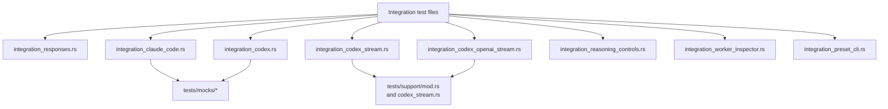

**Diagram sources**
- [tests/support/mod.rs:1-6](file://tests/support/mod.rs#L1-L6)
- [tests/support/codex_stream.rs:1-122](file://tests/support/codex_stream.rs#L1-L122)
- [tests/mocks/claude_code_client.rs:1-716](file://tests/mocks/claude_code_client.rs#L1-L716)
- [tests/mocks/codex_client.rs:1-375](file://tests/mocks/codex_client.rs#L1-L375)
- [tests/integration_responses.rs:1-200](file://tests/integration_responses.rs#L1-L200)
- [tests/integration_claude_code.rs:1-200](file://tests/integration_claude_code.rs#L1-L200)
- [tests/integration_codex.rs:1-200](file://tests/integration_codex.rs#L1-L200)
- [tests/integration_codex_stream.rs:1-200](file://tests/integration_codex_stream.rs#L1-L200)
- [tests/integration_codex_openai_stream.rs:1-200](file://tests/integration_codex_openai_stream.rs#L1-L200)
- [tests/integration_reasoning_controls.rs:1-200](file://tests/integration_reasoning_controls.rs#L1-L200)
- [tests/integration_worker_inspector.rs:1-200](file://tests/integration_worker_inspector.rs#L1-L200)
- [tests/integration_preset_cli.rs:1-155](file://tests/integration_preset_cli.rs#L1-L155)

**Section sources**
- [tests/lib.rs:1-6](file://tests/lib.rs#L1-L6)
- [tests/support/mod.rs:1-6](file://tests/support/mod.rs#L1-L6)
- [tests/support/codex_stream.rs:1-122](file://tests/support/codex_stream.rs#L1-L122)
- [tests/mocks/claude_code_client.rs:1-716](file://tests/mocks/claude_code_client.rs#L1-L716)
- [tests/mocks/codex_client.rs:1-375](file://tests/mocks/codex_client.rs#L1-L375)

## Core Components
The integration tests share several patterns:

| Area | Responsibility | Typical implementation pattern |
|---|---|---|
| Test application builder | Constructs an Axum `Router` with CCR state | Creates `EwmaTracker`, `TransformerRegistry`, rate limit tracker, retry budget, sticky sessions, admission tracker, and routes handler functions |
| Test config factory | Writes temporary JSON configuration | Uses `tempfile::tempdir`, writes a small provider definition, and loads it through `Config::from_file` |
| Wiremock backend | Simulates provider responses | Mounts mock handlers on paths like `/chat/completions`, `/messages`, or `/v1/messages` |
| Local Axum stream servers | Simulate upstream SSE streams | Bind a random loopback port, spawn an Axum server, and emit bytes over `ReceiverStream` |
| In-process request sender | Calls the test router without starting the full HTTP server | Uses `axum::ServiceExt::oneshot` with `Request::builder()` |
| External process runner | Invokes the compiled `ccr-rust` binary | Uses `std::process::Command` and asserts exit status, stdout, and stderr |

**Section sources**
- [tests/integration_responses.rs:1-200](file://tests/integration_responses.rs#L1-L200)
- [tests/integration_claude_code.rs:1-200](file://tests/integration_claude_code.rs#L1-L200)
- [tests/integration_codex.rs:1-200](file://tests/integration_codex.rs#L1-L200)
- [tests/integration_codex_stream.rs:1-120](file://tests/integration_codex_stream.rs#L1-L120)
- [tests/integration_codex_openai_stream.rs:1-120](file://tests/integration_codex_openai_stream.rs#L1-L120)
- [tests/integration_reasoning_controls.rs:1-120](file://tests/integration_reasoning_controls.rs#L1-L120)
- [tests/integration_worker_inspector.rs:1-120](file://tests/integration_worker_inspector.rs#L1-L120)
- [tests/integration_preset_cli.rs:1-155](file://tests/integration_preset_cli.rs#L1-L155)

## Architecture Overview
The main integration workflow connects a test client to a CCR router, then to a mocked upstream provider.

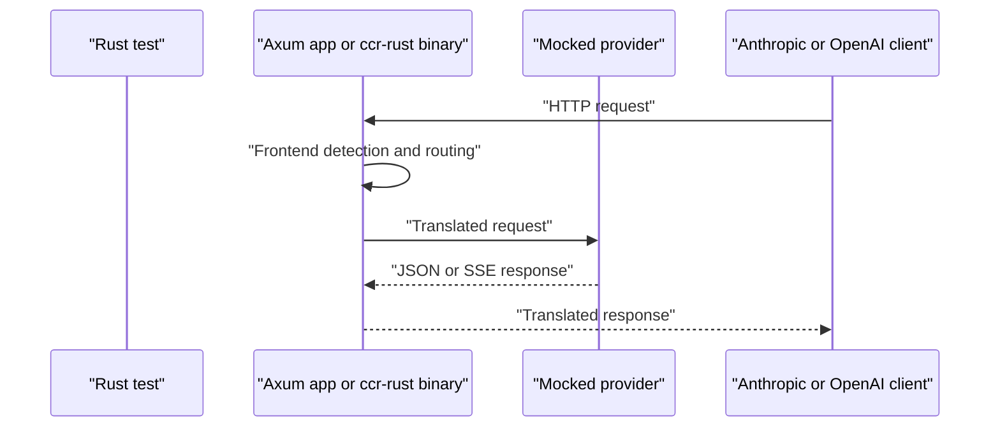

**Diagram sources**
- [tests/integration_codex.rs:120-250](file://tests/integration_codex.rs#L120-L250)
- [tests/integration_claude_code.rs:200-350](file://tests/integration_claude_code.rs#L200-L350)
- [tests/integration_codex_stream.rs:120-220](file://tests/integration_codex_stream.rs#L120-L220)
- [tests/integration_codex_openai_stream.rs:120-212](file://tests/integration_codex_openai_stream.rs#L120-L212)
- [tests/integration_reasoning_controls.rs:120-250](file://tests/integration_reasoning_controls.rs#L120-L250)

## Detailed Component Analysis

### Anthropic API Compatibility
The Anthropic compatibility tests exercise the `/v1/messages` endpoint. They verify:

- Request body structure uses Anthropic fields such as `model`, `messages`, and `max_tokens`.
- Frontend detection identifies Claude Code requests by headers such as `anthropic-client-id` and `anthropic-version`.
- Responses returned to the client follow the Anthropic message shape.
- System prompts are preserved.
- Streaming responses return `text/event-stream`.

The tests build an Axum router with only the messages route and mount a wiremock backend at `/chat/completions` when the internal translation path targets OpenAI format.

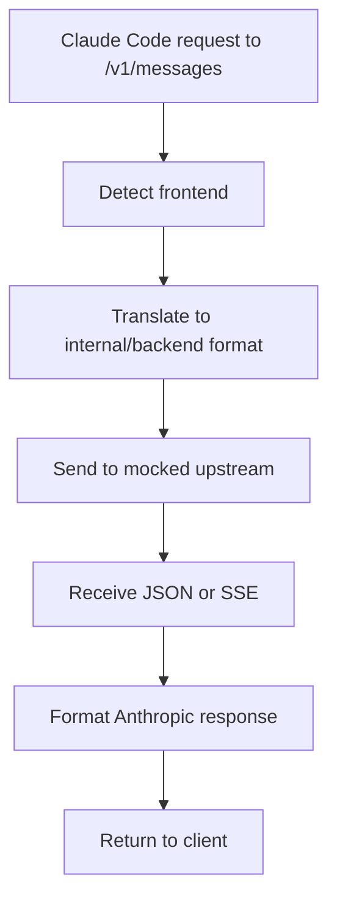

**Diagram sources**
- [tests/integration_claude_code.rs:1-200](file://tests/integration_claude_code.rs#L1-L200)
- [tests/integration_claude_code.rs:200-500](file://tests/integration_claude_code.rs#L200-L500)

**Section sources**
- [tests/integration_claude_code.rs:1-200](file://tests/integration_claude_code.rs#L1-L200)
- [tests/integration_claude_code.rs:200-500](file://tests/integration_claude_code.rs#L200-L500)
- [tests/mocks/claude_code_client.rs:1-716](file://tests/mocks/claude_code_client.rs#L1-L716)

### OpenAI API Compatibility
OpenAI compatibility is tested through two endpoints:

- `/v1/chat/completions`: standard chat completion flow.
- `/v1/responses`: newer OpenAI Responses API compatibility.

Key scenarios include:

- Non-streaming response objects are constructed correctly.
- Zstd-compressed request bodies are accepted.
- Developer role normalization maps to system role for the backend.
- OpenAI-style models list includes both route IDs and model identifiers.
- Frontend metrics record Codex-originated requests.

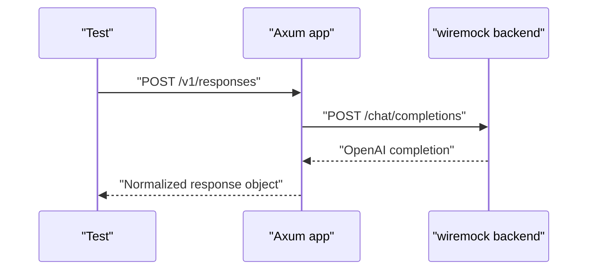

**Diagram sources**
- [tests/integration_responses.rs:200-450](file://tests/integration_responses.rs#L200-L450)
- [tests/integration_codex.rs:200-500](file://tests/integration_codex.rs#L200-L500)

**Section sources**
- [tests/integration_responses.rs:1-200](file://tests/integration_responses.rs#L1-L200)
- [tests/integration_responses.rs:200-450](file://tests/integration_responses.rs#L200-L450)
- [tests/integration_codex.rs:200-500](file://tests/integration_codex.rs#L200-L500)

### Claude Code Client Integration
The Claude Code integration tests focus on frontend detection and format passthrough. They assert:

- Detection by `anthropic-client-id`.
- Detection by `anthropic-version`.
- Ambiguous payloads may be detected as Codex rather than Claude Code because role-based OpenAI-style payloads take precedence.
- Claude Code vs Codex detection rules are consistent with the documented precedence.
- Thinking blocks and reasoning content are preserved in responses.

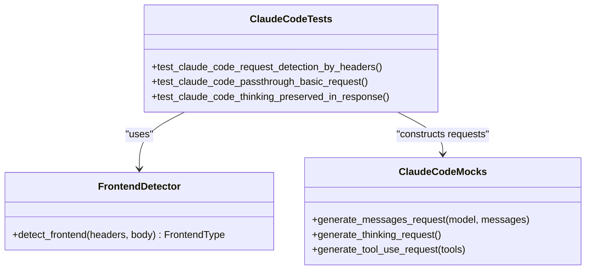

**Diagram sources**
- [tests/integration_claude_code.rs:1-200](file://tests/integration_claude_code.rs#L1-L200)
- [tests/mocks/claude_code_client.rs:1-200](file://tests/mocks/claude_code_client.rs#L1-L200)

**Section sources**
- [tests/integration_claude_code.rs:1-200](file://tests/integration_claude_code.rs#L1-L200)
- [tests/integration_claude_code.rs:200-500](file://tests/integration_claude_code.rs#L200-L500)
- [tests/mocks/claude_code_client.rs:1-716](file://tests/mocks/claude_code_client.rs#L1-L716)

### Codex Client Integration
The Codex integration tests simulate OpenAI-format requests from Codex. They verify:

- User-Agent-based frontend detection.
- Unwrapping of wrapped success envelopes.
- Model listing includes route identifiers.
- Frontend metrics capture Codex requests.
- Request transformation from OpenAI format to the internal backend format.
- Response transformation back to OpenAI format.

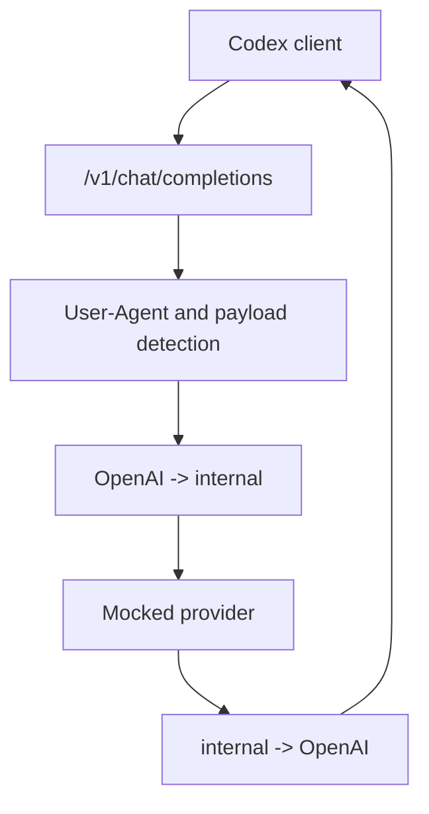

**Diagram sources**
- [tests/integration_codex.rs:1-200](file://tests/integration_codex.rs#L1-L200)
- [tests/integration_codex.rs:200-500](file://tests/integration_codex.rs#L200-L500)

**Section sources**
- [tests/integration_codex.rs:1-200](file://tests/integration_codex.rs#L1-L200)
- [tests/integration_codex.rs:200-500](file://tests/integration_codex.rs#L200-L500)
- [tests/mocks/codex_client.rs:1-375](file://tests/mocks/codex_client.rs#L1-L375)

### Streaming Response Handling
There are two major streaming conversion scenarios:

1. **Anthropic SSE to OpenAI SSE:** The test sends an Anthropic-style streaming request, provides a local Axum server emitting Anthropic events, and asserts that the downstream response is a well-formed OpenAI SSE stream ending with exactly one `[DONE]`.
2. **Upstream OpenAI SSE to OpenAI SSE:** The test simulates fragmented OpenAI SSE frames and asserts frame reassembly, role/content delta ordering, usage placement, and lifecycle frame filtering.

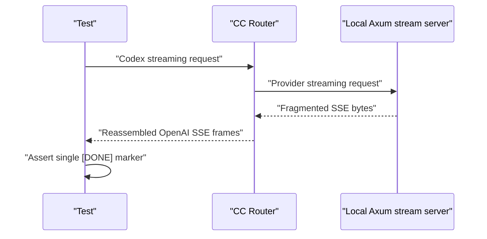

**Diagram sources**
- [tests/integration_codex_stream.rs:1-200](file://tests/integration_codex_stream.rs#L1-L200)
- [tests/integration_codex_stream.rs:200-579](file://tests/integration_codex_stream.rs#L200-L579)
- [tests/integration_codex_openai_stream.rs:1-212](file://tests/integration_codex_openai_stream.rs#L1-L212)

**Section sources**
- [tests/integration_codex_stream.rs:1-200](file://tests/integration_codex_stream.rs#L1-L200)
- [tests/integration_codex_stream.rs:200-579](file://tests/integration_codex_stream.rs#L200-L579)
- [tests/integration_codex_openai_stream.rs:1-212](file://tests/integration_codex_openai_stream.rs#L1-L212)
- [tests/support/codex_stream.rs:1-122](file://tests/support/codex_stream.rs#L1-L122)

### Reasoning Controls
Reasoning control tests target Anthropic protocol providers and validate:

- `reasoning.effort` from OpenAI-style requests maps to Anthropic `output_config`.
- Native Anthropic `thinking` modes are passed through.
- Signed thinking blocks and tool results round-trip correctly.
- Responses API preserves signed interleaved thinking.
- Streaming preserves signed interleaved thinking.
- Internal control keys such as `reasoning_effort`, `reasoning`, and CCR-specific keys are not forwarded to the upstream provider.

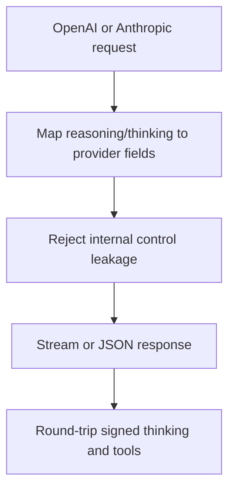

**Diagram sources**
- [tests/integration_reasoning_controls.rs:1-200](file://tests/integration_reasoning_controls.rs#L1-L200)
- [tests/integration_reasoning_controls.rs:200-600](file://tests/integration_reasoning_controls.rs#L200-L600)

**Section sources**
- [tests/integration_reasoning_controls.rs:1-200](file://tests/integration_reasoning_controls.rs#L1-L200)
- [tests/integration_reasoning_controls.rs:200-600](file://tests/integration_reasoning_controls.rs#L200-L600)

### Worker Inspector Functionality
The worker inspector tests run the actual `ccr-rust` binary through `std::process::Command`. They exercise:

- The `workers` subcommand.
- JSON output mode.
- Run listing with limits and omitted runs.
- Run details including outcome, model requested, failed commands, errors, and truncated final reports.
- Event pagination using cursor offsets.
- Error conditions with expected exit codes and error messages.
- Unicode handling in final reports.

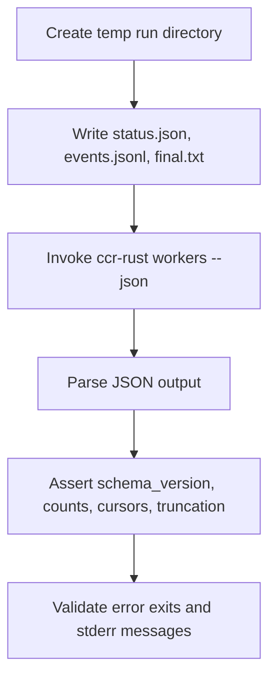

**Diagram sources**
- [tests/integration_worker_inspector.rs:1-200](file://tests/integration_worker_inspector.rs#L1-L200)
- [tests/integration_worker_inspector.rs:200-306](file://tests/integration_worker_inspector.rs#L200-L306)

**Section sources**
- [tests/integration_worker_inspector.rs:1-200](file://tests/integration_worker_inspector.rs#L1-L200)
- [tests/integration_worker_inspector.rs:200-306](file://tests/integration_worker_inspector.rs#L200-L306)

### Preset CLI Behavior
The preset CLI test starts the real `ccr-rust` server process, waits for health readiness, lists presets, dispatches a named preset, and rejects unknown routes. It validates:

- Named preset registration.
- Preset endpoint returns correct default parameters.
- Unknown preset routes return `NOT_FOUND`.
- Mismatched routes also return `NOT_FOUND`.
- The upstream mock receives the request with preset overrides.

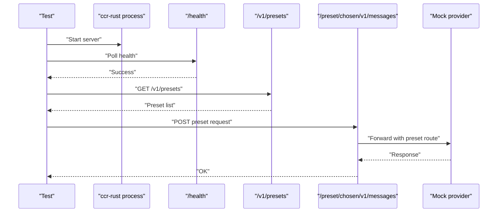

**Diagram sources**
- [tests/integration_preset_cli.rs:1-155](file://tests/integration_preset_cli.rs#L1-L155)

**Section sources**
- [tests/integration_preset_cli.rs:1-155](file://tests/integration_preset_cli.rs#L1-L155)

## Dependency Analysis
Integration tests depend on:

| Dependency | Purpose |
|---|---|
| `tokio` | Async runtime and test macros |
| `axum` | In-process HTTP server and request construction |
| `tower` | Service utilities |
| `wiremock` | Mock upstream provider |
| `tempfile` | Temporary configuration directories |
| `serde_json` | Request and response fixtures |
| `bytes` | Streaming byte payloads |
| `futures` | Stream iteration |
| `reqwest` | HTTP client used by the preset CLI test |
| `zstd` | Compressed request support in responses tests |

The project’s development dependencies are declared in `Cargo.toml`, while the production package name is `ccr-rust`.

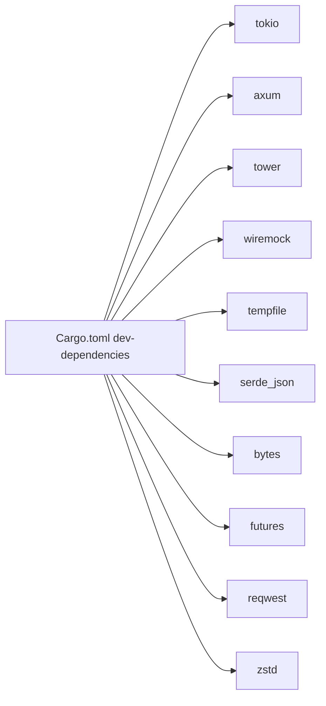

**Diagram sources**
- [Cargo.toml:1-87](file://Cargo.toml#L1-L87)

**Section sources**
- [Cargo.toml:1-87](file://Cargo.toml#L1-L87)

## Performance Considerations
Integration tests should be treated as slow end-to-end validations rather than fast unit checks. Common performance characteristics include:

- Local Axum servers bind random loopback ports, which adds small startup overhead.
- Streaming tests create channels and spawned tasks to simulate network latency and fragmentation.
- Wiremock mounts and verifications add synchronous-like assertions over asynchronous I/O.
- The preset CLI test spawns an external process and polls `/health`, making it sensitive to process startup time.
- Worker inspector tests read and write temporary files and parse JSONL event traces.

Recommended practices:

- Prefer in-process router tests when you do not need the real binary.
- Use timeouts around streaming reads to avoid hanging tests.
- Avoid binding fixed ports; prefer dynamic loopback addresses.
- Keep large fixture payloads minimal.
- Reuse shared helpers for app building and config creation where possible.

[No sources needed since this section provides general guidance]

## Troubleshooting Guide

### Cannot Bind Localhost Sockets
Many tests skip themselves when binding `127.0.0.1:0` fails. This commonly occurs in restricted environments such as CI sandboxes, containers without loopback networking, or sandboxed runners.

Symptoms:

- Tests print a skip message.
- Assertions never run.
- Test results show skipped or early-return behavior.

Resolution:

- Run the test in an environment that allows loopback TCP sockets.
- Check container networking configuration.
- Do not treat skipped tests as failures unless your environment explicitly requires localhost binding.

**Section sources**
- [tests/integration_codex_stream.rs:1-120](file://tests/integration_codex_stream.rs#L1-L120)
- [tests/support/codex_stream.rs:1-30](file://tests/support/codex_stream.rs#L1-L30)

### Missing Compiled Binary
Worker inspector and preset CLI tests require the compiled `ccr-rust` binary via `env!("CARGO_BIN_EXE_ccr-rust")`.

Symptoms:

- `cargo test` fails during compilation or test execution.
- Process spawning errors indicate the binary cannot be found.

Resolution:

- Build the release or test artifact first.
- Ensure the binary name matches the package name in `Cargo.toml`.
- For preset tests, confirm the process can start from the temporary working directory.

**Section sources**
- [tests/integration_worker_inspector.rs:1-40](file://tests/integration_worker_inspector.rs#L1-L40)
- [tests/integration_preset_cli.rs:1-40](file://tests/integration_preset_cli.rs#L1-L40)
- [Cargo.toml:1-10](file://Cargo.toml#L1-L10)

### Configuration File Issues
Most tests write a temporary `config.json` and load it through `Config::from_file`.

Common issues:

- Invalid JSON syntax.
- Missing provider name or model mapping.
- Incorrect `api_base_url`.
- Protocol mismatch between test expectation and provider configuration.

Resolution:

- Inspect the temporary directory created by the failing test.
- Confirm the provider URL points at the wiremock server.
- Confirm the protocol field matches the expected backend format.
- Reduce the configuration to a single provider when debugging.

**Section sources**
- [tests/integration_responses.rs:1-200](file://tests/integration_responses.rs#L1-L200)
- [tests/integration_codex_stream.rs:120-200](file://tests/integration_codex_stream.rs#L120-L200)
- [tests/support/codex_stream.rs:30-80](file://tests/support/codex_stream.rs#L30-L80)

### Streaming Frame Fragmentation Failures
Streaming tests deliberately split SSE frames across bytes to validate reassembly.

Common failure causes:

- Expected `[DONE]` marker missing.
- Multiple `[DONE]` markers emitted.
- Usage appearing on non-terminal chunks.
- Anthropic lifecycle frames leaking into OpenAI responses.
- UTF-8 characters split across chunks.

Resolution:

- Compare the raw streamed body with the expected OpenAI chunk contract.
- Verify that `parse_sse_data_frames` handles `\r\n`, whitespace, and empty frames.
- Check that tool deltas and stop events map correctly to OpenAI `tool_calls` and `finish_reason`.
- For UTF-8 splits, ensure the downstream parser does not assume clean byte boundaries.

**Section sources**
- [tests/integration_codex_stream.rs:200-579](file://tests/integration_codex_stream.rs#L200-L579)
- [tests/integration_codex_openai_stream.rs:120-212](file://tests/integration_codex_openai_stream.rs#L120-L212)
- [tests/support/codex_stream.rs:80-122](file://tests/support/codex_stream.rs#L80-L122)

### Reasoning Control Leakage
Reasoning control tests assert that internal keys are not forwarded to the upstream provider.

Common failure causes:

- OpenAI `reasoning` or `reasoning_effort` appears in the Anthropic request.
- CCR internal keys such as `__ccr_responses_request` leak.
- Signed thinking blocks become visible assistant text instead of being preserved as encrypted or structured content.

Resolution:

- Capture the exact upstream request body from wiremock.
- Verify mapping to `output_config` or native Anthropic fields.
- Confirm that hidden reasoning is not rendered as plain assistant text.

**Section sources**
- [tests/integration_reasoning_controls.rs:200-600](file://tests/integration_reasoning_controls.rs#L200-L600)

### Preset Route Validation
Preset tests expect successful dispatch through `/preset/<name>/v1/messages` and `NOT_FOUND` for unknown routes.

Common failure causes:

- Server process exits before health check passes.
- Log output indicates configuration or port binding failure.
- Preset name or route path is incorrect.
- Upstream mock expectations are not met.

Resolution:

- Read the captured server log path used by the test.
- Check `/health` readiness polling.
- Validate preset configuration in the temporary config file.
- Confirm the upstream mock path and request body match the preset defaults.

**Section sources**
- [tests/integration_preset_cli.rs:1-155](file://tests/integration_preset_cli.rs#L1-L155)

### Worker Inspector JSON Parsing
Worker inspector tests require clean JSON output and predictable stderr behavior.

Common failure causes:

- Non-JSON lines on stdout.
- Diagnostic or logging output on stderr.
- Unexpected exit code.
- Malformed event offsets or cursors.

Resolution:

- Inspect stderr for diagnostic logs.
- Verify `schema_version` and expected run metadata.
- Confirm event offset calculation matches the written JSONL file.
- Use smaller event sets when debugging cursor logic.

**Section sources**
- [tests/integration_worker_inspector.rs:1-200](file://tests/integration_worker_inspector.rs#L1-L200)
- [tests/integration_worker_inspector.rs:200-306](file://tests/integration_worker_inspector.rs#L200-L306)

## Conclusion
The CCR-Rust integration test suite covers the full interaction surface between coding clients, the router, and upstream providers. It separates concerns by using in-process routers for most cases and reserving external process tests for CLI and preset behavior. The strongest guarantees come from wiremock-backed request capture, streaming frame validation, and explicit assertions about translated request and response shapes. When adding new scenarios, reuse the shared app builder and config helper, mock the upstream provider precisely, and assert both the wire-level protocol and the business-level data transformation.

[No sources needed since this section summarizes without analyzing specific files]

## Appendices

### How to Run Integration Tests
Run all integration tests with the normal Rust test command. Tests requiring a compiled binary will use the built artifact discovered through Cargo.

Recommended order:

1. Build the project.
2. Run the full test suite.
3. If a test requires a running server, inspect its temporary directory and logs.
4. If localhost socket binding is unavailable, expect skipped tests rather than failures.

[No sources needed since this section provides general guidance]

### Configuring Test Providers
Each test creates a temporary configuration containing:

- A provider entry with `name`, `api_base_url`, `api_key`, and `models`.
- A router default pointing at the mock provider.
- An `API_TIMEOUT_MS` value suitable for testing.

For streaming tests, the base URL points at a local Axum server. For CLI tests, the base URL points at a wiremock server.

**Section sources**
- [tests/integration_responses.rs:1-200](file://tests/integration_responses.rs#L1-L200)
- [tests/integration_codex_stream.rs:120-200](file://tests/integration_codex_stream.rs#L120-L200)
- [tests/support/codex_stream.rs:30-80](file://tests/support/codex_stream.rs#L30-L80)

### Managing External Service Dependencies
External service dependencies are intentionally avoided. All upstream providers are mocked locally. The only external dependency is the compiled `ccr-rust` binary for CLI-oriented tests.

Best practices:

- Never point integration tests at real provider URLs.
- Use wiremock for JSON providers.
- Use a local Axum server for streaming providers.
- Clear environment variables before spawning child processes.
- Preserve only necessary diagnostics variables such as `RUST_LOG` or `RUST_BACKTRACE`.

**Section sources**
- [tests/integration_preset_cli.rs:40-155](file://tests/integration_preset_cli.rs#L40-L155)
- [tests/integration_worker_inspector.rs:1-40](file://tests/integration_worker_inspector.rs#L1-L40)

### Adding New Integration Test Scenarios
To add a new scenario:

1. Decide whether the test needs the in-process router or the real binary.
2. Create a temporary configuration with a mock provider.
3. Mount wiremock expectations for the upstream path.
4. Build the Axum router with the required routes.
5. Send a request using `Request::builder()` or `reqwest` for process tests.
6. Assert status, headers, body shape, and upstream captures.
7. For streaming, assert frame order, lifecycle events, termination, and encoding correctness.
8. If the scenario involves the CLI, spawn `ccr-rust`, wait for health, and assert HTTP behavior.

**Section sources**
- [tests/integration_responses.rs:200-450](file://tests/integration_responses.rs#L200-L450)
- [tests/integration_codex_stream.rs:120-220](file://tests/integration_codex_stream.rs#L120-L220)
- [tests/integration_preset_cli.rs:40-155](file://tests/integration_preset_cli.rs#L40-L155)