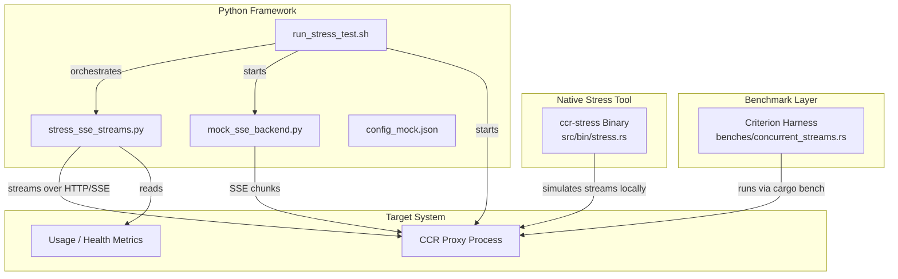
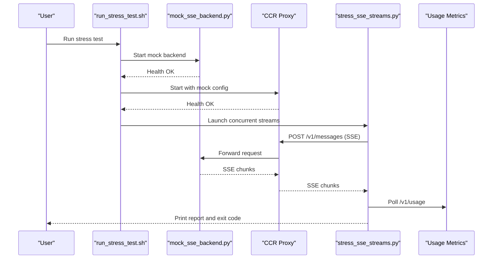
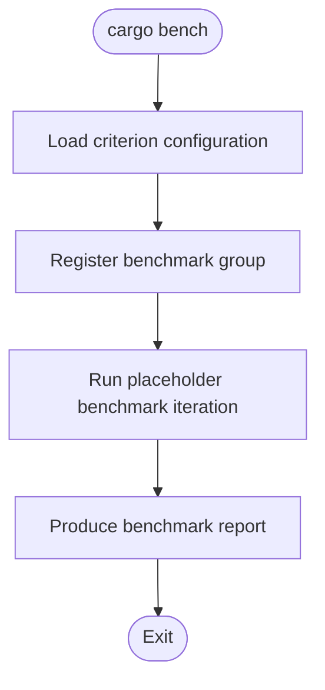
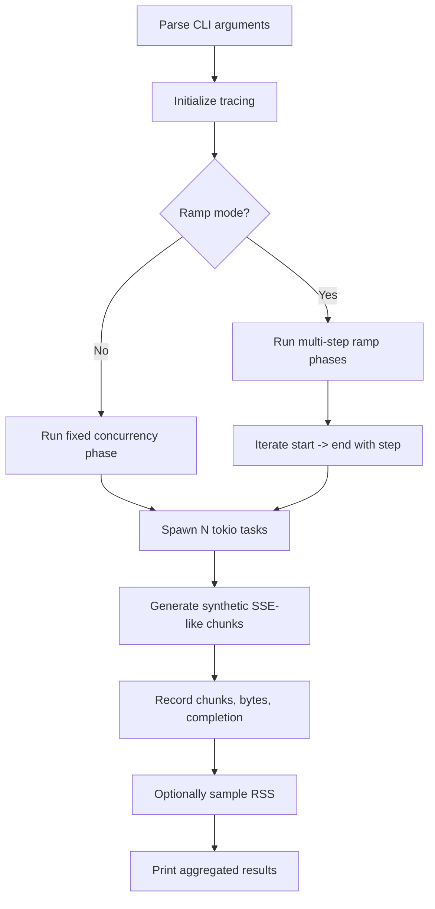
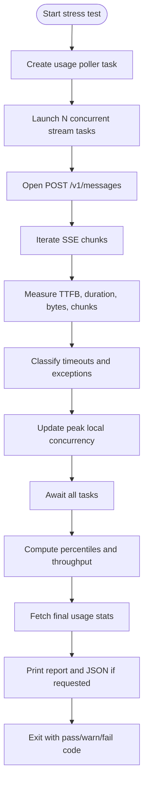
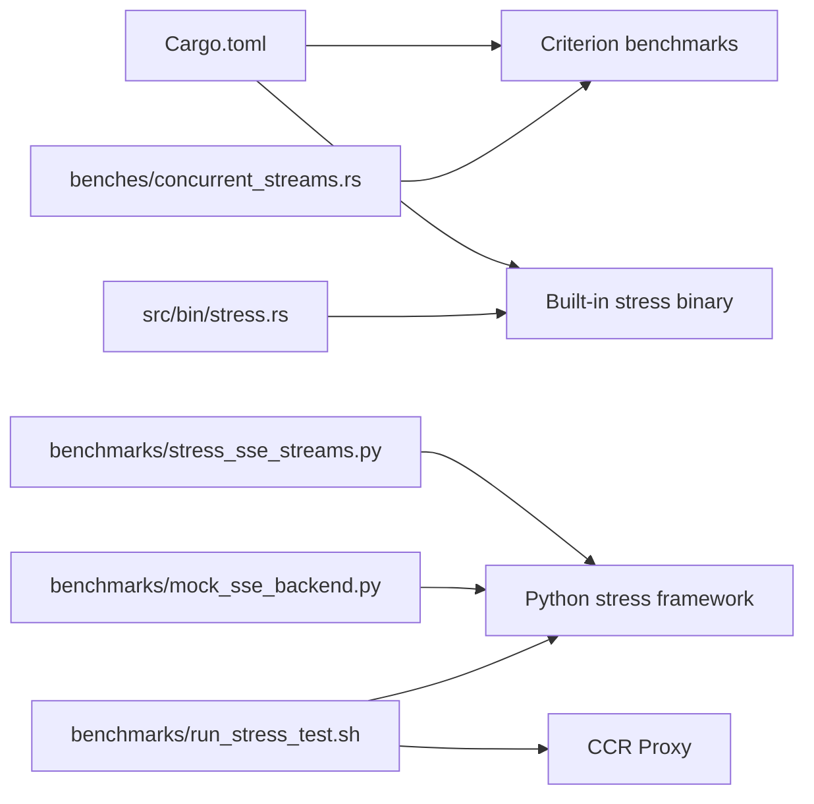

# Load Testing and Performance Benchmarks

<cite>
**Referenced Files in This Document**
- [Cargo.toml](file://Cargo.toml)
- [benches/concurrent_streams.rs](file://benches/concurrent_streams.rs)
- [benchmarks/README.md](file://benchmarks/README.md)
- [benchmarks/config_mock.json](file://benchmarks/config_mock.json)
- [benchmarks/mock_sse_backend.py](file://benchmarks/mock_sse_backend.py)
- [benchmarks/run_stress_test.sh](file://benchmarks/run_stress_test.sh)
- [benchmarks/stress_sse_streams.py](file://benchmarks/stress_sse_streams.py)
- [src/bin/stress.rs](file://src/bin/stress.rs)
</cite>

## Table of Contents
1. [Introduction](#introduction)
2. [Project Structure](#project-structure)
3. [Core Components](#core-components)
4. [Architecture Overview](#architecture-overview)
5. [Detailed Component Analysis](#detailed-component-analysis)
6. [Dependency Analysis](#dependency-analysis)
7. [Performance Considerations](#performance-considerations)
8. [Troubleshooting Guide](#troubleshooting-guide)
9. [Capacity Planning Guidelines](#capacity-planning-guidelines)
10. [Bottleneck Identification Techniques](#bottleneck-identification-techniques)
11. [Performance Regression Detection](#performance-regression-detection)
12. [Adding New Benchmarks and Baselines](#adding-new-benchmarks-and-baselines)
13. [Conclusion](#conclusion)

## Introduction
This document explains how load testing and performance benchmarking are implemented in CCR-Rust. It covers:

- The Criterion benchmark entry point for concurrent stream operations.
- The built-in Rust stress test binary that simulates large-scale concurrent SSE streams.
- The Python-based stress test framework that drives real or simulated providers through the CCR proxy.
- The mock SSE backend used to run fully self-contained tests without API keys or token costs.
- How to set up, run, interpret, and extend these tools for capacity planning, bottleneck detection, and regression prevention.

The goal is to help you validate CCR-Rust’s streaming proxy under agent-like workloads while keeping tests reproducible and measurable.

## Project Structure
The load-testing surface spans three layers:

| Layer | Location | Purpose |
|---|---|---|
| Criterion benchmarks | `benches/concurrent_streams.rs` | Small benchmark harness entry point registered with Cargo. |
| Built-in Rust stress tool | `src/bin/stress.rs` | Native concurrency and memory profiling under load using a local mock stream generator. |
| Python stress framework | `benchmarks/stress_sse_streams.py`, `benchmarks/mock_sse_backend.py`, `benchmarks/run_stress_test.sh`, `benchmarks/config_mock.json` | End-to-end orchestration against a running CCR instance. |

**Diagram sources**
- [benches/concurrent_streams.rs:1-9](file://benches/concurrent_streams.rs#L1-L9)
- [src/bin/stress.rs:1-120](file://src/bin/stress.rs#L1-L120)
- [benchmarks/stress_sse_streams.py:1-120](file://benchmarks/stress_sse_streams.py#L1-L120)
- [benchmarks/mock_sse_backend.py:1-80](file://benchmarks/mock_sse_backend.py#L1-L80)
- [benchmarks/run_stress_test.sh:1-60](file://benchmarks/run_stress_test.sh#L1-L60)
- [benchmarks/config_mock.json:1-16](file://benchmarks/config_mock.json#L1-L16)

**Section sources**
- [Cargo.toml:60-87](file://Cargo.toml#L60-L87)
- [benches/concurrent_streams.rs:1-9](file://benches/concurrent_streams.rs#L1-L9)
- [benchmarks/README.md:1-30](file://benchmarks/README.md#L1-L30)

## Core Components

### Criterion Benchmark Entry Point
The project registers a Criterion benchmark group named `concurrent_streams`. The current implementation is a placeholder benchmark intended as an extension point for adding focused micro-benchmarks around concurrent stream handling.

Key characteristics:
- Uses `criterion_group!` and `criterion_main!`.
- Defines one benchmark function that iterates a simple operation.
- Is declared in `Cargo.toml` as a separate benchmark target with `harness = false`.

When extending this file, keep it small and deterministic. Use it for CPU-bound or allocation-sensitive hot paths rather than network-heavy scenarios.

**Section sources**
- [benches/concurrent_streams.rs:1-9](file://benches/concurrent_streams.rs#L1-L9)
- [Cargo.toml:76-87](file://Cargo.toml#L76-L87)

### Built-in Rust Stress Test Binary
`src/bin/stress.rs` implements a native stress runner designed to scale CCR to 200+ concurrent streams. It does not require external providers; it generates synthetic SSE-like chunks internally and measures throughput, completion rates, peak concurrency, and optional RSS memory usage.

Highlights:
- CLI controls concurrency, duration, chunk size, delay, and ramp-up mode.
- Uses Tokio tasks, barriers, intervals, and atomic counters.
- Tracks per-stream lifecycle statistics and aggregate metrics.
- Supports fixed-concurrency runs and multi-step ramp tests.
- Optionally samples process RSS on Linux and prints summary results.

This tool is best suited for validating proxy stability, scheduler saturation, and memory behavior under controlled internal load.

**Section sources**
- [src/bin/stress.rs:1-120](file://src/bin/stress.rs#L1-L120)
- [src/bin/stress.rs:201-330](file://src/bin/stress.rs#L201-L330)
- [src/bin/stress.rs:330-520](file://src/bin/stress.rs#L330-L520)
- [src/bin/stress.rs:520-685](file://src/bin/stress.rs#L520-L685)

### Python-Based Stress Test Framework
`benchmarks/stress_sse_streams.py` launches concurrent async HTTP requests to CCR’s `/v1/messages` endpoint, consumes SSE chunks, and collects per-stream and aggregate metrics. It also polls `/v1/usage` to estimate peak active streams.

Highlights:
- Per-stream metrics include time-to-first-byte, total duration, chunk count, byte count, and error classification.
- Aggregate metrics include percentiles for TTFB and duration, total bytes, total chunks, throughput in Mbps, wall-clock time, peak local concurrency, and peak CCR active streams.
- Prints a human-readable report and exits with a status code based on failure thresholds.
- Can write detailed JSON output containing both the report and per-stream results.

This framework is the right choice when you want to exercise CCR’s actual HTTP/SSE proxy path and optionally route to real or mocked provider backends.

**Section sources**
- [benchmarks/stress_sse_streams.py:1-120](file://benchmarks/stress_sse_streams.py#L1-L120)
- [benchmarks/stress_sse_streams.py:201-330](file://benchmarks/stress_sse_streams.py#L201-L330)
- [benchmarks/stress_sse_streams.py:330-417](file://benchmarks/stress_sse_streams.py#L330-L417)

### Mock SSE Backend
`benchmarks/mock_sse_backend.py` implements a lightweight ASGI server that mimics an LLM provider’s streaming endpoint. It supports:

- Non-streaming responses.
- Configurable number of SSE chunks.
- Configurable inter-chunk delay.
- A health check route.
- Response headers indicating chunk count and delay.

This makes it possible to run full end-to-end stress tests without API keys, token consumption, or flaky external services.

**Section sources**
- [benchmarks/mock_sse_backend.py:1-80](file://benchmarks/mock_sse_backend.py#L1-L80)
- [benchmarks/mock_sse_backend.py:80-173](file://benchmarks/mock_sse_backend.py#L80-L173)

### Orchestration Script and Mock Configuration
`benchmarks/run_stress_test.sh` orchestrates the full test:

1. Parses flags such as stream count, chunk count, delay, ramp window, ports, and JSON output.
2. Builds a temporary CCR configuration pointing at the mock backend.
3. Starts the mock backend and verifies its health endpoint.
4. Starts CCR with the generated configuration.
5. Runs the Python stress test.
6. Cleans up processes and temporary files.

`benchmarks/config_mock.json` shows the expected structure for pointing CCR at a local mock provider and setting the default router model.

**Section sources**
- [benchmarks/run_stress_test.sh:1-60](file://benchmarks/run_stress_test.sh#L1-L60)
- [benchmarks/run_stress_test.sh:60-151](file://benchmarks/run_stress_test.sh#L60-L151)
- [benchmarks/config_mock.json:1-16](file://benchmarks/config_mock.json#L1-L16)
- [benchmarks/README.md:31-135](file://benchmarks/README.md#L31-L135)

## Architecture Overview
The recommended end-to-end flow uses the orchestration script, which coordinates three components:

**Diagram sources**
- [benchmarks/run_stress_test.sh:60-151](file://benchmarks/run_stress_test.sh#L60-L151)
- [benchmarks/mock_sse_backend.py:80-173](file://benchmarks/mock_sse_backend.py#L80-L173)
- [benchmarks/stress_sse_streams.py:201-330](file://benchmarks/stress_sse_streams.py#L201-L330)

## Detailed Component Analysis

### Criterion Benchmark Workflow
The Criterion benchmark workflow is intentionally minimal today:

This pattern is suitable for future micro-benchmarks targeting hot paths in routing, response transformation, or stream processing. Network-dependent benchmarks should generally live in the Python or Rust stress tools instead.

**Diagram sources**
- [benches/concurrent_streams.rs:1-9](file://benches/concurrent_streams.rs#L1-L9)
- [Cargo.toml:76-87](file://Cargo.toml#L76-L87)

**Section sources**
- [benches/concurrent_streams.rs:1-9](file://benches/concurrent_streams.rs#L1-L9)
- [Cargo.toml:60-87](file://Cargo.toml#L60-L87)

### Rust Stress Binary Internal Flow
The Rust stress binary simulates many concurrent streams by spawning Tokio tasks, generating synthetic chunks, and recording aggregate statistics.

**Diagram sources**
- [src/bin/stress.rs:201-330](file://src/bin/stress.rs#L201-L330)
- [src/bin/stress.rs:330-520](file://src/bin/stress.rs#L330-L520)
- [src/bin/stress.rs:520-685](file://src/bin/stress.rs#L520-L685)

**Section sources**
- [src/bin/stress.rs:1-120](file://src/bin/stress.rs#L1-L120)
- [src/bin/stress.rs:201-330](file://src/bin/stress.rs#L201-L330)
- [src/bin/stress.rs:330-520](file://src/bin/stress.rs#L330-L520)
- [src/bin/stress.rs:520-685](file://src/bin/stress.rs#L520-L685)

### Python Stress Test Internal Flow
The Python stress test creates many asynchronous tasks, each opening an SSE connection to CCR. It tracks first-byte latency, total duration, chunk counts, byte counts, and errors. It also polls CCR’s usage endpoint to observe active stream gauges.

**Diagram sources**
- [benchmarks/stress_sse_streams.py:201-330](file://benchmarks/stress_sse_streams.py#L201-L330)
- [benchmarks/stress_sse_streams.py:330-417](file://benchmarks/stress_sse_streams.py#L330-L417)

**Section sources**
- [benchmarks/stress_sse_streams.py:1-120](file://benchmarks/stress_sse_streams.py#L1-L120)
- [benchmarks/stress_sse_streams.py:201-330](file://benchmarks/stress_sse_streams.py#L201-L330)
- [benchmarks/stress_sse_streams.py:330-417](file://benchmarks/stress_sse_streams.py#L330-L417)

### Mock Backend Behavior
The mock backend provides two main routes:

| Route | Method | Behavior |
|---|---:|---|
| `/chat/completions` | POST | Returns either a non-streaming JSON response or an SSE stream with configurable chunks and delay. |
| `/health` | GET | Returns plain text to indicate readiness. |

For streaming responses, it yields repeated content chunks, sleeps between chunks, and emits a terminal `[DONE]` sentinel.

**Section sources**
- [benchmarks/mock_sse_backend.py:1-80](file://benchmarks/mock_sse_backend.py#L1-L80)
- [benchmarks/mock_sse_backend.py:80-173](file://benchmarks/mock_sse_backend.py#L80-L173)

## Dependency Analysis
The benchmarking and stress-testing stack has clear boundaries:

External runtime dependencies for the Python framework are listed in the benchmarks README and include an async HTTP client, ASGI server, and ASGI framework. These are installed separately from the Rust dependency graph.

**Diagram sources**
- [Cargo.toml:60-87](file://Cargo.toml#L60-L87)
- [benches/concurrent_streams.rs:1-9](file://benches/concurrent_streams.rs#L1-L9)
- [src/bin/stress.rs:1-120](file://src/bin/stress.rs#L1-L120)
- [benchmarks/stress_sse_streams.py:1-120](file://benchmarks/stress_sse_streams.py#L1-L120)
- [benchmarks/mock_sse_backend.py:1-80](file://benchmarks/mock_sse_backend.py#L1-L80)
- [benchmarks/run_stress_test.sh:1-60](file://benchmarks/run_stress_test.sh#L1-L60)
- [benchmarks/README.md:115-135](file://benchmarks/README.md#L115-L135)

**Section sources**
- [Cargo.toml:60-87](file://Cargo.toml#L60-L87)
- [benchmarks/README.md:115-135](file://benchmarks/README.md#L115-L135)

## Performance Considerations
Use the following guidance when interpreting results:

- **Time-to-first-byte**: Indicates routing, authentication, and initial upstream setup latency. High TTFB with low overall duration may suggest slow startup or upstream handshakes.
- **Stream duration**: Reflects total workload including upstream inference and proxy forwarding overhead.
- **Throughput (Mbps)**: Useful for comparing aggregate bandwidth across configurations, but less useful alone because chunk sizes and delays vary.
- **Percentiles**: Prefer p50/p95/p99/max for latency-sensitive analysis. A rising p99 often indicates tail-latency bottlenecks.
- **Active streams gauge**: Helps verify whether CCR can sustain planned concurrency without queueing or dropping connections.
- **RSS memory**: In the Rust stress binary, monitor peak RSS to detect memory growth under sustained concurrency.
- **Error rate**: Treat any consistent increase in timeout, cancellation, or HTTP error categories as a regression signal.

Choose the appropriate tool:
- Use the Criterion benchmark for CPU-bound hot-path micro-benchmarks.
- Use `src/bin/stress.rs` for native, provider-independent concurrency and memory validation.
- Use the Python framework for end-to-end HTTP/SSE validation against real or simulated providers.

[No sources needed since this section provides general guidance]

## Troubleshooting Guide

### Common Setup Issues
| Symptom | Likely Cause | Resolution |
|---|---|---|
| Mock backend health check fails | Port conflict or Python dependencies missing | Ensure port 9999 is free and install required Python packages. |
| CCR fails to start | Invalid mock configuration or wrong provider URL | Verify `api_base_url`, port, model name, and router defaults. |
| No streams complete | CCR cannot reach mock backend | Check firewall, loopback binding, and provider routing. |
| All streams fail with timeout | Upstream too slow or per-stream timeout too short | Increase chunk delay tolerance or raise the per-stream timeout. |
| Memory grows steadily | Too many concurrent streams or insufficient resource limits | Reduce concurrency, add ramp steps, or inspect CCR resource settings. |

### Interpreting Error Categories
The Python stress test classifies failures by the exception type or HTTP error prefix. Typical categories include:

- Timeout: Per-stream request exceeded the configured timeout.
- Cancelled: Task was cancelled during collection.
- HTTP status: Non-200 response body excerpt.
- Generic exceptions: Unexpected client-side errors.

Treat recurring categories as regression signals even if the overall pass rate is above the warning threshold.

**Section sources**
- [benchmarks/stress_sse_streams.py:201-330](file://benchmarks/stress_sse_streams.py#L201-L330)
- [benchmarks/stress_sse_streams.py:330-417](file://benchmarks/stress_sse_streams.py#L330-L417)
- [benchmarks/run_stress_test.sh:60-151](file://benchmarks/run_stress_test.sh#L60-L151)

## Capacity Planning Guidelines
Use these practices to plan capacity for agent-like workloads:

1. **Define target concurrency**: Start with the expected number of concurrent agents or streams.
2. **Establish baseline metrics**: Run the Python stress test against a stable version and record p50/p95/p99 TTFB, p50/p95/p99 duration, throughput, and active stream gauge.
3. **Validate with native stress tool**: Run the Rust stress binary at the same concurrency level to isolate proxy-level behavior from provider variability.
4. **Add headroom**: Plan for 20-40% additional capacity depending on traffic volatility and error budgets.
5. **Model worst-case duration**: If each stream lasts roughly `chunks × delay`, multiply by concurrency to estimate total resource demand.
6. **Monitor active streams**: Ensure the observed peak active streams matches expectations. A lower-than-expected peak may indicate connection drops or upstream rejection.
7. **Plan scaling triggers**: Define thresholds for CPU, memory, latency percentiles, and error rate that trigger horizontal scaling or throttling.

[No sources needed since this section provides general guidance]

## Bottleneck Identification Techniques
Apply these techniques systematically:

| Area | Technique | What to Look For |
|---|---|---|
| Client side | Compare local peak concurrency with CCR active streams | Large gaps indicate client-side backpressure or connection limits. |
| Proxy startup | Compare TTFB distribution | Increasing TTFB without longer durations suggests initialization or routing overhead. |
| Streaming path | Compare chunk count vs. bytes received | Low bytes per chunk with high chunk count may indicate overhead per event. |
| Upstream dependency | Replace mock backend with a slower or faster provider | Observe whether latency scales with upstream delay. |
| Memory pressure | Enable RSS sampling in the Rust stress tool | Rising peak RSS under constant concurrency indicates leaks or unbounded buffering. |
| Scheduler saturation | Add ramp steps | Latency spikes at specific concurrency levels reveal saturation points. |
| Error patterns | Analyze classified error buckets | Timeouts dominate → upstream or proxy limits; HTTP errors → routing or auth issues. |

**Section sources**
- [src/bin/stress.rs:330-520](file://src/bin/stress.rs#L330-L520)
- [benchmarks/stress_sse_streams.py:201-330](file://benchmarks/stress_sse_streams.py#L201-L330)

## Performance Regression Detection
To detect regressions reliably:

1. **Pin the test environment**: Record OS, CPU, Python version, CCR release tag, and mock backend parameters.
2. **Capture structured output**: Use the Python stress test’s JSON output to archive per-stream results and reports.
3. **Track key metrics**:
   - TTFB p50/p95/p99/max.
   - Duration p50/p95/p99/max.
   - Throughput in Mbps.
   - Total bytes and total chunks.
   - Active streams peak.
   - Error count and error categories.
   - Peak RSS where available.
4. **Define alert thresholds**:
   - Latency percentile increases beyond a percentage threshold.
   - Error rate increases beyond a small absolute threshold.
   - Throughput decreases significantly under equivalent load.
   - Peak memory increases without corresponding workload growth.
5. **Automate comparison**: Compare current run results against a stored baseline before merging changes.
6. **Fail fast on regressions**: Treat unexpected latency or error increases as CI failures even if all streams technically completed.

**Section sources**
- [benchmarks/stress_sse_streams.py:330-417](file://benchmarks/stress_sse_streams.py#L330-L417)
- [src/bin/stress.rs:520-685](file://src/bin/stress.rs#L520-L685)

## Adding New Benchmarks and Baselines

### Adding a Criterion Micro-Benchmark
1. Open `benches/concurrent_streams.rs`.
2. Add a new benchmark function that exercises the hot path under test.
3. Keep iterations deterministic and avoid network I/O.
4. Register the benchmark in the existing criterion group.
5. Run with `cargo bench`.
6. Capture HTML reports and store representative outputs as baselines.

**Section sources**
- [benches/concurrent_streams.rs:1-9](file://benches/concurrent_streams.rs#L1-L9)
- [Cargo.toml:76-87](file://Cargo.toml#L76-L87)

### Adding a New Stress Scenario
1. Extend `benchmarks/stress_sse_streams.py` with new request shapes, models, or metrics.
2. Update `benchmarks/mock_sse_backend.py` if the mock needs new endpoints, chunk shapes, or error behaviors.
3. Add flags to `benchmarks/run_stress_test.sh` if orchestration needs new options.
4. Update `benchmarks/config_mock.json` or let the script generate configuration.
5. Record a baseline run using JSON output.
6. Validate pass/warn/fail thresholds against your error budget.

**Section sources**
- [benchmarks/stress_sse_streams.py:1-120](file://benchmarks/stress_sse_streams.py#L1-L120)
- [benchmarks/mock_sse_backend.py:1-80](file://benchmarks/mock_sse_backend.py#L1-L80)
- [benchmarks/run_stress_test.sh:1-60](file://benchmarks/run_stress_test.sh#L1-L60)
- [benchmarks/config_mock.json:1-16](file://benchmarks/config_mock.json#L1-L16)

### Establishing Performance Baselines
Recommended baseline artifacts:

| Artifact | Content |
|---|---|
| Baseline report | Printed summary from the Python stress test. |
| Baseline JSON | Full per-stream results and aggregate report. |
| Environment metadata | CCR version, OS, CPU, Python version, mock parameters. |
| Native stress output | Console output from the Rust stress binary. |
| Capacity scenario | Target concurrency, expected duration, acceptable latency percentiles, and error budget. |

Store these artifacts alongside the relevant benchmark change so future runs can be compared automatically.

[No sources needed since this section provides general guidance]

## Conclusion
CCR-Rust’s performance and load-testing surface combines three complementary tools:

- A Criterion benchmark harness for small, deterministic micro-benchmarks.
- A native Rust stress binary for provider-independent concurrency and memory validation.
- A Python-based stress framework that exercises the real HTTP/SSE proxy path against a controllable mock backend.

Together they support capacity planning, bottleneck identification, and regression detection. For reliable results, always compare structured metrics across versions, pin environments, and treat latency percentiles and error categories as primary signals rather than raw averages.

[No sources needed since this section summarizes without analyzing specific files]