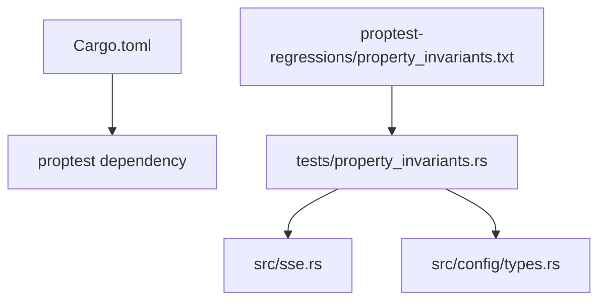
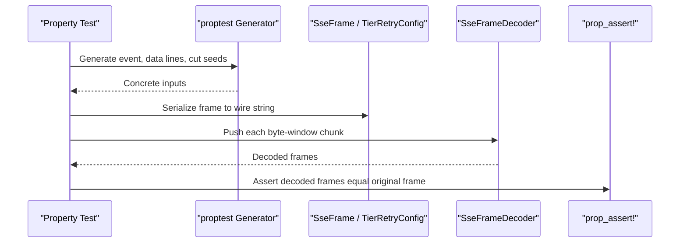
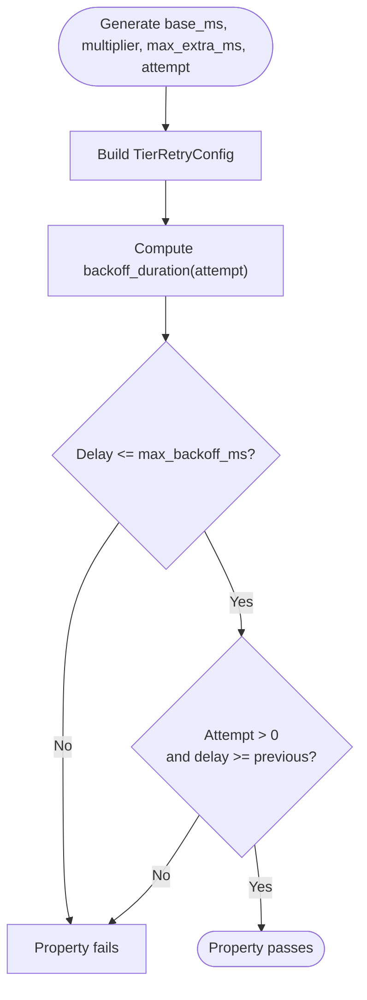
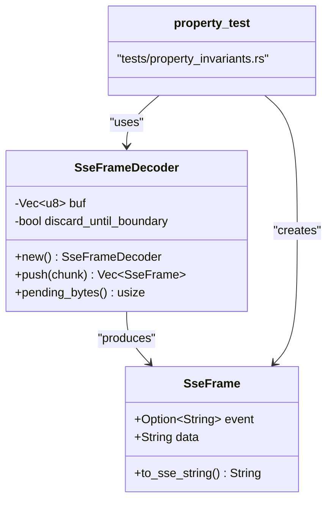
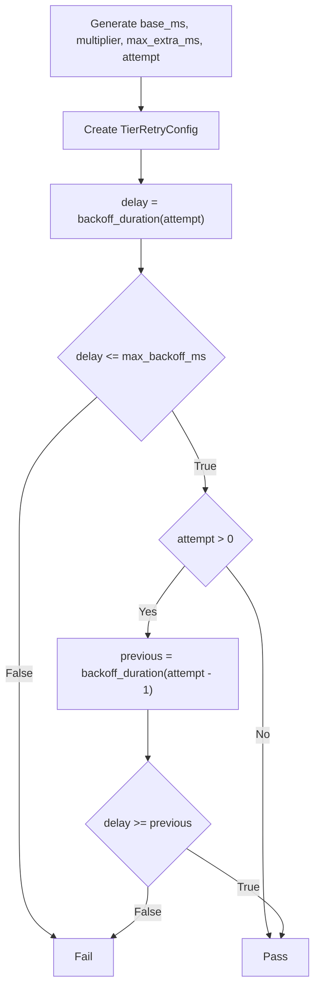
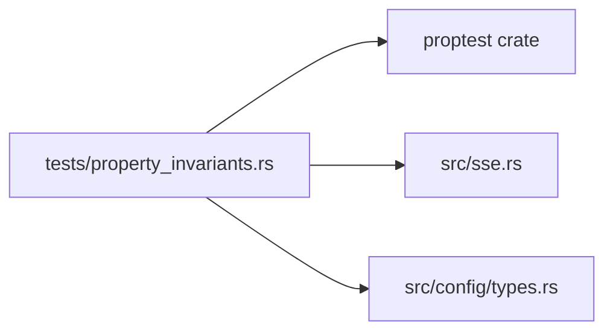
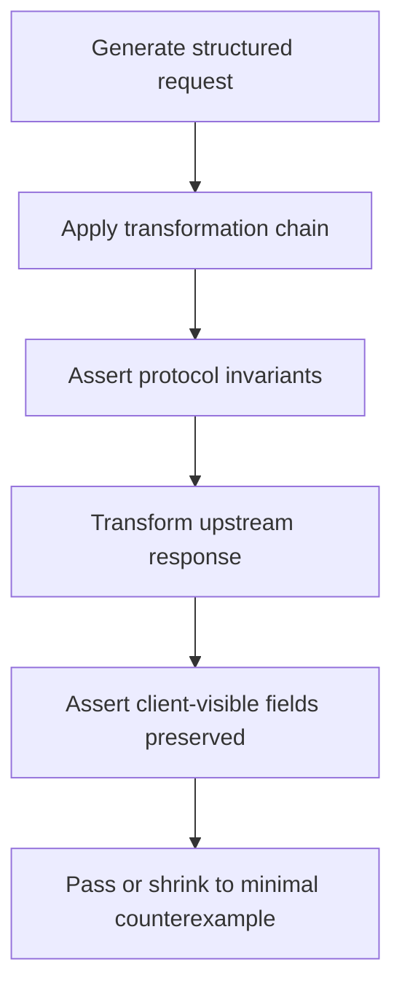

# Property-Based Testing

<cite>
**Referenced Files in This Document**
- [property_invariants.rs](file://tests/property_invariants.rs)
- [sse.rs](file://src/sse.rs)
- [types.rs](file://src/config/types.rs)
- [Cargo.toml](file://Cargo.toml)
- [property_invariants.txt](file://proptest-regressions/property_invariants.txt)
</cite>

## Table of Contents
1. [Introduction](#introduction)
2. [Project Structure](#project-structure)
3. [Core Components](#core-components)
4. [Architecture Overview](#architecture-overview)
5. [Detailed Component Analysis](#detailed-component-analysis)
6. [Dependency Analysis](#dependency-analysis)
7. [Performance Considerations](#performance-considerations)
8. [Troubleshooting Guide](#troubleshooting-guide)
9. [Conclusion](#conclusion)

## Introduction
This document explains how property-based testing is used in CCR-Rust with `proptest`. It focuses on the existing property tests, the invariants they assert, and how those invariants relate to real system behavior: streaming Server-Sent Events framing, retry backoff bounds, and the broader idea of request/response transformation consistency.

The central idea is simple: instead of writing one input per test, write a rule that must hold for many inputs generated automatically. For example, an SSE frame serialized into bytes, split at arbitrary boundaries, and decoded should reconstruct exactly the original frame. A retry delay should never exceed its configured ceiling and should never decrease as attempts increase.

These properties are stronger than single-case assertions because they cover edge cases that humans rarely think of, such as empty event names, carriage returns inside data, malformed frames, and boundary splits between line endings.

## Project Structure
Property-based tests live under `tests/`, while the library code they exercise lives under `src/`. The regression seed file lives under `proptest-regressions/` so that known failures are replayed automatically.

**Diagram sources**
- [Cargo.toml:68-68](file://Cargo.toml#L68-L68)
- [property_invariants.rs:1-138](file://tests/property_invariants.rs#L1-L138)
- [sse.rs:1-345](file://src/sse.rs#L1-L345)
- [types.rs:646-975](file://src/config/types.rs#L646-L975)
- [property_invariants.txt:1-7](file://proptest-regressions/property_invariants.txt#L1-L7)

**Section sources**
- [Cargo.toml:68-68](file://Cargo.toml#L68-L68)
- [property_invariants.rs:1-138](file://tests/property_invariants.rs#L1-L138)
- [property_invariants.txt:1-7](file://proptest-regressions/property_invariants.txt#L1-L7)

## Core Components
CCR-Rust’s current property-based testing effort centers on two subsystems:

| Area | Property tested | What it protects |
|---|---|---|
| SSE framing | Serializing, splitting, and decoding preserves exact frames | Streaming protocol compliance and byte-split safety |
| Retry backoff | Delays are bounded and non-decreasing | Stable retry behavior even with unusual configuration values |

### SSE Frame Invariant
The main invariant is:

> If an `SseFrame` is serialized, then any partition of the resulting bytes into consecutive chunks can be fed incrementally to `SseFrameDecoder`, and the decoded sequence equals the original frame.

This matters because network buffers, proxies, and operating systems can deliver SSE bytes at arbitrary positions. The decoder must not synthesize events, lose content, or corrupt multi-line data just because a chunk boundary falls in the middle of a line.

### Retry Backoff Invariants
Two related invariants are tested:

1. Every delay returned by `TierRetryConfig::backoff_duration` is less than or equal to the configured maximum.
2. For successive attempts, the delay never decreases.

A third unit test covers the degenerate case where the configured ceiling is below the base backoff; in that case, all attempts return the same constant ceiling value.

**Section sources**
- [property_invariants.rs:9-62](file://tests/property_invariants.rs#L9-L62)
- [property_invariants.rs:64-84](file://tests/property_invariants.rs#L64-L84)
- [sse.rs:30-45](file://src/sse.rs#L30-L45)
- [sse.rs:47-114](file://src/sse.rs#L47-L114)
- [types.rs:698-713](file://src/config/types.rs#L698-L713)
- [types.rs:890-898](file://src/config/types.rs#L890-L898)

## Architecture Overview
The property tests form a thin verification layer around core runtime logic. They do not start HTTP servers or call external providers; instead, they operate on in-memory structures.

**Diagram sources**
- [property_invariants.rs:9-44](file://tests/property_invariants.rs#L9-L44)
- [sse.rs:30-45](file://src/sse.rs#L30-L45)
- [sse.rs:47-114](file://src/sse.rs#L47-L114)

For retry backoffs, the flow is simpler:

**Diagram sources**
- [property_invariants.rs:46-62](file://tests/property_invariants.rs#L46-L62)
- [types.rs:698-713](file://src/config/types.rs#L698-L713)
- [types.rs:890-898](file://src/config/types.rs#L890-L898)

## Detailed Component Analysis

### SSE Framing Property Test
The test constructs an `SseFrame`, serializes it using `to_sse_string`, then simulates network fragmentation by computing cut points across the wire string. Each adjacent pair of cut points becomes a window passed to the decoder. The final assertion requires that only one frame is produced and that it matches the original frame.

Key design decisions visible in this test:

- Event names may be empty, which corresponds to `None` in `SseFrame`.
- Data may contain multiple lines joined by newlines.
- Carriage returns are excluded from generated data because the wire format does not allow a bare CR inside a field value.
- Cut seeds are normalized to valid indices and deduplicated so the windows cover every possible fragment boundary.

**Diagram sources**
- [sse.rs:30-45](file://src/sse.rs#L30-L45)
- [sse.rs:47-114](file://src/sse.rs#L47-L114)
- [property_invariants.rs:9-44](file://tests/property_invariants.rs#L9-L44)

#### Why This Is Meaningful
Streaming protocol correctness cannot be fully validated by checking a few fixed payloads. Real streams may arrive as one-byte fragments, as large batches, or as partial lines. This property captures the essential requirement: the wire representation and incremental decoder form a consistent round-trip over arbitrary chunk boundaries.

**Section sources**
- [property_invariants.rs:9-44](file://tests/property_invariants.rs#L9-L44)
- [sse.rs:30-45](file://src/sse.rs#L30-L45)
- [sse.rs:47-114](file://src/sse.rs#L47-L114)

### Retry Backoff Property Test
This property generates a base backoff, a multiplier, an extra ceiling, and an attempt number. It builds `TierRetryConfig`, computes the delay for the given attempt, asserts the delay does not exceed the ceiling, and asserts monotonicity when comparing with the previous attempt.

Important constraints:

- The base backoff starts at 1 millisecond.
- The multiplier is bounded away from zero to avoid pathological floating-point behavior.
- The ceiling is derived from `base_ms + max_extra_ms`, keeping the relationship between parameters explicit.
- Attempts range up to 24, covering both early retries and late retries after repeated failures.

**Diagram sources**
- [property_invariants.rs:46-62](file://tests/property_invariants.rs#L46-L62)
- [types.rs:698-713](file://src/config/types.rs#L698-L713)
- [types.rs:890-898](file://src/config/types.rs#L890-L898)

**Section sources**
- [property_invariants.rs:46-84](file://tests/property_invariants.rs#L46-L84)
- [types.rs:698-713](file://src/config/types.rs#L698-L713)
- [types.rs:890-898](file://src/config/types.rs#L890-L898)

### Unit Tests Complementing Properties
Several deterministic unit tests complement the property tests:

| Test purpose | File location |
|---|---|
| Complete frame drains while partial tail remains buffered | `tests/property_invariants.rs` |
| LF frame survives a split after the newline | `tests/property_invariants.rs` |
| CRLF line endings survive a split after the carriage return | `tests/property_invariants.rs` |
| Malformed oversized frames are discarded safely | `src/sse.rs` |
| Large batches of valid frames are preserved | `src/sse.rs` |
| Discarded frames resume at the next boundary | `src/sse.rs` |
| Highly fragmented one-byte-at-a-time input decodes correctly | `src/sse.rs` |

These tests are valuable because they encode precise expected outputs that would be harder to express purely as high-level invariants. Together with properties, they provide both broad coverage and targeted guarantees.

**Section sources**
- [property_invariants.rs:86-138](file://tests/property_invariants.rs#L86-L138)
- [sse.rs:217-345](file://src/sse.rs#L217-L345)

## Dependency Analysis
The property tests depend directly on:

- `proptest` for input generation and shrinking.
- `ccr_rust::config::TierRetryConfig` for retry semantics.
- `ccr_rust::sse::{SseFrame, SseFrameDecoder}` for streaming framing.

**Diagram sources**
- [property_invariants.rs:1-10](file://tests/property_invariants.rs#L1-L10)
- [Cargo.toml:68-68](file://Cargo.toml#L68-L68)

There are no `Arbitrary` implementations for `SseFrame` or `TierRetryConfig` in the repository snapshot analyzed here. Instead, the property test manually constructs these values from proptest-generated primitives. This keeps the generators close to the invariants being tested and avoids accidental generator drift.

**Section sources**
- [property_invariants.rs:1-10](file://tests/property_invariants.rs#L1-L10)
- [Cargo.toml:68-68](file://Cargo.toml#L68-L68)

## Performance Considerations
Property tests can become expensive if generators produce too much data or if shrinking takes too long. The current tests are intentionally modest:

- SSE data uses a small collection of short lines.
- Cut seeds are limited to a small number.
- Attempt numbers stop at 24.
- Retry multipliers and ceilings are bounded ranges rather than unbounded floats or integers.

When adding new properties, prefer:

- Small but meaningful value ranges.
- Explicit upper bounds on strings, collections, and durations.
- Separate heavy integration scenarios from fast unit-level properties.
- Using `prop_assume!` carefully to reject invalid combinations without silently accepting them.

[No sources needed since this section provides general guidance]

## Troubleshooting Guide

### Interpreting a Regression Failure
When a property test shrinks to a minimal failing input, `proptest` records a seed in `proptest-regressions/property_invariants.txt`. That seed is replayed before novel cases, ensuring that once a bug is found, it stays found.

The existing regression entry documents a failure involving an empty event and a carriage-return-only data line. Even though the property generator excludes CR from data, regression seeds preserve historical failures that may have been introduced through other paths or changed assumptions.

Steps to handle a regression:

1. Run the failing property test locally to reproduce the shrunk input.
2. Identify whether the failure is a real invariant violation or an overly strict property.
3. Fix the implementation if the invariant is correct.
4. Update the property or generator if the invariant was mis-specified.
5. Commit the updated regression seed unless you intentionally removed the failure case.

**Section sources**
- [property_invariants.txt:1-7](file://proptest-regressions/property_invariants.txt#L1-L7)
- [property_invariants.rs:9-44](file://tests/property_invariants.rs#L9-L44)

### Common Pitfalls When Writing New Properties
| Problem | Symptom | Remedy |
|---|---|---|
| Generator produces only easy cases | No failures even when bugs exist | Add corner cases like empty strings, large collections, negative-feeling numeric ranges, or boundary splits |
| Property is too weak | Fails only under unrealistic conditions | Strengthen invariants to cover ordering, bounds, idempotence, or round-trips |
| Shrinking takes too long | Tests appear stuck | Reduce value ranges, limit collection sizes, or split into smaller properties |
| Flaky timing-dependent behavior | Random failures in non-deterministic code | Avoid wall-clock time in properties; use controlled clocks or pure functions |
| Overfitting to a specific bug | Only one narrow input fails | Generalize the failing input into a meaningful family of inputs |

[No sources needed since this section provides general guidance]

## Relationship Between Request/Response Transformation Consistency and Current Properties
Although the current property tests focus on SSE framing and retry backoff, the broader goal for CCR-Rust includes request/response transformation consistency. A useful property pattern for transformations is:

> Applying a transformation chain to a request should produce a downstream-compatible request, and applying the corresponding response transformation to the upstream response should preserve semantic fields required by the client-facing protocol.

This has not yet been expressed as a proptest property in the analyzed files, but it can be modeled similarly to the SSE invariant: generate structured requests, apply transformations, and assert protocol-level invariants such as required fields, allowed enum values, size limits, and event sequencing.

[No sources needed since this diagram shows conceptual workflow, not actual code structure]

## Best Practices for Maintaining Property Test Suites
1. **Start with an invariant, not an input.** Ask what must remain true across many inputs.
2. **Keep generators close to the domain.** Use small primitives and compose them into meaningful structures.
3. **Prefer round-trip and monotonicity invariants.** Serialization round-trips and non-decreasing delays are strong, understandable rules.
4. **Use unit tests for exact outputs and properties for families of inputs.** Deterministic assertions complement probabilistic coverage.
5. **Treat regression seeds as part of the contract.** A committed seed means “this failure must not recur.”
6. **Review failed shrinks regularly.** Shrinks often reveal the simplest explanation for why an invariant broke.
7. **Avoid fragile properties.** Do not depend on randomness, timestamps, or process-global state unless explicitly seeded and isolated.
8. **Document the intent of each property.** A comment explaining the invariant helps future maintainers understand whether a failure is a bug or a design change.

[No sources needed since this section provides general guidance]

## Conclusion
CCR-Rust’s property-based testing currently validates two important operational invariants:

- SSE frames survive serialization and arbitrary network chunk boundaries.
- Retry backoff delays stay within their configured ceiling and do not decrease over attempts.

These tests are lightweight, focused, and closely tied to the underlying streaming and retry implementation. The regression seed file ensures discovered failures are remembered. Future work can extend this approach to request/response transformation consistency by defining generators for structured requests and asserting protocol-level invariants after transformation.

[No sources needed since this section summarizes without analyzing specific files]