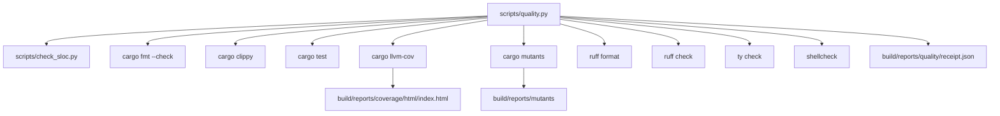
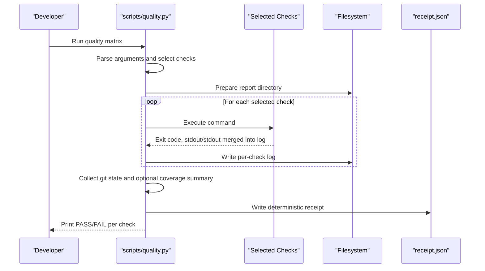
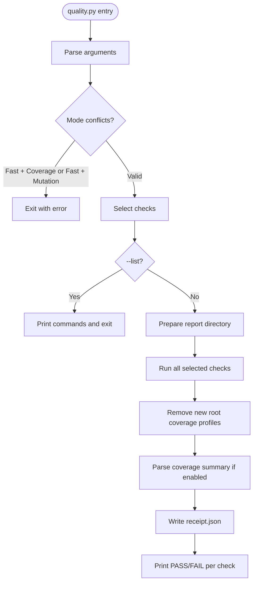
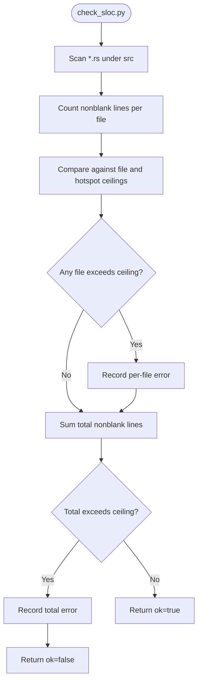
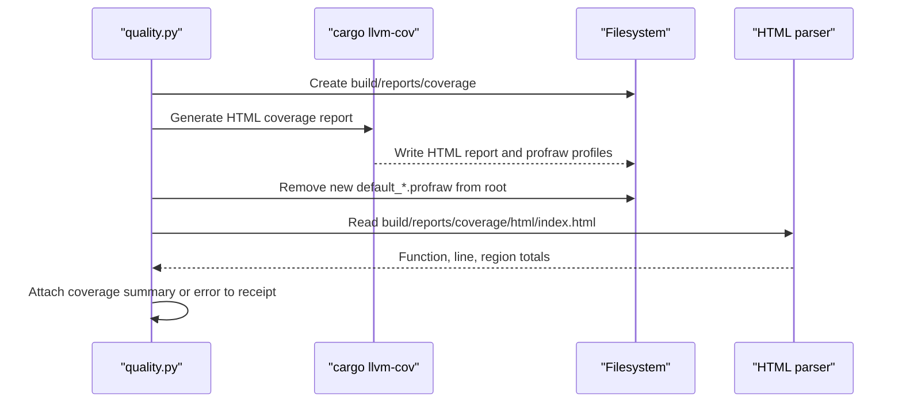
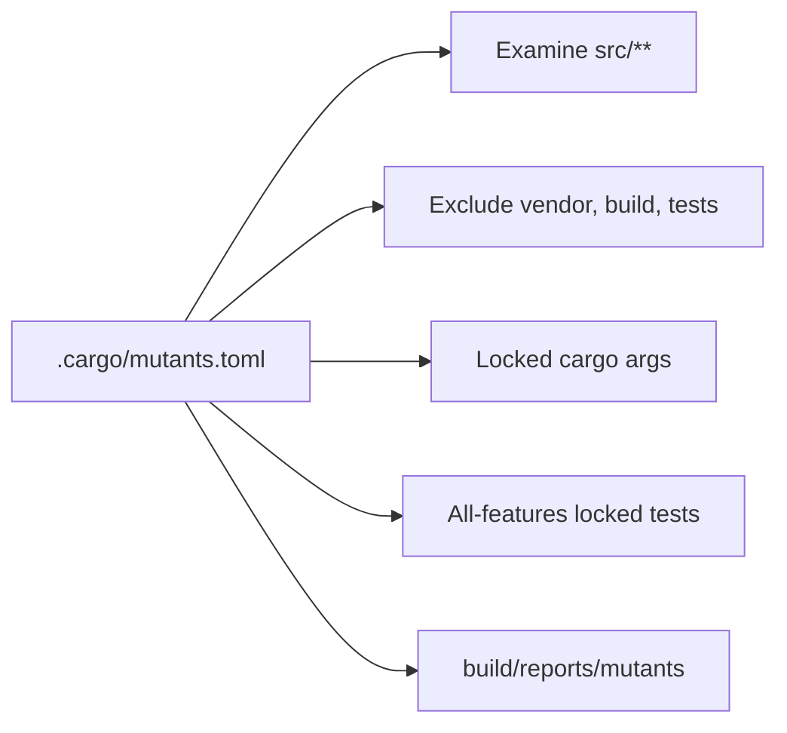
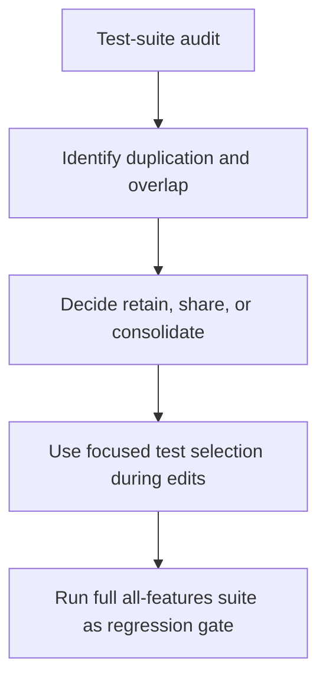
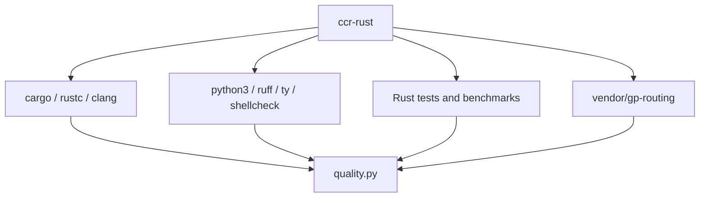

# Quality Metrics and Assessment

<cite>
**Referenced Files in This Document**
- [scripts/quality.py](file://scripts/quality.py)
- [scripts/check_sloc.py](file://scripts/check_sloc.py)
- [scripts/test_quality_matrix.py](file://scripts/test_quality_matrix.py)
- [docs/quality-matrix.md](file://docs/quality-matrix.md)
- [docs/test-suite-audit.md](file://docs/test-suite-audit.md)
- [.cargo/mutants.toml](file://.cargo/mutants.toml)
- [ruff.toml](file://ruff.toml)
- [Cargo.toml](file://Cargo.toml)
- [CONTRIBUTING.md](file://CONTRIBUTING.md)
- [evidence/quality-matrix-20261013.md](file://evidence/quality-matrix-20261013.md)
- [evidence/quality-standard-20261019.md](file://evidence/quality-standard-20261019.md)
</cite>

## Table of Contents
1. [Introduction](#introduction)
2. [Project Structure](#project-structure)
3. [Core Components](#core-components)
4. [Architecture Overview](#architecture-overview)
5. [Detailed Component Analysis](#detailed-component-analysis)
6. [Dependency Analysis](#dependency-analysis)
7. [Performance Considerations](#performance-considerations)
8. [Troubleshooting Guide](#troubleshooting-guide)
9. [Conclusion](#conclusion)
10. [Appendices](#appendices)

## Introduction
This document explains CCR-Rust’s quality assessment framework. It covers the Python-based quality matrix, code coverage analysis, Rust source-line SLOC tracking, mutation diagnostics, test audit practices, and how to interpret and maintain the resulting quality reports. The goal is to make it possible for both new contributors and experienced maintainers to run checks locally, understand what passes or fails, and improve quality scores over time without introducing regressions or hidden technical debt.

The framework is intentionally deterministic and offline by default: it does not call live model providers. Coverage and mutation modes are explicit opt-ins because they require additional tools and substantially more execution time.

## Project Structure
Quality-related assets are concentrated in a small set of files:

| Area | Responsibility |
| --- | --- |
| `scripts/quality.py` | Orchestrates the full quality matrix, writes the receipt, and collects per-check logs. |
| `scripts/check_sloc.py` | Enforces Rust source-line growth limits through a ratchet and hotspot ceilings. |
| `scripts/test_quality_matrix.py` | Validates dispatcher behavior, mode composition, paths, and report parsing. |
| `.cargo/mutants.toml` | Configures mutation testing scope and output location. |
| `ruff.toml` | Pins Python lint/format rules and per-file exceptions. |
| `docs/quality-matrix.md` | Operational contract describing commands, boundaries, and release gates. |
| `docs/test-suite-audit.md` | Records duplication audit findings and validation workflow. |
| `Cargo.toml` | Declares features and dev-dependencies used by tests and benchmarks. |
| `CONTRIBUTING.md` | Documents local workflows and recommended developer commands. |

**Diagram sources**
- [scripts/quality.py:1-200](file://scripts/quality.py#L1-L200)
- [scripts/quality.py:201-428](file://scripts/quality.py#L201-L428)
- [scripts/check_sloc.py:1-97](file://scripts/check_sloc.py#L1-L97)
- [.cargo/mutants.toml:1-9](file://.cargo/mutants.toml#L1-L9)
- [docs/quality-matrix.md:1-94](file://docs/quality-matrix.md#L1-L94)

**Section sources**
- [scripts/quality.py:1-428](file://scripts/quality.py#L1-L428)
- [scripts/check_sloc.py:1-97](file://scripts/check_sloc.py#L1-L97)
- [scripts/test_quality_matrix.py:1-212](file://scripts/test_quality_matrix.py#L1-L212)
- [docs/quality-matrix.md:1-94](file://docs/quality-matrix.md#L1-L94)
- [docs/test-suite-audit.md:1-46](file://docs/test-suite-audit.md#L1-L46)
- [ruff.toml:1-40](file://ruff.toml#L1-L40)
- [Cargo.toml:1-87](file://Cargo.toml#L1-L87)
- [CONTRIBUTING.md:1-112](file://CONTRIBUTING.md#L1-L112)

## Core Components
The quality framework has five primary components:

1. **Quality Matrix Dispatcher**: Selects and runs checks based on flags (`--fast`, `--coverage`, `--mutation`, `--list`). It never aborts after one failing check; instead, every check result is recorded.
2. **Rust Source-Line Ratchet**: Prevents uncontrolled growth in `src/**/*.rs` by enforcing a total ceiling, a per-file ceiling, and individual hotspot ceilings.
3. **Coverage Analyzer**: Generates LLVM source coverage when requested, enforces a line-coverage floor, parses the generated HTML totals, and cleans stale profiling artifacts.
4. **Mutation Diagnostics**: Runs mutation testing against production Rust code while excluding vendored, build, and test directories.
5. **Receipt Writer**: Produces a durable JSON receipt with metadata, per-check results, elapsed times, log paths, optional coverage summary, and an aggregate pass/fail indicator.

**Section sources**
- [scripts/quality.py:1-200](file://scripts/quality.py#L1-L200)
- [scripts/quality.py:201-428](file://scripts/quality.py#L201-L428)
- [scripts/check_sloc.py:1-97](file://scripts/check_sloc.py#L1-L97)
- [.cargo/mutants.toml:1-9](file://.cargo/mutants.toml#L1-L9)
- [docs/quality-matrix.md:1-94](file://docs/quality-matrix.md#L1-L94)

## Architecture Overview
The quality system follows a command-selection → execution → logging → reporting pattern.

**Diagram sources**
- [scripts/quality.py:201-428](file://scripts/quality.py#L201-L428)
- [docs/quality-matrix.md:1-94](file://docs/quality-matrix.md#L1-L94)

## Detailed Component Analysis

### Quality Matrix Dispatcher
The dispatcher defines a frozen `Check` dataclass carrying a name, command tuple, working directory, and environment overrides. It selects checks based on three modes:

| Mode | Behavior |
| --- | --- |
| Default | Formats, lints, type-checks, enforces SLOC, shellchecks, runs Clippy, unit/integration tests, no-default-features build, debug binary build, Python helper tests, and vendored GP routing tests. |
| Fast | Runs only property invariants for rapid iteration. |
| Coverage | Replaces normal Rust tests with LLVM source coverage and enforces a 75% line-coverage floor. |
| Mutation | Adds mutation diagnostics. Can compose with coverage, but cannot combine with fast mode. |

The dispatcher also supports `--list` to print selected commands without running them.

**Diagram sources**
- [scripts/quality.py:201-428](file://scripts/quality.py#L201-L428)

Key behaviors:
- Every check writes a log under `build/reports/quality/<name>.log`.
- Coverage mode removes newly created `default_*.profraw` profiles from the repository root.
- A failing check does not stop later checks; the final receipt includes an aggregate pass status.
- Git metadata failures are captured rather than failing the entire run.
- The receipt records revision, dirty state, platform, agent, mode, and optional coverage summary.

**Section sources**
- [scripts/quality.py:1-200](file://scripts/quality.py#L1-L200)
- [scripts/quality.py:201-428](file://scripts/quality.py#L201-L428)
- [scripts/test_quality_matrix.py:1-212](file://scripts/test_quality_matrix.py#L1-L212)

### Rust Source-Line SLOC Tracking
The SLOC tracker prevents uncontrolled growth in Rust source files. It counts nonblank lines across `src/**/*.rs` and compares them against three limits:

| Limit | Purpose |
| --- | --- |
| Total ceiling | Caps total nonblank Rust source lines at a measured baseline. |
| File ceiling | Caps every file at 2,500 nonblank lines. |
| Hotspot ceilings | Gives the largest existing files individually tracked ceilings. |

The script returns machine-readable JSON when invoked with `--json`, otherwise prints a human-readable summary plus errors.

**Diagram sources**
- [scripts/check_sloc.py:1-97](file://scripts/check_sloc.py#L1-L97)

Maintenance guidance:
- Lowering a ceiling is appropriate when refactoring shrinks a measured baseline.
- Raising a ceiling should generally be rejected unless a large hotspot has been split first.
- The current total ceiling is pinned to a hardened baseline and is treated as a ratchet, not a soft target.

**Section sources**
- [scripts/check_sloc.py:1-97](file://scripts/check_sloc.py#L1-L97)

### Code Coverage Analysis
Coverage is opt-in. When `--coverage` is enabled:
- The dispatcher prepares the coverage report directory.
- It replaces normal Rust tests with `cargo llvm-cov`.
- It sets `CARGO_TARGET_DIR` so coverage builds do not pollute the normal target directory.
- It enforces a 75% line-coverage floor through `--fail-under-lines`.
- After execution, it deletes any newly created root-level `default_*.profraw` profiles.
- It attempts to parse the generated HTML index and attach function, line, and region totals to the receipt.

The coverage parser matches header labels rather than assuming column positions, making it resilient to table formatting changes. If the HTML summary is unreadable, the receipt records a `coverage_summary_error` instead of silently omitting coverage information.

**Diagram sources**
- [scripts/quality.py:201-428](file://scripts/quality.py#L201-L428)

Current enforcement:
- Line coverage floor: 75%.
- Coverage is diagnostic-only in normal usage; it becomes part of the matrix only when explicitly requested.
- Historical evidence shows line coverage around the high 70s, well above the floor.

**Section sources**
- [scripts/quality.py:1-200](file://scripts/quality.py#L1-L200)
- [scripts/quality.py:201-428](file://scripts/quality.py#L201-L428)
- [evidence/quality-matrix-20261013.md:1-75](file://evidence/quality-matrix-20261013.md#L1-L75)

### Mutation Testing Effectiveness
Mutation testing is configured to focus on production Rust code and exclude vendored dependencies, generated outputs, and tests. Its configuration:

| Setting | Meaning |
| --- | --- |
| `examine_globs` | `src/**` |
| `exclude_globs` | `vendor/**`, `build/**`, `tests/**` |
| `additional_cargo_args` | `--locked` |
| `additional_cargo_test_args` | `--all-features --locked` |
| `all_features` | Enabled |
| `test_workspace` | Enabled |
| `output` | `build/reports/mutants` |

Mutation testing is not a routine merge gate. Evidence documents show that even a focused module can produce many survivors, timeouts, and unviable mutations. Survivors indicate areas where tests may be stronger, but they do not invalidate a passing deterministic matrix.

**Diagram sources**
- [.cargo/mutants.toml:1-9](file://.cargo/mutants.toml#L1-L9)

**Section sources**
- [.cargo/mutants.toml:1-9](file://.cargo/mutants.toml#L1-L9)
- [docs/quality-matrix.md:1-94](file://docs/quality-matrix.md#L1-L94)
- [evidence/quality-matrix-20261013.md:1-75](file://evidence/quality-matrix-20261013.md#L1-L75)

### Python Quality Rules
Python formatting and linting are controlled by `ruff.toml`. The rule set is pinned explicitly so defaults cannot silently weaken standards. Per-file ignores document deliberate patterns:
- Benchmark polling tolerates best-effort exceptions.
- Provider validation reports experiments separately.
- Scripts deliberately shell out and open operator-supplied URLs under documented constraints.

Type checking is scoped to `scripts`, which is the only Python tree validated by the default matrix and free of third-party import requirements. Optional packages needed by benchmarks and provider validation are intentionally excluded from the default type-check boundary.

**Section sources**
- [ruff.toml:1-40](file://ruff.toml#L1-L40)
- [docs/quality-matrix.md:1-94](file://docs/quality-matrix.md#L1-L94)

### Test Suite Audit Process
The test suite audit establishes that duplicated test execution is separate from semantic overlap between differently named tests. The audit confirmed that executed test names occurred once at the snapshot used, then provided dispositions for fixtures and legacy modules.

Key points:
- Identical streaming fixtures should share builders and parsers rather than duplicate execution.
- Legacy and canonical OpenAI-to-Anthropic response tests remain distinct because they cover different public implementations.
- Frontend detector tests and integration detection tests exercise different contracts.
- Focused test selection helps during editing, while the full all-features suite remains the regression gate.

**Diagram sources**
- [docs/test-suite-audit.md:1-46](file://docs/test-suite-audit.md#L1-L46)

**Section sources**
- [docs/test-suite-audit.md:1-46](file://docs/test-suite-audit.md#L1-L46)

## Dependency Analysis
Quality checks depend on both Rust toolchain utilities and Python tooling:

| Tool | Role |
| --- | --- |
| `cargo fmt` | Rust formatting boundary. |
| `cargo clippy` | Rust lint boundary with warnings as errors. |
| `cargo test` | Unit and mocked integration tests. |
| `cargo llvm-cov` | Opt-in source coverage. |
| `cargo mutants` | Opt-in mutation diagnostics. |
| `ruff` | Python formatting and linting. |
| `ty` | Python type checking for `scripts`. |
| `shellcheck` | Shell script linting. |
| `git` | Revision and dirty-state metadata. |

The project declares standard development dependencies such as `proptest`, `criterion`, `tempfile`, `tower`, `wiremock`, and optional telemetry features. The vendored `gp-routing` package has its own lockfile and is tested independently.

**Diagram sources**
- [Cargo.toml:1-87](file://Cargo.toml#L1-L87)
- [scripts/quality.py:1-200](file://scripts/quality.py#L1-L200)
- [docs/quality-matrix.md:1-94](file://docs/quality-matrix.md#L1-L94)

**Section sources**
- [Cargo.toml:1-87](file://Cargo.toml#L1-L87)
- [scripts/quality.py:1-200](file://scripts/quality.py#L1-L200)
- [docs/quality-matrix.md:1-94](file://docs/quality-matrix.md#L1-L94)

## Performance Considerations
The default matrix is designed for local iteration and CI-equivalent validation, but some checks are expensive:

| Check | Relative cost | Recommendation |
| --- | --- | --- |
| Formatting and linting | Low | Run frequently. |
| Type checking scripts | Low | Run before pushing. |
| SLOC ratchet | Low | Run with the default matrix. |
| Rust tests | Medium | Run locally before PR submission. |
| No-default-features build | Medium | Run when changing feature boundaries. |
| Debug binary build | Medium | Run when changing build configuration. |
| Python helper tests | Medium | Requires checkout-built binary. |
| LLVM coverage | High | Use only when improving coverage. |
| Mutation testing | Very high | Use only as a targeted diagnostic. |

Optimization strategies:
- Use `--fast` when iterating on property invariants.
- Avoid `--coverage` and `--mutation` unless investigating coverage gaps or mutation survivors.
- Use `--list` to verify the selected command sequence without executing it.
- Keep CI runs deterministic by pinning tool versions and using locked manifests.

[No sources needed since this section provides general guidance]

## Troubleshooting Guide

### Common Local Failures

| Symptom | Likely Cause | Resolution |
| --- | --- | --- |
| `--fast` combined with `--coverage` or `--mutation` | Mutually exclusive mode conflict | Drop `--fast`; use either focused mode or a full diagnostic mode. |
| Missing `build/reports/quality/receipt.json` | Interrupted run or missing report directory preparation | Re-run the desired mode; receipts are written atomically after all checks finish. |
| Coverage HTML summary missing | Coverage did not generate the report or path changed | Run with `--coverage` again and inspect the coverage log. |
| Stale coverage percentages | Previous HTML index was reused | The dispatcher deletes the old HTML index before generating a new report. |
| Root `default_*.profraw` files remain | Coverage profile cleanup did not run or ran outside the dispatcher | Remove them manually or rerun through `scripts/quality.py --coverage`. |
| Python helper tests cannot find the binary | `CCR_TEST_BINARY` or target directory mismatch | Ensure the debug binary exists at `target/debug/ccr-rust`. |
| SLOC check fails | New code increased nonblank lines beyond ceiling | Split hotspots or refactor; raising the ceiling requires justification. |
| Mutation testing survives too many mutants | Weak assertions or missing edge cases | Add focused tests targeting mutated branches. |

### Interpreting the Receipt
Open `build/reports/quality/receipt.json` after a run. Important fields include:

| Field | Meaning |
| --- | --- |
| `recorded_at` | UTC timestamp when the receipt was written. |
| `agent` | Caller identity, configurable via `QUALITY_AGENT`. |
| `mode` | Enabled modes such as `fast`, `coverage`, or `mutation`. |
| `platform` | Python platform string. |
| `source_revision` | Git revision used for the run. |
| `source_dirty` | List of modified or untracked paths. |
| `scope` | Human-readable description confirming offline behavior. |
| `checks` | Ordered list of check results. |
| `aggregate_passed` | Whether every check exited successfully. |
| `coverage_summary` | Optional parsed totals when coverage is enabled. |
| `coverage_summary_error` | Optional explanation when coverage totals could not be parsed. |

Each check result contains:
- `name`: Check identifier.
- `command`: Executed command.
- `exit_code`: Zero means success; nonzero means failure.
- `elapsed_seconds`: Approximate wall-clock duration.
- `log`: Path relative to the repository root.

### Improving Quality Scores
- **Low Rust coverage**: Add targeted integration tests for uncovered protocols, streams, and error paths. Prefer mocking upstreams rather than calling live providers.
- **Mutation survivors**: Inspect the mutation report and add assertions that kill surviving mutants. Focus on boundary conditions, error propagation, and stream termination.
- **SLOC violations**: Split large files, extract helpers, or reduce complexity. Do not raise ceilings just to admit new code.
- **Clippy warnings**: Fix warnings directly; the matrix treats warnings as errors.
- **Python lint/format/type issues**: Run `ruff format`, `ruff check`, and `ty check` over the relevant trees. Respect per-file ignore reasons.
- **Shell issues**: Run `shellcheck` over the tracked shell entry points.

### Establishing New Quality Thresholds
- **Coverage floor**: Adjust only after analyzing whether low coverage reflects untested behavior versus unrealistic expectations.
- **SLOC ceilings**: Lower when refactors shrink baselines; avoid raising them unless a large hotspot has been split.
- **Rule sets**: Extend `ruff.toml` with explicit rules and per-file exceptions only when justified by operator-facing behavior.
- **Release gates**: Treat dependency advisory scans as separate from the default matrix because they require network access and external databases.

**Section sources**
- [scripts/quality.py:201-428](file://scripts/quality.py#L201-L428)
- [scripts/check_sloc.py:1-97](file://scripts/check_sloc.py#L1-L97)
- [ruff.toml:1-40](file://ruff.toml#L1-L40)
- [docs/quality-matrix.md:1-94](file://docs/quality-matrix.md#L1-L94)
- [evidence/quality-standard-20261019.md:1-110](file://evidence/quality-standard-20261019.md#L1-L110)

## Conclusion
CCR-Rust’s quality framework is a layered system: deterministic offline checks form the baseline, Rust formatting and linting enforce style and correctness, SLOC tracking prevents code growth without refactoring, coverage measures exercised code paths, and mutation testing highlights weak assertions. The receipt provides a durable record of what ran, how long it took, and whether it passed.

For daily work, use the default matrix. For deep dives, enable coverage or mutation selectively. For maintenance, treat ceilings and thresholds as engineering contracts: lower them after refactoring, raise them only with strong justification, and keep the matrix offline and deterministic.

[No sources needed since this section summarizes without analyzing specific files]

## Appendices

### Running Quality Checks Locally

| Goal | Command |
| --- | --- |
| Default quality matrix | `python3 scripts/quality.py` |
| Fast property-invariant iteration | `python3 scripts/quality.py --fast` |
| Coverage mode | `python3 scripts/quality.py --coverage` |
| Mutation diagnostics | `python3 scripts/quality.py --mutation` |
| List selected checks | `python3 scripts/quality.py --list` |
| Rust tests | `cargo test --all-features --locked` |
| Rust formatting | `cargo fmt` |
| Rust linting | `cargo clippy --all-features --all-targets --locked -- -D warnings` |
| Python formatting | `ruff format --check benchmarks scripts tests/provider_validation` |
| Python linting | `ruff check benchmarks scripts tests/provider_validation` |
| Python type checking | `ty check scripts` |
| Shell linting | `shellcheck benchmarks/run_stress_test.sh examples/smoke-test.sh` |

**Section sources**
- [CONTRIBUTING.md:1-112](file://CONTRIBUTING.md#L1-L112)
- [docs/quality-matrix.md:1-94](file://docs/quality-matrix.md#L1-L94)

### Quality Matrix Boundaries
The default matrix owns these boundaries:

| Boundary | Owner |
| --- | --- |
| Rust formatting | `cargo fmt --check` |
| Python formatting | `ruff format --check` |
| Python linting | `ruff check` |
| Python type checking | `ty check scripts` |
| Rust SLOC ratchet | `scripts/check_sloc.py --json` |
| Shell linting | `shellcheck` |
| Rust linting | `cargo clippy` |
| Rust tests | `cargo test --all-features --locked` |
| No-default-features build | `cargo check --no-default-features --locked` |
| Debug binary build | `cargo build --all-features --locked` |
| Python helper tests | `python3 -m unittest discover -s scripts -p test_*.py` |
| Vendored GP routing tests | `cargo test --manifest-path vendor/gp-routing/Cargo.toml --locked` |

**Section sources**
- [docs/quality-matrix.md:1-94](file://docs/quality-matrix.md#L1-L94)
- [scripts/quality.py:1-200](file://scripts/quality.py#L1-L200)