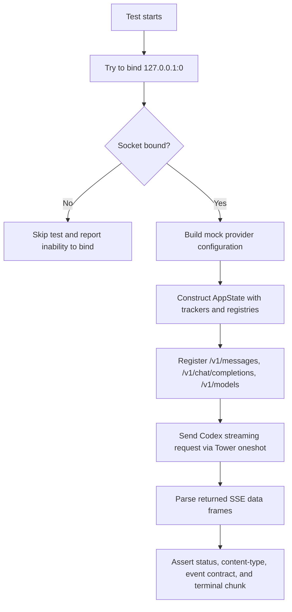
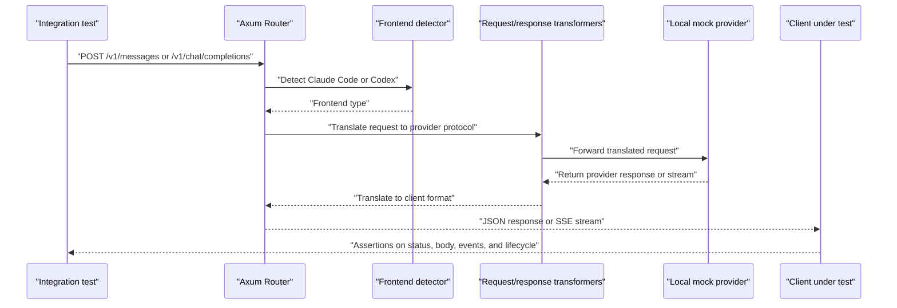
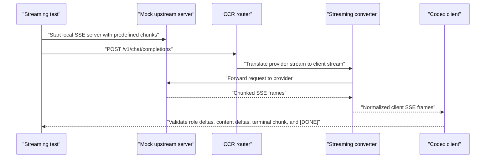
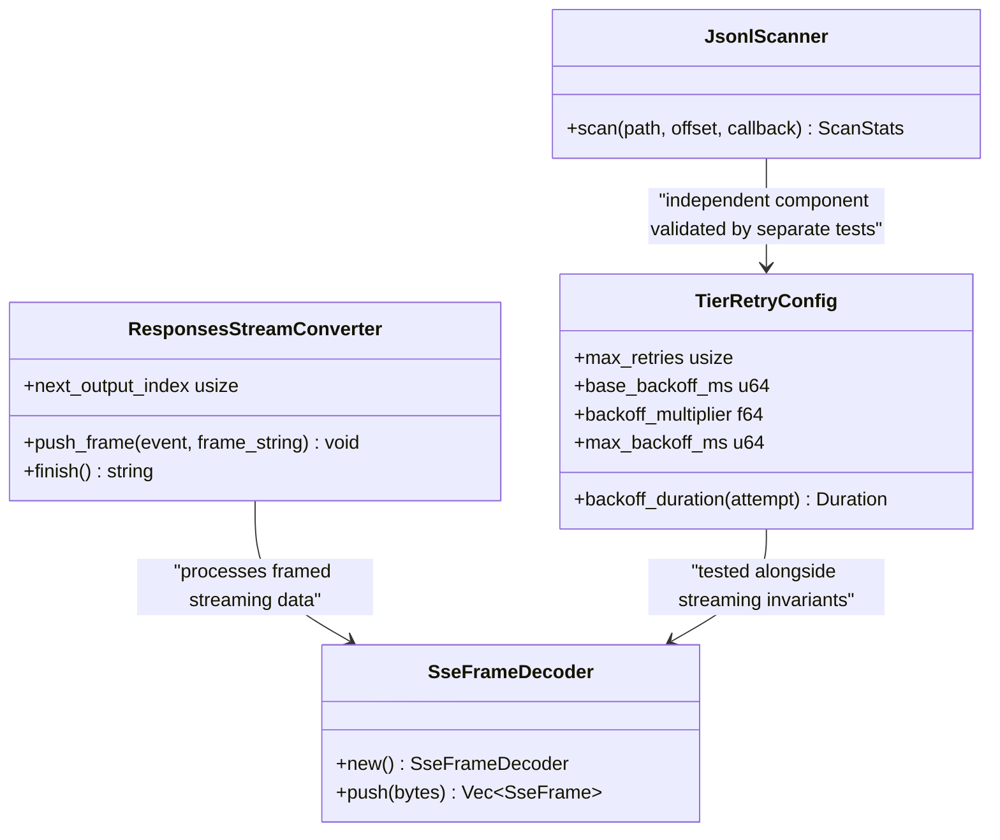
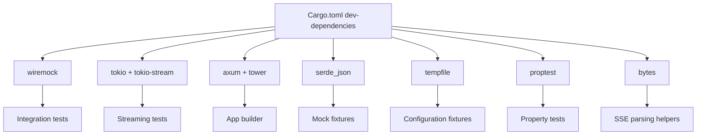

# Test Suite Architecture

<cite>
**Referenced Files in This Document**   
- [Cargo.toml](file://Cargo.toml)
- [tests/lib.rs](file://tests/lib.rs)
- [tests/support/mod.rs](file://tests/support/mod.rs)
- [tests/support/codex_stream.rs](file://tests/support/codex_stream.rs)
- [tests/mocks/claude_code_client.rs](file://tests/mocks/claude_code_client.rs)
- [tests/mocks/codex_client.rs](file://tests/mocks/codex_client.rs)
- [tests/integration_claude_code.rs](file://tests/integration_claude_code.rs)
- [tests/integration_codex.rs](file://tests/integration_codex.rs)
- [tests/integration_codex_stream.rs](file://tests/integration_codex_stream.rs)
- [tests/integration_codex_openai_stream.rs](file://tests/integration_codex_openai_stream.rs)
- [tests/integration_responses.rs](file://tests/integration_responses.rs)
- [tests/test_routing.rs](file://tests/test_routing.rs)
- [tests/test_failover_controls.rs](file://tests/test_failover_controls.rs)
- [tests/property_invariants.rs](file://tests/property_invariants.rs)
- [src/router/responses_api/incremental_stream/tests.rs](file://src/router/responses_api/incremental_stream/tests.rs)
- [src/router/dispatch/tests/endpoint_tests.rs](file://src/router/dispatch/tests/endpoint_tests.rs)
- [src/workers/stream_tests.rs](file://src/workers/stream_tests.rs)
</cite>

## Table of Contents
1. [Introduction](#introduction)
2. [Project Structure](#project-structure)
3. [Core Components](#core-components)
4. [Architecture Overview](#architecture-overview)
5. [Detailed Component Analysis](#detailed-component-analysis)
6. [Dependency Analysis](#dependency-analysis)
7. [Performance Considerations](#performance-considerations)
8. [Troubleshooting Guide](#troubleshooting-guide)
9. [Conclusion](#conclusion)
10. [Appendices](#appendices)

## Introduction
This document explains the CCR-Rust test suite architecture and testing strategy. The tests cover:

- Frontend detection for Claude Code and Codex clients.
- Request and response transformation between OpenAI, Anthropic, and internal formats.
- Streaming conversion from provider SSE to client-facing streaming responses.
- Router behavior, failover control surfaces, retry budgets, admission controls, and stickiness.
- Property-based invariants for streaming frame decoding and retry backoff.
- Unit tests for worker scanning logic and router endpoint construction.

The suite separates concerns into unit tests, integration tests against local mock servers, property tests, and in-module tests inside `src`. It uses a shared support module for common test helpers, explicit mock clients for request fixtures, and `wiremock` plus custom Axum services for controlled upstream behavior.

## Project Structure
The test tree is organized by responsibility rather than strictly by feature:

| Area | Purpose | Representative files |
|---|---|---|
| Root test entry | Re-exports public mock modules for other test crates | [tests/lib.rs](file://tests/lib.rs) |
| Shared test infrastructure | App builder, config builder, stream helper, SSE parser, environment skip guard | [tests/support/mod.rs](file://tests/support/mod.rs), [tests/support/codex_stream.rs](file://tests/support/codex_stream.rs) |
| Mock request fixtures | Realistic request payloads for Anthropic-style and OpenAI-style clients | [tests/mocks/claude_code_client.rs](file://tests/mocks/claude_code_client.rs), [tests/mocks/codex_client.rs](file://tests/mocks/codex_client.rs) |
| Integration tests | End-to-end router flows with mocked providers | [tests/integration_claude_code.rs](file://tests/integration_claude_code.rs), [tests/integration_codex.rs](file://tests/integration_codex.rs), [tests/integration_codex_stream.rs](file://tests/integration_codex_stream.rs), [tests/integration_codex_openai_stream.rs](file://tests/integration_codex_openai_stream.rs), [tests/integration_responses.rs](file://tests/integration_responses.rs) |
| Control-plane and routing tests | Retry configuration, deterministic failover, admission, EWMA, sticky sessions | [tests/test_routing.rs](file://tests/test_routing.rs), [tests/test_failover_controls.rs](file://tests/test_failover_controls.rs) |
| Property tests | Invariants over SSE frames and retry backoff | [tests/property_invariants.rs](file://tests/property_invariants.rs) |
| In-source unit tests | Internal components tested close to their implementation | [src/router/responses_api/incremental_stream/tests.rs](file://src/router/responses_api/incremental_stream/tests.rs), [src/router/dispatch/tests/endpoint_tests.rs](file://src/router/dispatch/tests/endpoint_tests.rs), [src/workers/stream_tests.rs](file://src/workers/stream_tests.rs) |

```mermaid
graph TB
    TestsLib["tests/lib.rs"]
    SupportMod["tests/support/mod.rs"]
    CodexStreamSupport["tests/support/codex_stream.rs"]
    ClaudeMock["tests/mocks/claude_code_client.rs"]
    CodexMock["tests/mocks/codex_client.rs"]
    IntegrationClaude["tests/integration_claude_code.rs"]
    IntegrationCodex["tests/integration_codex.rs"]
    IntegrationCodexStream["tests/integration_codex_stream.rs"]
    IntegrationCodexOpenaiStream["tests/integration_codex_openai_stream.rs"]
    IntegrationResponses["tests/integration_responses.rs"]
    RoutingTests["tests/test_routing.rs"]
    FailoverTests["tests/test_failover_controls.rs"]
    PropertyTests["tests/property_invariants.rs"]
    IncrementalTests["src/router/responses_api/incremental_stream/tests.rs"]
    DispatchTests["src/router/dispatch/tests/endpoint_tests.rs"]
    WorkerTests["src/workers/stream_tests.rs"]

    TestsLib --> SupportMod
    SupportMod --> CodexStreamSupport
    IntegrationClaude --> SupportMod
    IntegrationCodex --> SupportMod
    IntegrationCodexStream --> SupportMod
    IntegrationCodexOpenaiStream --> SupportMod
    IntegrationResponses --> SupportMod
    IntegrationClaude --> ClaudeMock
    IntegrationCodex --> CodexMock
    IntegrationCodexStream --> CodexMock
    IntegrationCodexOpenaiStream --> CodexMock
    RoutingTests --> SupportMod
    FailoverTests --> SupportMod
    PropertyTests --> SupportMod
```

**Diagram sources**
- [tests/lib.rs:1-6](file://tests/lib.rs#L1-L6)
- [tests/support/mod.rs:1-6](file://tests/support/mod.rs#L1-L6)
- [tests/support/codex_stream.rs:1-122](file://tests/support/codex_stream.rs#L1-L122)
- [tests/mocks/claude_code_client.rs:1-716](file://tests/mocks/claude_code_client.rs#L1-L716)
- [tests/mocks/codex_client.rs:1-375](file://tests/mocks/codex_client.rs#L1-L375)
- [tests/integration_claude_code.rs:1-1041](file://tests/integration_claude_code.rs#L1-L1041)
- [tests/integration_codex.rs:1-1488](file://tests/integration_codex.rs#L1-L1488)
- [tests/integration_codex_stream.rs:1-579](file://tests/integration_codex_stream.rs#L1-L579)
- [tests/integration_codex_openai_stream.rs:1-212](file://tests/integration_codex_openai_stream.rs#L1-L212)
- [tests/integration_responses.rs:1-1381](file://tests/integration_responses.rs#L1-L1381)
- [tests/test_routing.rs:1-2171](file://tests/test_routing.rs#L1-L2171)
- [tests/test_failover_controls.rs:1-751](file://tests/test_failover_controls.rs#L1-L751)
- [tests/property_invariants.rs:1-138](file://tests/property_invariants.rs#L1-L138)
- [src/router/responses_api/incremental_stream/tests.rs:1-91](file://src/router/responses_api/incremental_stream/tests.rs#L1-L91)
- [src/router/dispatch/tests/endpoint_tests.rs:1-18](file://src/router/dispatch/tests/endpoint_tests.rs#L1-L18)
- [src/workers/stream_tests.rs:1-286](file://src/workers/stream_tests.rs#L1-L286)

**Section sources**
- [tests/lib.rs:1-6](file://tests/lib.rs#L1-L6)
- [tests/support/mod.rs:1-6](file://tests/support/mod.rs#L1-L6)
- [tests/support/codex_stream.rs:1-122](file://tests/support/codex_stream.rs#L1-L122)

## Core Components
The core test infrastructure consists of three layers:

1. **Mock request fixtures** produce realistic request payloads without invoking real providers.
2. **Shared support utilities** build an Axum application wired to the router, construct test configuration, create streaming requests, parse SSE data frames, and skip tests when localhost binding is unavailable.
3. **Integration tests** compose these tools to validate frontend detection, protocol translation, streaming conversion, and control-plane behavior.

### Mock Clients
The mock clients are fixture generators, not network clients. They return `serde_json::Value` structures matching Anthropic or OpenAI request schemas so tests can assert on request shape, tool definitions, thinking blocks, system prompts, and streaming flags.

| Fixture module | Primary responsibility | Typical consumers |
|---|---|---|
| `tests/mocks/claude_code_client.rs` | Anthropic-style message, streaming, thinking, tool, forced-tool, and system-prompt request builders | Claude Code integration tests |
| `tests/mocks/codex_client.rs` | OpenAI-style chat completion, tool-enabled requests, streaming requests, tool definitions, and message constructors | Codex integration tests and streaming tests |

These fixtures encourage deterministic payloads and make assertions about model names, messages, tool schemas, and streaming flags explicit.

**Section sources**
- [tests/mocks/claude_code_client.rs:1-716](file://tests/mocks/claude_code_client.rs#L1-L716)
- [tests/mocks/codex_client.rs:1-375](file://tests/mocks/codex_client.rs#L1-L375)

### Shared Test Utilities
The shared support module exposes:

- `skip_if_localhost_bind_unavailable`: attempts to bind a local TCP socket and returns `true` when binding fails, allowing tests to abort early instead of flaking.
- `make_test_config`: builds a JSON configuration string containing a single mock provider, a default router target, and a short API timeout.
- `build_app`: constructs the router state and registers `/v1/messages`, `/v1/chat/completions`, `/v1/models`, and optionally metrics endpoints.
- `codex_stream_request_body`: produces the minimal OpenAI-style streaming request used by Codex-oriented tests.
- `parse_sse_data_frames`: normalizes line endings, splits SSE frames, strips `data:` prefixes, and joins multi-line data values.
- `make_codex_stream_request`: sends a POST to `/v1/chat/completions` through the test router using Tower’s `oneshot`.

**Diagram sources**
- [tests/support/codex_stream.rs:1-122](file://tests/support/codex_stream.rs#L1-L122)

**Section sources**
- [tests/support/mod.rs:1-6](file://tests/support/mod.rs#L1-L6)
- [tests/support/codex_stream.rs:1-122](file://tests/support/codex_stream.rs#L1-L122)

### Test Fixtures and Application Builder Pattern
Integration tests follow a consistent pattern:

1. Create a temporary directory and write a JSON configuration pointing at a local mock server.
2. Load the configuration through `ccr_rust::config::Config::from_file`.
3. Build an Axum `Router` with `AppState` populated with `EwmaTracker`, `TransformerRegistry`, active-stream counter, rate-limit tracker, admission tracker, retry budget, sticky-session tracker, shutdown timeout, and optional debug capture.
4. Mount routes for the relevant endpoints.
5. Send requests using `tower::ServiceExt::oneshot`.
6. Read response bodies as bytes and deserialize them for assertions.

This pattern appears across Claude Code, Codex, streaming, responses, routing, and failover tests.

**Section sources**
- [tests/integration_claude_code.rs:1-1041](file://tests/integration_claude_code.rs#L1-L1041)
- [tests/integration_codex.rs:1-1488](file://tests/integration_codex.rs#L1-L1488)
- [tests/integration_codex_stream.rs:1-579](file://tests/integration_codex_stream.rs#L1-L579)
- [tests/integration_codex_openai_stream.rs:1-212](file://tests/integration_codex_openai_stream.rs#L1-L212)
- [tests/integration_responses.rs:1-1381](file://tests/integration_responses.rs#L1-L1381)
- [tests/test_failover_controls.rs:1-751](file://tests/test_failover_controls.rs#L1-L751)

## Architecture Overview
At runtime, the router receives requests, detects the frontend, translates requests to the selected provider protocol, forwards them, and translates provider responses back to the client-facing format. The test suite validates this pipeline by replacing the real provider with a local mock server.

**Diagram sources**
- [tests/integration_claude_code.rs:1-1041](file://tests/integration_claude_code.rs#L1-L1041)
- [tests/integration_codex.rs:1-1488](file://tests/integration_codex.rs#L1-L1488)
- [tests/integration_codex_stream.rs:1-579](file://tests/integration_codex_stream.rs#L1-L579)
- [tests/integration_codex_openai_stream.rs:1-212](file://tests/integration_codex_openai_stream.rs#L1-L212)
- [tests/integration_responses.rs:1-1381](file://tests/integration_responses.rs#L1-L1381)

## Detailed Component Analysis

### Frontend Detection Tests
The Claude Code integration tests exercise header-based and payload-based detection. They verify that:

- Anthropic-specific headers identify Claude Code.
- Ambiguous OpenAI-style payloads are detected as Codex.
- User-Agent precedence rules apply.
- System-field and Anthropic-version fields do not incorrectly override codex-precedence rules where documented.

These tests call `detect_frontend` directly for pure detection scenarios and also run end-to-end HTTP requests through the router.

**Section sources**
- [tests/integration_claude_code.rs:1-1041](file://tests/integration_claude_code.rs#L1-L1041)

### Codex Non-Streaming Integration Tests
The Codex integration tests validate:

- Frontend detection by User-Agent.
- OpenAI-format request handling.
- Success envelope unwrapping.
- Response transformation back to OpenAI format.
- Interaction with a `wiremock` backend expecting OpenAI-shaped requests.

They use `wiremock::MockServer` to assert exact HTTP method, path, and JSON shape on the upstream side.

**Section sources**
- [tests/integration_codex.rs:1-1488](file://tests/integration_codex.rs#L1-L1488)

### Codex Streaming Conversion Tests
The streaming tests focus on protocol conversion between Anthropic SSE and OpenAI SSE:

- A local Axum service emits chunks representing Anthropic or OpenAI SSE frames.
- Chunks may split mid-frame; the decoder must reassemble them.
- The router converts Anthropic lifecycle events into OpenAI-compatible streaming events.
- Usage tokens appear only on the terminal OpenAI chunk.
- Anthropic lifecycle frames must not leak to OpenAI clients.
- `[DONE]` termination semantics are preserved.

The shared `parse_sse_data_frames` utility is used to normalize and inspect emitted SSE data.

**Diagram sources**
- [tests/integration_codex_stream.rs:1-579](file://tests/integration_codex_stream.rs#L1-L579)
- [tests/integration_codex_openai_stream.rs:1-212](file://tests/integration_codex_openai_stream.rs#L1-L212)
- [tests/support/codex_stream.rs:1-122](file://tests/support/codex_stream.rs#L1-L122)

**Section sources**
- [tests/integration_codex_stream.rs:1-579](file://tests/integration_codex_stream.rs#L1-L579)
- [tests/integration_codex_openai_stream.rs:1-212](file://tests/integration_codex_openai_stream.rs#L1-L212)

### Responses API Integration Tests
The responses integration tests validate OpenAI Responses API compatibility. They include:

- Custom SSE event parsing.
- A gated streaming server that pauses after the first chunk until a notification is received.
- Configuration variants for OpenAI and Anthropic protocols.
- Assertions about streamed event ordering, termination, and protocol-specific behavior.

These tests demonstrate how to construct asynchronous upstream streams using `tokio::sync::mpsc`, `ReceiverStream`, and `axum::serve`.

**Section sources**
- [tests/integration_responses.rs:1-1381](file://tests/integration_responses.rs#L1-L1381)

### Routing and Failover Control Tests
Routing tests primarily validate `TierRetryConfig` behavior:

- Exponential backoff growth.
- Maximum backoff clamping.
- Constant backoff when multiplier equals one.
- Zero base backoff behavior.
- Saturation at large attempt indices.
- Fractional multiplier arithmetic.
- Default value verification.
- JSON deserialization of full, partial, and empty configurations.
- Config-file deserialization with tier retries.

Failover control tests cover:

- Deterministic rejection classification.
- Admission deferral.
- Retry budgeting.
- EWMA clamping.
- Conversation stickiness.
- Fast failure on deterministic 400 errors.
- Cascading to larger-context tiers.
- Concurrency limits.

These tests construct local mock upstreams with configurable status codes and bodies, then assert on retry counts, status codes, and routed outcomes.

**Section sources**
- [tests/test_routing.rs:1-2171](file://tests/test_routing.rs#L1-L2171)
- [tests/test_failover_controls.rs:1-751](file://tests/test_failover_controls.rs#L1-L751)

### Property-Based Tests
Property tests assert structural invariants rather than specific inputs:

- Arbitrary chunk boundaries must preserve SSE frames.
- Retry delays must remain bounded.
- Retry delays must be non-decreasing after applying the configured ceiling.
- Decoder behavior for complete frames, partial tails, LF line endings, and CRLF line endings is deterministic.

This approach reduces brittle expectations and increases confidence in low-level streaming correctness.

**Section sources**
- [tests/property_invariants.rs:1-138](file://tests/property_invariants.rs#L1-L138)

### In-Source Unit Tests
Several components keep their tests adjacent to implementation:

- `src/router/responses_api/incremental_stream/tests.rs` verifies output index preservation and replayability of signed streaming reasoning.
- `src/router/dispatch/tests/endpoint_tests.rs` asserts provider endpoint URL suffix construction.
- `src/workers/stream_tests.rs` exercises JSONL scanning, cursor tracking, malformed records, oversized records, partial tails, and callback-driven early termination.

**Diagram sources**
- [src/router/responses_api/incremental_stream/tests.rs:1-91](file://src/router/responses_api/incremental_stream/tests.rs#L1-L91)
- [tests/property_invariants.rs:1-138](file://tests/property_invariants.rs#L1-L138)
- [src/workers/stream_tests.rs:1-286](file://src/workers/stream_tests.rs#L1-L286)

**Section sources**
- [src/router/responses_api/incremental_stream/tests.rs:1-91](file://src/router/responses_api/incremental_stream/tests.rs#L1-L91)
- [src/router/dispatch/tests/endpoint_tests.rs:1-18](file://src/router/dispatch/tests/endpoint_tests.rs#L1-L18)
- [src/workers/stream_tests.rs:1-286](file://src/workers/stream_tests.rs#L1-L286)

## Dependency Analysis
The test suite depends on:

| Category | Dependencies | Role |
|---|---|---|
| HTTP framework | `axum`, `tower` | Request building, routing, and async service invocation |
| Async runtime | `tokio`, `tokio-stream` | Local servers, channels, streams, and time utilities |
| Networking | `std::net::TcpListener`, `tokio::net::TcpListener` | Binding local ports for mock servers |
| Serialization | `serde_json` | Building and asserting JSON requests and responses |
| Mocking | `wiremock` | Deterministic HTTP mocks for provider endpoints |
| Temporary files | `tempfile` | Isolated configuration files per test |
| Property testing | `proptest` | Arbitrary input generation and invariant assertions |
| Byte streams | `bytes` | Efficient streaming frame handling |

**Diagram sources**
- [Cargo.toml:1-87](file://Cargo.toml#L1-L87)
- [tests/support/codex_stream.rs:1-122](file://tests/support/codex_stream.rs#L1-L122)
- [tests/integration_codex_stream.rs:1-579](file://tests/integration_codex_stream.rs#L1-L579)
- [tests/property_invariants.rs:1-138](file://tests/property_invariants.rs#L1-L138)

**Section sources**
- [Cargo.toml:1-87](file://Cargo.toml#L1-L87)

## Performance Considerations
The test suite avoids billable provider calls and real network latency by using local mock servers. Key performance-related patterns include:

- Small channel sizes for upstream streams (for example, size 4 or 8) to simulate constrained producers without overwhelming the test process.
- Short `API_TIMEOUT_MS` values in test configuration to fail fast rather than hang indefinitely.
- Immediate termination of streaming responses with `[DONE]` or usage-only terminal chunks.
- Use of `tempfile` to avoid persistent filesystem pollution across tests.
- Property tests that stress arbitrary chunk boundaries and retry parameters without requiring long-running processes.

These choices keep tests fast, deterministic, and suitable for CI environments.

[No sources needed since this section provides general guidance]

## Troubleshooting Guide
Common issues and their likely causes:

| Symptom | Likely cause | Recommended action |
|---|---|---|
| Tests skip with “cannot bind localhost sockets” | The execution environment forbids opening local TCP listeners | Run tests locally or in an environment that allows loopback socket binding; check container or sandbox networking restrictions |
| Streaming tests fail only intermittently | Race conditions around chunk delivery or downstream cancellation | Inspect gating logic, channel capacity, and whether the consumer drops the response before reading all frames |
| SSE parser returns unexpected frames | Line endings differ between `\n` and `\r\n`, or multi-line data values are not joined correctly | Use `parse_sse_data_frames` rather than ad hoc splitting; verify expected normalization |
| Requests hit the wrong provider endpoint | Incorrect `api_base_url`, missing protocol field, or malformed provider name | Validate generated config with `make_test_config` and confirm router defaults |
| Retry behavior does not match expectations | Misconfigured `tierRetries`, `retrySweeps`, or deterministic error classification | Inspect `TierRetryConfig` fields and deterministic 400 handling paths |
| Property tests fail due to boundary cases | Frame boundaries near start, middle, or end of serialized SSE text | Review `SseFrameDecoder` behavior for partial tails and mixed line endings |

**Section sources**
- [tests/support/codex_stream.rs:1-122](file://tests/support/codex_stream.rs#L1-L122)
- [tests/integration_codex_stream.rs:1-579](file://tests/integration_codex_stream.rs#L1-L579)
- [tests/property_invariants.rs:1-138](file://tests/property_invariants.rs#L1-L138)
- [tests/test_routing.rs:1-2171](file://tests/test_routing.rs#L1-L2171)
- [tests/test_failover_controls.rs:1-751](file://tests/test_failover_controls.rs#L1-L751)

## Conclusion
The CCR-Rust test suite is structured around clear separation of responsibilities:

- Mock fixtures define protocol-shaped requests.
- Shared support code builds routers, configurations, streaming requests, and parsers.
- Integration tests drive the router through realistic client flows.
- Control-plane tests validate retry, admission, failover, and stickiness behavior.
- Property tests enforce invariants for streaming and retry logic.
- In-source unit tests validate internal components close to their implementation.

This structure makes it straightforward to add new frontend types, provider adapters, or streaming converters while keeping tests deterministic and focused on one layer of behavior at a time.

[No sources needed since this section summarizes without analyzing specific files]

## Appendices

### Writing Effective Unit Tests for Async Rust
Recommended practices observed in this codebase:

- Prefer `#[tokio::test]` for async tests.
- Use local mock servers for any code that performs network I/O.
- Keep channel capacities small and timeouts short.
- Use `tower::ServiceExt::oneshot` to send requests through an in-process router.
- Deserialize response bodies explicitly for precise assertions.
- Separate setup helpers from individual test cases.
- Use `tempfile` for isolated configuration and file-backed state.
- Use `wiremock` when you need to assert exact HTTP interactions.
- Use `proptest` for invariants that should hold across arbitrary inputs.
- Avoid sleeping for real-time durations unless necessary; prefer bounded timeouts or gates when testing concurrency.

**Section sources**
- [tests/integration_codex_stream.rs:1-579](file://tests/integration_codex_stream.rs#L1-L579)
- [tests/integration_codex_openai_stream.rs:1-212](file://tests/integration_codex_openai_stream.rs#L1-L212)
- [tests/integration_responses.rs:1-1381](file://tests/integration_responses.rs#L1-L1381)
- [tests/test_failover_controls.rs:1-751](file://tests/test_failover_controls.rs#L1-L751)
- [tests/property_invariants.rs:1-138](file://tests/property_invariants.rs#L1-L138)