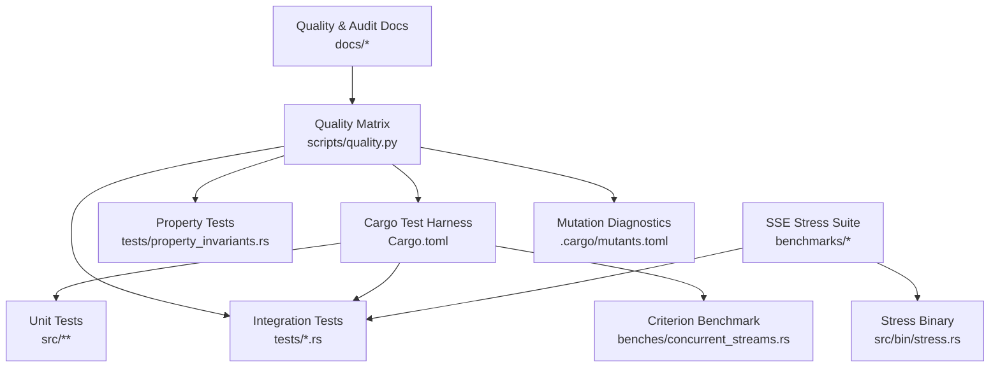
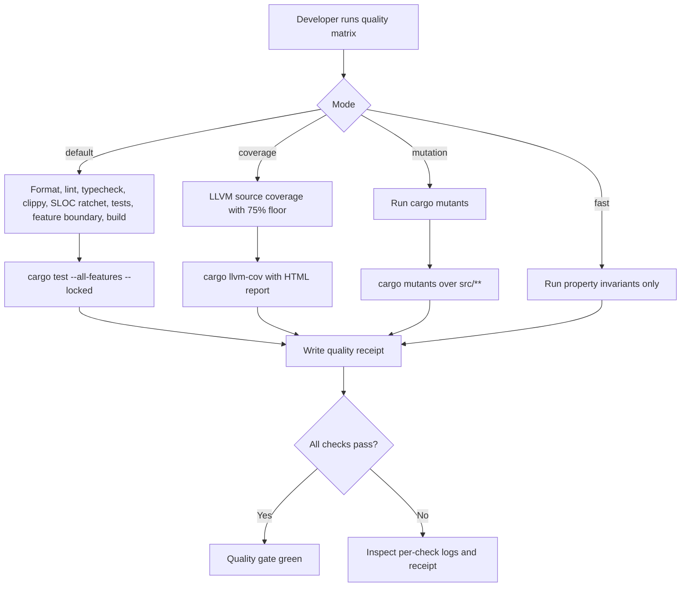
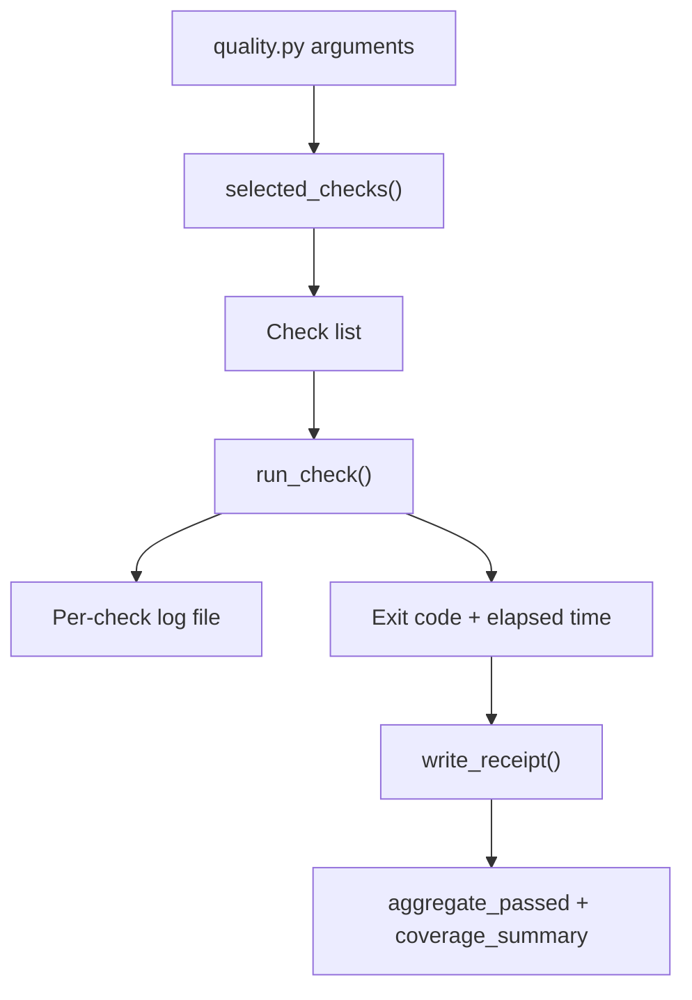
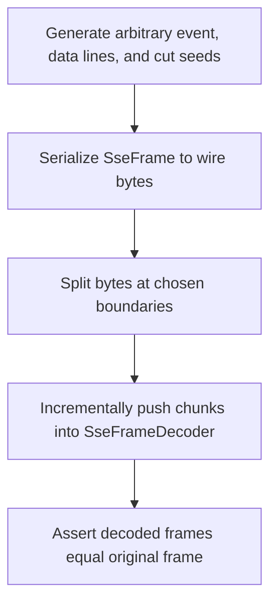
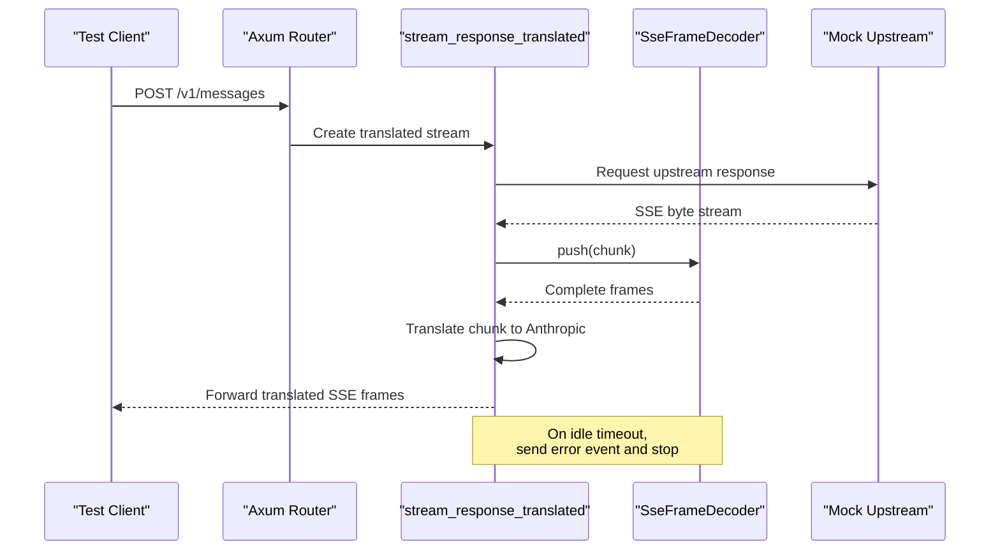
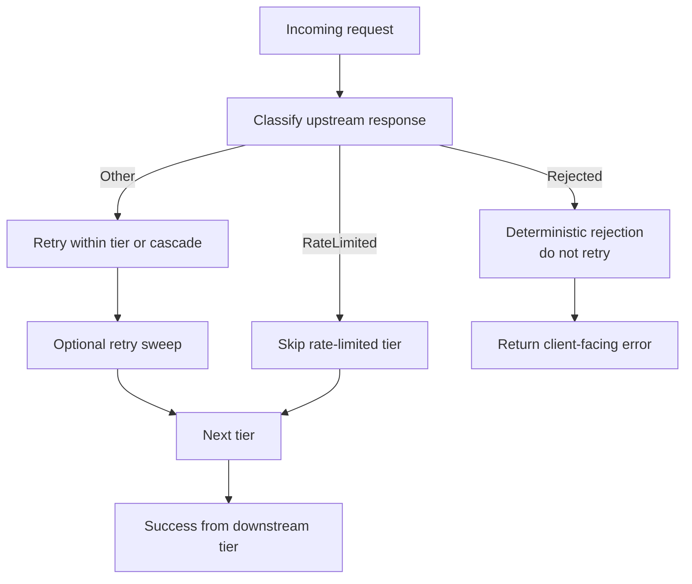
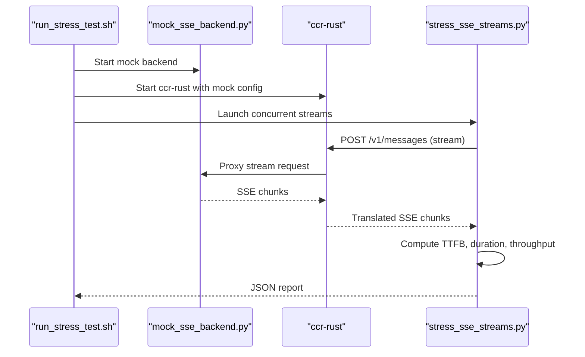
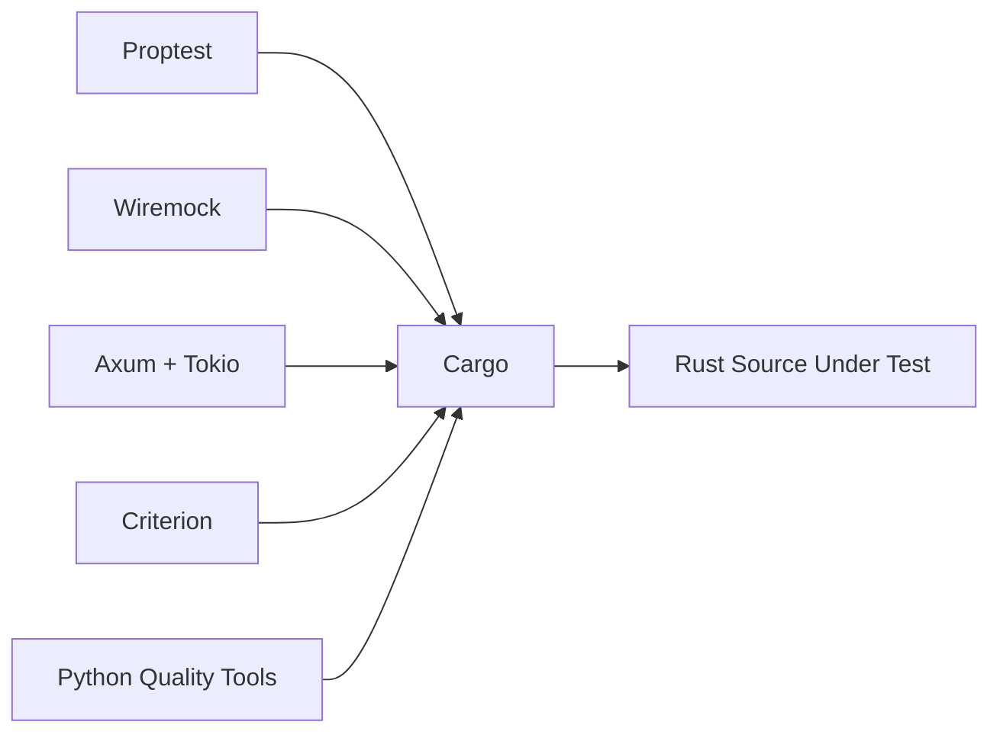

# Testing and Quality Assurance

<cite>
**Referenced Files in This Document**   
- [README.md](file://README.md)
- [CONTRIBUTING.md](file://CONTRIBUTING.md)
- [Cargo.toml](file://Cargo.toml)
- [docs/quality-matrix.md](file://docs/quality-matrix.md)
- [docs/test-suite-audit.md](file://docs/test-suite-audit.md)
- [docs/failover_architecture.md](file://docs/failover_architecture.md)
- [scripts/quality.py](file://scripts/quality.py)
- [.cargo/mutants.toml](file://.cargo/mutants.toml)
- [tests/lib.rs](file://tests/lib.rs)
- [tests/property_invariants.rs](file://tests/property_invariants.rs)
- [tests/test_failover_controls.rs](file://tests/test_failover_controls.rs)
- [tests/test_stream_error_detection.rs](file://tests/test_stream_error_detection.rs)
- [tests/integration_codex_stream.rs](file://tests/integration_codex_stream.rs)
- [tests/integration_responses.rs](file://tests/integration_responses.rs)
- [benches/concurrent_streams.rs](file://benches/concurrent_streams.rs)
- [src/bin/stress.rs](file://src/bin/stress.rs)
- [benchmarks/run_stress_test.sh](file://benchmarks/run_stress_test.sh)
- [benchmarks/stress_sse_streams.py](file://benchmarks/stress_sse_streams.py)
- [benchmarks/README.md](file://benchmarks/README.md)
- [src/router/streaming.rs](file://src/router/streaming.rs)
- [src/sse.rs](file://src/sse.rs)
- [src/retry_budget.rs](file://src/retry_budget.rs)
</cite>

## Table of Contents
1. [Introduction](#introduction)
2. [Project Structure](#project-structure)
3. [Core Components](#core-components)
4. [Architecture Overview](#architecture-overview)
5. [Detailed Component Analysis](#detailed-component-analysis)
6. [Dependency Analysis](#dependency-analysis)
7. [Performance Considerations](#performance-considerations)
8. [Troubleshooting Guide](#troubleshooting-guide)
9. [Conclusion](#conclusion)
10. [Appendices](#appendices)

## Introduction
This document describes the testing and quality assurance strategy for CCR-Rust, a multi-provider LLM router that translates between Anthropic and OpenAI protocols, streams responses, fails over across provider tiers, and exposes metrics and observability surfaces. The repository is organized as a Rust crate with additional Python tooling for quality orchestration, provider validation, and benchmarking.

The testing model emphasizes deterministic, offline verification: integration tests use local mock servers rather than live provider credentials, property-based tests validate streaming and retry invariants, mutation testing is available as an explicit diagnostic, and the quality matrix enforces formatting, linting, source-line growth limits, feature boundaries, coverage thresholds, and binary build checks.

## Project Structure
The test surface spans several layers:

| Layer | Purpose | Primary location |
|---|---|---|
| Unit tests | Module-level correctness without network calls | `src/**/*.rs` via `#[test]`, `#[tokio::test]`, and internal `mod tests` |
| Property-based tests | Invariant testing for SSE framing and retry backoff | `tests/property_invariants.rs` using Proptest |
| Integration tests | End-to-end HTTP flows with mocked upstreams | `tests/*.rs` |
| Streaming and error-flow tests | SSE parsing, chunk boundary behavior, embedded error detection | `tests/integration_*`, `tests/test_stream_error_detection.rs` |
| Failover and retry tests | Tier cascades, deterministic rejection, retry budgeting, admission control | `tests/test_failover_controls.rs` |
| Stress benchmarks | Concurrent SSE stream load against a proxy or built-in stress binary | `benches/concurrent_streams.rs`, `src/bin/stress.rs`, `benchmarks/*` |
| Quality orchestration | Formatting, linting, type checking, SLOC ratchet, coverage, mutation | `scripts/quality.py`, `.cargo/mutants.toml` |
| Provider validation | Optional provider smoke and policy helpers | `tests/provider_validation/*`, `scripts/*` |

**Diagram sources**
- [scripts/quality.py:1-200](file://scripts/quality.py#L1-L200)
- [scripts/quality.py:200-428](file://scripts/quality.py#L200-L428)
- [Cargo.toml:60-87](file://Cargo.toml#L60-L87)
- [tests/property_invariants.rs:1-138](file://tests/property_invariants.rs#L1-L138)
- [benches/concurrent_streams.rs:1-9](file://benches/concurrent_streams.rs#L1-L9)
- [src/bin/stress.rs:1-100](file://src/bin/stress.rs#L1-L100)
- [benchmarks/README.md:1-135](file://benchmarks/README.md#L1-L135)
- [.cargo/mutants.toml:1-9](file://.cargo/mutants.toml#L1-L9)
- [docs/quality-matrix.md:1-94](file://docs/quality-matrix.md#L1-L94)

**Section sources**
- [CONTRIBUTING.md:1-112](file://CONTRIBUTING.md#L1-L112)
- [Cargo.toml:1-87](file://Cargo.toml#L1-L87)
- [docs/quality-matrix.md:1-94](file://docs/quality-matrix.md#L1-L94)
- [docs/test-suite-audit.md:1-46](file://docs/test-suite-audit.md#L1-L46)

## Core Components
The testing system is driven by three main components:

1. **Quality Matrix Orchestrator (`scripts/quality.py`)**  
   Executes a deterministic sequence of checks, writes a machine-readable receipt under `build/reports/quality/receipt.json`, and supports fast iteration, LLVM source coverage, and mutation diagnostics.

2. **Rust Test Surface**  
   Includes unit tests, property-based tests, and integration tests built through Cargo. Wiremock and local Axum servers provide mocked upstreams.

3. **Benchmark and Stress Surface**  
   Includes a Criterion placeholder benchmark, a Rust stress binary for high-concurrency simulation, and a Python-driven end-to-end SSE stress suite orchestrated by a shell script.

Key responsibilities:

| Component | Responsibilities | Key behaviors |
|---|---|---|
| Quality matrix | Format, lint, type check, SLOC ratchet, clippy, feature-boundary check, test execution, coverage, mutation | Writes receipts; does not call live providers by default |
| Property tests | Validate SSE frame integrity and retry backoff bounds | Uses arbitrary inputs and cut points |
| Integration tests | Validate routing, translation, streaming, failover, admission, telemetry, MCP, CLI presets | Mocked HTTP servers on loopback |
| Stress suite | Measure concurrent stream throughput, TTFB, memory pressure, and stability | Uses mock backend or built-in stress generator |
| Mutation diagnostics | Exercise production code paths through controlled mutations | Excludes vendored and generated code |

**Section sources**
- [scripts/quality.py:1-200](file://scripts/quality.py#L1-L200)
- [scripts/quality.py:200-428](file://scripts/quality.py#L200-L428)
- [tests/lib.rs:1-6](file://tests/lib.rs#L1-L6)
- [tests/property_invariants.rs:1-138](file://tests/property_invariants.rs#L1-L138)
- [benches/concurrent_streams.rs:1-9](file://benches/concurrent_streams.rs#L1-L9)
- [src/bin/stress.rs:1-100](file://src/bin/stress.rs#L1-L100)

## Architecture Overview
The quality pipeline can be understood as a staged gate:

**Diagram sources**
- [scripts/quality.py:1-200](file://scripts/quality.py#L1-L200)
- [scripts/quality.py:200-428](file://scripts/quality.py#L200-L428)
- [docs/quality-matrix.md:1-94](file://docs/quality-matrix.md#L1-L94)

## Detailed Component Analysis

### Quality Matrix and Continuous Integration Gate
The quality matrix is the single entry point for CI-equivalent validation. It defines each check as a command tuple with optional environment overrides and working directory. Checks run sequentially but continue after individual failures so one defect does not hide another.

Default checks include:

| Check | Command family | Purpose |
|---|---|---|
| `format` | `cargo fmt --check` | Enforces Rust formatting |
| `python-format` | `ruff format --check` | Enforces Python formatting for benchmarks, scripts, and provider validation |
| `python-lint` | `ruff check` | Applies pinned Ruff rules |
| `python-typecheck` | `ty check scripts` | Type-checks the Python helper tree |
| `rust-sloc-ratchet` | `scripts/check_sloc.py --json` | Caps total and per-file nonblank source lines |
| `shellcheck` | `shellcheck` | Validates tracked shell entry points |
| `clippy` | `cargo clippy --all-features --all-targets --locked -- -D warnings` | Fails on warnings |
| `rust-tests` | `cargo test --all-features --locked` | Runs Rust tests |
| `no-default-features` | `cargo check --no-default-features --locked` | Validates optional feature boundaries |
| `debug-binary` | `cargo build --all-features --locked` | Verifies debug binary build |
| `python-helpers` | Python unittest discovery over `scripts` | Runs helper tests against the checkout-built debug binary |
| `vendored-gp-routing` | Cargo test over vendored GP surrogate | Validates isolated dependency graph |

Coverage mode replaces normal test execution with `cargo llvm-cov`, enforces a 75% line-coverage threshold, and parses the generated HTML summary into label-matched totals. Mutation mode adds `cargo mutants` over production Rust sources while excluding vendored and generated trees.

**Diagram sources**
- [scripts/quality.py:1-200](file://scripts/quality.py#L1-L200)
- [scripts/quality.py:200-428](file://scripts/quality.py#L200-L428)

**Section sources**
- [docs/quality-matrix.md:1-94](file://docs/quality-matrix.md#L1-L94)
- [scripts/quality.py:1-200](file://scripts/quality.py#L1-L200)
- [scripts/quality.py:200-428](file://scripts/quality.py#L200-L428)

### Unit Tests and Internal Module Coverage
Unit tests are distributed throughout the source tree. They cover configuration parsing, protocol translation, transformer registry behavior, worker selection, rendering, reporting, MCP catalog operations, client authentication, telemetry runtime behavior, schema validation, and streaming logic. The contribution guide recommends running `cargo test`, `cargo clippy`, and `cargo fmt` before submitting changes, and requires public items to have documentation comments.

The test-suite audit confirms that at the audited snapshot there were no duplicated test executions across the full all-features suite, even though multiple integration targets share common fixtures and app builders.

**Section sources**
- [CONTRIBUTING.md:1-112](file://CONTRIBUTING.md#L1-L112)
- [docs/test-suite-audit.md:1-46](file://docs/test-suite-audit.md#L1-L46)

### Property-Based Tests
The property-based test suite validates two core invariants:

1. **SSE frame round-trip safety:** A serialized `SseFrame` must survive being split across arbitrary byte boundaries during incremental decoding. This protects the streaming path from losing or synthesizing events when the network delivers partial frames.
2. **Retry backoff bounds:** Retry delays must remain bounded by the configured maximum and must not decrease across attempts once the ceiling is applied.

The suite also includes deterministic tests for partial frame buffering, LF and CRLF line endings, and cases where the retry ceiling is below the base backoff.

**Diagram sources**
- [tests/property_invariants.rs:1-138](file://tests/property_invariants.rs#L1-L138)
- [src/sse.rs:1-160](file://src/sse.rs#L1-L160)

**Section sources**
- [tests/property_invariants.rs:1-138](file://tests/property_invariants.rs#L1-L138)
- [src/sse.rs:1-160](file://src/sse.rs#L1-L160)

### Provider Validation Testing
Provider validation is separated from the default quality matrix because it may require optional dependencies such as `aiohttp`, `starlette`, `uvicorn`, `openai`, and `anthropic`. The Python runtime tests explicitly use the checkout-built debug binary and fail if that binary is absent. The default matrix excludes their type checks because those directories import optional packages not installed in the validation environment.

Provider validation testing therefore follows this pattern:

1. Build the debug binary.
2. Set `CCR_TEST_BINARY` to the checked-out binary path.
3. Run Python helper tests under `scripts` and `tests/provider_validation`.
4. Treat missing binaries or optional imports as environment-dependent failures rather than code defects.

**Section sources**
- [docs/quality-matrix.md:1-94](file://docs/quality-matrix.md#L1-L94)
- [scripts/quality.py:1-200](file://scripts/quality.py#L1-L200)

### Streaming API Testing Strategies
Streaming is tested at multiple levels:

| Area | Strategy | Example files |
|---|---|---|
| Incremental SSE decoding | Push partial bytes and assert complete frames are emitted correctly | `tests/property_invariants.rs`, `src/sse.rs` |
| Protocol translation | Convert OpenAI stream chunks to Anthropic format and preserve semantics | `tests/integration_responses.rs`, `tests/integration_codex_stream.rs` |
| Chunk boundary behavior | Send frames split inside `event:` or `data:` lines | `tests/integration_codex_stream.rs` |
| Embedded error detection | Detect quota or overload JSON inside HTTP 200 SSE bodies | `tests/test_stream_error_detection.rs` |
| Gated completion | Use synchronization gates to verify first-token timing and tail delivery | `tests/integration_responses.rs` |
| Idle timeout | Verify stream idle timeout sends an error event | `src/router/streaming.rs` |

The streaming implementation uses an incremental `SseFrameDecoder`, accumulates token usage, tracks first-token and last-token timestamps, detects terminal conditions, and sends idle-timeout errors when no useful frames arrive within the configured window.

**Diagram sources**
- [src/router/streaming.rs:1-150](file://src/router/streaming.rs#L1-L150)
- [src/sse.rs:1-160](file://src/sse.rs#L1-L160)
- [tests/integration_responses.rs:1-120](file://tests/integration_responses.rs#L1-L120)
- [tests/integration_codex_stream.rs:1-80](file://tests/integration_codex_stream.rs#L1-L80)

**Section sources**
- [tests/integration_codex_stream.rs:1-80](file://tests/integration_codex_stream.rs#L1-L80)
- [tests/integration_responses.rs:1-120](file://tests/integration_responses.rs#L1-L120)
- [tests/test_stream_error_detection.rs:1-200](file://tests/test_stream_error_detection.rs#L1-L200)
- [src/router/streaming.rs:1-150](file://src/router/streaming.rs#L1-L150)
- [src/sse.rs:1-160](file://src/sse.rs#L1-L160)

### Concurrent Operations Testing
Concurrency testing covers two dimensions:

1. **Router concurrency and admission control:** Integration tests construct `AppState` directly and send requests through the Axum router to validate tier cascade, admission deferral, retry budgeting, EWMA clamping, and conversation stickiness.
2. **High-throughput streaming:** The stress binary and Python stress suite simulate many concurrent streams and collect per-stream and aggregate metrics.

The failover controls test constructs two local mock upstreams to verify deterministic rejection behavior, context-window cascading, and concurrent request constraints.

**Section sources**
- [tests/test_failover_controls.rs:1-200](file://tests/test_failover_controls.rs#L1-L200)
- [docs/failover_architecture.md:1-120](file://docs/failover_architecture.md#L1-L120)

### Failover Scenarios
Failover testing verifies:

- Deterministic 4xx rejections (such as 400 for invalid tool results) are attempted once and do not consume retry sweeps.
- Context-window rejections cascade to a larger-context tier.
- Embedded provider errors in HTTP 200 SSE responses trigger tier cascading.
- Rate limiting, retry budgets, and admission control interact without amplifying load.

The failover architecture documents tier cascade order, sweep-loop behavior, failure classification, rate-limit tracking, and the distinction between deterministic rejections and retryable failures.

**Diagram sources**
- [docs/failover_architecture.md:1-120](file://docs/failover_architecture.md#L1-L120)
- [tests/test_failover_controls.rs:1-200](file://tests/test_failover_controls.rs#L1-L200)
- [tests/test_stream_error_detection.rs:1-200](file://tests/test_stream_error_detection.rs#L1-L200)

**Section sources**
- [docs/failover_architecture.md:1-120](file://docs/failover_architecture.md#L1-L120)
- [tests/test_failover_controls.rs:1-200](file://tests/test_failover_controls.rs#L1-L200)
- [tests/test_stream_error_detection.rs:1-200](file://tests/test_stream_error_detection.rs#L1-L200)

### Mutation Testing Setup
Mutation testing is enabled through `cargo mutants` and configured in `.cargo/mutants.toml`. Its scope is intentionally limited to production Rust sources under `src/**`, excluding vendored code, generated output, and test code. It runs with `--locked` and enables all features to exercise the same compilation surface used by the rest of the quality matrix.

Important characteristics:

- Mutation testing is an explicit diagnostic, not part of the default merge gate.
- It should be run after the default matrix passes.
- It focuses on production code paths that are exercised by the existing test suite.
- The vendored GP routing package has its own direct test suite and lockfile and is not included here.

**Section sources**
- [.cargo/mutants.toml:1-9](file://.cargo/mutants.toml#L1-L9)
- [scripts/quality.py:200-428](file://scripts/quality.py#L200-L428)
- [docs/quality-matrix.md:1-94](file://docs/quality-matrix.md#L1-L94)

### Load Testing and Stress Benchmarks
There are three related performance-testing mechanisms:

| Tool | Scope | Input | Output |
|---|---|---|
| Criterion benchmark | Placeholder microbenchmark | Local CPU work | HTML reports through `benches/concurrent_streams.rs` |
| Rust stress binary | Built-in stress generator | CLI flags for streams, ramp, duration, memory profiling | Per-stream stats, peak concurrency, memory statistics |
| Python SSE stress suite | End-to-end proxy load test | Mock SSE backend + ccr-rust | TTFB, duration percentiles, throughput, active-stream gauge |

The Python stress suite orchestrates three processes: a mock SSE backend, the ccr-rust binary, and a concurrent stream client. It collects per-stream metrics and aggregate percentiles, and optionally polls `/v1/usage` to track peak active streams.

**Diagram sources**
- [benchmarks/run_stress_test.sh:1-151](file://benchmarks/run_stress_test.sh#L1-L151)
- [benchmarks/stress_sse_streams.py:1-200](file://benchmarks/stress_sse_streams.py#L1-L200)
- [benchmarks/README.md:1-135](file://benchmarks/README.md#L1-L135)

**Section sources**
- [benches/concurrent_streams.rs:1-9](file://benches/concurrent_streams.rs#L1-L9)
- [src/bin/stress.rs:1-100](file://src/bin/stress.rs#L1-L100)
- [benchmarks/run_stress_test.sh:1-151](file://benchmarks/run_stress_test.sh#L1-L151)
- [benchmarks/stress_sse_streams.py:1-200](file://benchmarks/stress_sse_streams.py#L1-L200)
- [benchmarks/README.md:1-135](file://benchmarks/README.md#L1-L135)

### Quality Metrics and Code Assessment Framework
The quality framework combines static and dynamic assessments:

| Metric | Enforcement | Notes |
|---|---|---|
| Rust formatting | `cargo fmt --check` | Standard Rust formatter |
| Python formatting | `ruff format --check` | Pinned rule set |
| Python linting | `ruff check` | No drift from defaults |
| Python typing | `ty check scripts` | Scoped to helper tree |
| Shell linting | `shellcheck` | Tracked shell entry points |
| Source-line growth | `scripts/check_sloc.py --json` | Global cap, per-file cap, hotspot ceilings |
| Clippy | `cargo clippy --all-features --all-targets --locked -- -D warnings` | Warning-as-error |
| Feature boundaries | `cargo check --no-default-features --locked` | Ensures optional features compile independently |
| Binary build | `cargo build --all-features --locked` | Validates release/debug builds |
| Rust tests | `cargo test --all-features --locked` | Main regression gate |
| Coverage | `cargo llvm-cov` | 75% line-coverage floor in coverage mode |
| Dependency security | `cargo audit`, `cargo deny`, `osv-scanner` | Release gate with dated exceptions |
| Mutation testing | `cargo mutants` | Diagnostic-only |

The quality receipt records revision, dirty state, platform, selected mode, per-check exit codes, elapsed times, log paths, and aggregate pass/fail status.

**Section sources**
- [docs/quality-matrix.md:1-94](file://docs/quality-matrix.md#L1-L94)
- [scripts/quality.py:1-200](file://scripts/quality.py#L1-L200)
- [scripts/quality.py:200-428](file://scripts/quality.py#L200-L428)

### Retry Budget and Concurrency Controls
The retry budget prevents aggregate retry amplification when many client requests fail together. It packs active-request count and admitted retries into a single atomic value and reserves retry slots proportionally to active clients, with a small floor so a quiet router can still recover from transient failures.

Tests verify:

- Deterministic rejections do not burn retry budget.
- Cascading to a downstream tier occurs when the upstream returns embedded errors.
- Admission control and retry budgeting cooperate under concurrency.
- Conversation stickiness avoids mixing incompatible protocol conversations.

**Section sources**
- [src/retry_budget.rs:1-120](file://src/retry_budget.rs#L1-L120)
- [tests/test_failover_controls.rs:1-200](file://tests/test_failover_controls.rs#L1-L200)
- [docs/failover_architecture.md:1-120](file://docs/failover_architecture.md#L1-L120)

## Dependency Analysis
The testing ecosystem depends on:

- **Cargo test harness** for unit, integration, and property tests.
- **Proptest** for property-based generation and assertions.
- **Wiremock** for HTTP mocking in selected integration tests.
- **Axum and Tokio** for building local mock servers and async test drivers.
- **Criterion** for the placeholder benchmark harness.
- **Python tooling** (`ruff`, `ty`, `shellcheck`, `cargo mutants`, `cargo llvm-cov`) orchestrated by the quality matrix.

**Diagram sources**
- [Cargo.toml:60-87](file://Cargo.toml#L60-L87)
- [tests/property_invariants.rs:1-138](file://tests/property_invariants.rs#L1-L138)
- [tests/test_stream_error_detection.rs:1-200](file://tests/test_stream_error_detection.rs#L1-L200)
- [benches/concurrent_streams.rs:1-9](file://benches/concurrent_streams.rs#L1-L9)
- [scripts/quality.py:1-200](file://scripts/quality.py#L1-L200)

**Section sources**
- [Cargo.toml:60-87](file://Cargo.toml#L60-L87)

## Performance Considerations
The performance testing surface is intentionally divided:

- **Micro-benchmarks:** The Criterion benchmark currently contains a placeholder. Replace it with domain-specific measurements when evaluating algorithmic changes.
- **Built-in stress binary:** Suitable for validating the proxy’s ability to sustain many concurrent streams, measure memory usage, and detect instability.
- **End-to-end SSE stress suite:** Best for realistic load patterns because it exercises the full HTTP and streaming path through a mock backend.
- **Coverage mode:** Useful for identifying untested hot paths, but it is slower and should be used selectively.
- **Mutation testing:** Useful for exposing brittle assumptions in critical retry, streaming, and routing logic, but should not be run routinely unless investigating regressions.

Guidance:

- Prefer deterministic local mocks over live provider calls.
- Use the Python stress suite for realistic concurrent streaming scenarios.
- Use the Rust stress binary for targeted memory and throughput experiments.
- Keep Criterion benchmarks focused on measurable algorithmic changes.
- Avoid adding large fixtures to unit tests; prefer parameterized or property-based tests where possible.

[No sources needed since this section provides general guidance]

## Troubleshooting Guide
Common issues and how to diagnose them:

| Symptom | Likely cause | Resolution |
|---|---|---|
| `cargo test` passes locally but quality matrix fails | Missing external tools or different environment | Inspect `build/reports/quality/receipt.json` and the failing check log |
| Python helper tests fail | Debug binary not built or `CCR_TEST_BINARY` incorrect | Build debug binary and rerun quality matrix |
| Provider validation tests fail | Optional dependencies not installed | Install required Python packages or skip provider validation outside CI |
| Streaming tests hang | Upstream mock not responding or socket bind unavailable | Ensure localhost sockets are available; check test skip guards |
| Stress test fails to start mock backend | Port conflict or missing Python dependencies | Kill conflicting processes and install `aiohttp`, `uvicorn`, `starlette` |
| Coverage report missing totals | LLVM coverage HTML index not generated | Re-run with `--coverage` and inspect `build/reports/coverage/html/index.html` |
| Mutation testing reports no mutants | Selected sources or test setup not exercising target code | Review `examine_globs`, test coverage, and feature flags |

Useful artifacts:

- `build/reports/quality/receipt.json`: Machine-readable result summary.
- Per-check log files referenced by the receipt.
- LLVM coverage HTML report under `build/reports/coverage/html`.
- Stress test JSON output when `--json-out` is provided.
- Test-suite audit notes for understanding duplication history.

**Section sources**
- [scripts/quality.py:200-428](file://scripts/quality.py#L200-L428)
- [benchmarks/run_stress_test.sh:1-151](file://benchmarks/run_stress_test.sh#L1-L151)
- [benchmarks/README.md:1-135](file://benchmarks/README.md#L1-L135)
- [docs/test-suite-audit.md:1-46](file://docs/test-suite-audit.md#L1-L46)

## Conclusion
CCR-Rust’s testing and quality strategy is layered: deterministic offline checks form the baseline, property-based tests protect fragile streaming and retry behavior, integration tests cover protocol translation and failover, and stress tools evaluate real-world concurrency. The quality matrix centralizes enforcement, while separate suites handle provider validation, coverage, and mutation diagnostics.

For maintainers, the recommended workflow is:

1. Write or update tests before changing behavior.
2. Run the default quality matrix for CI-equivalent validation.
3. Use `--fast` during iterative invariant work.
4. Use `--coverage` when investigating untested paths.
5. Use `--mutation` as a diagnostic after the default matrix passes.
6. Keep integration tests local, mocked, and free of billable provider calls.
7. Maintain test coverage above the enforced threshold.
8. Treat quality receipts and per-check logs as primary evidence for failures.

[No sources needed since this section summarizes without analyzing specific files]

## Appendices

### How to Write New Tests
- Place module-level unit tests near the module they cover.
- Use property-based tests for invariants involving arbitrary input shapes, encoding boundaries, or retry parameters.
- Use integration tests for HTTP workflows, protocol translation, streaming, and failover.
- Use local mock servers or wiremock for upstream behavior.
- Avoid calling live providers; use loopback and mocked endpoints.
- If adding Python tooling, follow `ruff` rules and keep type annotations in `scripts`.
- If adding a new provider, add configuration-only support plus integration coverage as described in the contribution guide.

**Section sources**
- [CONTRIBUTING.md:1-112](file://CONTRIBUTING.md#L1-L112)
- [docs/quality-matrix.md:1-94](file://docs/quality-matrix.md#L1-L94)

### Interpreting Test Results
- A passing quality matrix means every selected check returned exit code zero.
- A failing check still produces a log file and a receipt record.
- Coverage mode fails when line coverage drops below 75%.
- Mutation testing is diagnostic: a failed mutant indicates a test did not detect the mutation; a passed mutant does not prove correctness.
- Stress test results should be interpreted alongside resource utilization, not only success counts.

**Section sources**
- [scripts/quality.py:200-428](file://scripts/quality.py#L200-L428)
- [docs/quality-matrix.md:1-94](file://docs/quality-matrix.md#L1-L94)