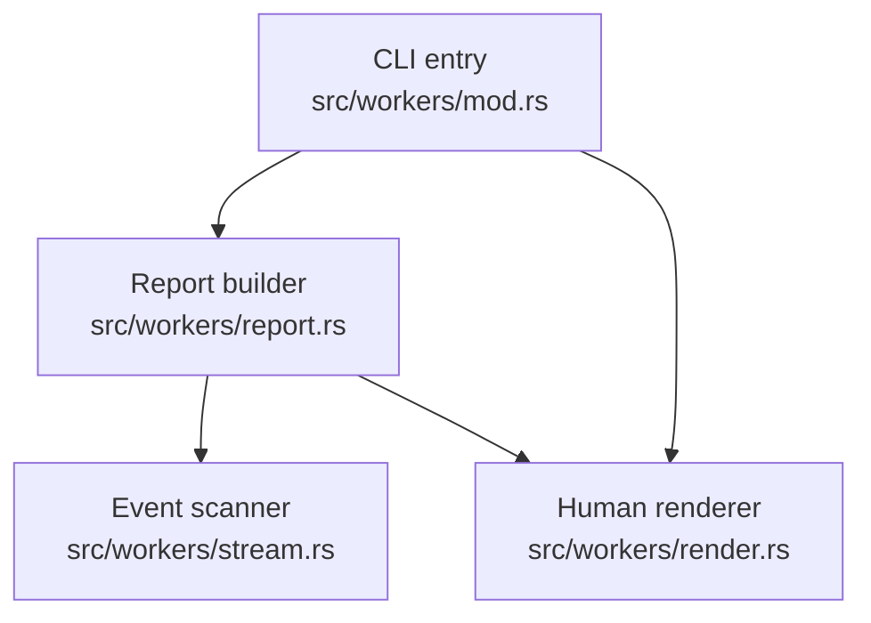
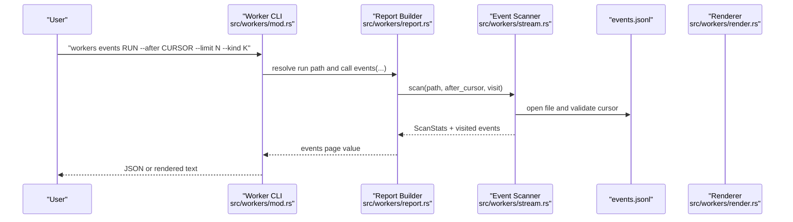
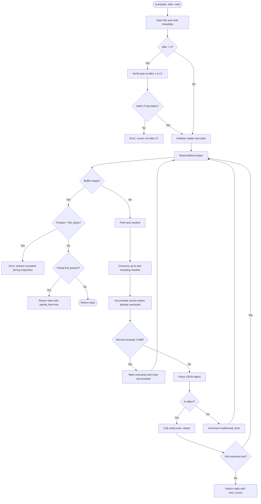
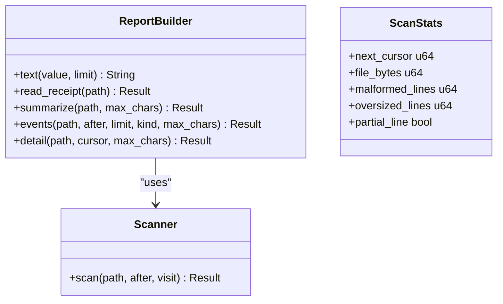
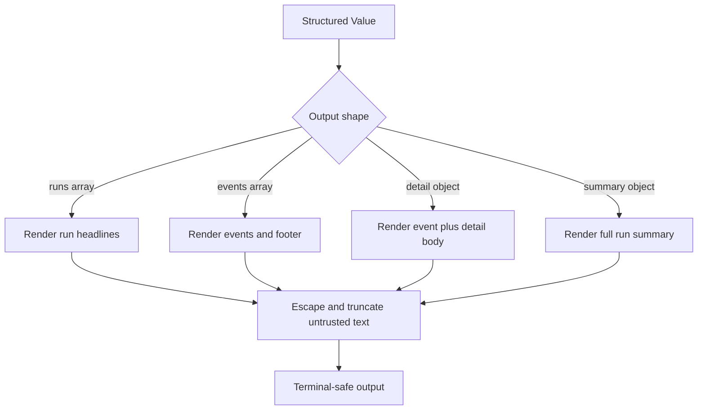
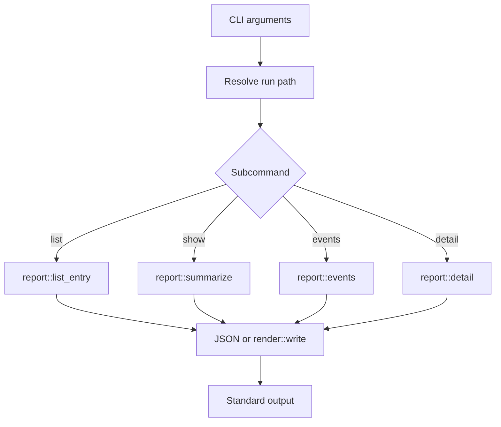
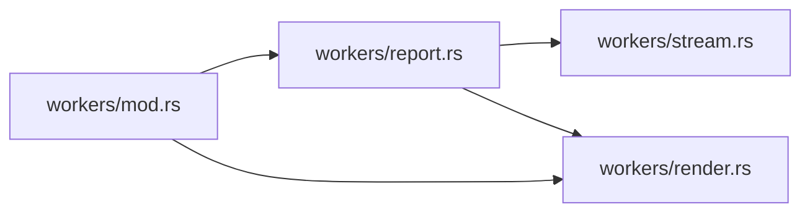

# Event Stream Processing

<cite>
**Referenced Files in This Document**
- [mod.rs](file://src/workers/mod.rs)
- [stream.rs](file://src/workers/stream.rs)
- [report.rs](file://src/workers/report.rs)
- [render.rs](file://src/workers/render.rs)
- [stream_tests.rs](file://src/workers/stream_tests.rs)
- [render_tests.rs](file://src/workers/render_tests.rs)
</cite>

## Table of Contents
1. Introduction
2. Project Structure
3. Core Components
4. Architecture Overview
5. Detailed Component Analysis
6. Dependency Analysis
7. Performance Considerations
8. Troubleshooting Guide
9. Conclusion

## Introduction
This document explains the event stream processing engine used by CCR-Rust’s worker inspection system. The inspector reads locally persisted launcher artifacts and presents them through bounded, paginated, and filterable commands. It does not call remote APIs, connect to the router, or modify launcher state. Its purpose is to help operators inspect completed or ongoing worker runs safely and efficiently.

The streaming architecture is designed for large `events.jsonl` traces:
- Events are parsed line-by-line from disk with a byte cursor.
- Pagination uses an offset-based cursor that points immediately after a newline.
- Backpressure is implemented through a visitor callback; callers can stop scanning once they have enough data.
- Memory usage is bounded by per-record limits and buffered I/O.
- Corrupted or incomplete records are tolerated without aborting the entire stream.
- Rendering converts structured JSON into human-readable text with safe escaping and truncation hints.

## Project Structure
The worker inspection subsystem lives under `src/workers/`:

**Diagram sources**
- [mod.rs:1-200](file://src/workers/mod.rs#L1-L200)
- [report.rs:1-200](file://src/workers/report.rs#L1-L200)
- [stream.rs:1-107](file://src/workers/stream.rs#L1-L107)
- [render.rs:1-160](file://src/workers/render.rs#L1-L160)

**Section sources**
- [mod.rs:1-200](file://src/workers/mod.rs#L1-L200)
- [stream.rs:1-107](file://src/workers/stream.rs#L1-L107)
- [report.rs:1-200](file://src/workers/report.rs#L1-L200)
- [render.rs:1-160](file://src/workers/render.rs#L1-L160)

## Core Components
The subsystem consists of four tightly coupled components:

| Component | Responsibility | Key behaviors |
|---|---|---|
| CLI layer | Parses user commands and dispatches to report functions | Supports `list`, `show`, `events`, and `detail`; enforces global JSON mode and output budgets |
| Report builder | Assembles run summaries, events pages, and detail payloads | Aggregates usage, recent activity, failures, active items, salvage metadata, and final reports |
| Event scanner | Streams `events.jsonl` using byte cursors | Validates cursors, tolerates malformed lines, tracks oversized records, and detects truncated files |
| Renderer | Produces terminal-friendly output | Escapes control characters, flattens multi-line fields, and prints truncation or omission hints |

**Section sources**
- [mod.rs:1-200](file://src/workers/mod.rs#L1-L200)
- [report.rs:1-200](file://src/workers/report.rs#L1-L200)
- [stream.rs:1-107](file://src/workers/stream.rs#L1-L107)
- [render.rs:1-160](file://src/workers/render.rs#L1-L160)

## Architecture Overview
The end-to-end flow for inspecting worker events is linear and intentionally single-threaded per command. There is no shared mutable state between runs.

**Diagram sources**
- [mod.rs:1-200](file://src/workers/mod.rs#L1-L200)
- [report.rs:1-200](file://src/workers/report.rs#L1-L200)
- [stream.rs:1-107](file://src/workers/stream.rs#L1-L107)
- [render.rs:1-160](file://src/workers/render.rs#L1-L160)

## Detailed Component Analysis

### Streaming Engine: Byte-Cursor Event Scanner
The scanner reads `events.jsonl` directly from disk. It does not load the whole file into memory. Instead, it maintains:
- A current byte position.
- A buffer reader.
- A record accumulator limited to 4 MiB.
- Statistics for malformed, oversized, and partial records.

Key design points:
- **Cursor validation**: If `after` is non-zero, the scanner verifies that the byte immediately before the cursor is a newline. This prevents resuming inside a record.
- **Truncation detection**: If the file shrinks while scanning, the scanner fails fast so the caller knows the snapshot is inconsistent.
- **Partial tail handling**: If the file ends mid-record, the scanner returns `partial_line = true` rather than failing. Callers can resume later using the same cursor.
- **Oversized record handling**: Records exceeding 4 MiB are skipped but counted. Subsequent valid records continue to be processed.
- **Malformed record handling**: Non-object JSON values and parse errors increment a malformed counter and do not abort scanning.
- **Backpressure via visitor**: The `visit(cursor, value)` closure decides whether scanning should continue. Returning `false` stops early and preserves the last complete cursor.

**Diagram sources**
- [stream.rs:1-107](file://src/workers/stream.rs#L1-L107)

Complexity analysis:
- Time complexity is linear in the number of scanned bytes. Each byte is inspected once, and each record is parsed at most once.
- Space complexity is dominated by the buffered reader (64 KiB default) and the per-record accumulator (bounded at 4 MiB).
- The visitor pattern allows constant-space downstream processing when the caller consumes only what it needs.

**Section sources**
- [stream.rs:1-107](file://src/workers/stream.rs#L1-L107)
- [stream_tests.rs:1-200](file://src/workers/stream_tests.rs#L1-L200)

### Report Builder: Aggregation, Filtering, and Bounded Output
The report builder coordinates three concerns:
1. Resolving run directories and receipts.
2. Scanning event streams and aggregating summary statistics.
3. Constructing bounded JSON documents for `list`, `show`, `events`, and `detail`.

Important behaviors:
- **Run discovery**: Valid runs must contain at least one of `events.jsonl`, `status.json`, `final.txt`, or `stderr.txt`. Timestamp-prefixed directories are sorted newest-first; non-timestamped directories fall back to name order.
- **Receipt safety**: Receipts larger than 1 MiB are rejected. Invalid receipt JSON produces warnings instead of crashing the entire summary.
- **Usage aggregation**: Usage counters are summed across turns with saturating addition. Reported turn count increments per valid usage event.
- **Recent activity window**: Only the latest five relevant events are retained.
- **Active item tracking**: Active items are stored in a bounded map keyed by item ID, with overflow counting.
- **Event filtering**: The `events` command supports filtering by event type or item type.
- **Output budgets**: All human-facing text goes through a sanitization function that replaces unsafe control characters and truncates to a configurable limit.
- **Salvage metadata**: When available, salvage information includes partial report size, changed path count, and a resume command.

**Diagram sources**
- [report.rs:1-200](file://src/workers/report.rs#L1-L200)
- [stream.rs:1-107](file://src/workers/stream.rs#L1-L107)

Pagination model:
- The `--after` argument is a byte offset.
- The scanner validates that this offset aligns with a newline boundary.
- The response includes `next_cursor`, which should be reused on subsequent calls.
- `has_more` indicates whether more events remain after the requested page.

Filtering model:
- Filtering occurs after successful parsing of a record.
- The filter matches against event-level and item-level fields.
- Filtering does not bypass cursor alignment or truncation checks.

Transformation pipeline:
- Raw JSONL records → validated objects → filtered objects → bounded summary structures → serialized JSON or rendered text.
- Text transformation applies Unicode-aware truncation and control-character replacement.

**Section sources**
- [report.rs:1-200](file://src/workers/report.rs#L1-L200)
- [mod.rs:1-200](file://src/workers/mod.rs#L1-L200)

### Human Renderer: Safe, Bounded, Human-Readable Output
The renderer is responsible for converting structured inspection results into terminal-friendly text. It handles several output shapes:
- Run list headlines.
- Event pages with footers showing pagination and trace quality.
- Single-event detail output.
- Full run summaries with usage, recent activity, failures, salvage metadata, final reports, and trace diagnostics.

Safety properties:
- Control characters other than newline and tab are replaced with a placeholder character.
- Newlines, tabs, and carriage returns in certain fields are flattened to spaces.
- Truncation is indicated explicitly rather than silently cutting output.
- Terminal escape sequences cannot inject new lines into headings or footers.

**Diagram sources**
- [render.rs:1-160](file://src/workers/render.rs#L1-L160)
- [render_tests.rs:1-154](file://src/workers/render_tests.rs#L1-L154)

**Section sources**
- [render.rs:1-160](file://src/workers/render.rs#L1-L160)
- [render_tests.rs:1-154](file://src/workers/render_tests.rs#L1-L154)

### CLI Layer: Commands, Limits, and JSON Mode
The CLI defines four main subcommands:
- `list`: Shows recent runs without printing tool output or final reports.
- `show`: Displays counts, reported tokens, recent/failing/started items, and a bounded final preview.
- `events`: Reads a page of compact events with optional filtering and pagination.
- `detail`: Reads one event’s tool output or message by its byte cursor.

Global options:
- `--json`: Emits one bounded JSON document instead of formatted text.
- `--runs-dir` / environment variable: Overrides the default worker runs directory.

Built-in limits:
- Command limits default to small numbers and are capped at 100.
- Character limits default to conservative values and are capped at 16,000.
- These limits protect interactive terminals and automation scripts from unexpectedly large outputs.

**Diagram sources**
- [mod.rs:1-200](file://src/workers/mod.rs#L1-L200)
- [report.rs:1-200](file://src/workers/report.rs#L1-L200)
- [render.rs:1-160](file://src/workers/render.rs#L1-L160)

**Section sources**
- [mod.rs:1-200](file://src/workers/mod.rs#L1-L200)

## Dependency Analysis
The dependency direction is strict and acyclic:

Coupling and cohesion:
- `mod.rs` depends on both `report.rs` and `render.rs`, acting as the command dispatcher.
- `report.rs` depends on `stream.rs` for low-level scanning and on `render.rs` indirectly through shared text utilities.
- `stream.rs` has no internal dependencies beyond standard library and serde, making it easy to reuse or test independently.
- `render.rs` depends on `report.rs` only for shared text helpers.

Potential risks:
- The renderer assumes specific JSON shapes produced by the report builder. Changing those shapes requires updating tests.
- The scanner is robust against malformed input but will fail if the underlying file disappears or shrinks during scanning.
- No concurrency is introduced within the inspection path, avoiding locking complexity at the cost of sequential processing per command.

**Diagram sources**
- [mod.rs:1-200](file://src/workers/mod.rs#L1-L200)
- [report.rs:1-200](file://src/workers/report.rs#L1-L200)
- [stream.rs:1-107](file://src/workers/stream.rs#L1-L107)
- [render.rs:1-160](file://src/workers/render.rs#L1-L160)

**Section sources**
- [mod.rs:1-200](file://src/workers/mod.rs#L1-L200)
- [report.rs:1-200](file://src/workers/report.rs#L1-L200)
- [stream.rs:1-107](file://src/workers/stream.rs#L1-L107)
- [render.rs:1-160](file://src/workers/render.rs#L1-L160)

## Performance Considerations
Memory efficiency:
- The scanner uses a buffered reader with a 64 KiB capacity.
- Per-record accumulation is capped at 4 MiB.
- Oversized records are skipped rather than held in memory.
- Receipts are limited to 1 MiB.
- Recent activity is limited to five entries.
- Active item maps cap their size and count overflows.

I/O efficiency:
- Random access is used only to validate the cursor boundary.
- Sequential scanning starts after the cursor.
- File truncation is detected immediately.

CPU efficiency:
- Parsing happens only for complete lines.
- Malformed and oversized records are counted but do not propagate parsing errors.
- Visitor callbacks allow early termination, reducing unnecessary work.

Concurrency:
- The current implementation is single-threaded per command.
- This avoids shared-state synchronization and simplifies error recovery.
- Parallelism would require careful cursor isolation and result merging, which is not currently implemented.

Optimization opportunities:
- Add a cursor cache for repeated scans of the same run.
- Introduce a concurrent page consumer when multiple independent consumers need different ranges.
- Provide a zero-copy streaming mode for downstream consumers that process raw JSON bytes.
- Expose scanner statistics through metrics hooks.

[No sources needed since this section provides general guidance]

## Troubleshooting Guide

### Cursor Mismatch
Symptoms:
- Errors indicating the cursor is not immediately after a newline.

Likely causes:
- Reusing a cursor from another run.
- Using a cursor from an intermediate partial record.
- Mixing cursors from different snapshots.

Recovery:
- Restart from cursor `0`.
- Use the `next_cursor` value returned by the previous page.

**Section sources**
- [stream.rs:1-107](file://src/workers/stream.rs#L1-L107)

### Truncated Event Stream
Symptoms:
- Error stating the worker stream was truncated during inspection.

Likely causes:
- The launcher wrote additional events after the snapshot started.
- The filesystem lost data.
- The run directory was modified externally.

Recovery:
- Restart scanning from cursor `0`.
- Do not assume prior progress remains valid.

**Section sources**
- [stream.rs:1-107](file://src/workers/stream.rs#L1-L107)

### Missing Events File
Symptoms:
- Empty event lists or fallback behavior when the events file is absent.

Likely causes:
- Incomplete worker run.
- Misconfigured `--runs-dir`.
- Run identifier pointing to the wrong directory.

Recovery:
- Verify the selected run path.
- Inspect the run directory contents.
- Use `workers list` to discover available runs.

**Section sources**
- [report.rs:1-200](file://src/workers/report.rs#L1-L200)

### Oversized or Malformed Records
Symptoms:
- `oversized_lines` or `malformed_lines` increase in trace statistics.
- Some events are missing from the output.

Likely causes:
- Extremely large tool output or message bodies.
- Corrupted JSONL lines.
- Non-object JSON values.

Recovery:
- Increase `--max-chars` where appropriate.
- Use `workers detail` to inspect individual events by cursor.
- Treat malformed and oversized records as degraded evidence, not fatal errors.

**Section sources**
- [stream.rs:1-107](file://src/workers/stream.rs#L1-L107)
- [stream_tests.rs:1-200](file://src/workers/stream_tests.rs#L1-L200)

### Unsafe Output in Terminals
Symptoms:
- Unexpected terminal control sequences or broken layout.

Likely causes:
- Untrusted event data containing control characters.

Mitigation:
- The renderer escapes control characters and flattens dangerous whitespace.
- Always inspect rendered output carefully.
- Prefer `--json` when piping into automated tools.

**Section sources**
- [render.rs:1-160](file://src/workers/render.rs#L1-L160)
- [render_tests.rs:1-154](file://src/workers/render_tests.rs#L1-L154)

## Conclusion
CCR-Rust’s worker inspection engine is a focused, defensive, and memory-efficient stream processor. It trades concurrency for simplicity and safety, favoring bounded I/O, explicit cursors, visitor-driven backpressure, and resilient parsing. The rendering layer ensures that untrusted launcher artifacts are presented safely to humans and automation. For future growth, the most valuable extensions would be cursor caching, optional parallel consumption, and richer observability—while preserving the current guarantees around bounds, resilience, and correctness.

[No sources needed since this section summarizes without analyzing specific files]