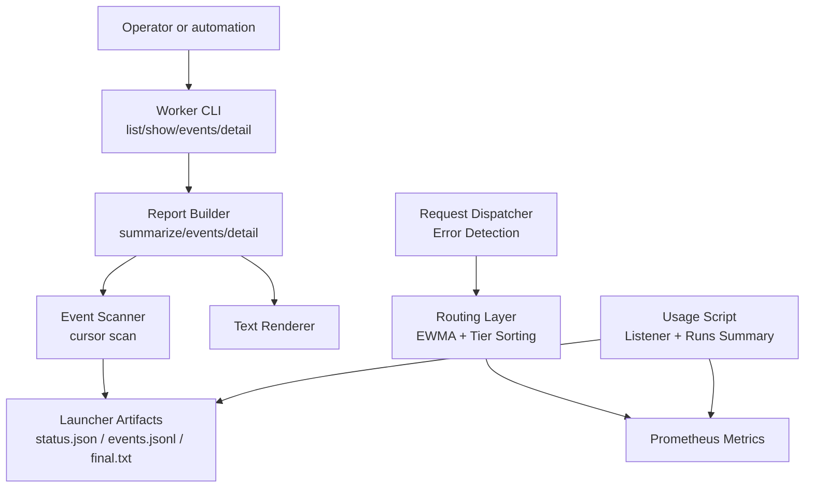
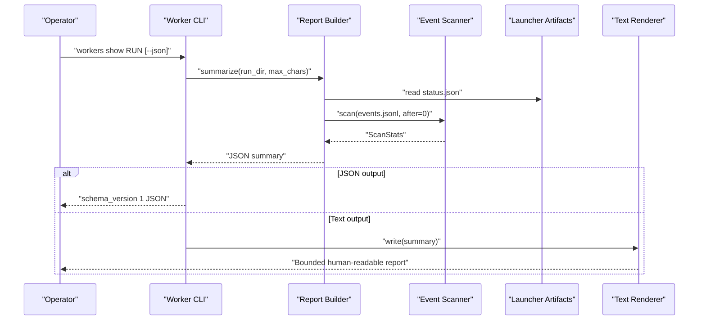
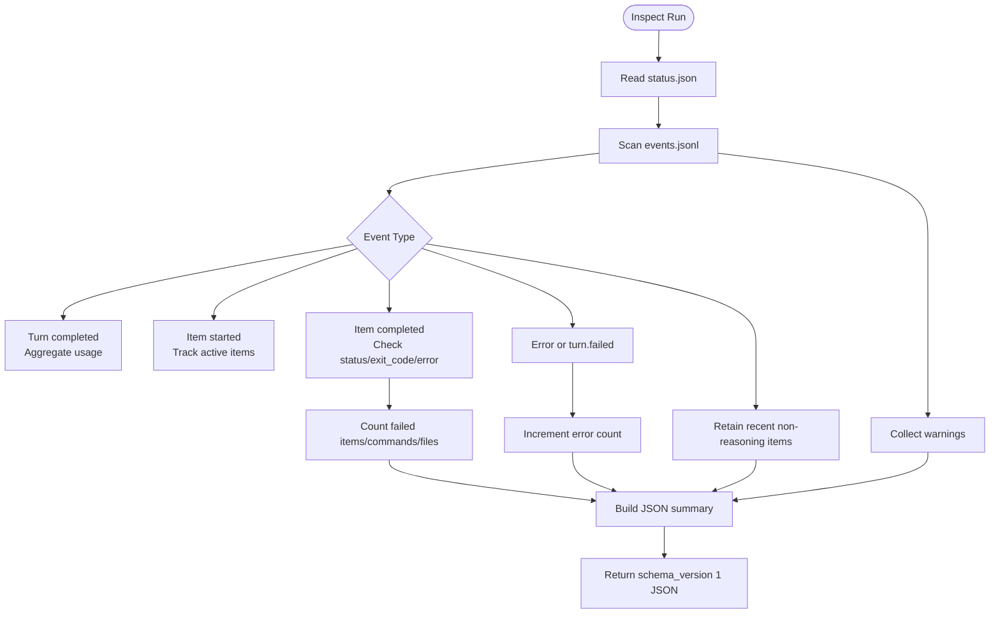
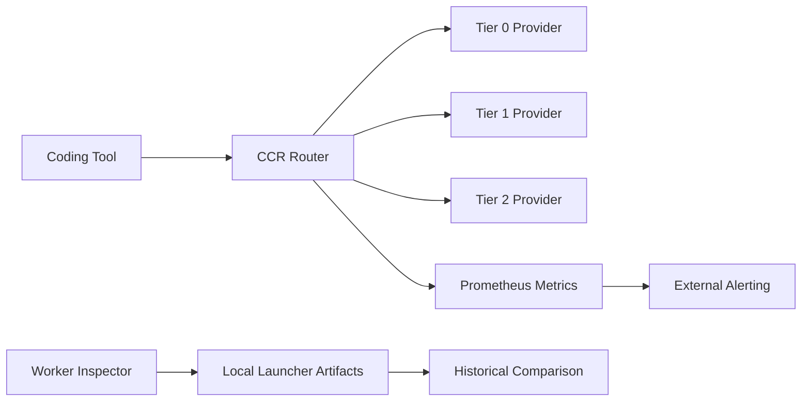
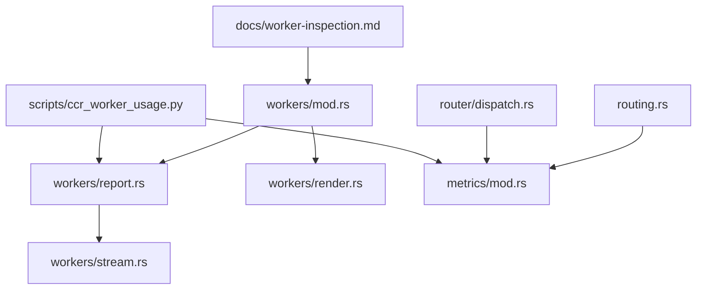

# Failure Analysis and Reporting

<cite>
**Referenced Files in This Document**
- [README.md](file://README.md)
- [src/workers/mod.rs](file://src/workers/mod.rs)
- [src/workers/report.rs](file://src/workers/report.rs)
- [src/workers/render.rs](file://src/workers/render.rs)
- [src/workers/stream.rs](file://src/workers/stream.rs)
- [src/routing.rs](file://src/routing.rs)
- [src/router/dispatch.rs](file://src/router/dispatch.rs)
- [src/metrics/mod.rs](file://src/metrics/mod.rs)
- [scripts/ccr_worker_usage.py](file://scripts/ccr_worker_usage.py)
- [docs/worker-inspection.md](file://docs/worker-inspection.md)
</cite>

## Table of Contents
1. [Introduction](#introduction)
2. [Project Structure](#project-structure)
3. [Core Components](#core-components)
4. [Architecture Overview](#architecture-overview)
5. [Detailed Component Analysis](#detailed-component-analysis)
6. [Dependency Analysis](#dependency-analysis)
7. [Performance Considerations](#performance-considerations)
8. [Troubleshooting Guide](#troubleshooting-guide)
9. [Conclusion](#conclusion)

## Introduction
This document explains how CCR-Rust detects, classifies, reports, and analyzes failures across its worker execution pipeline and provider routing layer. It focuses on:

- Failure detection algorithms used by the worker inspector and router.
- The classification system for runs, items, events, and upstream errors.
- Automated diagnosis through bounded summaries, event pages, and detail views.
- Report generation using JSON schemas and a human-readable template renderer.
- Worker evaluation criteria, quality metrics, token usage aggregation, and performance benchmarking integration.
- How worker insights relate to provider selection and tier routing.
- Advanced operational capabilities such as trend analysis, historical comparison, and alerting foundations exposed through Prometheus metrics and listener counters.

CCR-Rust is an LLM router that sits between coding tools and model providers. Its failure strategy centers on automatic failover, held retries, per-tier measurement, and transparent reporting so operators can understand why a request moved across tiers rather than simply observing a tool failure.

**Section sources**
- [README.md:1-100](file://README.md#L1-L100)

## Project Structure
The failure analysis and reporting capability spans several layers:

| Layer | Responsibility | Key files |
|---|---|---|
| Worker CLI entry point | Dispatches `list`, `show`, `events`, and `detail` commands; resolves run directories and receipts; chooses JSON or text output | [src/workers/mod.rs](file://src/workers/mod.rs) |
| Report builder | Parses launcher artifacts, aggregates counts, builds bounded summaries, and exposes stable JSON fields | [src/workers/report.rs](file://src/workers/report.rs) |
| Event stream scanner | Reads append-only `events.jsonl` with cursor-based pagination, malformed-line handling, and memory bounds | [src/workers/stream.rs](file://src/workers/stream.rs) |
| Human renderer | Formats summaries, events, details, warnings, salvage information, and final report previews | [src/workers/render.rs](file://src/workers/render.rs) |
| Provider routing and failure tracking | Tracks EWMA latency, applies failure penalties, sorts tiers deterministically or probabilistically, and measures attempt outcomes | [src/routing.rs](file://src/routing.rs) |
| Request dispatch and embedded error detection | Detects upstream HTTP-level failures, timeouts, streaming errors inside 200 responses, and integrates retry/hedge logic | [src/router/dispatch.rs](file://src/router/dispatch.rs) |
| Metrics and observability | Exposes request, failure, cost, token, latency, admission, retry sweep, and hedging metrics | [src/metrics/mod.rs](file://src/metrics/mod.rs) |
| Usage summarization script | Aggregates listener metrics and local worker run history into trends | [scripts/ccr_worker_usage.py](file://scripts/ccr_worker_usage.py) |
| Operational documentation | Defines inspection boundaries, cursor contracts, evidence authority, and command budgets | [docs/worker-inspection.md](file://docs/worker-inspection.md) |



**Diagram sources**
- [src/workers/mod.rs:1-120](file://src/workers/mod.rs#L1-L120)
- [src/workers/report.rs:1-120](file://src/workers/report.rs#L1-L120)
- [src/workers/stream.rs:1-107](file://src/workers/stream.rs#L1-L107)
- [src/workers/render.rs:1-160](file://src/workers/render.rs#L1-L160)
- [src/routing.rs:1-120](file://src/routing.rs#L1-L120)
- [src/router/dispatch.rs:1-120](file://src/router/dispatch.rs#L1-L120)
- [src/metrics/mod.rs:1-120](file://src/metrics/mod.rs#L1-L120)
- [scripts/ccr_worker_usage.py:1-120](file://scripts/ccr_worker_usage.py#L1-L120)

**Section sources**
- [src/workers/mod.rs:1-120](file://src/workers/mod.rs#L1-L120)
- [docs/worker-inspection.md:1-60](file://docs/worker-inspection.md#L1-L60)

## Core Components
The failure analysis system has five core components:

1. **Worker CLI dispatcher**: Selects runs, parses arguments, and routes to report or render functions. It supports both machine-readable JSON and human-readable output.
2. **Report builder**: Constructs structured summaries from launcher artifacts without executing code or accessing live models. It aggregates token usage, command/item failures, file changes, recent activity, active items, warnings, trace statistics, and optional final report previews.
3. **Event scanner**: Provides append-only, cursor-safe iteration over `events.jsonl`. It tracks malformed lines, oversized records, partial trailing lines, file size, and next cursor position.
4. **Text renderer**: Produces bounded human-readable reports, including headlines, event timelines, warnings, salvage hints, and final report previews.
5. **Routing and failure tracker**: Applies EWMA smoothing, failure penalties, minimum-sample thresholds, deterministic fallback ordering, and weighted random sampling for multi-tier load distribution.

Key responsibilities and constraints:

- Reports are evidence, not automated approvals.
- Command outputs and final reports are truncated and neutralized for control characters; they are not secret redactors.
- Run selection prefers timestamped directories but accepts explicit paths, receipts, and trace selectors.
- Cursor pagination is byte-position based and scoped to one artifact snapshot.
- Routing measurements reflect per-attempt latency, not total wall-clock time across retries.

**Section sources**
- [src/workers/mod.rs:1-120](file://src/workers/mod.rs#L1-L120)
- [src/workers/report.rs:1-120](file://src/workers/report.rs#L1-L120)
- [src/workers/stream.rs:1-107](file://src/workers/stream.rs#L1-L107)
- [src/workers/render.rs:1-160](file://src/workers/render.rs#L1-L160)
- [src/routing.rs:1-120](file://src/routing.rs#L1-L120)

## Architecture Overview
The failure analysis pipeline connects three main flows:

1. **Worker inspection flow**: Operator invokes `ccr-rust workers`, which reads launcher artifacts and emits either JSON or formatted text.
2. **Provider failure flow**: Incoming requests are routed through tiers; failures, timeouts, rate limits, and embedded stream errors are detected and recorded.
3. **Observability flow**: Prometheus metrics expose failure counts, latency distributions, token usage, admission pressure, retry sweeps, and hedging outcomes.



**Diagram sources**
- [src/workers/mod.rs:60-120](file://src/workers/mod.rs#L60-L120)
- [src/workers/report.rs:120-240](file://src/workers/report.rs#L120-L240)
- [src/workers/stream.rs:20-107](file://src/workers/stream.rs#L20-L107)
- [src/workers/render.rs:60-160](file://src/workers/render.rs#L60-L160)

**Section sources**
- [src/workers/mod.rs:60-120](file://src/workers/mod.rs#L60-L120)
- [src/workers/report.rs:120-240](file://src/workers/report.rs#L120-L240)
- [src/workers/stream.rs:20-107](file://src/workers/stream.rs#L20-L107)
- [src/workers/render.rs:60-160](file://src/workers/render.rs#L60-L160)

## Detailed Component Analysis

### Worker Inspection Commands and Selection Criteria
The worker CLI defines four subcommands:

| Command | Purpose | Key selection/input behavior |
|---|---|---|
| `list` | Show recent runs without printing tool output or final reports | Resolves run directories, builds thin list entries, returns `runs`, `total_runs`, and `omitted_runs` |
| `show` | Summarize a run's usage, failures, recent activity, and final report preview | Resolves `RUN` as latest, directory, receipt path, or trace path |
| `events` | Page compact events with optional kind filtering | Supports `after` cursor, `limit`, `kind`, and character budget |
| `detail` | Inspect one event's content by byte cursor | Scans from start to the requested cursor and expands supported item types |

Run resolution rules:

- `latest` selects the first directory returned by `run_directories`.
- Existing paths are accepted directly.
- Receipt files and trace files can resolve to their containing run directory.
- Timestamp-prefixed directories sort newest first before non-timestamped directories.
- Only directories containing recognized launcher artifacts (`events.jsonl`, `status.json`, `final.txt`, `stderr.txt`) are treated as runs.

Selection tests verify that `task_verified` and `provider_verified` are always false in inspected output, even when the saved receipt claims verification. This preserves the evidence boundary.

**Section sources**
- [src/workers/mod.rs:1-120](file://src/workers/mod.rs#L1-L120)
- [src/workers/mod.rs:120-221](file://src/workers/mod.rs#L120-L221)
- [src/workers/selection_tests.rs:1-163](file://src/workers/selection_tests.rs#L1-L163)
- [docs/worker-inspection.md:200-295](file://docs/worker-inspection.md#L200-L295)

### Failure Detection Algorithms
Failure detection operates at two levels:

#### Worker-level failure detection
The report builder scans launcher events and classifies:

- Thread and turn lifecycle events.
- Item start/completion events.
- Failed items based on status, nonzero exit codes, or presence of error fields.
- Command executions versus other item types.
- File change events.
- Error and failed-turn events.
- Active items still open when completion is missing.

It also warns about:

- Unreadable receipts.
- Missing or incomplete traces.
- Malformed or oversized trace records.
- Partial trailing records.
- Errors present in the receipt.

The `needs_attention` flag is true when the outcome is not completed, or when there are failed commands, failed items, errors, or warnings.

#### Provider-level failure detection
The dispatcher handles:

- HTTP-level failures and timeouts.
- Streaming responses wrapped in HTTP 200 that contain embedded error payloads.
- First-event peek timeouts so slow-start inference is not penalized.
- Deduplication of sensitive headers in debug captures.
- Normalization of some OpenAI-compatible success envelopes.



**Diagram sources**
- [src/workers/report.rs:120-240](file://src/workers/report.rs#L120-L240)
- [src/workers/report.rs:240-340](file://src/workers/report.rs#L240-L340)
- [src/router/dispatch.rs:120-200](file://src/router/dispatch.rs#L120-L200)

**Section sources**
- [src/workers/report.rs:120-240](file://src/workers/report.rs#L120-L240)
- [src/router/dispatch.rs:120-200](file://src/router/dispatch.rs#L120-L200)

### Classification System
The classifier distinguishes multiple dimensions:

| Dimension | Values / Rules | Interpretation |
|---|---|---|
| Outcome | Derived from receipt, defaulting to `receipt_pending` | Launcher-reported completion state |
| Task verified | Always false in inspector output | Inspector does not approve work |
| Provider verified | Always false in inspector output | Configured model names do not prove live routing |
| Needs attention | Non-completed outcome, failed commands/items, errors, or warnings | Signal for operator review |
| Item failure | Status `failed`, nonzero exit code, or error field present | Tool/command did not succeed |
| Event type | `thread.started`, `turn.started`, `item.started`, `item.completed`, `error`, `turn.failed`, etc. | Lifecycle and diagnostic signals |
| Item type | `command_execution`, `agent_message`, `file_change`, `mcp_tool_call`, `web_search`, `reasoning`, etc. | Determines summary and detail expansion |
| Trace health | Malformed lines, oversized lines, partial line, file bytes | Indicates whether counts may be incomplete |

**Section sources**
- [src/workers/report.rs:120-240](file://src/workers/report.rs#L120-L240)
- [src/workers/report.rs:240-340](file://src/workers/report.rs#L240-L340)
- [docs/worker-inspection.md:200-295](file://docs/worker-inspection.md#L200-L295)

### Report Generation Process
Reports are generated through a layered process:

1. **Receipt reading**: Validates that `status.json` is a JSON object under a 1 MiB limit.
2. **Trace scanning**: Iterates `events.jsonl` using cursor-safe scanning.
3. **Aggregation**: Counts turns, commands, failed commands, failed items, file changes, errors, and token usage.
4. **Recent activity retention**: Keeps bounded recent events and active items, omitting reasoning content.
5. **Final report preview**: Optionally reads `final.txt` with truncation metadata.
6. **Warning collection**: Adds warnings for unreadable artifacts, malformed traces, missing files, and receipt errors.
7. **Output formatting**: Emits either a JSON document or a bounded human-readable report.

The JSON schema version is stable at `1`. List, show, events, and detail each return consistent top-level structure appropriate to their purpose.

**Section sources**
- [src/workers/report.rs:1-120](file://src/workers/report.rs#L1-L120)
- [src/workers/report.rs:120-240](file://src/workers/report.rs#L120-L240)
- [src/workers/render.rs:1-160](file://src/workers/render.rs#L1-L160)

### Output Formats and Customization
The worker inspector supports two output modes:

| Mode | Characteristics | Use case |
|---|---|---|
| JSON | Single JSON document with `schema_version: 1`; suitable for automation | CI, dashboards, external analysis |
| Text | Bounded human-readable headings, events, warnings, salvage hints, and final report preview | Interactive troubleshooting |

Customization options include:

- `--json`: Emit JSON instead of text.
- `--runs-dir`: Override default worker run directory.
- `--limit`: Control number of runs or events (1–100).
- `--max-chars`: Control character budgets for summaries and details (1–16000).
- `--after`: Resume event scanning from a byte cursor.
- `--kind`: Filter events by event type or item type.

Control characters are neutralized in rendered text. Reasoning content is explicitly omitted everywhere in the inspector.

**Section sources**
- [src/workers/mod.rs:1-120](file://src/workers/mod.rs#L1-L120)
- [src/workers/render.rs:1-160](file://src/workers/render.rs#L1-L160)
- [docs/worker-inspection.md:200-295](file://docs/worker-inspection.md#L200-L295)

### Worker Evaluation Criteria and Quality Metrics
Worker evaluation separates observed evidence from approval:

- A completed outcome is not a correctness verdict.
- Failed commands may have been recovered; downstream evidence must be reviewed.
- Token usage comes from `turn.completed.usage` records and may be zero if no usage was reported.
- Cached input tokens are a subset of input tokens.
- Reasoning output tokens are a subset of output tokens when reported.
- `model_requested` reflects the launcher receipt, not live upstream proof.
- `stderr_bytes` indicates whether a separate stderr file exists but is not included in reports.
- Salvage data provides recovery evidence, not proof of successful work.

Quality-related metrics are primarily exposed through Prometheus and the usage script:

| Metric family | Meaning |
|---|---|
| `ccr_requests_total` | Total requests per tier |
| `ccr_request_duration_seconds` | Per-tier request duration histogram |
| `ccr_failures_total` | Failures per tier and reason |
| `ccr_cost_usd_total` | Estimated USD cost per priced tier |
| `ccr_input_tokens_total`, `ccr_output_tokens_total`, cache token counters | Token consumption per tier |
| `ccr_tier_ewma_latency_seconds` | EWMA latency per tier |
| `ccr_active_requests`, `ccr_active_streams` | Current concurrency |
| `ccr_retry_sweeps_total`, `ccr_hedges_launched_total`, `ccr_hedge_wins_total` | Retry and hedge behavior |
| `ccr_admission_defers_total` | Admission-limit deferrals |

The usage script combines listener metrics with local run history to summarize outcomes, timeout profiles, requested routes, permission flags, and elapsed time totals.

**Section sources**
- [src/metrics/mod.rs:1-120](file://src/metrics/mod.rs#L1-L120)
- [scripts/ccr_worker_usage.py:1-120](file://scripts/ccr_worker_usage.py#L1-L120)
- [docs/worker-inspection.md:200-295](file://docs/worker-inspection.md#L200-L295)

### Performance Benchmarking Integration
Benchmarking and quality checks are documented separately from runtime failure inspection:

- The repository includes Python-driven quality matrix checks for formatting, linting, testing, SLOC ratchets, and security scanning.
- Rust benchmarks exist for concurrent stream scenarios.
- The quality matrix writes a receipt recording revision, commands, exit codes, elapsed time, and log paths.
- Coverage and mutation modes are opt-in because they are slower and require additional tools.

These checks validate repository health and code growth policies rather than measuring live provider routing latency.

**Section sources**
- [docs/quality-matrix.md:1-94](file://docs/quality-matrix.md#L1-L94)
- [benchmarks/README.md:1-50](file://benchmarks/README.md#L1-L50)

### Integration with the Main Routing System
Worker inspection is deliberately independent of the live routing system:

- The inspector reads local launcher artifacts and does not call model APIs.
- It does not modify provider selection, retry policy, or admission control.
- It treats `final.txt`, `workers show` previews, and `workers detail` bodies as untrusted evidence.
- Routing decisions remain the responsibility of the parent system and router configuration.

However, routing and worker inspection share related concepts:

- Both produce structured observations: routing uses Prometheus metrics; worker inspection produces bounded JSON reports.
- Both emphasize that configured identity is not live proof: `provider_verified` remains false in worker reports.
- Both support trend analysis through persisted or exported data: metrics via Prometheus, run history via local receipts.



**Diagram sources**
- [README.md:60-120](file://README.md#L60-L120)
- [src/metrics/mod.rs:1-120](file://src/metrics/mod.rs#L1-L120)
- [src/workers/mod.rs:1-60](file://src/workers/mod.rs#L1-L60)

**Section sources**
- [docs/worker-inspection.md:1-120](file://docs/worker-inspection.md#L1-L120)
- [src/routing.rs:1-120](file://src/routing.rs#L1-L120)

### Advanced Features: Trend Analysis, Historical Comparison, and Automated Alerting
Trend analysis and historical comparison are achieved through two complementary data sources:

1. **Live listener metrics**: Prometheus endpoints expose request counts, durations, failures, costs, tokens, EWMA latency, admission pressure, retry sweeps, and hedging outcomes.
2. **Local run history**: Worker receipts provide outcomes, timeout profiles, requested routes, permissions, and elapsed time totals over configurable day ranges.

Automated alerting is not implemented inside the worker inspector itself. Instead, the system exposes stable metric families and structured run summaries that external monitoring systems can consume. Typical alerting strategies include:

- Rising `ccr_failures_total` for a specific tier and reason.
- Increasing `ccr_tier_ewma_latency_seconds` beyond a threshold.
- Elevated `ccr_admission_defers_total` indicating capacity saturation.
- Sustained `ccr_retry_sweeps_total` suggesting persistent upstream degradation.
- High proportion of `receipt_pending` or `unreadable` outcomes in recent runs.
- Repeated `completed` outcomes with `failed_commands > 0`, requiring manual verification.

**Section sources**
- [src/metrics/mod.rs:1-120](file://src/metrics/mod.rs#L1-L120)
- [scripts/ccr_worker_usage.py:120-224](file://scripts/ccr_worker_usage.py#L120-L224)
- [docs/worker-inspection.md:200-295](file://docs/worker-inspection.md#L200-L295)

## Dependency Analysis
The following diagram shows key dependencies among failure analysis and reporting components:



**Diagram sources**
- [src/workers/mod.rs:1-120](file://src/workers/mod.rs#L1-L120)
- [src/workers/report.rs:1-120](file://src/workers/report.rs#L1-L120)
- [src/workers/stream.rs:1-107](file://src/workers/stream.rs#L1-L107)
- [src/workers/render.rs:1-160](file://src/workers/render.rs#L1-L160)
- [src/routing.rs:1-120](file://src/routing.rs#L1-L120)
- [src/router/dispatch.rs:1-120](file://src/router/dispatch.rs#L1-L120)
- [src/metrics/mod.rs:1-120](file://src/metrics/mod.rs#L1-L120)
- [scripts/ccr_worker_usage.py:1-120](file://scripts/ccr_worker_usage.py#L1-L120)
- [docs/worker-inspection.md:1-60](file://docs/worker-inspection.md#L1-L60)

**Section sources**
- [src/workers/mod.rs:1-120](file://src/workers/mod.rs#L1-L120)
- [src/workers/report.rs:1-120](file://src/workers/report.rs#L1-L120)
- [src/routing.rs:1-120](file://src/routing.rs#L1-L120)
- [src/metrics/mod.rs:1-120](file://src/metrics/mod.rs#L1-L120)

## Performance Considerations
Several design choices keep failure analysis safe under load:

- Event scanning uses buffered I/O and bounded record accumulation.
- Oversized records are skipped and counted rather than retained.
- Cursor seeking avoids replaying already processed events.
- Final report previews are limited in bytes and report truncation explicitly.
- Worker receipt parsing enforces a 1 MiB limit.
- Control characters are neutralized during rendering.
- Reasoning content is excluded from summaries and details.
- EWMA routing uses per-tier state with bounded updates and configurable smoothing.
- Failure penalties avoid treating arbitrary timeout durations as normal latency.

Operational recommendations:

- Use `--json` for automation and avoid parsing human-rendered output.
- Use cursors to paginate large traces instead of repeatedly starting from zero.
- Keep `--max-chars` small for interactive use and increase only when investigating specific events.
- Do not treat `completed` as correctness; inspect failed commands and items.
- Monitor Prometheus metrics externally for alerting rather than polling worker output.

**Section sources**
- [src/workers/stream.rs:1-107](file://src/workers/stream.rs#L1-L107)
- [src/workers/report.rs:1-120](file://src/workers/report.rs#L1-L120)
- [src/routing.rs:120-300](file://src/routing.rs#L120-L300)
- [docs/worker-inspection.md:200-295](file://docs/worker-inspection.md#L200-L295)

## Troubleshooting Guide

### Common Failure Patterns and Interpretation

| Symptom | Likely meaning | Recommended action |
|---|---|---|
| `outcome` is `receipt_pending` | No readable completion receipt; does not prove liveness | Check whether the worker process is still running; inspect launch logs separately |
| `needs_attention` is true | Non-completed outcome, failed items/commands, errors, or warnings | Review recent events and failures before accepting work |
| `failed_commands > 0` | At least one command execution exited nonzero | Inspect the command detail and subsequent evidence |
| `failed_items > 0` | An item marked failed or with an error field | Inspect item detail; patch attempts may have partially succeeded |
| `errors > 0` | One or more error or failed-turn events occurred | Review event timeline and warnings |
| `trace.malformed_lines > 0` | Some complete JSONL lines were invalid | Treat counts as approximate; inspect original artifacts locally |
| `trace.oversized_lines > 0` | Some records exceeded 4 MiB and were skipped | Increase investigation scope carefully; avoid retaining raw outputs |
| `trace.partial_line` is true | Trailing record was incomplete at snapshot time | Poll again later with the same cursor; do not advance past it |
| `model_requested` differs from expected route | Worker receipt model name does not prove served upstream | Verify routing through metrics or dispatcher logs |
| Provider returns error inside HTTP 200 stream | Embedded error payload detected during first-event peek | Investigate upstream provider behavior; check failure metrics |

### Step-by-Step Investigation Workflow

1. Run `ccr-rust workers list --limit 10 --json` to find runs needing attention.
2. Run `ccr-rust workers show RUN --json` to get a bounded summary.
3. Inspect `outcome`, `needs_attention`, `failed_commands`, `failed_items`, `errors`, and `warnings`.
4. Run `ccr-rust workers events RUN --after 0 --limit 20 --json` to page recent events.
5. Use `--kind` to filter relevant event types or item types.
6. Run `ccr-rust workers detail RUN CURSOR --max-chars 2000 --json` for one event's content.
7. If tracing is incomplete, repeat from cursor 0 or inspect original artifacts.
8. Cross-check routing and provider health using Prometheus metrics.
9. Do not execute salvage commands or final reports without independent verification.

**Section sources**
- [docs/worker-inspection.md:200-295](file://docs/worker-inspection.md#L200-L295)
- [src/workers/report.rs:120-240](file://src/workers/report.rs#L120-L240)
- [src/workers/report.rs:240-406](file://src/workers/report.rs#L240-L406)
- [src/router/dispatch.rs:120-200](file://src/router/dispatch.rs#L120-L200)

### Example Generated Reports

#### List output (conceptual)
```json
{
  "schema_version": 1,
  "runs": [
    {
      "run_id": "20261024-120000-new",
      "outcome": "completed",
      "needs_attention": false,
      "model_requested": "zai,glm-5.3-flashx",
      "commands_completed": 3,
      "failed_commands": 0,
      "failed_items": 0,
      "file_changes": 2,
      "usage": {
        "input_tokens": 1200,
        "cached_input_tokens": 400,
        "output_tokens": 800,
        "reasoning_output_tokens": 0,
        "reported_turns": 1
      }
    }
  ],
  "total_runs": 42,
  "omitted_runs": 32
}
```

#### Show output (conceptual)
```json
{
  "schema_version": 1,
  "run_id": "20261024-120000-new",
  "outcome": "completed",
  "needs_attention": false,
  "model_requested": "zai,glm-5.3-flashx",
  "elapsed_seconds": 14.2,
  "commands_completed": 3,
  "failed_commands": 0,
  "failed_items": 0,
  "file_changes": 2,
  "errors": 0,
  "usage": {
    "input_tokens": 1200,
    "cached_input_tokens": 400,
    "output_tokens": 800,
    "reasoning_output_tokens": 0,
    "reported_turns": 1
  },
  "recent": [],
  "failures": [],
  "warnings": [],
  "trace": {
    "next_cursor": 1024,
    "file_bytes": 1024,
    "malformed_lines": 0,
    "oversized_lines": 0,
    "partial_line": false
  }
}
```

#### Events output (conceptual)
```json
{
  "schema_version": 1,
  "run_id": "20261024-120000-new",
  "events": [
    {
      "cursor": 1024,
      "event": "item.completed",
      "item_type": "command_execution",
      "summary": {
        "text": "git diff --stat",
        "truncated": false
      },
      "exit_code": 0
    }
  ],
  "next_cursor": 1200,
  "has_more": false,
  "trace": {
    "next_cursor": 1200,
    "file_bytes": 1200,
    "malformed_lines": 0,
    "oversized_lines": 0,
    "partial_line": false
  }
}
```

These examples illustrate the shape of machine-readable output. Actual values depend on the inspected run.

**Section sources**
- [src/workers/report.rs:120-240](file://src/workers/report.rs#L120-L240)
- [src/workers/report.rs:240-406](file://src/workers/report.rs#L240-L406)
- [src/workers/mod.rs:60-120](file://src/workers/mod.rs#L60-L120)

## Conclusion
CCR-Rust’s failure analysis and reporting system separates evidence from decision-making. Worker inspection reads local launcher artifacts, classifies failures conservatively, and emits bounded, cursor-addressable reports. Provider routing independently tracks latency, failures, admission pressure, retry sweeps, and hedging behavior through Prometheus metrics. Together, these layers allow operators to diagnose why a request failed, which tier handled it, whether the worker completed its bounded task, and whether external alerting should react.

For reliable operations:

- Treat worker reports as evidence, not approval.
- Use cursors and JSON output for automation.
- Inspect failed commands and items before accepting work.
- Monitor Prometheus metrics for trends and alerts.
- Keep routing and worker inspection concerns separate while correlating them operationally.

[No sources needed since this section summarizes without analyzing specific files]