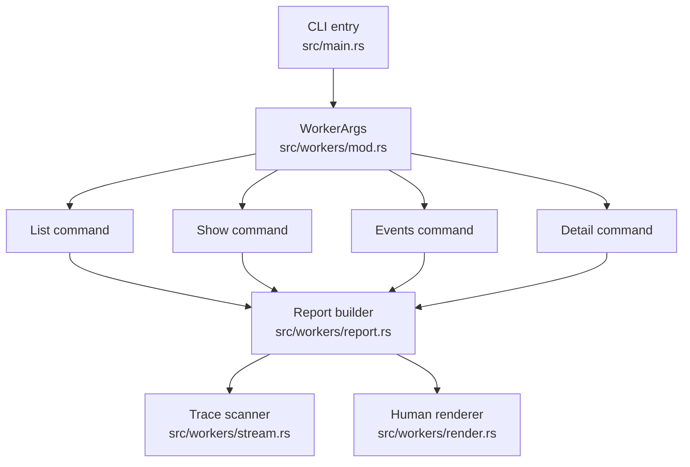
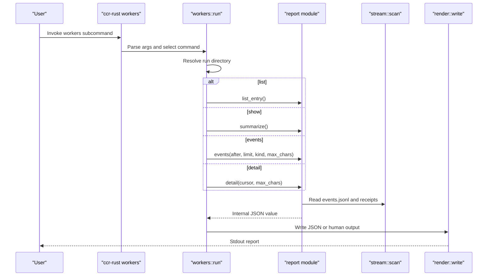
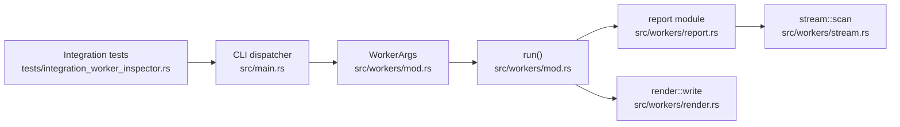

# Worker CLI Commands

<cite>
**Referenced Files in This Document**
- [main.rs](file://src/main.rs)
- [mod.rs](file://src/workers/mod.rs)
- [report.rs](file://src/workers/report.rs)
- [render.rs](file://src/workers/render.rs)
- [stream.rs](file://src/workers/stream.rs)
- [integration_worker_inspector.rs](file://tests/integration_worker_inspector.rs)
- [worker-inspection.md](file://docs/worker-inspection.md)
</cite>

## Table of Contents
1. [Introduction](#introduction)
2. [Project Structure](#project-structure)
3. [Core Components](#core-components)
4. [Architecture Overview](#architecture-overview)
5. [Detailed Component Analysis](#detailed-component-analysis)
6. [Dependency Analysis](#dependency-analysis)
7. [Performance Considerations](#performance-considerations)
8. [Troubleshooting Guide](#troubleshooting-guide)
9. [Conclusion](#conclusion)
10. [Appendices](#appendices)

## Introduction
This document describes the CCR-Rust worker inspection commands used to examine locally saved launcher artifacts without starting the router, connecting to a live listener, or calling models. The inspector reads receipt files, event traces, final reports, and stderr metadata from a local runs directory. It supports listing recent runs, browsing paginated event streams, inspecting individual tool outputs, and producing machine-readable summaries suitable for failure reporting.

The commands are designed as an inspection surface: they do not execute agent transcripts, change providers, resume workers, mark tasks verified, or modify artifacts. Successful output is one JSON document on stdout when `--json` is enabled; otherwise, a human-readable report is rendered. Errors go to stderr.

## Project Structure
The worker inspector is exposed as the `ccr-rust workers` subcommand and implemented under the `workers` module.



**Diagram sources**
- [main.rs:1-200](file://src/main.rs#L1-L200)
- [mod.rs:1-120](file://src/workers/mod.rs#L1-L120)
- [report.rs:1-120](file://src/workers/report.rs#L1-L120)
- [render.rs:1-160](file://src/workers/render.rs#L1-L160)

**Section sources**
- [main.rs:1-200](file://src/main.rs#L1-L200)
- [mod.rs:1-120](file://src/workers/mod.rs#L1-L120)

## Core Components
The worker inspector consists of four main parts:

| Component | Responsibility |
|---|---|
| `WorkerArgs` and `WorkerCommand` | Parse global options such as `--runs-dir` and `--json`, then dispatch to `list`, `show`, `events`, or `detail`. |
| `run` | Resolve the selected run directory, build the internal JSON value, and write either JSON or human-readable output. |
| `report` | Build structured summaries, list entries, events pages, and detail records from receipts and event traces. |
| `render` | Convert the internal JSON into compact terminal-friendly text, including headlines, event rows, truncation markers, and trace footers. |

Global options apply to every worker subcommand:

| Option | Type | Default | Meaning |
|---|---|---|---|
| `--runs-dir` | Path | `~/.cache/ccr-worker-runs` | Root directory containing saved launcher artifacts. Can also be set through `CCR_WORKER_RUNS_DIR`. |
| `--json` | Flag | Disabled | Emit one bounded JSON document instead of human-readable text. |

All successful commands return exit code 0 and print one JSON object with `schema_version: 1` when `--json` is used. Failure cases return non-zero status codes and print errors to stderr.

**Section sources**
- [mod.rs:1-120](file://src/workers/mod.rs#L1-L120)
- [mod.rs:120-221](file://src/workers/mod.rs#L120-L221)

## Architecture Overview
The inspector follows a read-only pipeline: argument parsing → run selection → artifact scanning → report construction → rendering.



**Diagram sources**
- [mod.rs:120-221](file://src/workers/mod.rs#L120-L221)
- [report.rs:1-200](file://src/workers/report.rs#L1-L200)
- [render.rs:1-160](file://src/workers/render.rs#L1-L160)

## Detailed Component Analysis

### Global Command Syntax
```text
ccr-rust workers [--runs-dir PATH] [--json] <subcommand>
```

| Parameter | Required | Description |
|---|---:|---|
| `--runs-dir` | No | Override the default launcher artifacts root. Environment variable `CCR_WORKER_RUNS_DIR` has the same effect. |
| `--json` | No | Emit one JSON document on stdout. |
| `subcommand` | Yes | One of `list`, `show`, `events`, `detail`. |

Common validation rules:

| Option | Allowed range | Behavior outside range |
|---|---:|---|
| `--limit` | 1–100 | Rejected during argument parsing. |
| `--max-chars` | 1–16000 | Rejected during argument parsing. |

**Section sources**
- [mod.rs:1-120](file://src/workers/mod.rs#L1-L120)

### Listing Agent Runs
Use `list` to enumerate recent runs. It never prints tool output or full final reports.

#### Syntax
```text
ccr-rust workers list [--limit N]
```

| Parameter | Required | Default | Description |
|---|---:|---:|---|
| `--limit` | No | 10 | Number of run summaries to include. |

#### Example usage
```text
ccr-rust workers list --limit 5
ccr-rust workers --json list --limit 3
```

#### Output format
When `--json` is disabled, each run appears as a headline line followed by a count summary. When `--json` is enabled, stdout contains one document with these fields:

| Field | Type | Meaning |
|---|---|---|
| `schema_version` | integer | Always `1`. |
| `runs` | array | Thin run summaries ordered newest first. |
| `total_runs` | integer | Total number of valid run directories discovered. |
| `omitted_runs` | integer | Number of runs beyond `--limit`. |

Each run entry includes:

| Field | Type | Meaning |
|---|--- |---|
| `run_id` | string | Run identifier or directory name. |
| `thread_id` | string | Thread identifier if present. |
| `outcome` | string | Launcher-reported outcome. |
| `task_verified` | boolean | Always false; inspection does not verify correctness. |
| `needs_attention` | boolean | True for non-completed outcomes, failed items, failed commands, event errors, or artifact warnings. |
| `model_requested` | string | Model requested by the launcher receipt. |
| `elapsed_seconds` | number | Elapsed time observed in the trace. |
| `commands_completed` | integer | Observed completed command executions. |
| `failed_commands` | integer | Observed failed command executions. |
| `failed_items` | integer | Observed failed items. |
| `file_changes` | integer | Observed file-change records. |
| `usage` | object | Aggregated token counters reported by the run. |

Runs are sorted with timestamped directories first (newest last), followed by other directories. A run is considered valid only if it contains at least one of `events.jsonl`, `status.json`, `final.txt`, or `stderr.txt`.

#### Filtering tips
- Use `--limit` to reduce output size.
- Combine `list` with `show` to move from summary to evidence.
- Prefer `needs_attention` and `failed_commands` / `failed_items` for identifying failures.
- Do not treat `completed` as a correctness verdict; use downstream verification separately.

**Section sources**
- [mod.rs:40-100](file://src/workers/mod.rs#L40-L100)
- [report.rs:120-200](file://src/workers/report.rs#L120-L200)
- [render.rs:40-80](file://src/workers/render.rs#L40-L80)
- [integration_worker_inspector.rs:130-170](file://tests/integration_worker_inspector.rs#L130-L170)

### Browsing Event Streams with Pagination
Use `events` to browse compact events from a run’s trace. This is the primary way to follow what a worker did over time.

#### Syntax
```text
ccr-rust workers events RUN [--after CURSOR] [--limit N] [--kind KIND] [--max-chars M]
```

| Parameter | Required | Default | Description |
|---|---:|---:|---|
| `RUN` | No | `latest` | Run selector: run ID, run directory, receipt path, or `latest`. |
| `--after` | No | 0 | Byte cursor returned by a previous page. |
| `--limit` | No | 20 | Number of events to return. |
| `--kind` | No | None | Filter by event type or item type. |
| `--max-chars` | No | 240 | Maximum character budget for event summaries. |

#### Examples
```text
ccr-rust workers events 2026-09-24-b --limit 20
ccr-rust workers events latest --after 1234 --limit 10
ccr-rust workers events RUN --kind command_execution --max-chars 500
ccr-rust workers --json events RUN --after NEXT_CURSOR --limit 10
```

#### Cursor contract
Each event carries a `cursor`, which is the byte position immediately after its complete JSONL record. To paginate:

1. Call `events RUN --limit N`.
2. Read `next_cursor` from the response.
3. Call `events RUN --after NEXT_CURSOR --limit N`.
4. Repeat until `has_more` is false.

Important cursor rules:

- Cursors are unique even across resumed turns because they refer to byte positions.
- Changing `--kind` while reusing a cursor does not replay old events.
- Use `--after 0` to start from the beginning.
- Invalid cursors or offsets beyond the current file size produce errors.
- An unterminated trailing record is deferred without advancing the cursor.
- `has_more` can be true with zero events when the trace still has a partial line. Wait before polling again.
- Cursors are not portable across file replacement or different runs.

#### Filtering
`--kind` matches event-level types and item-level types:

| Kind pattern | Matches |
|---|---|
| `error` | Event-type errors. |
| `turn.started` | Turn-start events. |
| `turn.completed` | Completed turns with usage data. |
| `item.started` | Started items. |
| `item.completed` | Completed items. |
| `command_execution` | Command execution items. |

Unknown event payloads are skipped by `detail`, but unknown event types still advance the cursor during pagination.

#### Output format
Human output lists each event with its cursor, event description, item ID, truncated summary, optional exit code, and a footer showing pagination state. JSON output contains:

| Field | Type | Meaning |
|---|--- |---|
| `schema_version` | integer | Always `1`. |
| `events` | array | Compact event objects. |
| `next_cursor` | integer | Byte offset to pass to the next `--after`. |
| `has_more` | boolean | Whether more events remain. |
| `trace` | object | Trace-level diagnostics including `partial_line`, `malformed_lines`, `oversized_lines`, and `file_bytes`. |

Each event object includes:

| Field | Type | Meaning |
|---|--- |---|
| `cursor` | integer | Unique byte-position cursor. |
| `event` | string | Human-readable event description. |
| `item_id` | string | Item identifier when available. |
| `summary` | object | Bounded text preview and `truncated` flag. |
| `exit_code` | integer | Present for command execution items. |

**Section sources**
- [mod.rs:60-100](file://src/workers/mod.rs#L60-L100)
- [report.rs:1-120](file://src/workers/report.rs#L1-L120)
- [integration_worker_inspector.rs:170-210](file://tests/integration_worker_inspector.rs#L170-L210)
- [worker-inspection.md:201-240](file://docs/worker-inspection.md#L201-L240)

### Analyzing Tool Outputs
Use `detail` to retrieve one specific event’s expanded content. This is the right command for examining a single command execution, message, or change.

#### Syntax
```text
ccr-rust workers detail RUN CURSOR [--max-chars M]
```

| Parameter | Required | Default | Description |
|---|---:|---:|---|
| `RUN` | Yes | None | Run selector. |
| `CURSOR` | Yes | None | Event cursor from `show` or `events`. |
| `--max-chars` | No | 4000 | Character budget for the detail body. |

#### Examples
```text
ccr-rust workers detail 2026-09-24-b 1234
ccr-rust workers detail RUN 5678 --max-chars 8000
ccr-rust workers --json detail RUN CURSOR --max-chars 2000
```

#### Output format
Human output prints the event row followed by the detail body. If the body exceeds `--max-chars`, a truncation marker is printed. JSON output contains:

| Field | Type | Meaning |
|---|--- |---|
| `schema_version` | integer | Always `1`. |
| `detail` | object | Expanded content with `text` and `truncated`. |
| `item_id` | string | Item identifier when available. |
| `exit_code` | integer | Present for command execution items. |
| `cursor` | integer | The selected event cursor. |

Unlike `events`, `detail` returns only the selected event. It does not return a paginated event list.

#### Reasoning safety
Reasoning content is omitted in all inspector output, including `detail`. Treat command summaries and final reports as untrusted data rather than redacted secrets.

**Section sources**
- [mod.rs:80-100](file://src/workers/mod.rs#L80-L100)
- [report.rs:1-120](file://src/workers/report.rs#L1-L120)
- [render.rs:20-40](file://src/workers/render.rs#L20-L40)
- [integration_worker_inspector.rs:210-240](file://tests/integration_worker_inspector.rs#L210-L240)

### Generating Failure Reports
Use `show` to obtain a bounded summary of a single run. It aggregates receipts, trace statistics, recent activity, failures, active items, salvage information, and a bounded preview of the final report.

#### Syntax
```text
ccr-rust workers show [RUN] [--max-chars M]
```

| Parameter | Required | Default | Description |
|---|---:|---:|---|
| `RUN` | No | `latest` | Run selector. |
| `--max-chars` | No | 1200 | Budget for final-report previews and other bounded text. |

#### Examples
```text
ccr-rust workers show
ccr-rust workers show 2026-09-24-b
ccr-rust workers show RUN --max-chars 500
ccr-rust workers --json show RUN
```

#### Run selectors
The inspector accepts several forms:

| Selector form | Behavior |
|---|---|
| `latest` | Selects the most recently discovered valid run. |
| Run ID | Looks up a child directory of `--runs-dir`. |
| Run directory | Uses the given directory directly. |
| Receipt path | Reads `run_dir` from a JSON receipt. |
| `events.jsonl` path | Uses its parent directory. |
| Other file path | Produces an error. |

Receipt-based selection is limited to 1 MiB and requires a `run_dir` field. Explicit paths and receipt `run_dir` values may point outside `--runs-dir`; use trusted selectors only.

#### Output format
Human output shows a headline with outcome, command counts, failed items, file changes, token totals, and an attention marker. It then lists started-but-incomplete items, failures, recent activity, warnings, salvage evidence, a bounded final report preview, and trace metadata.

JSON output contains:

| Field | Type | Meaning |
|---|--- |---|
| `schema_version` | integer | Always `1`. |
| `run_id` | string | Run identifier. |
| `outcome` | string | Launcher-reported outcome. |
| `task_verified` | boolean | Always false. |
| `needs_attention` | boolean | Indicates problems requiring manual review. |
| `model_requested` | string | Requested model from the receipt. |
| `elapsed_seconds` | number | Observed elapsed time. |
| `commands_completed` | integer | Completed command executions. |
| `failed_commands` | integer | Failed command executions. |
| `failed_items` | integer | Failed items. |
| `file_changes` | integer | File-change records. |
| `usage` | object | Token usage summary. |
| `active_items` | array | Items started without an observed completion. |
| `failures` | array | Observed failures. |
| `recent` | array | Recent bounded activity. |
| `warnings` | array | Artifact or receipt warnings. |
| `salvage` | object | Optional recovery evidence. |
| `final_report` | object | Bounded preview with `text` and `truncated`. |
| `trace` | object | Trace-level diagnostics. |

Usage fields are sums of reported turn usage:

| Field | Type | Meaning |
|---|--- |--- |
| `input_tokens` | integer | Reported input tokens. |
| `cached_input_tokens` | integer | Cached input tokens. |
| `output_tokens` | integer | Reported output tokens. |
| `reasoning_output_tokens` | integer | Reported reasoning output tokens. |
| `reported_turns` | integer | Number of turns reporting usage. |

A `reported_turns` value of zero means no usage was reported, not that token consumption was zero.

#### Salvage and recovery evidence
A `salvage` object may contain:

| Field | Type | Meaning |
|---|--- |--- |
| `partial_report_bytes` | integer | Size of any partial report. |
| `changed_path_count` | integer | Number of changed paths recorded. |
| `resume_command` | string | Recovery hint preserved from the launcher. |

Treat salvage data as evidence, not proof that tests passed or work is complete.

**Section sources**
- [mod.rs:50-100](file://src/workers/mod.rs#L50-L100)
- [report.rs:120-406](file://src/workers/report.rs#L120-L406)
- [render.rs:40-160](file://src/workers/render.rs#L40-L160)
- [worker-inspection.md:240-295](file://docs/worker-inspection.md#L240-L295)

## Dependency Analysis
The worker inspector has clear layering and minimal coupling:



Key relationships:

- `main.rs` declares the `Workers(ccr_rust::workers::WorkerArgs)` subcommand.
- `workers/mod.rs` defines argument parsing, run resolution, and command dispatch.
- `workers/report.rs` builds structured values from receipts and event traces.
- `workers/stream.rs` provides append-only trace scanning with cursor support.
- `workers/render.rs` formats JSON structures for terminal consumption.
- Integration tests validate JSON framing, stdout/stderr separation, argument handling, and lifecycle behavior.

There are no direct runtime dependencies on the router, MCP server, model providers, or database. The inspector depends only on local filesystem access and standard JSON parsing.

**Diagram sources**
- [main.rs:1-200](file://src/main.rs#L1-L200)
- [mod.rs:1-221](file://src/workers/mod.rs#L1-L221)
- [report.rs:1-200](file://src/workers/report.rs#L1-L200)
- [render.rs:1-160](file://src/workers/render.rs#L1-L160)
- [integration_worker_inspector.rs:1-80](file://tests/integration_worker_inspector.rs#L1-L80)

**Section sources**
- [main.rs:1-200](file://src/main.rs#L1-L200)
- [mod.rs:1-221](file://src/workers/mod.rs#L1-L221)

## Performance Considerations
The inspector is optimized for reading existing artifacts rather than streaming live data:

| Operation | Complexity | Notes |
|---|---|---|
| `list` | O(R + S) | R is the number of candidate run directories; S is the scan cost for the most recent runs. |
| `show` | O(T) | Scans the trace once to aggregate receipts, events, usage, and summaries. |
| `events` | O(K) | Starts at the supplied cursor and reads forward up to `--limit`. |
| `detail` | O(C) | Scans to the selected cursor and returns only that event. |

Memory characteristics:

- Individual event records are bounded.
- Summaries scan the selected trace without retaining raw outputs.
- Incremental `events` seeks directly to the supplied cursor.
- External receipt selectors are limited to 1 MiB.
- Oversized lines and malformed lines are skipped with counters.
- Control characters are neutralized before human rendering.
- Final report previews are bounded by `--max-chars`.

Optimization recommendations:

- Use `--limit` and `--max-chars` to control output size.
- Paginate with `events --after` instead of repeatedly requesting `--after 0`.
- Avoid polling rapidly when `trace.partial_line` is true.
- Prefer `list` for adoption metrics and `show` for per-run failure analysis.
- Use `detail` sparingly for targeted investigation rather than broad browsing.

[No sources needed since this section provides general guidance derived from implementation characteristics already cited above]

## Troubleshooting Guide

### Common Problems

| Symptom | Likely cause | Resolution |
|---|---|---|
| No runs found | `--runs-dir` points to an empty or incorrect location | Verify the launcher artifacts directory or pass `--runs-dir`. |
| `latest` fails | No valid run directories exist | Inspect the runs directory manually or select a known run ID. |
| `events` returns zero events with `has_more=true` | Trace has a partial line | Wait briefly and retry; do not spin. |
| Cursor-based pagination skips events | Cursor reused after changing `--kind` | Start from `--after 0` when you need to replay with a new filter. |
| `detail` returns no event | Invalid cursor or wrong run | Confirm the cursor belongs to the selected run and trace. |
| JSON output is missing or mixed with text | Missing `--json` or unexpected error | Add `--json` for automation; check stderr for errors. |
| Exit code is non-zero | Argument validation, missing run, invalid cursor, malformed receipt, or I/O error | Read stderr and fix the selector or environment. |

### Error Handling Rules
- Successful commands exit with code 0.
- Successful JSON output is exactly one document on stdout.
- Errors go to stderr.
- Validation errors for `--limit` and `--max-chars` occur during argument parsing.
- Missing or unreadable runs produce explicit errors.
- Malformed complete lines and oversized records are skipped with counters rather than failing the entire scan.
- Inspection exits 0 even for a failed worker; automation should inspect JSON fields and the launcher’s own exit code.

### Practical Workflows

#### Identifying failed runs
1. List recent runs and focus on those with `needs_attention=true`.
2. Inspect `failed_commands` and `failed_items`.
3. Use `show RUN` to see failures and salvage evidence.
4. Use `events RUN --kind command_execution` to locate failing commands.
5. Use `detail RUN CURSOR` to inspect the exact output of the failing command.

#### Examining a specific tool execution
1. Run `events RUN --kind command_execution --limit 50`.
2. Find the target event’s `cursor` and `exit_code`.
3. Run `detail RUN CURSOR --max-chars 8000`.
4. Check whether `detail.truncated` is true; increase `--max-chars` if needed.

#### Comparing performance across different providers
1. Use `show RUN --json` to compare `model_requested`, `elapsed_seconds`, and `usage`.
2. Compare `reported_turns` to understand how many turns reported usage.
3. Remember that `provider_verified` is always false; routing configuration is not live upstream proof.
4. Compare token counts cautiously: cached tokens are a subset of input, and reasoning tokens are a subset of output when reported.
5. Validate routing decisions separately using router or listener metrics.

#### Generating a failure report
1. Run `ccr-rust workers --json show RUN`.
2. Record `run_id`, `outcome`, `needs_attention`, `failed_commands`, `failed_items`, and `errors`.
3. Include relevant events and the `detail` output for the failing command.
4. Include salvage evidence when present.
5. State clearly that the report is evidence about the inspected surface, not an automatic approval decision.

**Section sources**
- [mod.rs:120-221](file://src/workers/mod.rs#L120-L221)
- [report.rs:1-120](file://src/workers/report.rs#L1-L120)
- [worker-inspection.md:240-295](file://docs/worker-inspection.md#L240-L295)
- [integration_worker_inspector.rs:80-130](file://tests/integration_worker_inspector.rs#L80-L130)

## Conclusion
The CCR-Rust worker inspector provides a safe, low-context surface for examining locally saved launcher artifacts. Its four commands cover the common analysis workflow: discover runs with `list`, inspect a run with `show`, browse incremental evidence with `events`, and expand a specific event with `detail`. All commands support bounded budgets, cursor-based pagination, and machine-readable JSON output.

The most important operational rule is that inspector results are evidence, not automatic approval. Completed outcomes, command counts, file changes, and final reports must be interpreted carefully, especially when commands failed, processes terminated unexpectedly, or receipts are incomplete. For automation, rely on JSON fields and explicit exit codes rather than parsing human-rendered text.

[No sources needed since this section summarizes without analyzing specific files]

## Appendices

### Appendix A: Command Reference Summary

| Command | Purpose | Key Options | Typical Next Step |
|---|---|---|---|
| `ccr-rust workers list` | Summarize recent runs | `--limit` | Pick a run for `show`. |
| `ccr-rust workers show RUN` | Summarize one run | `--max-chars` | Browse events or inspect details. |
| `ccr-rust workers events RUN` | Page through events | `--after`, `--limit`, `--kind`, `--max-chars` | Use `detail` for a specific cursor. |
| `ccr-rust workers detail RUN CURSOR` | Expand one event | `--max-chars` | Include output in a failure report. |

### Appendix B: Interpretation Checklist
- Treat `completed` as launcher outcome, not test correctness.
- Treat `running` and `receipt_pending` as launcher state signals, not process liveness guarantees.
- Treat `needs_attention` as a signal to inspect further, not as a verdict.
- Treat salvage evidence as recovery hints, not proof of success.
- Treat `model_requested` as launcher receipt data, not live provider verification.
- Treat token usage as reported, not necessarily complete.
- Keep original artifacts for deeper inspection when automated summaries are insufficient.

**Section sources**
- [worker-inspection.md:240-295](file://docs/worker-inspection.md#L240-L295)