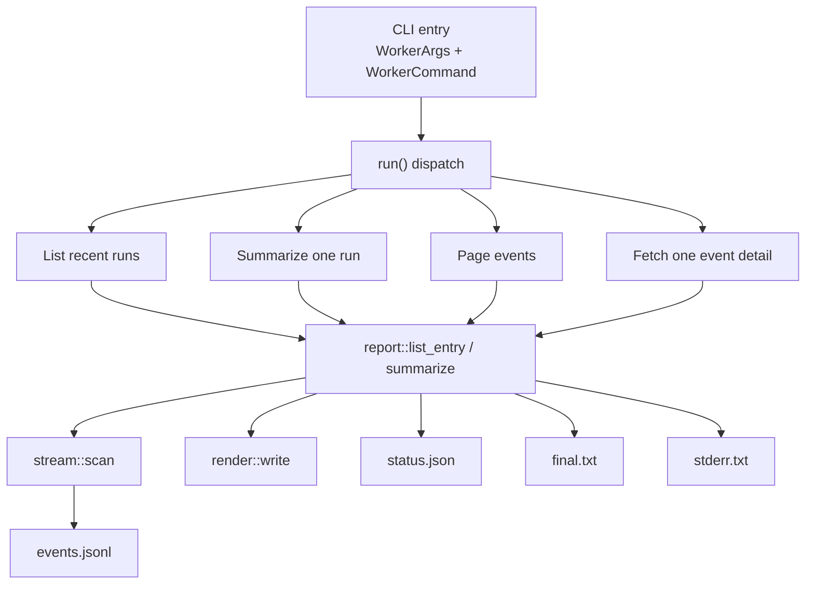
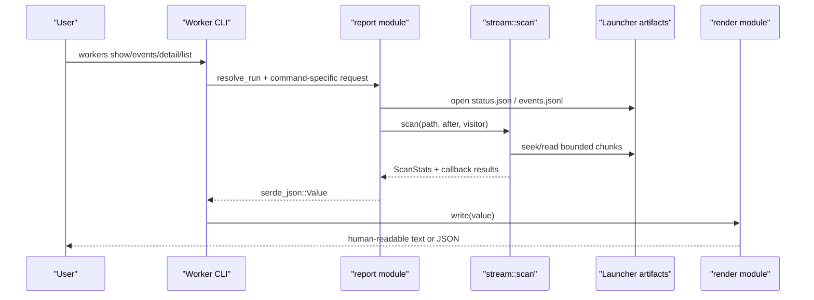
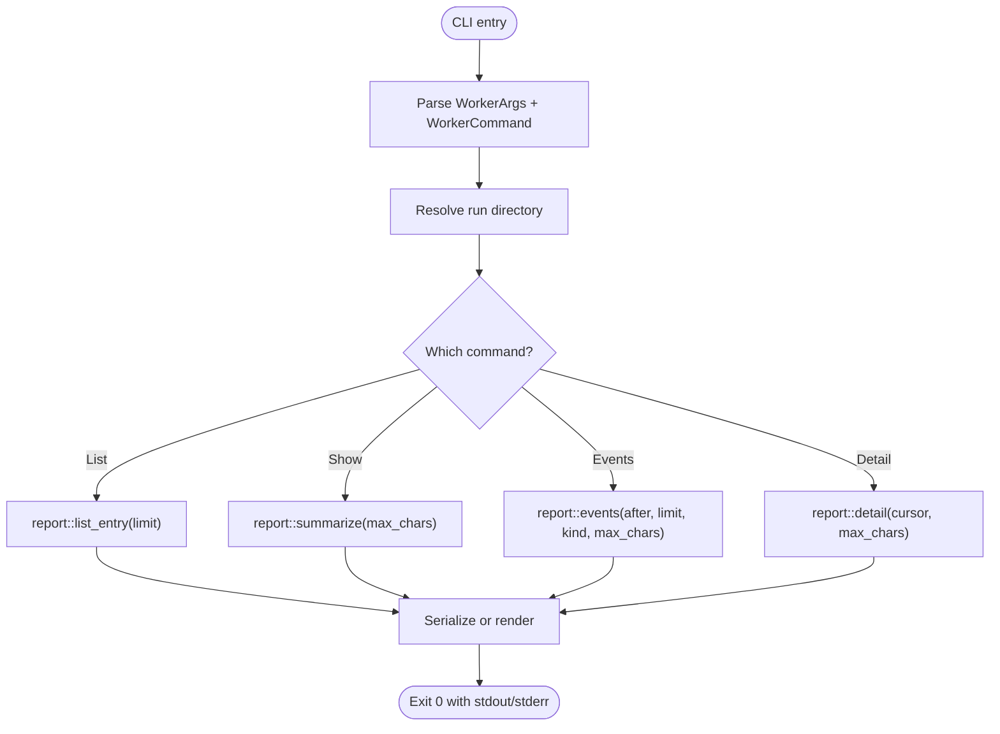
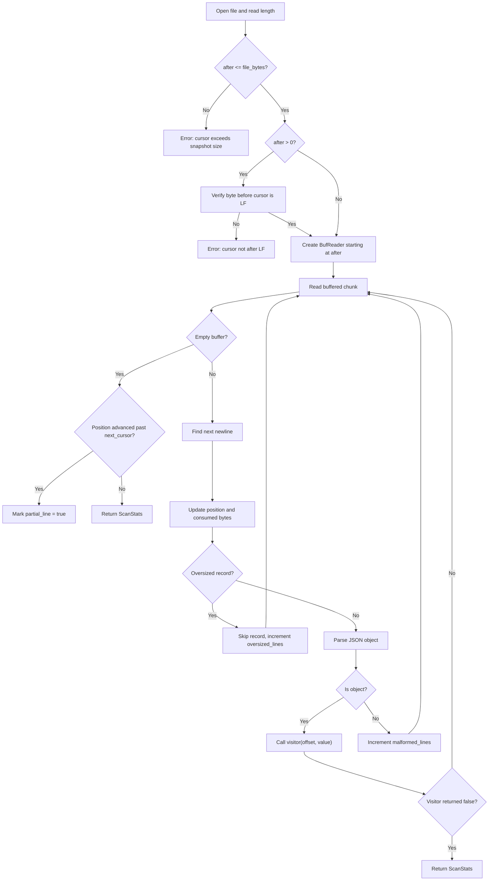
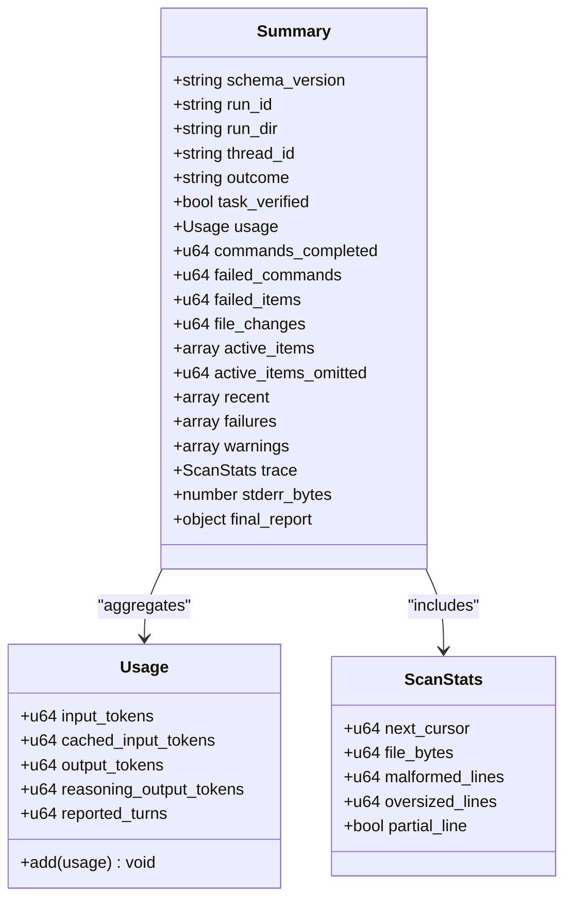
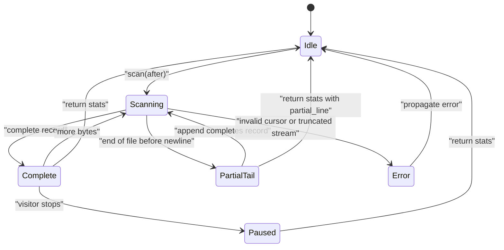
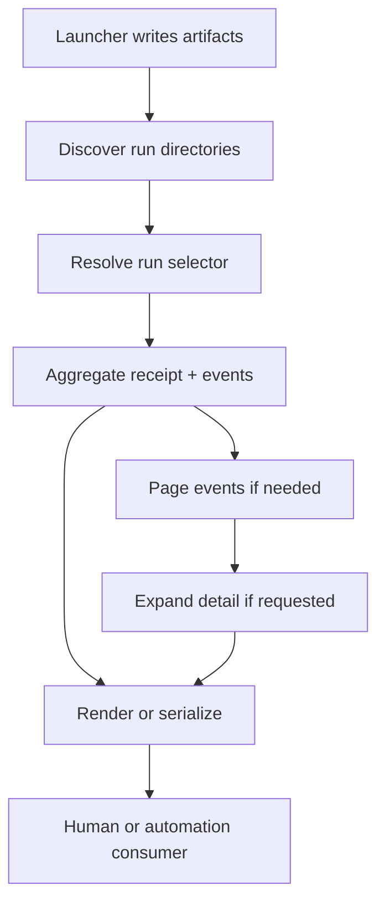
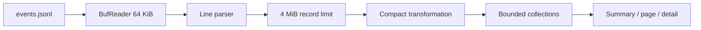

# Worker Data Models and Structures

<cite>
**Referenced Files in This Document**
- [src/workers/mod.rs](file://src/workers/mod.rs)
- [src/workers/stream.rs](file://src/workers/stream.rs)
- [src/workers/report.rs](file://src/workers/report.rs)
- [src/workers/render.rs](file://src/workers/render.rs)
- [docs/worker-inspection.md](file://docs/worker-inspection.md)
- [benches/concurrent_streams.rs](file://benches/concurrent_streams.rs)
</cite>

## Table of Contents
1. [Introduction](#introduction)
2. [Project Structure](#project-structure)
3. [Core Components](#core-components)
4. [Architecture Overview](#architecture-overview)
5. [Detailed Component Analysis](#detailed-component-analysis)
6. [Data Models and Serialization Schemas](#data-models-and-serialization-schemas)
7. [Streaming and Cursor Contract](#streaming-and-cursor-contract)
8. [Lifecycle of Worker Data](#lifecycle-of-worker-data)
9. [Memory Management and Performance](#memory-management-and-performance)
10. [Troubleshooting Guide](#troubleshooting-guide)
11. [Conclusion](#conclusion)

## Introduction
This document explains the worker data models and internal structures used by CCR-Rust’s inspection system. It focuses on how launcher artifacts are discovered, parsed, summarized, paginated, and rendered into human-readable or machine-readable output. The primary raw artifact is an append-only JSON Lines event stream, optionally accompanied by a receipt, final report, and diagnostic files.

The inspection layer does not call external APIs, start MCP servers, or modify launcher artifacts. It reads local traces under `~/.cache/ccr-worker-runs` (or a user-supplied directory), aggregates bounded summaries, and exposes cursor-based pagination for large datasets.

## Project Structure
The worker inspection subsystem lives under `src/workers` and is composed of four cooperating modules:

| Module | Responsibility |
| --- | --- |
| `mod.rs` | CLI argument parsing, run discovery, command dispatch, and top-level orchestration. |
| `stream.rs` | Low-level streaming scan over the JSON Lines trace with byte cursors and bounded memory. |
| `report.rs` | Aggregation of receipts and events into compact lists, summaries, event pages, and per-event details. |
| `render.rs` | Safe, single-line, control-character-neutral text rendering for human consumption. |

**Diagram sources**
- [src/workers/mod.rs:21-171](file://src/workers/mod.rs#L21-L171)
- [src/workers/report.rs:1-406](file://src/workers/report.rs#L1-L406)
- [src/workers/stream.rs:1-107](file://src/workers/stream.rs#L1-L107)
- [src/workers/render.rs:1-160](file://src/workers/render.rs#L1-L160)

**Section sources**
- [src/workers/mod.rs:21-171](file://src/workers/mod.rs#L21-L171)
- [src/workers/stream.rs:1-107](file://src/workers/stream.rs#L1-L107)
- [src/workers/report.rs:1-406](file://src/workers/report.rs#L1-L406)
- [src/workers/render.rs:1-160](file://src/workers/render.rs#L1-L160)

## Core Components
The inspection pipeline has five core responsibilities:

1. **Run discovery:** Enumerate subdirectories that contain the expected launcher artifact set (`events.jsonl`, `status.json`, `final.txt`, `stderr.txt`). Sort timestamped directories first, then other names.
2. **Streaming scan:** Read `events.jsonl` from a byte cursor without loading the whole file into memory.
3. **Report construction:** Combine launcher receipt fields with scanned event statistics to produce list entries, summaries, event pages, and details.
4. **Rendering:** Convert structured values into safe, bounded, single-line terminal output.
5. **Serialization:** Optionally emit one complete JSON document per invocation when `--json` is enabled.

Key constraints enforced throughout:
- Argument limits: `--limit` is 1–100; `--max-chars` is 1–16000.
- Record limit: individual JSON Lines records larger than 4 MiB are skipped.
- Receipt limit: `status.json` is read up to 1 MiB.
- Truncation is explicit via boolean flags such as `truncated`.
- Control characters are neutralized before rendering.

**Section sources**
- [src/workers/mod.rs:21-171](file://src/workers/mod.rs#L21-L171)
- [src/workers/stream.rs:11-20](file://src/workers/stream.rs#L11-L20)
- [src/workers/report.rs:11-21](file://src/workers/report.rs#L11-L21)
- [docs/worker-inspection.md:218-240](file://docs/worker-inspection.md#L218-L240)

## Architecture Overview
The runtime architecture separates concerns between I/O, parsing, aggregation, and presentation.

**Diagram sources**
- [src/workers/mod.rs:90-171](file://src/workers/mod.rs#L90-L171)
- [src/workers/report.rs:148-406](file://src/workers/report.rs#L148-L406)
- [src/workers/stream.rs:22-107](file://src/workers/stream.rs#L22-L107)
- [src/workers/render.rs:65-160](file://src/workers/render.rs#L65-L160)

## Detailed Component Analysis

### CLI and Command Dispatch
The `WorkerArgs` structure defines the global options:
- `runs_dir`: Optional path overriding `~/.cache/ccr-worker-runs`.
- `json`: Emit one JSON document instead of human-readable output.

The `WorkerCommand` enum supports four operations:
- `List`: Returns thin summaries of recent runs.
- `Show`: Returns a bounded summary of one run.
- `Events`: Returns a page of compact events with pagination metadata.
- `Detail`: Returns one event’s expanded content at its exact byte cursor.

Validation rules include:
- `parse_limit` accepts 1–100.
- `parse_chars` accepts 1–16000.
- Run selection resolves `latest`, existing paths, root-relative IDs, or explicit receipt paths.

**Diagram sources**
- [src/workers/mod.rs:21-171](file://src/workers/mod.rs#L21-L171)

**Section sources**
- [src/workers/mod.rs:21-171](file://src/workers/mod.rs#L21-L171)

### Streaming Scanner
The scanner is the foundation for efficient processing of large event datasets. Its key properties are:

| Concept | Implementation |
| --- | --- |
| Input format | Append-only JSON Lines file. |
| Positioning | Byte offset cursor immediately after a complete record. |
| Chunk size | 64 KiB buffered reader. |
| Maximum record size | 4 MiB; oversized records are skipped but do not stop scanning. |
| Partial tail handling | A trailing incomplete record sets `partial_line = true` and does not advance past it. |
| Malformed handling | Non-object JSON values increment `malformed_lines`; they are not passed to the visitor. |
| Progress tracking | `next_cursor` advances only after a complete newline-delimited record. |

**Diagram sources**
- [src/workers/stream.rs:22-107](file://src/workers/stream.rs#L22-L107)

**Section sources**
- [src/workers/stream.rs:11-107](file://src/workers/stream.rs#L11-L107)

### Report Builder
The report builder combines two data sources:
1. **Receipt (`status.json`):** High-level launcher outcome, model name, configuration, salvage information, and error arrays.
2. **Event stream (`events.jsonl`):** Typed events such as thread starts, turns, item starts/completions, errors, and usage reports.

Important aggregation behaviors:
- Usage counters are summed across `turn.completed` events.
- Active items are tracked per turn and capped at 100 entries; excess increments `active_items_omitted`.
- Recent and failure histories are bounded using a fixed-size queue.
- Command execution and file change item types contribute to aggregate counts.
- Warnings are accumulated when traces are malformed, oversized, truncated, or missing.

**Diagram sources**
- [src/workers/report.rs:54-90](file://src/workers/report.rs#L54-L90)
- [src/workers/report.rs:148-335](file://src/workers/report.rs#L148-L335)
- [src/workers/stream.rs:15-20](file://src/workers/stream.rs#L15-L20)

**Section sources**
- [src/workers/report.rs:11-406](file://src/workers/report.rs#L11-L406)

### Human Renderer
The renderer converts structured JSON values into terminal-friendly text. Its safety measures include:
- Flattening multi-line strings into single lines.
- Replacing newlines, tabs, and carriage returns with spaces.
- Neutralizing non-newline/tabs control characters.
- Rendering truncation hints explicitly.
- Avoiding injection through untrusted human-readable fields.

It supports three main output shapes:
- Run list headlines with omission footers.
- Event pages with pagination metadata.
- Single-event detail with optional expanded content.

**Section sources**
- [src/workers/render.rs:1-160](file://src/workers/render.rs#L1-L160)

## Data Models and Serialization Schemas

### Raw Artifact Layout
Each worker run is represented as a directory containing:

| File | Purpose | Access Rules |
| --- | --- | --- |
| `events.jsonl` | Append-only JSON Lines event stream. | Scanned with cursor-based pagination. |
| `status.json` | Launcher receipt with outcome, model, configuration, and errors. | Limited to 1 MiB; must be a JSON object. |
| `final.txt` | Worker-generated final report. | Previewed with truncation detection. |
| `stderr.txt` | Diagnostic output from the launcher. | Size counted but not included in summaries. |

Run discovery requires at least one of these files to exist inside the candidate directory.

**Section sources**
- [src/workers/mod.rs:173-221](file://src/workers/mod.rs#L173-L221)
- [src/workers/report.rs:23-52](file://src/workers/report.rs#L23-L52)

### Compact Event Schema
A compact event is produced by `compact(cursor, event, max_chars)` and reused in summaries, recent/failure lists, and event pages.

| Field | Type | Meaning |
| --- | --- | --- |
| `cursor` | integer | Byte position immediately after the complete JSON Lines record. |
| `event` | string | Normalized short form of the event type. |
| `item_type` | string | Normalized form of `item.type`. |
| `item_id` | string | Normalized form of `item.id`. |
| `status` | string | Normalized form of `item.status`. |
| `exit_code` | integer or null | Exit code when present. |
| `summary.text` | string | Bounded preview of source content. |
| `summary.truncated` | boolean | Whether the original source exceeded the character budget. |
| `change_count` | integer | Number of changes in a file-change item. |
| `changes_omitted` | integer | Extra changes beyond the displayed subset. |
| `output_bytes` | integer or null | Length of aggregated output when available. |

Source extraction varies by item type:
- `command_execution`: command string.
- `agent_message`: message text.
- `file_change`: limited change kinds and paths.
- `mcp_tool_call`: server and tool names.
- `web_search`: query string.
- Errors and failed turns: error or message field.
- Reasoning: explicitly omitted.

**Section sources**
- [src/workers/report.rs:337-376](file://src/workers/report.rs#L337-L376)

### List Entry Schema
Returned by `report::list_entry`. It contains a reduced set of fields suitable for listing:

| Field | Source |
| --- | --- |
| `schema_version` | Literal `1`. |
| `run_id` | Directory name. |
| `thread_id` | From event or receipt. |
| `outcome` | From receipt. |
| `task_verified` | Always `false`. |
| `needs_attention` | Derived from outcome and counters. |
| `model_requested` | From receipt. |
| `elapsed_seconds` | From receipt. |
| `commands_completed` | Aggregated from events. |
| `failed_commands` | Max of event count and receipt counter. |
| `failed_items` | Aggregated from events. |
| `file_changes` | Aggregated from file-change items. |
| `usage` | Summed usage object. |

**Section sources**
- [src/workers/report.rs:118-146](file://src/workers/report.rs#L118-L146)

### Show Summary Schema
Returned by `report::summarize`. It extends the list entry with richer context:

| Field | Meaning |
| --- | --- |
| `schema_version` | Fixed to `1`. |
| `run_id`, `run_dir` | Identifier and filesystem location. |
| `thread_id` | Thread identifier if present. |
| `outcome` | Launcher-reported outcome. |
| `task_verified` | Always `false`. |
| `cwd`, `brief_path` | Optional launcher context. |
| `salvage` | Optional recovery evidence from receipt. |
| `needs_attention` | True when there are failures, errors, warnings, or non-completed outcomes. |
| `model_requested`, `provider_verified` | Model name and verification flag. |
| `elapsed_seconds`, `exit_code`, `read_only`, `network_allowed`, `retry_not_before` | Launcher metadata. |
| `usage` | Accumulated token and turn counters. |
| `commands_completed`, `failed_commands`, `failed_items`, `file_changes`, `errors`, `turns_completed` | Event-derived metrics. |
| `active_items` | Up to five started-but-not-completed items. |
| `active_items_omitted` | Count of dropped active items. |
| `recent` | Up to five recent non-reasoning items. |
| `failures` | Up to five failed/error/failed-turn items. |
| `warnings` | Descriptive warnings about artifacts and traces. |
| `trace` | Underlying `ScanStats`. |
| `stderr_bytes` | Size of separate stderr file. |
| `final_report` | Optional truncated preview of `final.txt`. |

**Section sources**
- [src/workers/report.rs:148-335](file://src/workers/report.rs#L148-L335)

### Events Page Schema
Returned by `report::events`:

| Field | Meaning |
| --- | --- |
| `schema_version` | Fixed to `1`. |
| `run_id`, `run_dir` | Identifiers. |
| `events` | Array of compact events matching the optional filter. |
| `next_cursor` | Cursor for the next page. |
| `has_more` | True when more bytes remain after `next_cursor`. |
| `trace` | Underlying `ScanStats`. |

Filtering can match either the event type or the nested item type. Filtering does not affect cursor advancement: all complete records still move the cursor forward.

**Section sources**
- [src/workers/report.rs:378-396](file://src/workers/report.rs#L378-L396)

### Detail Schema
Returned by `report::detail`:

| Field | Meaning |
| --- | --- |
| `schema_version` | Fixed to `1`. |
| Fields inherited from compact event | Cursor, event, item metadata, summary, change counts. |
| `detail.text` | Expanded content for supported item/event types. |
| `detail.truncated` | Whether the expanded content exceeded the character budget. |

Supported detail expansion includes command execution output, agent messages, file-change payloads, MCP tool calls, web search queries, todo lists, turn completion usage, and error/failed-turn diagnostics. Reasoning content is always omitted.

**Section sources**
- [src/workers/report.rs:398-406](file://src/workers/report.rs#L398-L406)

### Usage Schema
Internal accumulation structure exposed in summaries:

| Field | Meaning |
| --- | --- |
| `input_tokens` | Input tokens summed across reported turns. |
| `cached_input_tokens` | Cached input tokens summed across reported turns. |
| `output_tokens` | Output tokens summed across reported turns. |
| `reasoning_output_tokens` | Reasoning output tokens summed across reported turns. |
| `reported_turns` | Number of `turn.completed` usage records processed. |

Sums use saturating addition to avoid overflow on malformed numeric fields.

**Section sources**
- [src/workers/report.rs:54-90](file://src/workers/report.rs#L54-L90)

## Streaming and Cursor Contract

### Cursor Semantics
A cursor is a byte offset pointing immediately after a complete JSON Lines record. It has these guarantees:
- Uniqueness within a run: even if resumed turns reuse item IDs, the cursor remains unique.
- Pagination: pass the previous page’s `next_cursor` as the next `--after`.
- Filtering independence: changing `--kind` while keeping a cursor does not replay old events.
- Snapshot semantics: reads stop at the current file length.
- Partial tail safety: an unterminated trailing record is deferred; polling should wait rather than spin.
- Invalid cursor handling: cursors not aligned to line endings or beyond file length fail.
- Non-portability: cursors assume append-only traces and are not portable across file replacement or different runs.

**Diagram sources**
- [src/workers/stream.rs:22-107](file://src/workers/stream.rs#L22-L107)
- [docs/worker-inspection.md:232-259](file://docs/worker-inspection.md#L232-L259)

**Section sources**
- [src/workers/stream.rs:22-107](file://src/workers/stream.rs#L22-L107)
- [docs/worker-inspection.md:232-259](file://docs/worker-inspection.md#L232-L259)

## Lifecycle of Worker Data

### Generation
The launcher writes:
1. An append-only `events.jsonl` event stream.
2. A `status.json` receipt when available.
3. A `final.txt` report when available.
4. A `stderr.txt` diagnostic file when available.

The inspector never generates or modifies these artifacts.

### Discovery
`run_directories` enumerates candidate directories under the configured runs directory and filters those containing the expected artifact files. Timestamp-prefixed directories are sorted newest-first, followed by other names.

### Summarization
`summarize` opens the receipt, scans the event stream, accumulates usage and activity, previews the final report, and constructs a rich summary. Missing or unreadable artifacts become warnings rather than fatal failures where appropriate.

### Pagination
`events` scans from a cursor, applies optional filtering, collects compact events, and returns pagination metadata.

### Detail Retrieval
`detail` scans from the beginning until it reaches the requested cursor, expands supported content, and wraps it in a bounded preview.

### Rendering or Serialization
The CLI renders human-readable output unless `--json` is provided, in which case it serializes the underlying `serde_json::Value`.

**Diagram sources**
- [src/workers/mod.rs:90-171](file://src/workers/mod.rs#L90-L171)
- [src/workers/report.rs:118-406](file://src/workers/report.rs#L118-L406)

**Section sources**
- [src/workers/mod.rs:90-221](file://src/workers/mod.rs#L90-L221)
- [src/workers/report.rs:118-406](file://src/workers/report.rs#L118-L406)

## Memory Management and Performance

### Streaming Boundaries
The scanner avoids loading entire traces into memory:
- Buffered reads use 64 KiB chunks.
- Individual record buffers are cleared after each complete record.
- Records exceeding 4 MiB are skipped without being retained.
- Only compact summaries are collected for event pages, not raw outputs.
- Partial tails are detected but not deserialized.

### Aggregation Limits
- Active items are capped at 100; excess increments a counter.
- Recent and failure lists are bounded to five entries.
- Final report previews are limited and mark truncation explicitly.
- Receipts are limited to 1 MiB.

### Time Complexity
- `scan` is approximately linear in the number of bytes from `after` to the end of the file.
- `events` is linear in the scanned range plus JSON parsing for complete records.
- `detail` is linear in the number of bytes up to the requested cursor because it scans from zero.
- `summarize` is linear in the full trace size because it builds aggregate statistics.

### Optimization Opportunities
- `detail` could benefit from an index mapping cursors to offsets if frequently used against very large traces.
- Concurrent stream processing exists conceptually through the benchmark placeholder, but the current implementation uses sequential scanning per command.
- Batched event collection could be tuned for higher throughput when many events fit within the page limit.
- Cache-aware scanning could reduce repeated scans when multiple commands operate on the same run.

**Diagram sources**
- [src/workers/stream.rs:11-20](file://src/workers/stream.rs#L11-L20)
- [src/workers/stream.rs:22-107](file://src/workers/stream.rs#L22-L107)
- [src/workers/report.rs:54-90](file://src/workers/report.rs#L54-L90)

**Section sources**
- [src/workers/stream.rs:11-107](file://src/workers/stream.rs#L11-L107)
- [src/workers/report.rs:54-90](file://src/workers/report.rs#L54-L90)
- [benches/concurrent_streams.rs:1-9](file://benches/concurrent_streams.rs#L1-L9)

## Troubleshooting Guide

| Symptom | Likely Cause | Recommended Action |
| --- | --- | --- |
| `cursor exceeds worker stream snapshot size` | The cursor refers beyond the current file length. | Restart from cursor `0` or wait for the writer to finish. |
| `cursor is not immediately after LF` | The cursor is misaligned with a line boundary. | Use a cursor returned by this inspection system; do not guess offsets. |
| `worker stream was truncated during inspection` | The underlying file disappeared or shrank during scanning. | Retry from cursor `0`; this assumes append-only traces. |
| `no complete event at that cursor` | The cursor does not correspond to a complete record. | Use a cursor from `workers events` or `workers show`. |
| `events.jsonl is not available` | The trace file is missing. | Inspect the run directory locally; treat warnings as incomplete evidence. |
| `worker receipt exceeds 1 MiB` | `status.json` is too large. | Inspect the artifact directly; the inspector enforces a hard limit. |
| `trace contains skipped records` | Malformed or oversized JSON Lines records were encountered. | Treat counts as potentially incomplete; inspect the original trace. |
| `partial trailing record deferred` | The writer is still appending. | Wait and retry with the same cursor. |
| Human output contains unexpected control characters | Untrusted text was injected. | The renderer neutralizes most control characters; verify output and prefer `--json` for automation. |
| `needs_attention` is true unexpectedly | Outcome is not completed, or there are failures, errors, or warnings. | Review `failures`, `warnings`, and relevant `detail` entries. |

**Section sources**
- [src/workers/stream.rs:30-61](file://src/workers/stream.rs#L30-L61)
- [src/workers/report.rs:212-237](file://src/workers/report.rs#L212-L237)
- [docs/worker-inspection.md:232-295](file://docs/worker-inspection.md#L232-L295)

## Conclusion
CCR-Rust’s worker inspection system separates launcher artifact reading from application logic through a small, well-bounded pipeline. The scanner provides safe, cursor-driven access to large JSON Lines traces. The report builder transforms low-level events into actionable summaries while enforcing explicit limits and truncation signals. The renderer protects human-facing output from control-character injection, and the CLI exposes both machine-readable and human-readable interfaces.

For large datasets, the recommended access pattern is:
1. Use `list` to find runs.
2. Use `show` to decide whether deeper inspection is needed.
3. Use `events` with stable cursors for incremental processing.
4. Use `detail` only for specific events requiring expanded content.
5. Prefer `--json` for automation and retain raw artifacts for offline verification.

The design prioritizes safety, bounded memory, and explicit truncation over convenience. It treats worker reports as evidence, not automated approval, and keeps inspection side-effect free.