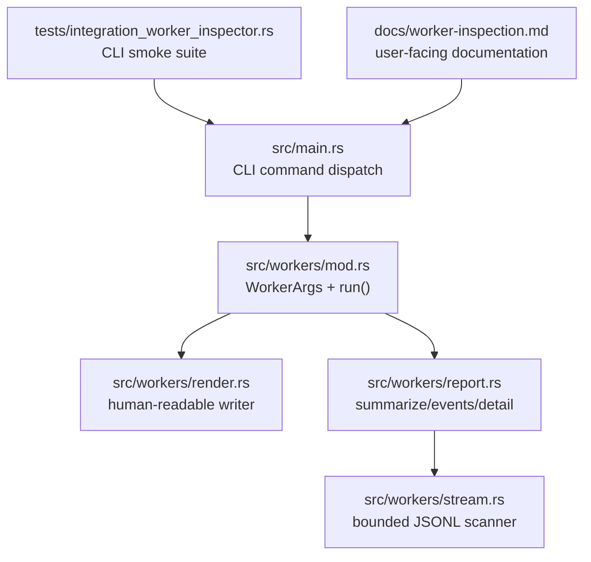
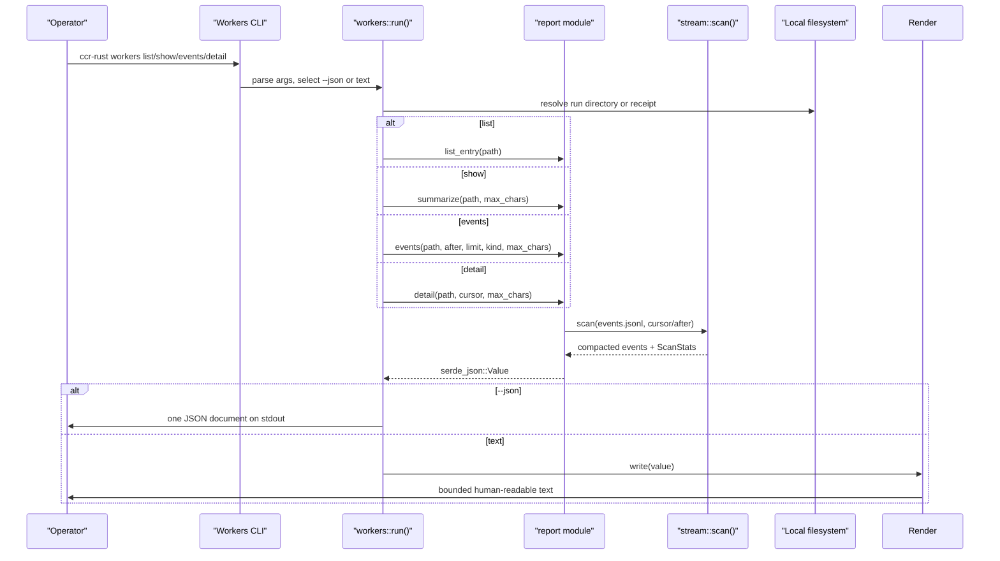
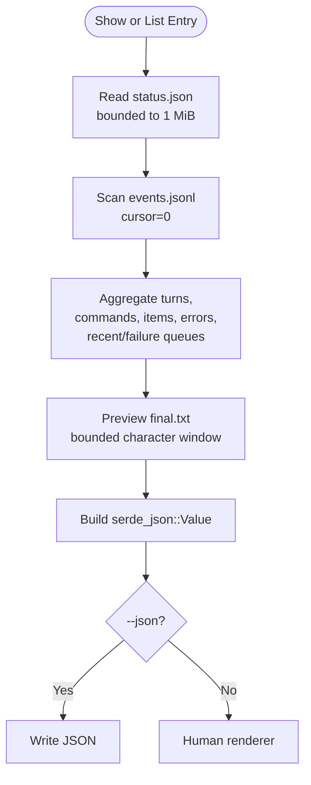
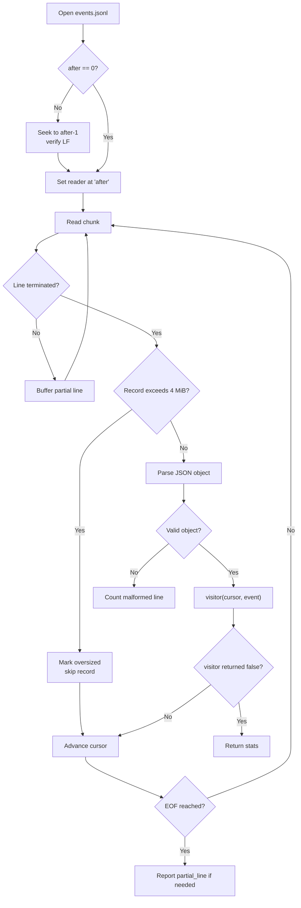
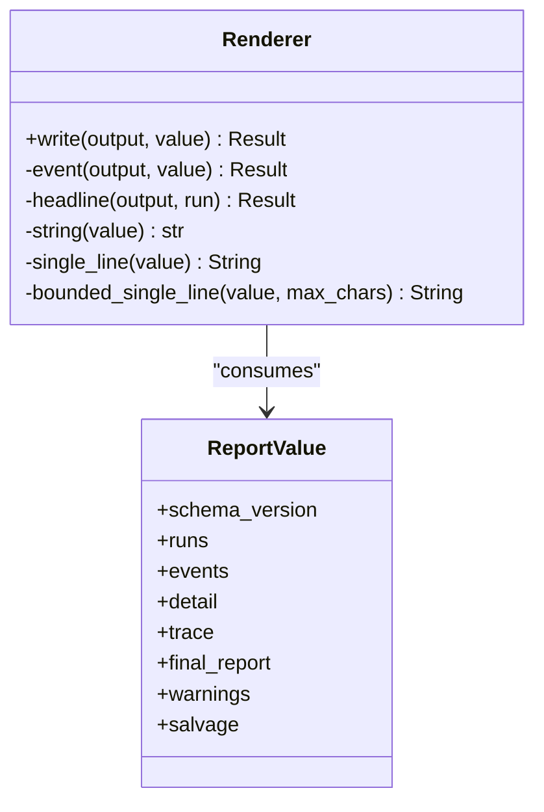
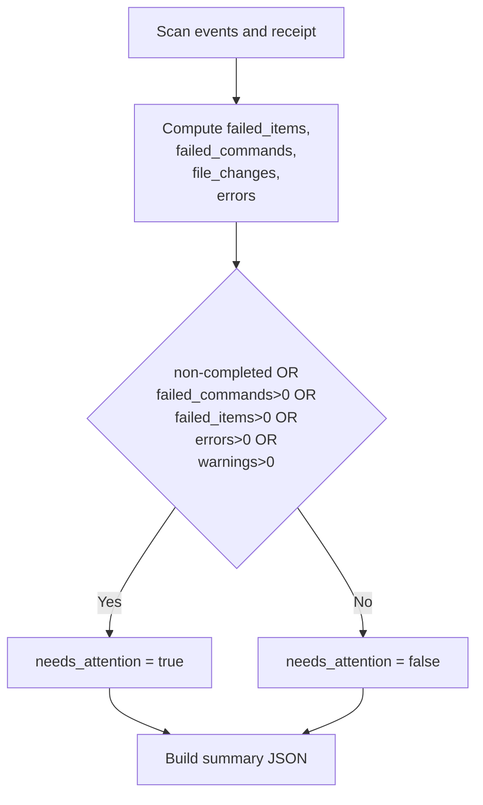
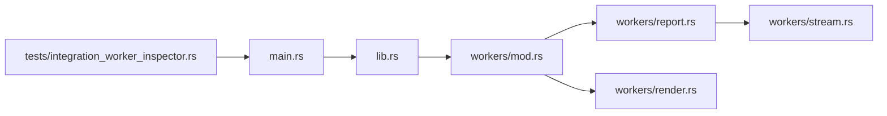

# Worker Inspection and Analysis

<cite>
**Referenced Files in This Document**   
- [main.rs](file://src/main.rs)
- [lib.rs](file://src/lib.rs)
- [mod.rs](file://src/workers/mod.rs)
- [render.rs](file://src/workers/render.rs)
- [report.rs](file://src/workers/report.rs)
- [stream.rs](file://src/workers/stream.rs)
- [integration_worker_inspector.rs](file://tests/integration_worker_inspector.rs)
- [worker-inspection.md](file://docs/worker-inspection.md)
- [ccr_worker_usage.py](file://scripts/ccr_worker_usage.py)
</cite>

## Table of Contents
1. [Introduction](#introduction)
2. [Project Structure](#project-structure)
3. [Core Components](#core-components)
4. [Architecture Overview](#architecture-overview)
5. [Detailed Component Analysis](#detailed-component-analysis)
6. [Dependency Analysis](#dependency-analysis)
7. [Performance Considerations](#performance-considerations)
8. [Troubleshooting Guide](#troubleshooting-guide)
9. [Conclusion](#conclusion)
10. [Appendices](#appendices)

## Introduction
This document explains CCR-Rust’s worker inspection and analysis capabilities: how to list agent runs, browse event streams with pagination, inspect tool outputs, summarize failures, and interpret metrics. It focuses on the local artifact inspection path, which reads launcher-produced traces under `~/.cache/ccr-worker-runs` without calling models, MCP servers, or the live router.

The inspector is deliberately read-only and bounded: it never retries workers, changes providers, executes transcript commands, marks tasks verified, or modifies artifacts. Human-readable output sanitizes control characters, while JSON output exposes structured fields for automation.

## Project Structure
Worker inspection lives under `src/workers`, is registered as a CLI subcommand, and is tested through both focused unit tests and an integration test that launches the real binary.

**Diagram sources**
- [main.rs:154-154](file://src/main.rs#L154-L154)
- [main.rs:841-841](file://src/main.rs#L841-L841)
- [lib.rs:27-27](file://src/lib.rs#L27-L27)
- [mod.rs:17-147](file://src/workers/mod.rs#L17-L147)
- [render.rs:1-160](file://src/workers/render.rs#L1-L160)
- [report.rs:1-406](file://src/workers/report.rs#L1-L406)
- [stream.rs:1-107](file://src/workers/stream.rs#L1-L107)
- [integration_worker_inspector.rs:1-306](file://tests/integration_worker_inspector.rs#L1-L306)
- [worker-inspection.md:1-295](file://docs/worker-inspection.md#L1-L295)

**Section sources**
- [main.rs:154-154](file://src/main.rs#L154-L154)
- [main.rs:841-841](file://src/main.rs#L841-L841)
- [lib.rs:27-27](file://src/lib.rs#L27-L27)
- [mod.rs:17-147](file://src/workers/mod.rs#L17-L147)

## Core Components
The worker inspection subsystem has four layers:

| Layer | Responsibility | Key file |
|---|---|---|
| CLI entry | Parses global options and subcommands; selects JSON vs human rendering | [mod.rs](file://src/workers/mod.rs) |
| Data assembly | Reads receipts, scans events, aggregates counts, builds summaries | [report.rs](file://src/workers/report.rs) |
| Stream parsing | Reads append-only JSONL traces with byte cursors, malformed-line tracking, and record-size limits | [stream.rs](file://src/workers/stream.rs) |
| Rendering | Produces bounded human-readable text with sanitized control characters | [render.rs](file://src/workers/render.rs) |

### CLI Subcommands

| Command | Purpose | Important options |
|---|---|---|
| `workers list` | Summarize recent runs without printing tool output or final reports | `--limit 1–100` |
| `workers show RUN` | Counts, usage, recent activity, failures, warnings, and up to a bounded final report preview | `RUN`, `--max-chars 1–16000` |
| `workers events RUN` | Browse a page of compact events with pagination and optional filtering | `--after cursor`, `--limit`, `--kind`, `--max-chars` |
| `workers detail RUN CURSOR` | Inspect one event’s tool output or message by its byte cursor | `--max-chars 1–16000` |

Global options:
- `--runs-dir`: Override the default launcher artifact directory. Default is `~/.cache/ccr-worker-runs`.
- `--json`: Emit one bounded JSON document instead of human-readable text.

Run selectors accepted by `show`, `events`, and `detail`:
- `latest` — most recently discovered run directory.
- A run directory path.
- A receipt JSON file containing `run_dir`.
- An `events.jsonl` file (its parent directory is selected).

**Section sources**
- [mod.rs:17-147](file://src/workers/mod.rs#L17-L147)
- [mod.rs:200-221](file://src/workers/mod.rs#L200-L221)
- [worker-inspection.md:200-230](file://docs/worker-inspection.md#L200-L230)

## Architecture Overview
A typical inspection flow reads launcher artifacts from disk and produces either structured JSON or sanitized text.

**Diagram sources**
- [main.rs:154-154](file://src/main.rs#L154-L154)
- [main.rs:841-841](file://src/main.rs#L841-L841)
- [mod.rs:93-147](file://src/workers/mod.rs#L93-L147)
- [report.rs:239-406](file://src/workers/report.rs#L239-L406)
- [stream.rs:23-107](file://src/workers/stream.rs#L23-L107)
- [render.rs:33-160](file://src/workers/render.rs#L33-L160)

## Detailed Component Analysis

### Worker Run Data Model
The inspector does not define a single Rust struct for every field. Instead, it constructs `serde_json::Value` objects whose shape is documented by the code paths and tests.

#### List response
`list` returns a top-level object containing:
- `schema_version`: fixed value `1`.
- `runs`: array of thin run entries.
- `total_runs`: number of valid run directories found.
- `omitted_runs`: number of directories beyond `--limit`.

Each run entry contains: `run_id`, `thread_id`, `outcome`, `task_verified`, `needs_attention`, `model_requested`, `elapsed_seconds`, `commands_completed`, `failed_commands`, `failed_items`, `file_changes`, `usage`.

#### Show response
`show` returns a richer object including:
- Identity and policy: `run_id`, `run_dir`, `thread_id`, `cwd`, `brief_path`, `read_only`, `network_allowed`, `retry_not_before`.
- Outcome signals: `outcome`, `task_verified`, `needs_attention`, `errors`, `turns_completed`, `stderr_bytes`.
- Usage counters: `input_tokens`, `cached_input_tokens`, `output_tokens`, `reasoning_output_tokens`, `reported_turns`.
- Activity indicators: `commands_completed`, `failed_commands`, `failed_items`, `file_changes`.
- Bounded lists: `active_items`, `recent`, `failures`, `warnings`.
- Trace metadata: `trace.next_cursor`, `trace.file_bytes`, `trace.malformed_lines`, `trace.oversized_lines`, `trace.partial_line`.
- Evidence previews: `final_report.text`, `final_report.truncated`.
- Salvage information when present: partial report bytes, changed path count, resume command.

#### Events response
`events` returns:
- `schema_version`, `run_id`, `run_dir`.
- `events`: array of compacted event records.
- `next_cursor`: byte position after the last complete record scanned.
- `has_more`: true if more data remains beyond `next_cursor`.
- `trace`: the same `ScanStats` structure used internally.

#### Detail response
`detail` returns one compacted event plus:
- `detail.text`: expanded content appropriate to the item type.
- `detail.truncated`: whether the content exceeded `--max-chars`.
- `schema_version`.

Supported detail expansions include command execution output, agent messages, file change listings, MCP tool call results/errors, web search queries, todo lists, turn completion usage, and error/failed-turn messages. Reasoning content is intentionally omitted.

**Diagram sources**
- [report.rs:1-200](file://src/workers/report.rs#L1-L200)
- [report.rs:200-406](file://src/workers/report.rs#L200-L406)
- [stream.rs:23-107](file://src/workers/stream.rs#L23-L107)
- [render.rs:33-160](file://src/workers/render.rs#L33-L160)

**Section sources**
- [report.rs:1-200](file://src/workers/report.rs#L1-L200)
- [report.rs:200-406](file://src/workers/report.rs#L200-L406)
- [integration_worker_inspector.rs:86-199](file://tests/integration_worker_inspector.rs#L86-L199)

### Event Stream Format and Parsing Algorithm
The event stream is an append-only JSON Lines file named `events.jsonl`. Each line is a JSON object. The parser:

1. Opens the trace file and records its current length.
2. Validates the `--after` cursor against the file size.
3. If `--after > 0`, seeks one byte before the cursor, verifies it is a newline, then seeks back to the cursor.
4. Reads in chunks of 64 KiB.
5. Accumulates each line into a bounded buffer.
6. Skips lines exceeding 4 MiB, counting them as oversized.
7. Parses remaining lines as JSON objects; malformed lines are counted.
8. Calls the visitor with `(byte_cursor, event)` until the visitor returns false or EOF.
9. Reports whether the last record was complete, malformed, oversized, or partially written.

The cursor contract is explicit:
- Cursor equals the byte position immediately after a complete JSONL record.
- Pagination uses `next_cursor` as the next `--after`.
- Changing filters does not reset the cursor; use `--after 0` to replay.
- Truncation detection prevents infinite polling when a writer is still appending.

**Diagram sources**
- [stream.rs:23-107](file://src/workers/stream.rs#L23-L107)
- [worker-inspection.md:230-265](file://docs/worker-inspection.md#L230-L265)

**Section sources**
- [stream.rs:1-107](file://src/workers/stream.rs#L1-L107)
- [worker-inspection.md:230-265](file://docs/worker-inspection.md#L230-L265)

### Rendering Engine
The renderer converts a generic JSON value into human-readable text:

- `list` prints one headline per run and a summary line showing how many runs were shown versus omitted.
- `events` prints each compact event with cursor, event kind, item ID, truncated summary, and optional exit code, followed by pagination metadata.
- `detail` prints the compact event header and the expanded detail body with truncation notice.
- `show` prints a headline, requested model, usage, active/recent/failure items, warnings, salvage information, final report preview, trace metadata, stderr size, and a liveness warning.

Control characters are neutralized before display. Tabs, carriage returns, and non-printable control characters are replaced or collapsed so forged or untrusted text cannot break terminal formatting.

**Diagram sources**
- [render.rs:1-160](file://src/workers/render.rs#L1-L160)

**Section sources**
- [render.rs:1-160](file://src/workers/render.rs#L1-L160)
- [integration_worker_inspector.rs:234-306](file://tests/integration_worker_inspector.rs#L234-L306)

### Failure Reporting and Needs-Aggregation Logic
Failure reporting is conservative and evidence-oriented:

- `needs_attention` is true when the outcome is not `completed`, or when there are failed commands, failed items, errors, or warnings.
- Failed items include items with status `failed`, nonzero `exit_code`, or a non-null error field.
- `failed_commands` is incremented for failed `command_execution` items and also takes the maximum of the receipt’s `failed_tool_commands` counter.
- `file_changes` counts entries from `file_change` items’ `changes` arrays.
- Errors and failed turns increment `errors`.
- Warnings include malformed or oversized trace lines, deferred partial lines, missing `events.jsonl`, unreadable receipts, unreadable final reports, receipt errors, and recent receipt error entries.
- `task_verified` is always false because launcher outcomes are not correctness verdicts.
- `provider_verified` is always false because configured model names and worker claims are not live upstream proof.

There is no separate “failure report generator” that writes a new document. Instead, `show` composes a bounded failure-aware summary, and `detail` expands individual failing events. Automation should consume JSON fields rather than parse human-rendered text.

**Diagram sources**
- [report.rs:200-300](file://src/workers/report.rs#L200-L300)
- [worker-inspection.md:265-295](file://docs/worker-inspection.md#L265-L295)

**Section sources**
- [report.rs:200-300](file://src/workers/report.rs#L200-L300)
- [worker-inspection.md:265-295](file://docs/worker-inspection.md#L265-L295)

### Selection Criteria for Worker Evaluation
Selection is driven by the CLI arguments, filesystem discovery rules, and bounded budgets:

| Selection point | Rule |
|---|---|
| Runs discovery | Directories under `--runs-dir` containing at least one of `events.jsonl`, `status.json`, `final.txt`, or `stderr.txt`. |
| Run ordering | Timestamp-prefixed directories first, sorted newest-first, followed by other directories sorted newest-first. |
| Latest selection | First result from discovery. |
| Explicit selector | Directory path, receipt JSON, or `events.jsonl`. |
| Limit | `1–100`; defaults vary by command. |
| Character budget | `1–16000`; defaults vary by command. |
| Event filtering | `--kind` matches either event type or item type. |
| Cursor pagination | Byte-position-based; validated against current file size. |

The integration test validates empty-list behavior, missing-run errors, invalid argument ranges, malformed cursor handling, and successful lifecycle coverage for `list`, `show`, `events`, and `detail`.

**Section sources**
- [mod.rs:63-147](file://src/workers/mod.rs#L63-L147)
- [mod.rs:200-221](file://src/workers/mod.rs#L200-L221)
- [integration_worker_inspector.rs:1-85](file://tests/integration_worker_inspector.rs#L1-L85)
- [integration_worker_inspector.rs:200-306](file://tests/integration_worker_inspector.rs#L200-L306)

### Relationship Between Workers and the Main Routing System
Worker inspection is decoupled from routing:

- It reads saved launcher artifacts, not live router state.
- `model_requested` comes from the launcher receipt, but `provider_verified` is always false.
- `retry_not_before` may preserve rate-limit cooldown timing, but inspection does not override cooldowns or retry policies.
- The documentation states that the launcher-level Qoder lane and judgment-tier sub-agents do not enter `Router.tiers` or the shared fallback policy.
- Worker evaluation is about inspecting completed or pending work artifacts, not selecting an upstream provider during request routing.

Therefore, workers are best understood as post-hoc inspection and diagnostics, not as part of the live request routing pipeline.

**Section sources**
- [worker-inspection.md:1-120](file://docs/worker-inspection.md#L1-L120)
- [report.rs:239-300](file://src/workers/report.rs#L239-L300)

## Dependency Analysis

**Diagram sources**
- [lib.rs:27-27](file://src/lib.rs#L27-L27)
- [main.rs:154-154](file://src/main.rs#L154-L154)
- [main.rs:841-841](file://src/main.rs#L841-L841)
- [mod.rs:1-10](file://src/workers/mod.rs#L1-L10)
- [report.rs:1-10](file://src/workers/report.rs#L1-L10)
- [integration_worker_inspector.rs:1-10](file://tests/integration_worker_inspector.rs#L1-L10)

Coupling characteristics:
- `mod.rs` depends on `report` and `render`, but not directly on `stream`.
- `report` depends on `stream` only for scanning `events.jsonl`.
- `render` depends only on `report`’s exported text helper and the assembled JSON value.
- There is no circular dependency among these modules.
- External dependencies include filesystem access, JSON serialization, timestamp parsing, and home-directory resolution.

**Section sources**
- [mod.rs:1-10](file://src/workers/mod.rs#L1-L10)
- [report.rs:1-10](file://src/workers/report.rs#L1-L10)
- [stream.rs:1-10](file://src/workers/stream.rs#L1-L10)

## Performance Considerations
The implementation emphasizes bounded memory and predictable I/O:

| Operation | Complexity / Behavior | Notes |
|---|---|---|
| Listing runs | O(N) directory enumeration, plus O(R) where R is the number of listed runs | Only recent runs are summarized; older runs are not scanned unless explicitly selected. |
| Showing a run | O(E) where E is the number of events in `events.jsonl` | Scans the full trace once; keeps bounded recent/failure queues. |
| Events page | O(P) where P is the number of scanned records | Seeks directly to `--after`; does not retain raw event payloads. |
| Detail lookup | O(C) where C is the cursor position in bytes | Scans from the beginning until the exact cursor is matched. |
| Record parsing | Constant per-record overhead | Records over 4 MiB are skipped; malformed lines are counted. |
| Receipt reading | Up to 1 MiB | Rejects oversized receipts early. |
| Human rendering | Linear in output size | Control characters are normalized; truncation is explicit. |

Optimization opportunities:
- Add an index over `events.jsonl` cursors if frequent random-access lookups become common.
- Cache receipt metadata separately from event scanning when repeatedly showing the same run.
- Parallelize listing across independent run directories if many runs exist, keeping per-run work bounded.
- Expose a cursor-to-offset index only when security boundaries allow exposing internal offsets to callers.

[No sources needed since this section provides general guidance]

## Troubleshooting Guide

### Common Commands and Expected Results

| Scenario | Command pattern | What to check |
|---|---|---|
| Find recent runs needing attention | `ccr-rust workers list --limit 20` | `needs_attention`, `failed_commands`, `failed_items`, `errors`, `warnings`. |
| Inspect one run | `ccr-rust workers show RUN --json` | `outcome`, `needs_attention`, `usage`, `trace`, `final_report`, `salvage`. |
| Browse events incrementally | `ccr-rust workers events RUN --after NEXT_CURSOR --limit 20 --json` | `next_cursor`, `has_more`, `trace.partial_line`. |
| Filter events | `ccr-rust workers events RUN --kind command_execution --json` | Verify `event` and `item_type` match expectations. |
| Inspect one failing tool | `ccr-rust workers detail RUN CURSOR --json` | `detail.text`, `detail.truncated`, `exit_code`, `error`. |
| Measure adoption without API calls | `ccr-worker-usage --days 7` | Listener gauge and per-tier counters plus local receipt history. |

### Interpreting Worker Metrics

| Field | Meaning | Caveat |
|---|---|---|
| `usage.input_tokens` | Reported input token total | Mid-turn consumption may be incomplete. |
| `usage.cached_input_tokens` | Cached input tokens | Subset of input when reported. |
| `usage.output_tokens` | Reported output token total | May include reasoning when client reports it. |
| `usage.reasoning_output_tokens` | Reasoning output tokens | Subset of output when reported. |
| `usage.reported_turns` | Number of `turn.completed` usage records observed | Zero means no usage was reported, not zero usage. |
| `commands_completed` | Observed completed command executions | Not proof of success. |
| `failed_commands` | Failed command executions | May have been recovered downstream. |
| `failed_items` | All failed items, including non-command types | Inspect details before concluding failure. |
| `file_changes` | Counted file-change entries | Not deduplicated diffs. |
| `errors` | Error or failed-turn events | Separate from item-level failures. |
| `stderr_bytes` | Size of separate stderr artifact | Stderr content is not included. |
| `model_requested` | Launcher receipt model claim | Not live proof of served provider. |
| `retry_not_before` | Rate-limit cooldown epoch | Inspection does not enforce or override it. |

### Diagnosing Agent Failures
A recommended workflow:

1. Run `workers list` and identify runs with `needs_attention`.
2. Run `workers show RUN --json` and review `outcome`, `failed_commands`, `failed_items`, `errors`, and `warnings`.
3. Inspect `final_report.text` only as untrusted evidence; never execute it.
4. Use `workers events RUN --after 0 --kind error --json` to isolate error events.
5. Use `workers events RUN --after 0 --kind command_execution --json` to find failing commands.
6. For each failure, use `workers detail RUN CURSOR --json` to expand output.
7. Confirm whether the run is still writing artifacts by checking `trace.partial_line` and `has_more`.
8. Compare launcher outcome with observed event counts; failed commands do not automatically mean the task failed.
9. For adoption metrics, use `ccr-worker-usage --days N` rather than replaying transcripts.

**Section sources**
- [worker-inspection.md:200-295](file://docs/worker-inspection.md#L200-L295)
- [report.rs:200-406](file://src/workers/report.rs#L200-L406)
- [integration_worker_inspector.rs:86-199](file://tests/integration_worker_inspector.rs#L86-L199)
- [ccr_worker_usage.py:1-224](file://scripts/ccr_worker_usage.py#L1-L224)

## Conclusion
CCR-Rust’s worker inspection system is a bounded, local, read-only diagnostic layer. It discovers launcher artifacts, parses append-only event streams with strict cursor semantics, aggregates failure-related counts, and renders either machine-readable JSON or sanitized human output. It complements, but does not replace, the main routing system: worker inspection observes what already happened, while routing selects providers during live requests. Operators should treat all worker output as evidence, verify critical findings independently, and rely on explicit JSON fields for automation.

[No sources needed since this section summarizes without analyzing specific files]

## Appendices

### Appendix A: CLI Reference Summary

| Command | Defaults | Output budget |
|---|---|---|
| `ccr-rust workers list --limit N` | `N=10` | No tool output or final reports |
| `ccr-rust workers show RUN --max-chars N` | `N=1200` | Final report preview |
| `ccr-rust workers events RUN --after CURSOR --limit N --kind K --max-chars M` | `CURSOR=0`, `N=20`, `M=240` | Compact event summaries |
| `ccr-rust workers detail RUN CURSOR --max-chars N` | `N=4000` | One event’s expanded content |

All commands support `--json`. Successful stdout contains exactly one JSON document with `schema_version: 1`. Errors go to stderr.

**Section sources**
- [mod.rs:29-92](file://src/workers/mod.rs#L29-L92)
- [worker-inspection.md:200-230](file://docs/worker-inspection.md#L200-L230)

### Appendix B: Cursor and Pagination Rules

- Use `next_cursor` from the previous page as `--after`.
- Keep the same run and trace when chaining pages.
- Do not assume `has_more=true` means more events; `trace.partial_line=true` can delay the last record.
- Invalid cursors, non-newline boundary cursors, and cursors beyond the snapshot size fail.
- `detail` scans from the beginning to the requested cursor.

**Section sources**
- [stream.rs:23-107](file://src/workers/stream.rs#L23-L107)
- [worker-inspection.md:230-265](file://docs/worker-inspection.md#L230-L265)

### Appendix C: Usage Aggregation Script
`scripts/ccr_worker_usage.py` combines:
- In-memory listener metrics: active request gauge and per-tier request counters.
- Local launcher receipt history: outcomes, timeout profiles, permissions, requested routes, and elapsed time totals.

It supports loopback-only HTTP validation, JSON output, and modes that work when either the listener or receipt directory is unavailable.

**Section sources**
- [ccr_worker_usage.py:1-224](file://scripts/ccr_worker_usage.py#L1-L224)
- [worker-inspection.md:120-200](file://docs/worker-inspection.md#L120-L200)